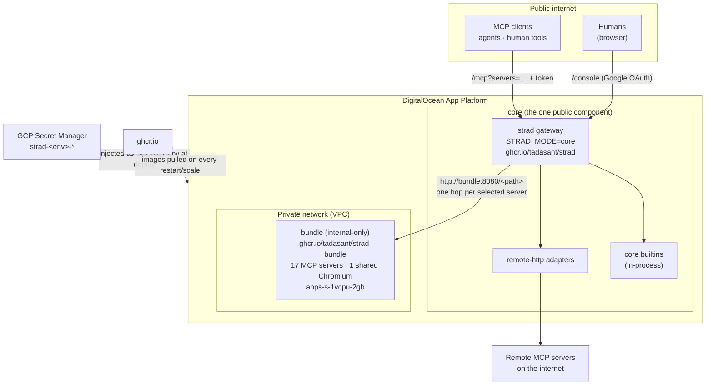
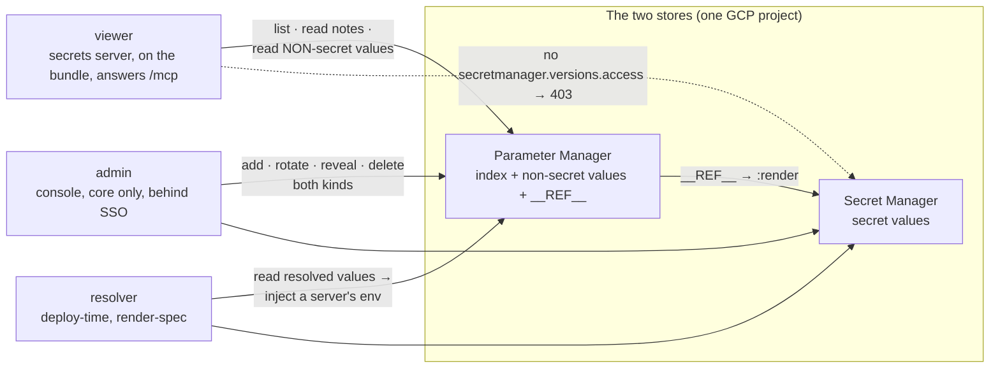

strad is a small gateway process with an unusual deployment shape: the server list
in your config decides how many containers exist and how they are wired to each
other.

## The whole system

This is strad's own deployment — two App Platform components, which is the whole
of it.



## Core and bundles

There is exactly one public component — the **core gateway**. Everything else is
a **bundle**: an internal-only App Platform component that lives on the private
network and is never reachable from the internet. The core reaches a bundle at
`${bundle.PRIVATE_URL}`, which resolves to `http://bundle-name:8080` — a private,
in-VPC hop (~4ms) with no public-edge hairpin.

A bundle runs **one image**, and any number of servers may share it, each on its
own `path`. strad's own deployment has one main bundle: a
`ghcr.io/tadasant/strad-bundle` container that mounts seventeen MCP servers in one
Node process, assembled from ten independently-built dependency trees. The
staging config maps twenty-six of its twenty-seven `supplementary-image` entries
onto those seventeen mounts, because capability variants of one upstream are two
entries pointing at the same path. The twenty-seventh runs on the second bundle,
below.

It has a **second** bundle, `bundle-zimmer-secrets`, and the reason is worth
stating because it is the one thing a bundle cannot share: `process.env`. That
component runs the same image and is only ever routed `/secrets`, but it fronts a
different parameter store. See [Two stores, one
gateway](/operate/secrets/#two-stores-one-gateway).

Three numbers, three different things:

| Number | What it counts                                                                      |
| ------ | ----------------------------------------------------------------------------------- |
| **3**  | App Platform components (`core`, `bundle`, `bundle-zimmer-secrets`)                 |
| **17** | MCP servers mounted inside the bundle image                                         |
| **29** | server slugs in `infra/strad.staging.yaml` (27 supplementary + `echo` + `deepwiki`) |

### The two modes

The strad image itself runs in one of two modes, selected by `STRAD_MODE`:

- **`core`** mounts `remote-http` servers and `core` `builtin`s in-process, and
  proxies to every non-core bundle over private HTTP.
- **`bundle`** mounts only the `builtin`s assigned to its `STRAD_BUNDLE` and serves
  them back to core. A bundle component only runs the strad image in this mode if
  it holds `builtin` servers; a bundle of `supplementary-image` servers runs _their_
  image instead, and `STRAD_MODE` never enters the picture.

Core also asks every bundle a second question, on `POST /_strad/presence`: which
of the env keys this deployment expects does the process actually hold? The answer
is one of five words per key — `absent`, `empty`, `unexpanded`, `placeholder`,
`present` — and never a value. It exists because a supplementary server's `env:` is
baked onto its own component and core cannot read it, so unaided the console's only
honest answer is that it did not check. Both the strad image in bundle mode and
the `strad-bundle` host image serve it, both behind `STRAD_INTERNAL_TOKEN`, and both
fail closed when that token is unset. See
[Secrets](/operate/secrets/#the-presence-route-a-component-answering-for-itself).

When core proxies to a strad-image bundle, it calls
`${base}/mcp?servers=<slug>` with `Authorization: Bearer ${STRAD_INTERNAL_TOKEN}`.
Because that bundle is itself a strad that already namespaces its tools, the adapter
strips and restores the inner `<slug>__` prefix so you never see
`bundled__bundled__whoami`.

<aside class="starlight-aside starlight-aside--note">

**The private network is not an authorization story.** A strad-image bundle has no
public route, but it still requires the shared `STRAD_INTERNAL_TOKEN` (constant-time
compare) — anything else in the VPC could otherwise reach it. The `strad-bundle`
image is the exception on its MCP mounts, and it is an open one: they have no bearer
auth of their own and rely on having no public route. See `HACKS.md` #13. Its
presence route does not share that exception — see below.

</aside>

## Adapters

All three server kinds are unified behind a single `ServerAdapter` interface
(`listTools`, `callTool`, `close`):

- **`HttpServerAdapter`** backs `remote-http`, `supplementary-image`, **and**
  core→bundle builtin proxying — all of which are Streamable HTTP under the hood.
- **`BuiltinServerAdapter`** runs a builtin module in-process.

Adapters are built **once at boot** — they hold long-lived upstream connections.
Only the _toolset_ is resolved per request, from the caller's entitlements
intersected with `?servers=`. Per-hop upstream timeouts are set explicitly to
`120_000` ms, because the MCP SDK defaults to 60s at every hop and would silently
kill long tool calls.

### One connection per slug, shared — so nothing closes it unilaterally

`HttpServerAdapter` caches **one** MCP client per slug, and every concurrent
request for that server runs on it. That is what keeps a full handshake off each
tool call, and it is also why closing that client is not a decision one failing
call gets to make: the close tears down the transport, and every request in
flight on it dies at the same instant.

So the adapter separates **retiring** a connection from **closing** it. Each
request takes a lease for its duration; a failure retires the connection — no
later caller is handed it — but the socket closes only when the last lease is
released. A `resources/list` that fails can therefore never cost an in-flight
`tools/list` its connection.

Retirement is narrowed to failures that mean the _connection_ is unusable:
timeouts, closed connections, DNS failures, aborted fetches. An upstream that
**answers**, even with a JSON-RPC error, has a working transport, and dropping it
would be pointless churn. Retirement is also scoped to the exact connection that
failed, so a slow failure cannot evict a fresh one another caller has since
installed.

Resource proxying asks the handshake rather than the error text: if an upstream
never advertised the `resources` capability — which is every tools-only server,
i.e. most of them — `listResources()` answers `[]` without a round trip. A server
that advertises it and answers `-32601` is treated the same way. Nothing keys off
the wording of somebody else's error message.

A failing upstream is handled differently depending on **who chose that server**:

- **The request named it** (`?servers=secrets`) — `tools/list` **fails**. A slug
  the caller asked for by name whose upstream cannot be listed would otherwise
  contribute an empty list, which is indistinguishable from a server that
  genuinely has no tools — and that is how a dead `secrets` slug went unnoticed
  on staging. This is the same posture `?servers=` already had for entitlement,
  where a server you cannot have is a 424 and never a silently smaller toolset.
  Any named server failing fails the listing, not all of them.
- **The request did not** (no `?servers=`, meaning "everything I'm entitled to")
  — the failing server contributes **zero tools** and a log line, rather than
  taking the other twenty-eight down with it.

The trigger is a `tools/list` that **throws**. A server that answers with an
empty list is a server with no tools, and no amount of error handling can tell
those apart from the outside — which is why core also watches from the inside. A
background **tool-surface monitor** (`src/gateway/reachability.ts`) probes every
mounted slug on an interval and classifies it `ok`, `empty` (answered, offered
nothing) or `unreachable` (refused, 404'd or timed out), tagged with the server
`kind` so a third-party remote is not confused with a component we deploy. It
logs `strad.tool_surface_degraded` when a slug's state changes, publishes the
current answer on
[`/healthz`](/operate/operations/#health-and-console-surface) as `degraded`, and
records [`strad.mcp.tool_surface`](/operate/telemetry/#stradmcptool_surface--is-a-slug-serving-anything-at-all).
All three leave the container: the log line ships too, against the
[event allowlist](/operate/telemetry/#logs--strads-own-events-and-only-those),
because a stdout line on App Platform is a line nobody reads. The staging deploy
fails when a slug we ship is `unreachable`.

The monitor issues `tools/list` and nothing else, so it sees a slug the way a
single-method client does. A failure that only appears when a client mixes
methods is invisible to it by construction — see
[known limitations #40](/limitations/#40-the-tool-surface-monitor-asks-one-question-so-it-can-only-catch-one-kind-of-failure).

Selection is re-checked at `tools/call` time too: `tools/list` filters by the
current `?servers=`, but a client could call any tool name it saw on a prior
request, so authorization is re-enforced on the action itself.

## Capability (read-only vs read-write)

A server's capability — which of its tools may actually be used — is a property of
the **slug**, enforced by the **gateway**:

```yaml
- slug: onepassword-ro
  kind: supplementary-image
  image: ghcr.io/tadasant/strad-bundle:latest
  bundle: bundle
  path: /onepassword
  tools:
    allow: [onepassword_list_vaults, onepassword_get_item, ...]

- slug: onepassword-rw # same image, same path, same container
  kind: supplementary-image
  image: ghcr.io/tadasant/strad-bundle:latest
  bundle: bundle
  path: /onepassword
  # no `tools:` — every tool this server has
```

`allow` is exhaustive; `deny` subtracts and wins over `allow`; omitting `tools:`
means no restriction. The policy filters `tools/list` **and rejects a
`tools/call`** for a withheld tool with JSON-RPC `-32600` (`InvalidRequest`) —
before the adapter is touched, so there is no API call and no side effect. Hiding a
tool from the listing alone would be decoration: a client can call any name it saw
on a previous request.

`unmatchedAllowEntries()` logs `mcp.policy_unmatched_tools` when an `allow` entry
names a tool the upstream doesn't offer. That is the drift alarm: an upstream that
renames a tool would otherwise quietly shrink a read-only tier to nothing.

The same predicate runs in CI, before a deploy: the job that boots the bundle
image dumps every mount's real tool names and
[`check-tool-policy`](/operate/deploy-model/#checking-a-tools-policy-against-the-tools-that-exist)
matches each config's `tools:` entries against them. Anything it cannot enumerate
— a remote server, a mount whose surface here is a floor — it skips and names
rather than failing.

This is why the deployment is small. Capability used to be a container env var
(`GMAIL_ENABLED_TOOLGROUPS=readonly`), and a component's env is the union of its
servers' env maps — so a read-only and a read-write variant of one upstream could
not share a container, and each variant cost a billed component. With the decision
at the gateway, one container runs each upstream at full capability and the
variants are just two config entries.

The trade is real and worth stating: read-only is now **policy** (a gateway that
declines), not **physics** (a process that lacks the tool). See HACKS.md #22.

## One MCP server object, two doors

`/mcp` owns authentication, `?servers=` and the 424. The protocol half — `tools/list`,
`tools/call`, resource proxying, and the capability check on the action — is
`buildGatewayServer()` in `src/gateway/mcpServer.ts`, and it has two callers:

- the `/mcp` handler, per request, over Streamable HTTP;
- the console **playground** (`/playground/:server`), per request, over an
  in-memory transport in the same process.

The playground is a human MCP client: a signed-in operator lists a server's tools
and calls them by hand, with no model anywhere in the path. It shares the builder
rather than reaching into the registry, so a tool a `tools:` policy withholds is
missing from the human's list and refused on the human's call, by the same code
that refuses an agent. A second listing path would be a second opinion about what
a policy means, and the first `tools:` rule that changed would leave the console
showing a human something they cannot call.

The console holds no `/mcp` token and mints none — see
[the console playground](/auth/overview/#the-console-playground) for why the
session stops one layer short of the wire.

## Sizing bundles

The server list drives how containers are grouped:

- **Lightweight builtins** colocate in one bundle at roughly $0 marginal cost.
- **A bundle runs ONE image** — but any number of servers may share it, on
  distinct paths, and capability variants may even share a path.
- **A browser bundle needs real headroom.** Chromium costs ~1.06s per launch and
  peaks ~545MB RSS, and CPU rather than RAM is what binds it, because 1 vCPU
  serialises rendering. strad's own deployment puts everything (16 mounted servers,
  one shared Chromium, the `op` CLI) in one `apps-s-1vcpu-2gb` component: the
  measured working set is ~760MB with two browser servers logging in at once.
  Several Chromiums in one component is the thing to avoid — share one browser and
  open a context per call, which is what `servers/bundle/host/src/browser.ts` does.

<aside class="starlight-aside starlight-aside--caution">

**One process, one core, seventeen servers is an accepted risk, not a proven
design.** A crash in the bundle host takes all seventeen down together, and the
single vCPU is shared with Chromium. If it turns out to be starved, the next move
is a dedicated CPU (`apps-d-1vcpu-2gb`), not more RAM — the binding constraint is
compute. This is what the [telemetry](/operate/telemetry/) exists to answer. See
`HACKS.md` #24.

</aside>

## Platform, images, and secrets

- **Deploy target:** DigitalOcean App Platform. `src/deploy/appspec.ts` turns
  your config into an App Platform spec — the server list decides the container
  topology. See [Deploy model](/operate/deploy-model/).
- **Images:** published to **ghcr** (`ghcr.io/tadasant/strad`).
- **Secrets:** one model per deployment, declared as `gateway.secrets.provider`
  and pluggable behind `SecretProvider` in `src/secrets/provider/`. With `env`
  (the default) secrets are injected as App Platform SECRET env vars _at deploy
  time_ and the runtime container holds no cloud credentials. With
  `gcp-parameter-store` they are read _at runtime_ from the parameter store, so a
  rotation of a request-path reference reaches a running gateway without a
  deploy, and the only secret in the spec on a component that runs strad is the
  credential for the store itself. A third-party `supplementary-image` component
  cannot read the store, so its own `env:` and its two boot keys are still read
  from the store at render time and baked onto it. See
  [Secrets](/operate/secrets/).

## The secrets and parameters system

The `strad-<env>-*` secrets above configure the gateway itself. A separate,
store-agnostic system manages the values a proxied server needs — a bucket name, a
service-account email, a private key — as **parameters** addressed by one canonical
path (`src/secrets/parameters`):

```
/strad/{env}/mcp/{server-slug}/{kind}/{VARIABLE_NAME}
```

`kind` is `static` today; an `oauth` kind is a future ticket ([issue
#32](https://github.com/tadasant/strad/issues/32)). A parameter is **either**
non-secret (a value safe to read back) **or** secret (write-and-inject-only). GCP
is the first backend behind the interface; a second store implements the same
`ParameterStore` and nothing else changes.

**Two stores (GCP).** Parameter Manager is the index of everything. A non-secret
parameter's value lives directly in Parameter Manager. A secret parameter's value
lives in Secret Manager, and Parameter Manager holds a `__REF__(...)` pointer at the
Secret Manager version; a `:render` dereferences it, for a credential that can reach
Secret Manager. A secret value is stored **base64url-encoded**, because `:render`
splices the bytes into the JSON payload as text and rejects anything that looks
structurally damaged — see
[Secrets](/operate/secrets/#what-a-secret-value-looks-like-in-the-store).

**Three credentials, deliberately different.** The whole design is that reading a
secret value is a power the agent path does not have:



- The **viewer** is the `secrets` MCP server, mounted on the bundle. It lists
  parameters, reads notes, and reads non-secret values — and **cannot read a secret
  value**, because its service account lacks `secretmanager.versions.access`, so
  Google answers `403` to the only call that would return one. Its four tools are
  `list_managed_namespaces`, `list_parameters`, `get_parameter` (non-secret values
  only; it refuses a secret), and `open_secrets_manager` (a deep link that hands a
  human the console URL).
- The **admin** is the SSO-gated console (`/ui/secrets`), on the core component
  only. It reads and writes both kinds. Its credential arrives via `consoleEnv:`,
  which the deploy layer puts on core and nowhere else — the bundle never sees it.
- The **resolver** reads both stores' resolved values and hands them to a child
  process, never returning a value over strad's own MCP channel. It runs in one of
  two places depending on what it is resolving for: at **deploy time** for a
  `supplementary-image` (see [Deploy
  model](/operate/deploy-model/#deploy-time-parameter-resolution)), because that
  is a container the gateway does not run; and at **runtime, in the container**,
  for a `bundle: core` builtin and for the gateway's own `${NAME}` references
  under `/strad/{env}/gateway/static/` when `gateway.secrets.provider` is
  `gcp-parameter-store`. In that second case the container holds exactly one
  cloud credential — the resolver key — and no other secret at all. See
  [Secrets](/operate/secrets/).

A baked server opts into resolution with `params: true`. Everything under
`/strad/{env}/mcp/{slug}/static/*` is resolved and injected as that server's
environment — for a `core` builtin in-process on every call, for a
`supplementary-image` at deploy time onto its bundle. `remote-filesystem-tmp-public` is the worked example: it
authenticates to GCS with a non-secret `REMOTE_FILESYSTEM_TMP_PUBLIC_GCS_CLIENT_EMAIL` and a
secret `REMOTE_FILESYSTEM_TMP_PUBLIC_GCS_PRIVATE_KEY`, both set by a human in `/ui/secrets`
and delivered by the resolver. What that server does with them — and why one
boolean decides whether a link expires or demands a login — is [The artifact
store](/servers/artifact-store/).
