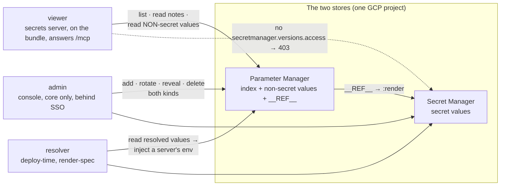

strad is a small gateway process with an unusual deployment shape: the server list
in your config decides how many containers exist and how they are wired to each
other.

## The whole system

This is strad's own deployment — two App Platform components, which is the whole
of it.


## Core and bundles

There is exactly one public component — the **core gateway**. Everything else is
a **bundle**: an internal-only App Platform component that lives on the private
network and is never reachable from the internet. The core reaches a bundle at
`${bundle.PRIVATE_URL}`, which resolves to `http://bundle-name:8080` — a private,
in-VPC hop (~4ms) with no public-edge hairpin.

Traffic runs core → bundle with one exception, and three things use it. A server
that declares
[`paramsWritable:`](/operate/secrets/#paramswritable--a-credential-that-rotates-on-use)
calls **back** to core to persist a credential that rotated under it; one that
declares
[`paramsRefresh:`](/operate/secrets/#paramsrefresh--a-rotation-that-lands-without-a-deploy)
calls back on an interval to re-read a credential somebody rotated in the store.
And the bundle host asks it which
[store-served instances](/operate/secrets/#store-served-instances--a-mount-credentialed-from-its-own-namespace)
to run, and what each one holds. All three go over the same private network,
authenticated with the component's own `STRAD_INTERNAL_TOKEN`, because core is
the component that holds the store-admin credential and the bundle deliberately
holds none. Core reads the caller's component off that token and answers only
for servers on it. Every non-core component gets `STRAD_CORE_URL` for it.

A bundle runs **one image**, and any number of servers may share it, each on its
own `path`. strad's own deployment has one main bundle: a
`ghcr.io/tadasant/strad-bundle` container that mounts thirty-three MCP servers in
one Node process, assembled from twenty-four independently-built dependency trees.
The staging config maps forty-one of its forty-three `supplementary-image`
entries onto twenty-eight paths, because capability variants of one upstream are two
entries pointing at the same path. Twenty-seven of those are baked mounts;
`/x-twitter`, `/google-sheets`, `/grafana` and `/aws-device-farm` are baked with no staging slug
pointing at them. The twenty-eighth, `/grafana-registry`, is a **per-slug
instance** — a mount the host stands up only when the container carries that
slug's own credential (see below). The other two entries run on bundles of
their own, below.

Seven of those mounts are also mounted again, once per slug, when a deployment
gives a slug its own credential rather than sharing the container's: `/telegram`,
`/remote-filesystem-tmp-public`, `/grafana`, `/google-sheets`, `/gmail`,
`/google-docs` and `/onepassword`. What counts as "its own" is per tree:
telegram wants the whole credential, the artifact store wants a bucket, grafana
wants an origin and a token, 1Password wants a service-account token, and
google-sheets, gmail and google-docs want the OAuth client id and secret — never
the refresh token, which a human mints later on the mount's own console page.
That is what makes six `google-sheets-*` slugs over three Google accounts one
server rather than three — see [Google Sheets](/servers/google-sheets/) — and
what lets one bundle hold several 1Password accounts, each at its own
`/onepassword-<name>`, without one token answering for another's vaults
([how](/servers/confirmations/#1password-every-reveal-and-every-write)).

gmail and google-docs are the two with **two** auth modes, and the collapsed
bundle carries both.
The conventional `/gmail` mount authenticates as a service account impersonating
a Workspace user — `gmail-ro`, `gmail-rw` and `gmail-rw-external` are three slugs
over it — while a per-slug `/gmail-<account>` mount authenticates as a person,
through an OAuth refresh token minted by that person in the console. The two sets
of variables sit on one container, so a per-slug gmail mount reads **every**
per-account name from its own slug prefix or not at all: inheriting the bare
service-account trio would serve a Workspace mailbox under a slug named for a
personal account, and nothing about that would read as broken. google-docs is
the same shape: `/google-docs` impersonates a Workspace user for the
`google-docs-ro` / `-rw` / `-rw-external` slugs, and a per-slug
`/google-docs-<account>` mount drops that service account the same way.

A hosted server can also be a CLIENT of core. With a [flow-through](/servers/flow-through/)
grant (`reaches:` on it, `reachableFrom:` on the target), it opens an MCP
session at `/_strad/reach/{its slug}/mcp` with its component's own internal token,
and core serves it `buildGatewayServer` over exactly the granted tools, with the
grant's pinned arguments checked on every call. The target's credential never
leaves the target's container. The console is a client in the other direction:
`/apps/{slug}` renders a server's [MCP App](/servers/apps/) in a sandboxed frame
and runs its tool calls as the signed-in human, through the same builder.

A **store-served instance** is the same per-slug mount with nothing on the
container. A server on `path: /_instance/{tree}/{slug}` is listed to its bundle
by core (`GET /_strad/instances`), and the host builds a telegram, google-sheets,
grafana or [ssh](/servers/ssh/) instance from that slug's own namespace, which it reads through core
(`GET /_strad/instances/{slug}`) rather than from its environment. It re-syncs on
`STRAD_INSTANCE_SYNC_SECONDS` (default 60, floor 15) and on the first request for
an instance it does not hold yet, so a slug a runtime write creates is served on
that request, with no deploy.

It has a **second** bundle, `bundle-zimmer-secrets`, and the reason is worth
stating because it is the one thing a bundle cannot share: `process.env`. That
component runs the same image and is only ever routed `/secrets`, but it fronts a
different parameter store. See [Two stores, one
gateway](/operate/secrets/#two-stores-one-gateway).

A **third**, `bundle-whatsapp`, holds the one [WhatsApp](/servers/whatsapp/)
linked-device socket for `whatsapp-zimmer`, at one instance: a second replica
would open a second socket on the same device. It becomes a fourth component
once that slug is enabled; while it is disabled the bundle renders nothing.

Three numbers, three different things:

| Number | What it counts                                                                               |
| ------ | -------------------------------------------------------------------------------------------- |
| **3**  | App Platform components (`core`, `bundle`, `bundle-zimmer-secrets`)                          |
| **33** | MCP servers mounted inside the bundle image                                                  |
| **46** | server slugs in `infra/strad.staging.yaml` (43 supplementary + `echo` + `deepwiki` + `anki`) |

### The two modes

The strad image itself runs in one of two modes, selected by `STRAD_MODE`:

- **`core`** mounts `remote-http` servers and `core` `builtin`s in-process, and
  proxies to every non-core bundle over private HTTP.
- **`bundle`** mounts only the `builtin`s assigned to its `STRAD_BUNDLE` and serves
  them back to core. A bundle component only runs the strad image in this mode if
  it holds `builtin` servers; a bundle of `supplementary-image` servers runs _their_
  image instead, and `STRAD_MODE` never enters the picture.

Core also asks every bundle a second question, on `POST /_strad/presence`: which
of the env keys this deployment expects does the process actually hold? The answer
is one of five words per key — `absent`, `empty`, `unexpanded`, `placeholder`,
`present` — and never a value. It exists because a supplementary server's `env:` is
baked onto its own component and core cannot read it, so unaided the console's only
honest answer is that it did not check. Both the strad image in bundle mode and
the `strad-bundle` host image serve it, both behind the component's own
`STRAD_INTERNAL_TOKEN`, and both fail closed when that token is unset — from one handler, `presenceResponse` in
`src/secrets/presence.ts`, vendored into the host tree with the vocabulary it
answers in. See
[Secrets](/operate/secrets/#the-presence-route-a-component-answering-for-itself).

When core proxies to a strad-image bundle, it calls
`${base}/mcp?servers=<slug>` with `Authorization: Bearer <token>`, where the token
is the one core derives for that component.
Because that bundle is itself a strad that already namespaces its tools, the adapter
strips and restores the inner `<slug>__` prefix so you never see
`bundled__bundled__whoami`.

A `supplementary-image` component gets the same header, on the same terms — the
gateway adds it to every such adapter rather than asking each config entry for a
`headers:` block. A configured `Authorization` wins, because that one names an
upstream's credential rather than strad's.

<aside class="starlight-aside starlight-aside--note">

**The private network is not an authorization story.** A bundle has no public
route, but it still requires its own `STRAD_INTERNAL_TOKEN`, compared in constant
time — anything else in the VPC could otherwise reach it. `STRAD_INTERNAL_TOKEN`
on core is a **root**; every other component is baked its own token under the
same name, `base64url(HMAC-SHA256(root, "strad-internal-token/v1:" + component))`,
and core presents the matching one per call. So a sibling component's token, or
the root, is refused. That holds for
both images: the strad image checks it in `authenticateInternal`, and the
`strad-bundle` host checks it in front of every mount, through the same comparator
its presence route uses. Both images read the header with the same parse and
compare it with the same comparator, vendored from `src/secrets/presence.ts`, so a
header one image refuses the other refuses too — see
[Every door reads `Authorization` the same way](/auth/overview/#every-door-reads-authorization-the-same-way).
Neither serves anything when the token is unset — the
strad image calls that 401 like any other refusal, the `strad-bundle` host calls
it 503, the same distinction its presence route already drew — and both leave
`/healthz` open, because App Platform's prober holds no credential. See
[Known limitations #63](/limitations/#63-one-internal-token-means-any-container-can-reach-any-writable-parameter)
for the design and what deriving the tokens costs.

</aside>

## Adapters

All four server kinds are unified behind a single `ServerAdapter` interface
(`listTools`, `callTool`, `close`):

- **`HttpServerAdapter`** backs `remote-http`, `local-tunnel`,
  `supplementary-image`, **and** core→bundle builtin proxying — all of which are
  Streamable HTTP under the hood.
- **`BuiltinServerAdapter`** runs a builtin module in-process.

Adapters are built **once at boot** — they hold long-lived upstream connections.
Only the _toolset_ is resolved per request, from the caller's entitlements
intersected with `?servers=`. A tool call also carries a small per-request
`CallContext` — the client's advertised capabilities, and the principal that
authenticated the request. It grants nothing, since whether this caller may reach
these slugs was settled before any adapter ran; it is there for an in-process
server whose _answer_ depends on who is asking. One does: the roster editor
bounds a write by what its author already reaches
([runtime config](/operate/runtime-config/#a-runtime-write-reaches-no-mount-its-author-cannot-already-reach)).
The third thing it carries is the caller's confirmation channel: the
`X-Elicitation-Url` a `/mcp` request named, checked against
`gateway.elicitation.allowedUrlPrefixes`. The HTTP adapter forwards it as core's
own `_meta`, and only to a `supplementary-image` slug that declares
`confirmations: true`, where gmail's `send_email` asks a human before it sends ([confirmations](/servers/confirmations/)). With it goes that slug's
`confirmationHeaders:`, resolved by core. For such a slug the context carries
two more things. One is the caller's abort signal: when the caller goes away,
or the hop's timeout runs out, core aborts that call's own HTTP request to the
bundle, so a stateless bundle sees the drop and never sends. The other relays
progress, so the bundle's keepalives reach a caller that asked for them. Per-hop upstream timeouts are set explicitly to
`120_000` ms, because the MCP SDK defaults to 60s at every hop and would silently
kill long tool calls.

A `local-tunnel` adds one bound the others do not have: `connectTimeoutMs`
(default 5s) caps the **handshake** specifically, as both a request timeout and
an abort on the socket. Its upstream is a machine that is off much of the time,
and without that cap a closed laptop costs a full minute per request — the run
budget stays at `timeoutMs`, because driving a real desktop is legitimately
slow. See [the kind's section](/servers/interface/#2-local-tunnel).

### Events: a feed polled, or pushed, through the same door

An adapter may also serve **MCP Events** (draft SEP-3415, poll and webhook
modes): optional `supportsEvents`, `listEvents`, `pollEvents`,
`subscribeEvents` and `unsubscribeEvents`. The HTTP adapter reads
the first from the upstream's handshake and gates `listEvents` on it, the way it
gates resources. On `initialize`, the router asks every selected slug and
advertises `io.modelcontextprotocol/events` if any of them serves events. Event
names are slug-prefixed like tools, and a poll is checked against the same
selection a tool call is. Core holds no event state; the cursor is the
upstream's. For a webhook subscribe, core adds the one thing only it knows —
the authenticated principal, in a `_meta` it builds itself — and the upstream
holds the subscription and POSTs the deliveries; core is not on that path.
See [MCP Events](/servers/events/).

### The raw data plane: files that do not fit in a tool result

MCP carries text. A tool result is a message in a conversation, so anything
travelling inside one is paid for in context — which makes it the wrong place
for a file. And a mount cannot fall back to naming a path instead: it runs in its
own container, so a path it writes names nothing the caller can open.

So two routes sit beside `/mcp`, and they are the same idea in both directions:

| Route                            | Adapter method | Body     | For                              |
| -------------------------------- | -------------- | -------- | -------------------------------- |
| `POST /mcp-upload/<slug>/<tok>`  | `postRaw`      | buffered | getting bytes **into** a mount   |
| `GET /mcp-download/<slug>/<tok>` | `getRaw`       | streamed | getting bytes **out of** a mount |

Both are generic: core resolves the slug to a supplementary image, forwards to
that container's `/<mount>/upload/<tok>` or `/<mount>/download/<tok>` on that
component's internal token, and otherwise stays out of the way. Nothing about either route
knows which mount is behind it.

**Neither is authenticated by a header, and that is the design.** The caller is
an agent session that holds no strad API key and cannot be given one, so the
token in the path is the whole credential. The mount that minted it is the only
thing that can check it, and does.

The asymmetry between them is deliberate. An upload is bounded — the artifact
store caps it at 100MB — so `postRaw` may buffer. A download is not bounded, so
`getRaw` pipes: the response body streams through core without ever being
resident, and the gateway's memory does not grow with the file. `getRaw`'s
timeout differs for the same reason. `postRaw` aborts the whole operation after
`timeoutMs`; applied to a download that would be a size limit wearing a clock's
clothes, so `getRaw` resets its timer on every chunk instead. It bounds a
transfer that has **stopped moving**, and lets a large, healthy one run as long
as it keeps going. That bound applies at both ends: the timer is driven from
inside the pipeline, so a caller that stops reading for longer than `timeoutMs`
is dropped too, which is what stops a stalled reader holding an upstream
connection open indefinitely.

A body that fails partway is **destroyed, not ended**. A stream ended tidily
after a failure is a truncated file delivered under a `200`, and a half-written
archive that looks whole is worse than an obvious error. See `streamFailure` in
`src/http/async-route.ts`.

The four users of this today are the artifact store's `get_upload_url` (in),
Slack's `slack_download_file` (out), described in
[the Slack attachment flow](/servers/slack-attachments/), WhatsApp's
`whatsapp_get_attachment` (out), described under
[WhatsApp attachments](/servers/whatsapp/#attachments), and LiveOak's
`get_statement` (out), described under [the link](/servers/liveoak/#the-link).

### One connection per slug, shared — so nothing closes it unilaterally

`HttpServerAdapter` caches **one** MCP client per slug, and every concurrent
request for that server runs on it. That is what keeps a full handshake off each
tool call, and it is also why closing that client is not a decision one failing
call gets to make: the close tears down the transport, and every request in
flight on it dies at the same instant.

So the adapter separates **retiring** a connection from **closing** it. Each
request takes a lease for its duration; a failure retires the connection — no
later caller is handed it — but the socket closes only when the last lease is
released. A `resources/list` that fails can therefore never cost an in-flight
`tools/list` its connection.

Retirement is narrowed to failures that mean the _connection_ is unusable:
timeouts, closed connections, DNS failures, aborted fetches. An upstream that
**answers**, even with a JSON-RPC error, has a working transport, and dropping it
would be pointless churn. Retirement is also scoped to the exact connection that
failed, so a slow failure cannot evict a fresh one another caller has since
installed.

### A bundle's handshake is believed for five minutes

What `initialize` answered — the upstream's capabilities, the events extension
among them — is cached with the connection. A bundle component is stateless
Streamable HTTP, so a deploy that replaces its container behind the same URL
does not break the connection: the next request simply reaches the new
container, tools keep working, and the cached capabilities keep describing the
container that is gone. A bundle redeployed with events switched on would
otherwise stay invisible to `initialize` and `events/list` until core restarted.

So for a `supplementary-image` slug, the first lease after `HANDSHAKE_MAX_AGE_MS`
(five minutes) shakes hands again, and the new connection replaces the old one
only once that handshake succeeds. Requests already running on the old one
finish there. A re-handshake that fails keeps the old connection, which still
works, and tries again an interval later. The reachability prober lists every
slug every minute, so each bundle slug pays one `initialize` per five minutes.

`remote-http` and `local-tunnel` connections are not re-asked on age: a strad
deploy does not replace either behind its URL, a third-party server may hold a
session per connection that a periodic reconnect would orphan, and a
local-tunnel handshake is the one bounded as "is the machine on". Their
handshake lasts until the connection is retired by a failure or a rotation.

### A minted bearer is an endpoint that changes

The adapter resolves its endpoint — URL plus headers — on every operation, and
rebuilds the connection when the digest of that endpoint changes; that is how a
rotated `${SECRET}` reaches a running gateway. A `remote-http` server with
[`oauthRefresh:`](/servers/interface/#oauthrefresh--a-bearer-that-expires-minted-by-strad)
rides the same seam: its endpoint thunk asks an `AccessTokenMinter`
(`src/gateway/adapters/oauth-refresh.ts`) for the current access token and puts
it in the `Authorization` header, so a refresh is just an endpoint that changed.
One minter per slug, built by the registry and reachable from that slug's thunk
alone — there is no cache shared between servers to key wrongly — and everything
a minter holds is tied to the refresh token the store handed it, so a re-seed to
another account drops the old one's token before the next request.

The adapter adds one thing for it: a `401` from the upstream is reported back to
the minter with the endpoint that was refused, the connection carrying it is
retired, and the operation is tried once more against whatever the thunk
resolves next. A `401` is the upstream refusing the request before running it,
so the retry cannot run a tool twice.

### A listing gets a second look; a tool call does not

`tools/list`, `resources/list` and `events/list` retry a **transient** upstream failure: a
`408`, `429` or `500`/`502`/`503`/`504`, an upstream's JSON-RPC `InternalError`
(`-32603`) — it answered, and it threw — a connection that closed under the
request, a socket reset or refused connect, or a resolver answering `EAI_AGAIN`
("try again"). Three tries, with jittered exponential
backoff from 250ms — under a second of sleep in all — and no new try once 5s
have gone, which keeps a retry inside the 10s deadline the reachability probe
puts around a listing. Each try is still bounded by `timeoutMs`. Each failure
the budget absorbs is an `mcp.list_retry` record at Info, which pages nobody;
`mcp.list_tools_failed` and `mcp.list_resources_failed` fire at ERROR only once
the budget is spent, and carry `attempts` and `retry` — `budget`, `deadline`,
`not_transient` or `closed` — so a page says whether the failure outlasted the
retry or was never eligible for one. They also carry what KIND of failure it
was, since the upstream's text never leaves the box: `status` (the HTTP
status), `rpc_code` (the JSON-RPC error code) and `error_class` (the error's
class, from a closed list, else `other`). `mcp.events_list_failed` carries the
same five. One bad
second at a hosted server's edge therefore does not page, and an upstream that
is still failing a moment later still does.

Everything else fails on the first answer: any other `4xx` (`401`, `403` and
`404` among them), any other JSON-RPC code (`-32601`, `-32602`, …), a
timeout, a name that does not resolve (`ENOTFOUND`) or a TLS failure, a slug waiting on an unseeded credential, and a `local-tunnel` machine
that is off. A `401` on a minted credential keeps its own single retry above.
`tools/call` is never retried, because a `5xx` does not say whether the tool
ran. Each listing retries on its own, so an upstream answering `429` to every
request sees up to three per listing.

Resource proxying asks the handshake rather than the error text: if an upstream
never advertised the `resources` capability — which is every tools-only server,
i.e. most of them — `listResources()` answers `[]` without a round trip. A server
that advertises it and answers `-32601` is treated the same way. Nothing keys off
the wording of somebody else's error message.

A failing upstream is handled differently depending on **who chose that server**:

- **The request named it** (`?servers=secrets`) — `tools/list` **fails**. A slug
  the caller asked for by name whose upstream cannot be listed would otherwise
  contribute an empty list, which is indistinguishable from a server that
  genuinely has no tools — and that is how a dead `secrets` slug went unnoticed
  on staging. This is the same posture `?servers=` already had for entitlement,
  where a server you cannot have is a 424 and never a silently smaller toolset.
  Any named server failing fails the listing, not all of them.
- **The request did not** (no `?servers=`, meaning "everything I'm entitled to")
  — the failing server contributes **zero tools** and a log line, rather than
  taking the other thirty down with it.

There is exactly one exception, and it is `local-tunnel`. The rule above exists
because a silently smaller toolset **hides a fault**; for a server on a machine
you own there is no fault to hide, since being offline is the advertised
behaviour of the kind. So a machine that is not answering neither fails the
listing nor vanishes from it: the slug keeps its place and contributes **one
tool**, `<slug>__troubleshoot_host`, which names the machine and the commands to
bring it back. `?servers=anki,slack` with the laptop asleep is a working Slack
plus that tool; `?servers=anki` alone is that tool rather than an error, which
matters because the console hands out one `?servers=<slug>` per server. See
[the kind's page](/servers/interface/#2-local-tunnel).

Two failures qualify — a machine that is **offline** and one that **refuses**
(`401`/`403`, a credential gone stale) — and the tool tells them apart. Anything
else from a local-tunnel, a `404` on a wrong path or a `500`, is an ordinary
broken upstream and fails a named listing like any other kind. The exception is
about machines somebody can go and switch on, not about the kind in general.

Either way it reports as `mcp.local_machine_offline` rather than
`mcp.list_tools_failed` — an Info-severity record, because nothing failed — and
the hop's span and `strad.mcp.upstream.errors` label it
`error.kind: local_machine_offline` rather than lumping it in with real faults.
`resources/list` makes the same distinction, and has to: `resources` is
advertised unconditionally, so a closed laptop throws there on every session
that lists them. Failing a request and declaring a strad fault are different
claims — see
[an offline `local-tunnel` is not a fault](/operate/telemetry/#an-offline-local-tunnel-is-not-a-fault-and-does-not-export-as-one).

The trigger is a `tools/list` that **throws**. A server that answers with an
empty list is a server with no tools, and no amount of error handling can tell
those apart from the outside — which is why core also watches from the inside. A
background **tool-surface monitor** (`src/gateway/reachability.ts`) probes every
mounted slug on an interval and classifies it `ok`, `empty` (answered, offered
nothing), `unreachable` (refused, 404'd or timed out), `offline` — a
`local-tunnel` whose machine is simply switched off, which is that
kind's normal state, stays out of the `degraded` list and pages nobody — or
`unconfigured`, a slug that
[declared `mayBeUnseeded:`](/operate/secrets/#maybeunseeded--deploying-a-server-ahead-of-its-credential)
for a credential nobody has seeded yet. The last is out of `degraded` for the
opposite reason to `offline`: nothing is down and nothing is misrouted, the
deploy shipped ahead of a token on purpose, and counting it as degraded would red
the deploy the feature exists to let through. It is named on its own in the
snapshot's `unconfigured` list instead. It is
tagged with the server
`kind` so a third-party remote — or a laptop that is simply switched off — is
not confused with a component we deploy. It
logs `strad.tool_surface_degraded` when a slug's state changes — or
`strad.tool_surface_offline` / `strad.tool_surface_unconfigured`, both at Info and
pageable by nothing, for the switched-off and awaiting-a-token cases — publishes
the current answer on
[`/healthz`](/operate/operations/#health-and-console-surface) as `degraded`, and
records [`strad.mcp.tool_surface`](/operate/telemetry/#stradmcptool_surface--is-a-slug-serving-anything-at-all).
All three leave the container: the log line ships too, against the
[event allowlist](/operate/telemetry/#logs--strads-own-events-and-only-those),
because a stdout line on App Platform is a line nobody reads. The staging deploy
fails when a slug we ship is `unreachable` — which is neither a `remote-http`
nor a `local-tunnel`, because neither is ours to run.

The monitor issues `tools/list` and nothing else, so it sees a slug the way a
single-method client does. A failure that only appears when a client mixes
methods is invisible to it by construction — see
[known limitations #40](/limitations/#40-the-tool-surface-monitor-asks-one-question-so-it-can-only-catch-one-kind-of-failure).

A listing that works is also not a call that works. A mount whose login went stale
lists every tool and fails every call, and only the bundle knows — its `/healthz`
names each mount it holds and whether that mount is degraded. So in core the
monitor also reads each bundle's `/healthz` on the same interval
(`src/gateway/mount-health.ts`), one request per bundle, and carries the answer
**beside** the surface state: a `mount` word (`ok` / `degraded`) on each
`supplementary-image` slug it read, `mountDegraded` and `mountUnread` lists on
`/healthz`, the
[`strad.mcp.mount_degraded`](/operate/telemetry/#stradmcpmount_degraded--does-the-bundle-say-a-mount-is-unwell)
gauge, and `strad.mount_state` on change, at Info. Beside and never
inside: `degraded` stays "serves no tools", which is what the deploy gate and the
fast retry read. What crosses from the bundle is one bit per mount, matched onto
the config's own slugs by path; the bundle's reason for it is upstream text and is
dropped where it is parsed.

The bundle's `/healthz` also answers for the process itself. Once its event loop
has been saturated for a minute it answers 503, which core reads as the bundle
`unreachable`. A `liveness_health_check` restarts the container on that 503 or on
a probe that times out. The host's own watchdog exits after three minutes even
without the check. See [what a strad-bundle component is rendered
with](/servers/interface/#what-a-strad-bundle-component-is-rendered-with-so-it-recovers-on-its-own).

Selection is re-checked at `tools/call` time too: `tools/list` filters by the
current `?servers=`, but a client could call any tool name it saw on a prior
request, so authorization is re-enforced on the action itself.

## The config is not necessarily fixed for the life of the process

A deployment with
[`gateway.configStore.enabled`](/operate/runtime-config/) merges a stored
overlay over the checked-in `servers:` list, which means the roster core serves
can change while core is running. Every component below the config still gets
**one** config for its whole life, because a change is a rebuild rather than a
mutation.

`ReloadableGateway` (`src/gateway/reload.ts`) owns that. `http.createServer` is
handed a stable dispatch function, and what sits behind it — the registry, the
Express app, the tool-surface monitor — is built fresh on the new config and
installed with one pointer assignment. The listening socket outlives the rebuild,
so nothing re-binds a port and no connection is dropped; the next request routes
on the new roster.

The outgoing registry **drains** rather than closing. Its adapters hold live MCP
connections, and a request that was mid-`tools/call` at the moment of the swap is
still holding one, so closing underneath it would turn a successful call into a
transport error for no reason. It is closed 30 seconds later — long enough to
outlast a request already in flight, short enough not to leak a connection per
reload. A call still running at the end of that window gets its transport closed,
which is what a redeploy would have done to it.

A rebuild that throws leaves everything exactly as it was: the new instance is
never assigned and the old registry is never drained, which is what lets a bad
roster edit be a refusal rather than an outage.

Both of strad's doors can make that edit. The console at `/connectors` is the
human one; the `connectors` builtin (`src/servers/connectors.ts`) is the same
roster as MCP tools, so an agent can add a `remote-http` server and select it on
its next request. They share one implementation of the rules and one rebuild —
`RuntimeConfig.assertAcceptable` decides what may be written, `RuntimeConfig.apply`
validates the whole merged document — because two answers to "may I add this" is
one answer too many. The builtin ships in the image and is mounted only by a
deployment that declares it.

## Capability (read-only vs read-write)

A server's capability — which of its tools may actually be used — is a property of
the **slug**, enforced by the **gateway**:

```yaml
- slug: onepassword-ro
  kind: supplementary-image
  image: ghcr.io/tadasant/strad-bundle:latest
  bundle: bundle
  path: /onepassword
  tools:
    allow: [onepassword_list_vaults, onepassword_get_item, ...]

- slug: onepassword-rw # same image, same path, same container
  kind: supplementary-image
  image: ghcr.io/tadasant/strad-bundle:latest
  bundle: bundle
  path: /onepassword
  # no `tools:` — every tool this server has
```

`allow` is exhaustive; `deny` subtracts and wins over `allow`; omitting `tools:`
means no restriction. The policy filters `tools/list` **and rejects a
`tools/call`** for a withheld tool with JSON-RPC `-32600` (`InvalidRequest`) —
before the adapter is touched, so there is no API call and no side effect. Hiding a
tool from the listing alone would be decoration: a client can call any name it saw
on a previous request.

`unmatchedAllowEntries()` logs `mcp.policy_unmatched_tools` when an `allow` entry
names a tool the upstream doesn't offer. That is the drift alarm: an upstream that
renames a tool would otherwise quietly shrink a read-only tier to nothing.

The same predicate runs in CI, before a deploy: the job that boots the bundle
image dumps every mount's real tool names and
[`check-tool-policy`](/operate/deploy-model/#checking-a-tools-policy-against-the-tools-that-exist)
matches each config's `tools:` entries against them. Anything it cannot enumerate
— a remote server, a mount whose surface here is a floor — it skips and names
rather than failing.

This is why the deployment is small. Capability used to be a container env var
(`GMAIL_ENABLED_TOOLGROUPS=readonly`), and a component's env is the union of its
servers' env maps — so a read-only and a read-write variant of one upstream could
not share a container, and each variant cost a billed component. With the decision
at the gateway, one container runs each upstream at full capability and the
variants are just two config entries.

The trade is real and worth stating: read-only is now **policy** (a gateway that
declines), not **physics** (a process that lacks the tool). See HACKS.md #22.

## One MCP server object, two doors

`/mcp` owns authentication, `?servers=` and the 424. **Authentication there is
two credentials and exactly two**: a static `strad_<env>_<pubid>_<secret>` token,
and — on a deployment that configures `auth.mcpOAuth` — an access token from
strad's own OAuth 2.1 authorization server, which authenticates the human behind
it with Google. The prefix on the presented credential decides which, and it
decides exclusively, so a deployment running no authorization server takes the
code path it always did. Everything downstream is identical: both resolve to a
`Principal` whose `roles` come from the server side, and `?servers=` narrows the
entitled set the same way for each. The authorization server itself is
`src/auth/mcp-oauth/` behind `src/http/oauth.ts`, mounted on **core only** and
only when the flow can complete end to end; the model is in
[Auth](/auth/overview/#mcp--oauth-21-interactive-clients). The protocol half — `tools/list`,
`tools/call`, resource proxying, and the capability check on the action — is
`buildGatewayServer()` in `src/gateway/mcpServer.ts`, and it has two callers:

- the `/mcp` handler, per request, over Streamable HTTP;
- the console **playground** (`/playground/:server`), per request, over an
  in-memory transport in the same process.

The playground is a human MCP client: a signed-in operator lists a server's tools
and calls them by hand, with no model anywhere in the path. It shares the builder
rather than reaching into the registry, so a tool a `tools:` policy withholds is
missing from the human's list and refused on the human's call, by the same code
that refuses an agent. A second listing path would be a second opinion about what
a policy means, and the first `tools:` rule that changed would leave the console
showing a human something they cannot call.

Sharing the builder means sharing its wire, too. An adapter's error crosses a
JSON-RPC boundary on its way to the page, so it arrives as an `McpError` carrying
a message and no class. Where the console has to know WHICH failure it is holding
— a `local-tunnel` whose machine is off, which is expected rather than broken —
it reads the degraded surface the gateway substitutes (one `troubleshoot_host`
tool in place of the server's own) instead of the error, and says so above the
tool list. See [what the console shows](/servers/local-tunnel-host/#what-the-console-shows).

The console holds no `/mcp` token and mints none — see
[the console playground](/auth/overview/#the-console-playground) for why the
session stops one layer short of the wire.

### What `/mcp` answers when strad itself fails

A failure strad does not otherwise classify — anything that throws at or below
the authentication step, including the MCP SDK driving a caller-supplied body —
is a **500 `{"error":"internal_error"}`** and nothing more. No message, no class,
no upstream text: the same rule the rest of this endpoint keeps
([telemetry](/operate/telemetry/)). The class is written to the container's
stderr under `strad.route_failed` and exported as that event's `error.kind`, and
the request is counted with an `internal_error` outcome so the failure shows up
in the request metrics rather than only in a log.

That answer exists because the alternative is the container. Express 4 drops the
promise an async handler returns and routes its rejection nowhere, and this
process treats an unhandled rejection as fatal — so without a guard, a defect
that costs one caller one response costs every concurrent request on the
component. Every async route in strad is therefore mounted through one wrapper,
`asyncRoute` in `src/http/async-route.ts`, which awaits the handler and hands
the failure to that route's own renderer: JSON for `/mcp` and the machine
routes, an HTML page for the console.

One consequence is worth stating, because it is a narrowing. These failures are
no longer fatal, so they no longer reach the [exception
reporter](/operate/telemetry/#exception-reporting--glitchtip-over-the-sentry-protocol), which saw them as unhandled
rejections and carried a stack. What replaces the stack is the metric — an
`internal_error` outcome is countable and alertable, where a restart was neither
— plus the event's kind and the class on stderr.

## Sizing bundles

The server list drives how containers are grouped:

- **Lightweight builtins** colocate in one bundle at roughly $0 marginal cost.
- **A bundle runs ONE image** — but any number of servers may share it, on
  distinct paths, and capability variants may even share a path. Sharing a path
  means sharing an INSTANCE: one upstream process, one set of credentials, told
  apart only by the gateway's `tools:` policy. Two slugs that need different
  credentials need different paths, and the bundle host then builds one instance
  per slug from [its own variables](/operate/secrets/#what-a-servers-variables-are-called-on-the-box).
- **A browser bundle needs real headroom.** Chromium costs ~1.06s per launch and
  peaks ~545MB RSS, and CPU rather than RAM is what binds it, because 1 vCPU
  serialises rendering. strad's own deployment puts everything (33 mounted servers,
  one shared Chromium, the `op` CLI) in one `apps-s-1vcpu-2gb` component: the
  measured working set is ~760MB with two browser servers logging in at once.
  Several Chromiums in one component is the thing to avoid — share one browser and
  open a context per call, which is what `servers/bundle/host/src/browser.ts` does.
- **CPU-bound mounts work off the event loop.** [image-diff and
  svg-tracer](/servers/image-tools/) run each call in a worker thread, one at a
  time per process, so a large diff (up to ~400MB at its 10-megapixel limit)
  neither stalls the other mounts nor stacks a second peak beside Chromium.
- **Data a mount needs is baked at build time, not fetched at boot.**
  [nutrition-facts](/servers/nutrition-facts/) downloads its USDA and MenuStat
  releases in its Dockerfile stage, pinned by SHA-256, and loads the ~2 MB
  result lazily on first use; the bundle has no disk that outlives a deploy.

<aside class="starlight-aside starlight-aside--caution">

**One process, one core, thirty-three servers is an accepted risk, not a proven
design.** A crash in the bundle host takes all thirty-three down together, and the
single vCPU is shared with Chromium. If it turns out to be starved, the next move
is a dedicated CPU (`apps-d-1vcpu-2gb`), not more RAM — the binding constraint is
compute. This is what the [telemetry](/operate/telemetry/) exists to answer. See
`HACKS.md` #24.

</aside>

## Platform, images, and secrets

- **Deploy target:** DigitalOcean App Platform. `src/deploy/appspec.ts` turns
  your config into an App Platform spec — the server list decides the container
  topology. See [Deploy model](/operate/deploy-model/).
- **Images:** published to **ghcr** (`ghcr.io/tadasant/strad`).
- **Secrets:** one model per deployment, declared as `gateway.secrets.provider`
  and pluggable behind `SecretProvider` in `src/secrets/provider/`. With `env`
  (the default) secrets are injected as App Platform SECRET env vars _at deploy
  time_ and the runtime container holds no cloud credentials. With
  `gcp-parameter-store` they are read _at runtime_ from the parameter store, so a
  rotation of a request-path reference reaches a running gateway without a
  deploy, and the only secret in the spec on a component that runs strad is the
  credential for the store itself. A `${NAME}` written on a server entry is read
  from [that server's own
  namespace](/operate/secrets/#a-servers-secrets-live-in-that-servers-namespace)
  before the shared one — which is how an unhosted kind, with no container and no
  deploy-time environment, gets a namespace of its own at all. A third-party `supplementary-image` component
  cannot read the store, so its own `env:` and its two boot keys are still read
  from the store at render time and baked onto it. See
  [Secrets](/operate/secrets/).
- **Tailnet egress:** a bundle with a `tailnet:` block runs a userspace
  `tailscaled` beside its host process and joins a Tailscale tailnet as a
  tagged, ephemeral node. The `ssh` tree reaches a host that resolves into the
  tailnet through its loopback SOCKS5 listener; nothing else uses it, and the
  tailnet policy bounds what it can reach. See [Tailnet egress](/operate/tailnet/).

## The secrets and parameters system

The `strad-<env>-*` secrets above configure the gateway itself. A separate,
store-agnostic system manages the values a proxied server needs — a bucket name, a
service-account email, a private key — as **parameters** addressed by one canonical
path (`src/secrets/parameters`):

```
/strad/{env}/mcp/{server-slug}/{kind}/{VARIABLE_NAME}
```

`kind` names where the value came from — `static` for a value a human typed,
`oauth` for one strad's consent callback minted — and both resolve identically,
`oauth` first. A parameter is **either**
non-secret (a value safe to read back) **or** secret (write-and-inject-only). GCP
is the first backend behind the interface; a second store implements the same
`ParameterStore` and nothing else changes.

**Two stores (GCP).** Parameter Manager is the index of everything. A non-secret
parameter's value lives directly in Parameter Manager. A secret parameter's value
lives in Secret Manager, and Parameter Manager holds a `__REF__(...)` pointer at the
Secret Manager version; a `:render` dereferences it, for a credential that can reach
Secret Manager. A secret value is stored **base64url-encoded**, because `:render`
splices the bytes into the JSON payload as text and rejects anything that looks
structurally damaged — see
[Secrets](/operate/secrets/#what-a-secret-value-looks-like-in-the-store).

**Three credentials, deliberately different.** The whole design is that reading a
secret value is a power the agent path does not have:



- The **viewer** is the `secrets` MCP server, mounted on the bundle. It lists
  parameters, reads notes, and reads non-secret values — and **cannot read a secret
  value**, because its service account lacks `secretmanager.versions.access`, so
  Google answers `403` to the only call that would return one. Its four read
  tools are `list_managed_namespaces`, `list_parameters`, `get_parameter`
  (non-secret values only; it refuses a secret), and `open_secrets_manager` (a
  link that lands a human on the console page the value lives on); a fifth,
  `refresh_gateway`, makes the gateway
  [re-read the store now](/operate/secrets/#one-reading-of-the-store-per-process)
  and touches nothing in it.
- The **admin** is the SSO-gated console (`/ui/secrets`), on the core component
  only. It reads and writes both kinds. Its credential arrives via `consoleEnv:`,
  which the deploy layer puts on core and nowhere else — the bundle never sees it.
- The **resolver** reads both stores' resolved values and hands them to a child
  process, never returning a value over strad's own MCP channel. It runs in one of
  two places depending on what it is resolving for: at **deploy time** for a
  `supplementary-image` (see [Deploy
  model](/operate/deploy-model/#deploy-time-parameter-resolution)), because that
  is a container the gateway does not run; and at **runtime, in the container**,
  for a `bundle: core` builtin and for the gateway's own `${NAME}` references
  under `/strad/{env}/gateway/static/` when `gateway.secrets.provider` is
  `gcp-parameter-store`. In that second case the container holds exactly one
  cloud credential — the resolver key — and no other secret at all. See
  [Secrets](/operate/secrets/).

A baked server opts into resolution with `params: true`. Everything under
`/strad/{env}/mcp/{slug}/static/*` and `/strad/{env}/mcp/{slug}/oauth/*` are
resolved and injected as that server's
environment — for a `core` builtin in-process on every call, for a
`supplementary-image` at deploy time onto its bundle. `remote-filesystem-tmp-public` is the worked example: it
authenticates to GCS with a non-secret `REMOTE_FILESYSTEM_TMP_PUBLIC_GCS_CLIENT_EMAIL` and a
secret `REMOTE_FILESYSTEM_TMP_PUBLIC_GCS_PRIVATE_KEY`, both set by a human in `/ui/secrets`
and delivered by the resolver. What that server does with them — and why one
boolean decides whether a link expires or demands a login — is [The artifact
store](/servers/artifact-store/).

`params: true` is not the only reader of that namespace. A `supplementary-image`
server's `env:` `${NAME}` references resolve from its own
`/strad/{env}/mcp/{slug}/oauth/` and `/strad/{env}/mcp/{slug}/static/` **before**
the shared
`/strad/{env}/gateway/static/`, with no flag, which is what lets two servers
write the same `${NAME}` and be handed different values — see [two servers, one
variable name](/operate/secrets/#a-servers-secrets-live-in-that-servers-namespace). The two paths
differ in what they inject: `params:` takes the namespace whole, substitution
takes only names the config already references.
