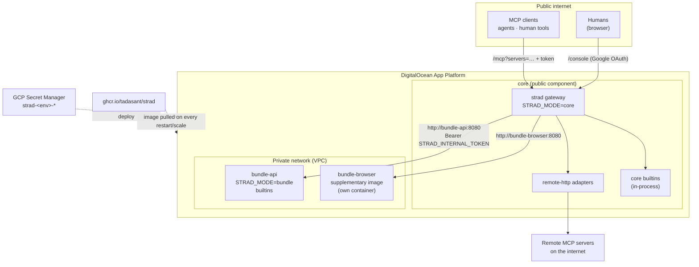

strad is a small gateway process with an unusual deployment shape: the same
binary runs in two modes, and the server list in your config decides how many
containers exist and how they are wired to each other.

## The whole system



## Core and bundles

There is exactly one public component — the **core gateway**. Everything else is
a **bundle**: an internal-only App Platform component that lives on the private
network and is never reachable from the internet. The core reaches a bundle at
`${bundle.PRIVATE_URL}`, which resolves to `http://bundle-name:8080` — a private,
in-VPC hop (~4ms) with no public-edge hairpin.

The same image runs in two modes, selected by the `STRAD_MODE` env var:

- **`core`** mounts `remote-http` servers and core `builtin`s directly, and
  proxies to every non-core bundle over private HTTP.
- **`bundle`** mounts only the `builtin`s assigned to its `STRAD_BUNDLE`, and
  serves them back to core over private HTTP.

When core proxies to a bundle, it calls the bundle at
`${base}/mcp?servers=<slug>` with `Authorization: Bearer ${STRAD_INTERNAL_TOKEN}`.
Because a bundle is itself a strad that already namespaces its tools, the adapter
strips and restores the inner `<slug>__` prefix so you never see
`bundled__bundled__whoami`.

<aside class="starlight-aside starlight-aside--note">

**Internal network is not an authorization story.** Bundle components have no
public route, but they still require the shared `STRAD_INTERNAL_TOKEN` (verified
with a constant-time compare) — because anything else in the VPC could otherwise
reach them.

</aside>

## Adapters

All three server kinds are unified behind a single `ServerAdapter` interface
(`listTools`, `callTool`, `close`):

- **`HttpServerAdapter`** backs `remote-http`, `supplementary-image`, **and**
  core→bundle builtin proxying — all of which are Streamable HTTP under the hood.
- **`BuiltinServerAdapter`** runs a builtin module in-process.

Adapters are built **once at boot** — they hold long-lived upstream connections.
Only the _toolset_ is resolved per request, from the caller's entitlements
intersected with `?servers=`. Per-hop upstream timeouts are set explicitly to
`120_000` ms, because the MCP SDK defaults to 60s at every hop and would silently
kill long tool calls.

A slow or failing upstream contributes **zero tools** to `tools/list` (and logs
it) rather than failing the whole request with a 500. Selection is re-checked at
`tools/call` time too: `tools/list` filters by the current `?servers=`, but a
client could call any tool name it saw on a prior request, so authorization is
re-enforced on the action itself.

## Capability (read-only vs read-write)

A server's capability — which of its tools may actually be used — is a property of
the **slug**, enforced by the **gateway**:

```yaml
- slug: onepassword-ro
  kind: supplementary-image
  image: ghcr.io/tadasant/strad-bundle:latest
  bundle: bundle
  path: /onepassword
  tools:
    allow: [onepassword_list_vaults, onepassword_get_item, ...]

- slug: onepassword-rw # same image, same path, same container
  kind: supplementary-image
  image: ghcr.io/tadasant/strad-bundle:latest
  bundle: bundle
  path: /onepassword
  # no `tools:` — every tool this server has
```

`allow` is exhaustive; `deny` subtracts and wins over `allow`; omitting `tools:`
means no restriction. The policy filters `tools/list` **and rejects a
`tools/call`** for a withheld tool — before the request reaches the upstream, so
there is no API call and no side effect. Hiding a tool from the listing alone
would be decoration: a client can call any name it likes.

This is why the deployment is small. Capability used to be a container env var
(`GMAIL_ENABLED_TOOLGROUPS=readonly`), and a component's env is the union of its
servers' env maps — so a read-only and a read-write variant of one upstream could
not share a container, and each variant cost a billed component. With the decision
at the gateway, one container runs each upstream at full capability and the
variants are just two config entries.

The trade is real and worth stating: read-only is now **policy** (a gateway that
declines), not **physics** (a process that lacks the tool). See HACKS.md #22.

## Sizing bundles

The server list drives how containers are grouped:

- **Lightweight builtins** colocate in one bundle at roughly $0 marginal cost.
- **A bundle runs ONE image** — but any number of servers may share it, on
  distinct paths, and capability variants may even share a path.
- **A browser bundle needs real headroom.** Chromium costs ~1.06s per launch and
  peaks ~545MB RSS, and CPU — not RAM — is what binds it, because 1 vCPU
  serialises rendering. strad's own deployment puts everything (14 servers, one
  shared Chromium, the `op` CLI) in one `apps-s-1vcpu-2gb` component: measured
  working set is ~760MB with two browser servers logging in at once. Several
  Chromiums in one component is the thing to avoid — share one browser and open a
  context per server.

## Platform, images, and secrets

- **Deploy target:** DigitalOcean App Platform. `src/deploy/appspec.ts` turns
  your config into an App Platform spec — the server list decides the container
  topology. See [Deploy model](/operate/deploy-model/).
- **Images:** published to **ghcr** (`ghcr.io/tadasant/strad`).
- **Secrets:** stored in **GCP Secret Manager** as `strad-<env>-<NAME>`, and
  injected as App Platform SECRET env vars _at deploy time_. The runtime
  container holds **no cloud credentials** — it simply reads `process.env`, and
  the secret source is pluggable behind `loadSecrets()` in `src/secrets/`.
