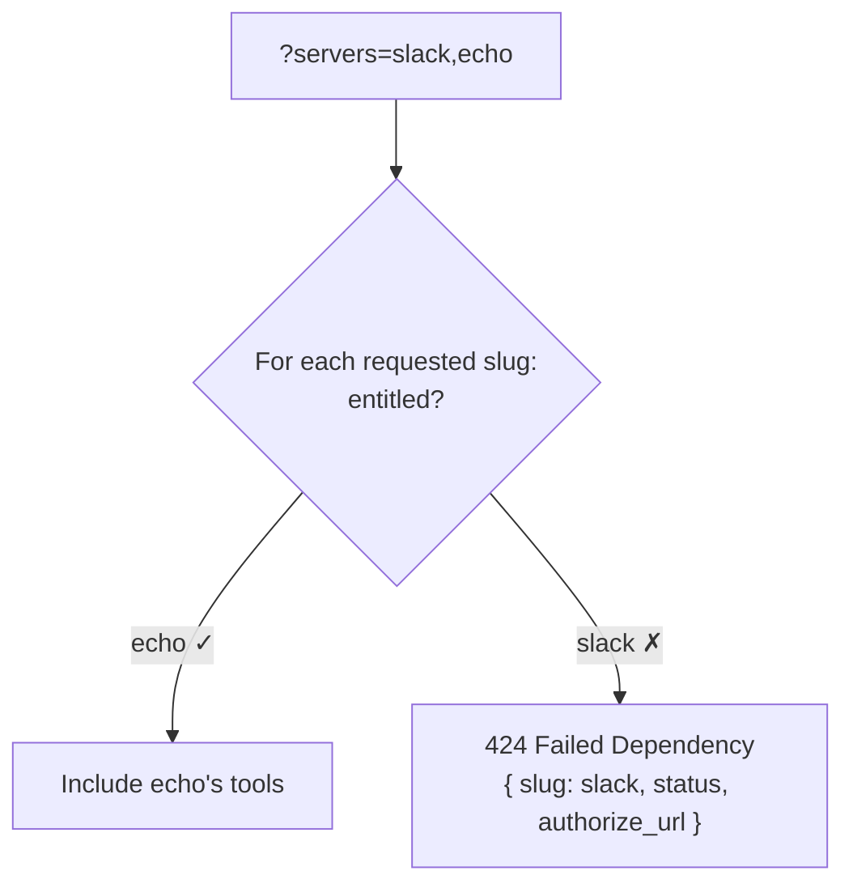

A short glossary of the terms the rest of these docs lean on. Each one is a real
thing in the code, not a metaphor.

## Server

An upstream toolset strad brokers. A server is one of [four
kinds](/servers/interface/) — `remote-http`, `local-tunnel`,
`supplementary-image`, or `builtin` — but downstream of the adapter layer they
are indistinguishable: each exposes `listTools` / `callTool` / `close`.

## Slug

A server's stable identifier, matching `^[a-z0-9][a-z0-9-]{0,62}$`. It is what you
put in `?servers=`, and it is the first half of every namespaced tool name. Slugs
cannot contain underscores — that restriction is what makes namespacing
unambiguous.

## Namespacing

Every tool is exposed as `<server>__<tool>` — for example
`granola__list_meetings`. The separator is `__` (two underscores). Denamespacing
splits on the **first** `__` only, because tool names may themselves contain
underscores while slugs may not. Namespacing is what lets strad merge many
servers into one toolset without collisions.

## Selection (`?servers=`)

The `?servers=` query parameter names which servers a client wants for this
request. An **empty or absent** `?servers=` means "everything this token is
entitled to" (sorted). A **non-empty** list narrows to those servers.

Selection is a _hint_, never a grant. This is the one rule:

> **The query string proposes. The token disposes.**

`?servers=` can only narrow the token-derived entitled set — it can never widen
it. See [Auth](/auth/overview/) for why (RFC 8707: a query string is not a
resource, so it cannot scope a token).

A named server whose upstream cannot be listed **fails the request** rather than
quietly dropping out of the toolset. The single exception is a
[`local-tunnel`](/servers/interface/#2-local-tunnel) whose machine is not
answering, because for that kind that is expected rather than a fault: it keeps
its place in the listing and serves one tool, `<slug>__troubleshoot_host`, saying
which machine is down and what to run on it. Named on its own it returns that
tool rather than an error.

## Entitlement

The set of servers a token may reach, computed **server-side** by intersecting
two directions that must _both_ agree:

1. A **role** the token holds must name the server under `roles.<role>.servers`
   (where `["*"]` means every server), **and**
2. The **server** must list that role under its `entitlements`.

Neither side grants access alone. A server with `entitlements: []` (the default)
is reachable by nobody — strad fails closed.

An OAuth access token may also carry a **slug set** — its `slug:` scopes, the
slugs left ticked on the consent screen, and its client's `servers` allowlist —
and that set is intersected last, so it can only remove. Every other credential
carries none, and roles are the whole answer. See
[Auth](/auth/overview/#per-client-policy-and-slug-scopes). The final selection
for a request is `entitled ∩ requested`.

## The 424 contract

When a requested server is not in the entitled set, strad returns **`424 Failed
Dependency`** rather than dropping it silently or returning `401`. The body names
each unavailable server with a `status` (`not_configured`, `not_entitled`, or
`disabled`) and an `authorize_url` — that server's console page,
`${publicUrl}/ui/<slug>`. A slug that names nothing lands on the console's own
not-found rather than on a stock 404, with the server list one click away. This
is the fail-closed contract: a client always learns _which_ server it couldn't
get and _where_ to fix it.



## Statelessness

strad keeps **no session state**. A fresh MCP `Server` + transport is constructed
per request (`sessionIdGenerator: undefined`) and destroyed when the response
closes. The toolset is a pure function of `(token, URL)`. This is both an
operational property (any replica can serve any request) and the reason
`?servers=` is spec-conformant under the 2026-07-28 revision, which forbids
per-_connection_ toolset variation but allows per-_request_ variation.

## Bundle

A deployment group. `core` is the implicit, public bundle (the gateway process
itself); every other bundle becomes an internal-only App Platform component on
the private network. Bundles are how strad scales out heavy servers without
exposing them. See [Architecture](/intro/architecture/).

One bundle runs one image, but any number of servers may share it — each on its
own `path`, and capability variants of one upstream on the _same_ path. strad's
own deployment is three components: `core`; one bundle whose image mounts
forty-one MCP servers in a single process; and `bundle-zimmer-secrets`, which runs that same
image for the one thing a bundle cannot share — its `process.env`, and so the
parameter store the `secrets` server fronts. `bundle-whatsapp` becomes a fourth
once its one slug is enabled.

## Capability

Which of a server's tools a slug may use, set by `tools: { allow: [...] }` /
`{ deny: [...] }` and enforced by the gateway on `tools/list` **and**
`tools/call` — a withheld tool is refused with JSON-RPC `-32600` before it reaches
the upstream. The capability is baked into the slug (`onepassword-ro` vs
`onepassword-rw`), so `?servers=` selects it. Two capability variants are the same
container.

An `allow` list is exhaustive, so an entry naming a tool the upstream does not
serve costs that slug the tool it meant to grant, silently. CI matches every entry
against the booted bundle's real tool names
([`check-tool-policy`](/operate/deploy-model/#checking-a-tools-policy-against-the-tools-that-exist));
the gateway reports what CI could not enumerate, at runtime, as
`mcp.policy_unmatched_tools`.

Capability is therefore **policy** — a gateway that declines — and not **physics** —
a process that lacks the tool. It is a real boundary and a weaker one than the
container-level tool-group env vars it replaced, and strad says so rather than
letting you assume the stronger guarantee. See `HACKS.md` #22.

## Parameter

A named value strad manages for one server — a bucket name, a service-account
email, a private key. A parameter is **either** non-secret (safe to read back) or
**secret** (write-and-inject-only), and it is addressed by one canonical path:

```
/strad/{env}/mcp/{server-slug}/{kind}/{VARIABLE_NAME}
```

`kind` names where the value came from: `static` is a value a human typed into the
console, `oauth` is a credential strad's own consent callback minted. Both resolve
the same way, `oauth` first — see [the two
kinds](/operate/secrets/#the-two-kinds-static-and-oauth). A **namespace** is a
prefix of that path (e.g. `/strad/staging/mcp/`) — the `secrets` server is scoped to one and
refuses to act outside it. Parameters live behind a store-agnostic interface; GCP
(Parameter Manager indexing everything, Secret Manager backing the secret parts) is
the first backend. See [Architecture](/intro/architecture/#the-secrets-and-parameters-system).

`/strad/{env}/gateway/static/` sits beside `mcp/` and holds what belongs to the
deployment rather than to one server — the `${NAME}` references a config makes,
and the gateway's own keys. It is what `gateway.secrets.provider:
gcp-parameter-store` reads at runtime. A supplementary server's `env:` reference
reads its own `mcp/{slug}/oauth/` and `mcp/{slug}/static/` first and falls back to
this one, so the same
`${NAME}` in two servers can mean two values; see [two servers, one variable
name](/operate/secrets/#a-servers-secrets-live-in-that-servers-namespace) and
[Secrets](/operate/secrets/).

## Secret provider

Where a running strad resolves `${NAME}` from, and **when**. `env` (the default)
reads the process environment, so a secret is fixed for the life of the container
and changing one needs a deploy. `gcp-parameter-store` reads the parameter store
while the gateway runs — once per process, held for `ttlSeconds` — so a change
made through strad's console or the `secrets` MCP server lands at once, and one
made any other way on the fallback: a rotation within `ttlSeconds` (a day), an
addition within `negativeTtlSeconds` (an hour). No deploy. One
provider per deployment, because two ways to manage a credential means one is
stale and nobody knows which.

## `consoleEnv`

Env for the **core gateway only** — the human console's half of a
`supplementary-image` server. `env:` lands on the component that answers `/mcp`, so
anything in it is a credential the agent path holds. `consoleEnv:` lands on core,
which serves the SSO-gated console and nothing an agent can reach. The asymmetry is
the point: the `secrets` server's viewer key (which cannot read a secret value) is
in `env:`, and its admin key (which can) is in `consoleEnv:`, so the two never meet.
The deploy layer keeps `consoleEnv:` off every other component — a broadcast SECRET
would have reached the bundle too. See [Auth](/auth/overview/#the-secrets-console-three-credentials).

## `params`

A boolean opt-in on a `builtin` or `supplementary-image` server. When `true`,
everything under `/strad/{env}/mcp/{slug}/static/*` is resolved from the parameters
system and injected as that server's environment — for a `core` builtin in-process
**on every call**, so a changed parameter reaches it without a restart; for a
supplementary image at **deploy time** onto its bundle, because that is a container
strad does not run. It is the modern alternative to hand-writing `${REF}` entries in
`env:`. The resolved values reach the child process only, never a tool result.

## Mode

Which role a running container plays: `core` (public gateway, proxies to bundles)
or `bundle` (internal, serves its assigned builtins to core). Selected by
`STRAD_MODE`; the same image runs both.
