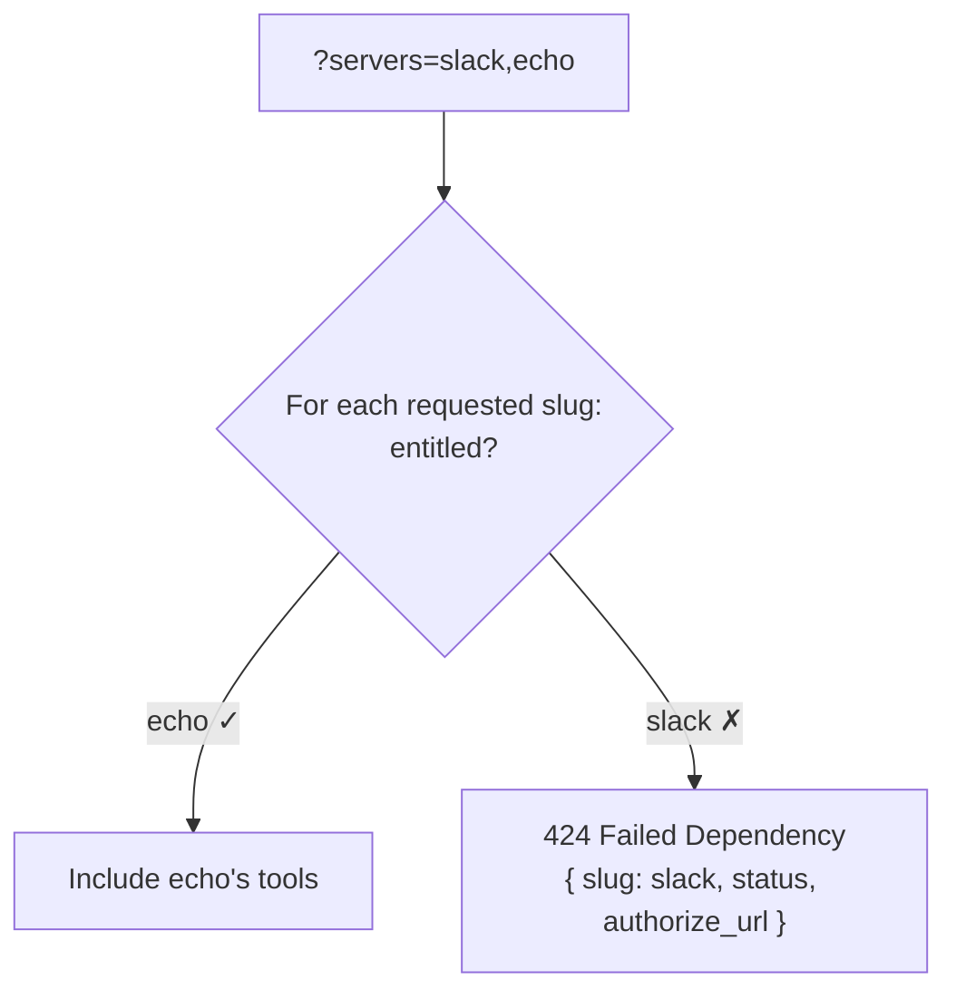

A short glossary of the terms the rest of these docs lean on. Each one is a real
thing in the code, not a metaphor.

## Server

An upstream toolset strad brokers. A server is one of [three
kinds](/servers/interface/) — `remote-http`, `supplementary-image`, or `builtin`
— but downstream of the adapter layer they are indistinguishable: each exposes
`listTools` / `callTool` / `close`.

## Slug

A server's stable identifier, matching `^[a-z0-9][a-z0-9-]{0,62}$`. It is what you
put in `?servers=`, and it is the first half of every namespaced tool name. Slugs
cannot contain underscores — that restriction is what makes namespacing
unambiguous.

## Namespacing

Every tool is exposed as `<server>__<tool>` — for example
`granola__list_meetings`. The separator is `__` (two underscores). Denamespacing
splits on the **first** `__` only, because tool names may themselves contain
underscores while slugs may not. Namespacing is what lets strad merge many
servers into one toolset without collisions.

## Selection (`?servers=`)

The `?servers=` query parameter names which servers a client wants for this
request. An **empty or absent** `?servers=` means "everything this token is
entitled to" (sorted). A **non-empty** list narrows to those servers.

Selection is a _hint_, never a grant. This is the one rule:

> **The query string proposes. The token disposes.**

`?servers=` can only narrow the token-derived entitled set — it can never widen
it. See [Auth](/auth/overview/) for why (RFC 8707: a query string is not a
resource, so it cannot scope a token).

## Entitlement

The set of servers a token may reach, computed **server-side** by intersecting
two directions that must _both_ agree:

1. A **role** the token holds must name the server under `roles.<role>.servers`
   (where `["*"]` means every server), **and**
2. The **server** must list that role under its `entitlements`.

Neither side grants access alone. A server with `entitlements: []` (the default)
is reachable by nobody — strad fails closed. The final selection for a request is
`entitled ∩ requested`.

## The 424 contract

When a requested server is not in the entitled set, strad returns **`424 Failed
Dependency`** rather than dropping it silently or returning `401`. The body names
each unavailable server with a `status` (`not_configured`, `not_entitled`, or
`disabled`) and an `authorize_url`. This is the fail-closed contract: a client
always learns _which_ server it couldn't get and _where_ to fix it.

## Statelessness

strad keeps **no session state**. A fresh MCP `Server` + transport is constructed
per request (`sessionIdGenerator: undefined`) and destroyed when the response
closes. The toolset is a pure function of `(token, URL)`. This is both an
operational property (any replica can serve any request) and the reason
`?servers=` is spec-conformant under the 2026-07-28 revision, which forbids
per-_connection_ toolset variation but allows per-_request_ variation.

## Bundle

A deployment group. `core` is the implicit, public bundle (the gateway process
itself); every other bundle becomes an internal-only App Platform component on
the private network. Bundles are how strad scales out heavy servers without
exposing them. See [Architecture](/intro/architecture/).

One bundle runs one image, but any number of servers may share it — each on its
own `path`, and capability variants of one upstream on the _same_ path. strad's
own deployment is two components: `core`, and one bundle holding all fourteen
containerised servers.

## Capability

Which of a server's tools a slug may use, set by `tools: { allow: [...] }` /
`{ deny: [...] }` and enforced by the gateway on `tools/list` **and**
`tools/call` — a withheld tool is refused before it reaches the upstream. The
capability is baked into the slug (`onepassword-ro` vs `onepassword-rw`), so
`?servers=` selects it. Two capability variants are the same container.

## Mode

Which role a running container plays: `core` (public gateway, proxies to bundles)
or `bundle` (internal, serves its assigned builtins to core). Selected by
`STRAD_MODE`; the same image runs both.
