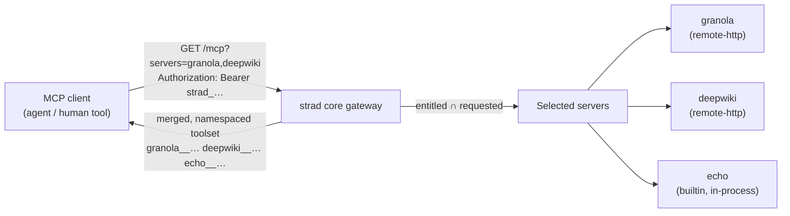

strad is a self-hosted MCP platform. It puts **one endpoint in front of many MCP
servers**. A client points at that endpoint, names the servers it wants, presents
a token, and gets back a single merged toolset drawn from exactly those servers —
proxied, namespaced, and access-controlled server-side.

The core ships with **zero** MCP servers baked in. strad is a platform, not a
bundle of integrations. Servers are attached through one config interface, and
that config is the entire product surface.

## The shape of the thing



Point any MCP client at `https://your-strad.example.com/mcp?servers=granola,deepwiki`,
present a token, and strad returns the union of those servers' tools — every tool
namespaced as `server__tool` (e.g. `granola__list_meetings`) so nothing collides.

## The one rule: the query proposes, the token disposes

There is a single invariant that everything else follows from:

> **The query string proposes. The token disposes.**

The `?servers=` parameter can only ever _narrow_ what a caller is already
entitled to. It is **never an authorization boundary**. A token minted for `/mcp`
is valid at `?servers=anything`; the query string cannot widen access, only
select within it. Entitlement is computed server-side from the caller's roles and
the config — nothing the caller sends can grow it.

The justification is RFC 8707: resource indicators bind a token to a _resource_,
and a query string is not one. So `?servers=` is treated as a **selection hint**,
not a credential scope. See [Auth](/auth/overview/) for how the entitled set is
actually computed.

## It fails closed

Ask for a server you are not entitled to, and strad does **not** silently drop it.
It returns a `424 Failed Dependency` with a machine-readable body naming exactly
what's missing and where to authorize it:

```json
{
  "error": "downstream_not_authenticated",
  "message": "One or more requested servers are unavailable to this token.",
  "servers": [
    {
      "slug": "slack",
      "status": "not_entitled",
      "authorize_url": "https://…/console/servers/slack"
    }
  ]
}
```

The per-server `status` is one of `not_configured`, `not_entitled`, or
`disabled`. strad deliberately avoids returning a `401` here — a `401` would march
the client into a pointless OAuth loop against the gateway, when the real problem
is downstream authorization. And it avoids silently omitting the server, because
"a client that asked for slack and got a toolset without it looks like a broken
Slack integration." Fail closed, loudly, with a pointer to the fix.

## Stateless, and spec-conformant because of it

strad is **stateless**. It builds a fresh MCP `Server` and transport for every
request (`StreamableHTTPServerTransport({ sessionIdGenerator: undefined })`) and
tears it down when the response closes. The toolset a client sees is a pure
function of `(token, URL)` — it is never derived from session state.

That is exactly what keeps `?servers=` conformant with the **2026-07-28 MCP spec
revision**, which removes sessions and forbids a server from varying its toolset
per _connection_ — while explicitly allowing variation by per-request _input_.
Because `?servers=` is request input and there are no sessions, selecting servers
per request is squarely within spec.

## Auth is the only gate

strad is built to run on the **open internet** — there is no tailnet, VPN, or IP
allowlist in front of it. That posture is deliberate, and it means auth is the
only thing standing between a caller and the tools:

- **`/mcp`** always requires a static system token. No token, no tools —
  including the CI smoke test that asserts an unauthenticated `/mcp` returns
  `401`.
- **`/console`** (the human surface) uses Google Workspace OAuth.

See [Auth](/auth/overview/) for the full model.

## What it is not

It is not a hosted product — there is no SaaS. You deploy it yourself on
DigitalOcean App Platform (see [Deploy model](/operate/deploy-model/)). It is not
a bundle of pre-wired integrations — the core has no servers until you add them.
And it is not multi-tenant in the SaaS sense: it is a single circle of trust,
governed by roles you define.
