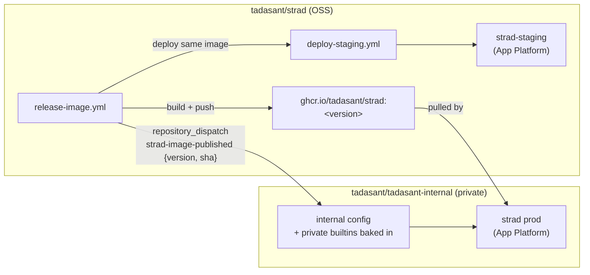
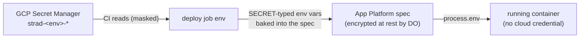
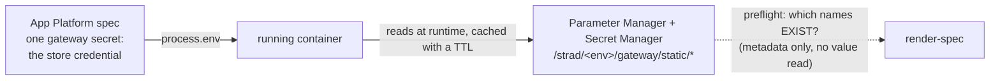

strad's deploy model separates **the image** from **the deployment**. The
open-source repo builds and publishes the image; a private repo consumes that
image with its own config to run production. This is the same seam zimmer uses —
the OSS core is a reusable artifact, and the private repo is where the real
config, private servers, and prod secrets live.

## The two repos



- **`tadasant/strad` mints the image.** `release-image.yml` builds and pushes
  `ghcr.io/tadasant/strad:<version>` (plus `:latest` and `:sha-<sha>`) using the
  built-in `GITHUB_TOKEN` — which can write packages owned by the repo, so no
  personal access token is needed for the push.
- **`tadasant/strad` also runs staging** from the same image, via
  `deploy-staging.yml`, using `infra/strad.staging.yaml` as its config. Dispatched
  on a feature branch with `build: true`, the same workflow builds that branch's
  core and bundle images under branch-scoped tags and deploys them — without
  moving `:latest` or touching the handshake below. See [deploying a
  branch](/operate/operations/#deploying-a-branch-to-staging).
- **A deploy ships an immutable tag — for every component.** `:latest` exists for
  humans and for `docker pull`; no deploy uses it. `render-spec` refuses a core
  image on a mutable tag outright, and `deploy-staging.yml` resolves
  `sha-<commit>` for the core **and** the bundle. Under
  `--require-immutable-images` — which the staging deploy passes —
  `render-spec` refuses to emit a spec in which any component at all ships a tag
  that moves; without it, the same finding is a warning naming every component,
  because prod renders this script against a config in another repository whose
  `image:` lines it cannot change. See [which image a deploy
  ships](/operate/operations/#which-image-a-deploy-ships).
- **`tadasant-internal` runs prod.** It is a separate, deliberate act with a
  different DigitalOcean token. It consumes the published image plus its **own
  internal config** — private `builtin` modules baked into its own image, or a
  `STRAD_CONFIG` path — and deploys it.

## Versioning

The scheme is deterministic with no commit-back (borrowed from zimmer):

- A committed **`VERSION`** file is the manual floor (currently `0.1.0`).
- The **effective version** is `MAJOR.MINOR.(BASE_PATCH + commits_since_VERSION_last_changed)`.
- To bump minor or major, edit `VERSION` in a PR — which resets the patch offset.

## The cross-repo handshake

On each release, strad fires a cross-repo `repository_dispatch` to
`tadasant/tadasant-internal`:

- `event_type: strad-image-published`, payload `{ version, sha }`.
- Sent via `GH_STRAD_SYNC_TOKEN_TADASANT_INTERNAL`.

The dispatch is **best-effort**: a no-op if the token is unset, and a _warning_
(never a build failure) if it's rejected — "tadasant-internal polls on its own
schedule." The OSS release never depends on the private repo being reachable.

## The secrets seam

Secrets never live in the repo. Which of two paths they take is declared by the
config's `gateway.secrets.provider`, and a deployment gets exactly one — see
[Secrets](/operate/secrets/) for the full model.

### `provider: env` (the default)



`scripts/render-spec.ts` reads `strad-<env>-*` from GCP Secret Manager into the
job env, then renders SECRET-typed env vars into the App Platform spec (encrypted
at rest by DigitalOcean). The container just reads `process.env`. `render-spec`'s
output contains secret values, so it is written to a file and **never logged**.
`collectSecretRefs` walks the _parsed_ config (not raw YAML — so `${…}` inside a
comment isn't mistaken for a real ref), and an unresolved `${…}` fails the render
loudly instead of producing a crash-looping deploy.

The cost of this path is that **a rotated secret does nothing until the deploy
workflow runs again.** The value is in the spec, not read at boot.

### `provider: gcp-parameter-store`



The gateway needs one credential in the spec — the service-account key it uses to
reach the store. Everything the gateway resolves **on the request path** is read
while it runs, so adding or rotating one of those needs no deploy: a rotation
lands within `ttlSeconds` (default 60s), an addition within `negativeTtlSeconds`
(default 10s). A boot key is a restart and a baked one is a deploy — see
[what rotates live](/operate/secrets/#what-rotates-live-what-needs-a-restart-and-what-needs-a-redeploy).

`render-spec` still fails loudly on a reference to a secret that does not exist —
that is the **preflight**, which asks the store which names exist and never asks
for a value. What it does not do is bake one: a baked copy would silently outrank
a rotated stored one, and there would be two ways again.

The preflight consults **both** namespaces, because a server's `${NAME}` resolves
from its own before the shared one. A name every referencing server holds for
itself is reported as served per-server and does not fail the deploy; a name even
one referencing server would still fall through for does. Getting this wrong in
the strict direction is not a small bug — this gate exits 1, so a credential filed
in its owner's namespace would red every deploy until it was moved back out.

#### The exception: a container that cannot ask the store

"Read it at runtime instead" is a claim about strad's own process. A
`supplementary-image` component does not run strad — it is a third-party image —
and it holds no store credential, because that key reaches the strad image and
stops there. It cannot hydrate, and giving it the credential would not change
that, since nothing inside it knows how to ask.

So `render-spec` reads that component's two boot keys — `STRAD_INTERNAL_TOKEN`
and `OTEL_EXPORTER_OTLP_HEADERS` — **from the store** and bakes them onto it,
exactly as it already does for that component's `env:`. One place to manage them;
a redeploy to change them.

Both of those keys fail silently when absent — a bundle with no OTLP header
exports into rejection about a minute after a green deploy, with `/healthz` still
200 — so the render checks rather than trusts, in three places that answer
different questions:

| Check                                        | Fails the deploy when                                                                                                                                                                                  |
| -------------------------------------------- | ------------------------------------------------------------------------------------------------------------------------------------------------------------------------------------------------------ |
| `preflightSecrets()`                         | **no namespace** holds a required name — neither the gateway's nor that of every server referencing it. It reads metadata, so it cannot tell whether the value renders.                                |
| the required-boot-key check in `render-spec` | a required boot key resolves to **nothing** — the parameter is there, `list()` reports a value, and `:render` returns empty. Presence is not resolvability, and this is the half preflight cannot see. |
| `bootEnvGaps()`                              | a component in the **rendered spec** holds neither a boot key it needs nor the credential to fetch it. A cross-check on the renderer itself.                                                           |

The OTLP header is deliberately not on the **required** list: an ingestor that
needs no auth is ordinary, and demanding a header would fail correct deploys. (It
is still inside `bootEnvGaps` — once the store yields a value, a component
missing it is a gap like any other.) An **endpoint with no resolvable header** is
warned about by name instead, because it is
indistinguishable from a healthy deploy right up until the ingestor starts
refusing batches — and the staging deploy's [telemetry
report](/operate/operations/#deploy-stagingyml--put-it-on-app-platform) is what
catches it after the fact.

### Per-server `${NAME}` resolution

A supplementary server's `env:` refs resolve from **two** namespaces:
`/strad/{env}/mcp/{slug}/static/` first, `/strad/{env}/gateway/static/` as the
fallback. That is what lets two servers write the same `${NAME}` and mean
different values — see [two servers, one variable
name](/operate/secrets/#a-servers-secrets-live-in-that-servers-namespace) for the semantics, the
compatibility argument and the one-bundle-one-environment limit.

A namespace decides which value a server resolves; it does not decide where the
value can go. **Every** supplementary server's `env:` is additionally emitted under
per-slug names (`TELEGRAM_RW__TELEGRAM_API_HASH`: the slug uppercased, `-` to `_`,
joined with `__`), unconditionally, so the set of names is computable from one
server's config entry. Nothing is removed: the bare names keep their values and
every server reads them unchanged, which is why the core and bundle images can
deploy in any order. What `path:` decides is which slugs can READ their own names —
the host runs one instance per path — and two slugs on ONE path resolving one
variable differently still throws.

Three things happen here as a result:

- **One listing, then targeted reads.** `render-spec` lists `/strad/{env}/mcp/`
  once — metadata, no values — and only calls `resolve()` on the namespaces whose
  slugs actually reference one of their names, concurrently. A store with no
  per-server parameters costs one extra `list()` and nothing else; a store with K
  such slugs costs K more namespace reads, in parallel, and `list()` enumerates
  the project each time (see [Known limitations](/limitations/) #52).
- **The shared namespace is a fallback, not a requirement.** A name every
  referencing server holds for itself no longer has to exist in the gateway
  namespace; a name even one referencing server still needs from there is a hard
  error that names the servers. The same is true of the refs strad resolves at
  **runtime** — a `url:`, a `headers:` map, a builtin's `options:` — which are
  layered the same way by the gateway process rather than by the renderer, and
  which is the only route a kind strad runs no container for has to its own
  namespace.
- **A seeded namespace nothing reads is a `::warning::`** with the paths and
  variable names in it. It used to be a bare `continue`. So is a parameter that
  exists and yields no usable value — an un-dereferenced `__REF__`, an empty
  payload: it is dropped rather than injected, and the shared namespace gets its
  turn, because baking the pointer would ship a non-credential _and_ suppress a
  value that works. A namespace that fails to render outright still fails the
  deploy, as the gateway namespace always has.

The read is gated on the **resolver credential**, not on the provider, which is
where `params: true` already draws its line. An `env`-provider deployment whose
deploy job carries `STRAD_PARAMS_*` therefore consults the store for a
supplementary `env:` ref, ahead of the deploy environment; a deployment with no
resolver credential resolves exactly as it did.

### Deploy-time parameter resolution

A `supplementary-image` server with `params: true` gets its managed parameters —
everything under `/strad/{env}/mcp/{slug}/static/*` in the [parameters
system](/intro/architecture/#the-secrets-and-parameters-system) — resolved **here,
at render time**, by the **resolver** credential (`STRAD_PARAMS_*`, read from the
deploy environment). `render-spec` resolves that namespace for each such
server, pulling non-secret values from Parameter Manager and secret values from
Secret Manager, and hands the resulting map to `renderAppSpec` as `resolvedParams`.
Those values land as SECRET env vars **scoped onto that server's bundle** — the same
per-bundle scoping as a `${REF}` in `env:`, and the running container still holds no
cloud credential.

The resolver is **optional by design**: with no `STRAD_PARAMS_*` credential set,
`resolverFromEnv()` returns `null`, resolution is a no-op, and a `params: true`
server boots without those values rather than failing the render. That is what lets
the feature ship ahead of the resolver service account existing — see [Known
limitations](/limitations/).

Deploy-time is the _only_ option for a supplementary image, and the reason is
architectural rather than incidental: its `env:` is the environment of a container
the gateway process does not run, so nothing inside strad can change it while it
runs. A `bundle: core` builtin with `params: true` resolves **at runtime**, on
every call, and does pick up a change without a restart.

Namespaces are resolved **three at a time**, not all at once. Each `resolve()`
already fans out ten wide inside one namespace, so resolving every namespace
simultaneously made the size of the burst a function of how many servers the config
has — six added slugs were enough to push it past Parameter Manager's per-project
read quota and 429 the render. The batch keeps the burst flat as the config grows.

Two other things guard the same seam. The render enumerates the store [once, not
once per
namespace](/operate/secrets/#one-enumeration-per-deploy-not-one-per-namespace),
which is what cuts the request COUNT rather than its shape; and the [retry in the
store client](/operate/secrets/#a-refused-read-is-not-an-answer-about-the-parameter)
is what survives a refusal when one happens anyway.

The render also bakes **`STRAD_PARAM_KEYS`** onto each component that carries a
`params: true` server: a `GENERAL` (not `SECRET`) env var holding
`{"<slug>": ["VARIABLE", ...]}`. Names only, and only when at least one server on
the component uses `params:` — so a spec diff moves only when the thing it
describes does.

It exists because a managed parameter is not a `${NAME}` reference: the config
does not name it, so the console running on `core` cannot enumerate it, and the
only honest thing it could say about a `params: true` server was that it had not
looked. With the names on the component, the component's
[presence route](/operate/secrets/#the-presence-route-a-component-answering-for-itself)
answers for each one — presence, never a value.

## App Platform: the hard-won facts

These are encoded in `src/deploy/appspec.ts` because each one cost something to
learn:

- **A spec update is a full REPLACE. An omitted field is a deletion.** This is the
  one that has actually bitten. Omitting `domains` from an update _detaches the
  custom domain_, and the app stays perfectly healthy on its `*.ondigitalocean.app`
  ingress while the real hostname fails its TLS handshake — so nothing alerts.
  `render-spec` now always emits `domains`, defaulting it from
  `gateway.publicUrl`. Verify the custom domain still serves after any deploy. See
  `HACKS.md` #18.
- **Internal components use `internal_ports: [8080]` and must _omit_
  `http_port`.** `http_port` is what mints a public route; setting both is a hard
  API rejection. Omitting it is what keeps a bundle private.
- **Don't hand-write `ingress` rules** — let App Platform derive them.
- **`${bundle.PRIVATE_URL}` → `http://bundle-name:8080`** — a private in-VPC hop
  (~3.9ms) with no public-edge hairpin (~58ms). It binds in both directions: core
  gets one per bundle it proxies to, and every non-core component gets
  `STRAD_CORE_URL` = `${core.PRIVATE_URL}` for the
  [parameter write-back route](/operate/secrets/#paramswritable-a-credential-that-rotates-on-use),
  which is the one call that runs bundle → core.
- **A component that hosts a `paramsWritable:` server may not have
  `instanceCount` above 1.** The render throws rather than emit it: a credential
  that rotates on use has exactly one valid value at a time, so two replicas
  refreshing it invalidate each other at the upstream.
- **Deploy from a registry image, not a GitHub source.** App Platform's GitHub
  integration needs an interactive OAuth handshake and can't be driven headlessly
  from CI.
- The **core** service gets `STRAD_MODE=core`, `NODE_ENV=production`, the whole
  config inline as `STRAD_CONFIG_YAML`, a `/healthz` health check, and a
  `STRAD_BUNDLE_URL_<BUNDLE>` env per bundle (bound to `${bundle.PRIVATE_URL}`).
- **What a bundle component gets depends on whose image it runs.** A bundle of
  `builtin` servers runs the strad image and gets `STRAD_MODE=bundle` +
  `STRAD_BUNDLE=<name>`. A bundle of `supplementary-image` servers runs _their_
  image and gets only its own resolved `env:` map (SECRET-typed), any
  `params: true`-resolved parameters (also SECRET-typed), the identity vars
  (`STRAD_COMPONENT`, `STRAD_ENV`, `STRAD_VERSION`, and `STRAD_PUBLIC_URL` when
  `gateway.publicUrl` is set), `STRAD_CORE_URL`, and the telemetry vars — never
  `STRAD_MODE`, never the config, never the token secrets it has no use for.
  `STRAD_PUBLIC_URL` is
  non-secret and lets strad-owned bundle code mint absolute URLs for routes that
  core publicly proxies, such as remote-filesystem upload leases. A server's
  `consoleEnv:` is pointedly **not** here — it lands on core alone. The blast
  radius of a compromised upstream image is bounded by what it was handed.
  (`parseImage` handles GHCR / DOCR / Docker Hub refs.)

## What strad's own config renders to

`infra/strad.staging.yaml` produces exactly **three** components — `core`,
`bundle` and `bundle-zimmer-secrets` — and `test/staging-config.test.ts` asserts
that. `core` runs `ghcr.io/tadasant/strad` with `http_port: 8080`; `bundle` runs
`ghcr.io/tadasant/strad-bundle` at `apps-s-1vcpu-2gb` with `internal_ports: [8080]`
and no public route.

`bundle-zimmer-secrets` runs the **same** bundle image at the default
`apps-s-1vcpu-1gb`, and it is the one component that is not there for capability.
Capability is config, and config can be shared; a parameter STORE is
`process.env`, and a container has exactly one of those. It exists so a second
`secrets` slug can front a different project — see [Two stores, one
gateway](/operate/secrets/#two-stores-one-gateway) for the shape and its cost.

Prod, in `tadasant-internal`, is a separate config against the same renderer.

## A connector's credentials are injected, not referenced

A server with an [`oauth:` connector](/operate/connectors/) has three variables
the renderer puts on its bundle — the OAuth client id, the client secret, and the
refresh token strad's console writes when a human consents. They arrive by
INJECTION from `/strad/{env}/mcp/{slug}/static/`, not by resolving a `${NAME}`,
and the difference is a deploy-ordering property rather than a style:

- `render-spec` exits 1 on the first `${NAME}` it cannot resolve, and it renders
  the whole spec. One slug's missing credential is every slug's failed deploy.
- A connector's refresh token cannot exist until a human has completed the console
  flow, and the console page for a slug does not exist until that slug is
  deployed. Referencing it would deadlock the fleet on a value that needs the
  fleet deployed to be created.

So each variable is injected if — and only if — the store holds it, and the
config gate refuses a `${NAME}` reference to one. An unconnected slug renders with
two variables and no third: it deploys, mounts, lists its tools and reports itself
degraded on `/healthz`. The order is one-phase:

```text
seed client id + secret  →  deploy  →  connect in the console  →  next deploy
```

Each value lands as a SECRET env var on that server's bundle alone, under both the
bare name and the [per-slug name](/operate/secrets/#what-a-servers-variables-are-called-on-the-box),
never as a broadcast and never on core.

**The activation boundary is a deploy.** A supplementary server's environment is
baked at render time, so a credential stored through the console reaches the
container on the next deploy — not the moment the console says it was written. The
console page says so rather than implying otherwise.

## Checking a config before it deploys

`scripts/check-config.ts` validates a config the way a deploy would, without
deploying and without a single credential. `render-spec` needs the real secrets
and emits the real spec; this needs neither, which is what makes it runnable on
every pull request — including from a repo that holds a config but no cloud
access.

```bash
node --experimental-transform-types scripts/check-config.ts \
  --config infra/strad.staging.yaml

# or, from this repo
npm run config:check -- --config infra/strad.staging.yaml
```

| Flag              | Meaning                                           |
| ----------------- | ------------------------------------------------- |
| `--config <path>` | **required** — the config file to check           |
| `--image <ref>`   | image ref to render with; only affects the render |
| `--app <name>`    | app name to render with; only affects the render  |

| Exit | Meaning                                                          |
| ---- | ---------------------------------------------------------------- |
| `0`  | the config is valid; the referenced secret **names** are printed |
| `1`  | at least one problem; every problem is printed and annotated     |
| `2`  | the script was called wrong (no `--config`, unreadable file)     |

Every problem is emitted as a `::error file=<config>::…` workflow command on
stderr, so GitHub annotates the run, and repeated as a list on stdout. Output is
names and structure only — it never prints a value, and the values it renders
with are dummies anyway.

Four checks, in order:

1. **Schema.** The same `parseConfig` the gateway boots with — types, required
   fields, and the cross-field rules (an undefined role, two images in one bundle,
   a `tools:` block with neither `allow` nor `deny`).
2. **Unknown keys.** The check the others cannot do. Zod strips what it does not
   recognise, so `consoleEnvs:` for `consoleEnv:` passes every other check here and
   does nothing at runtime. Detection is a **diff**, not a second strict schema: the
   document is parsed with the real schema, and any key present in the YAML but
   absent from the result was stripped. A copy of the schema would have to be edited
   in lockstep with the real one, and forgetting would mean a check that quietly
   stopped checking; a diff has nothing to drift from. Keys inside an open map are
   the declarer's vocabulary, not the schema's, and are never flagged: an `env:` /
   `consoleEnv:` variable name, a builtin's `options:`, and a **role name** under
   `roles:` (the role's own fields, like `servers:`, _are_ checked).
3. **Render.** The full `renderAppSpec`, with a dummy value substituted for every
   `${NAME}`. This is a smoke test — the dummy bag covers exactly the names the
   renderer resolves, so a schema-valid config essentially always renders — and it
   is what produces the real spec check 4 inspects.
4. **Console scope.** Two things a rendered spec can prove, and nothing else can:
   every key a server declares under `consoleEnv:` reaches the `core` component,
   and no two servers claim one key with different values. The first is the
   invariant `/ui` depends on. The second matters because `consoleEnvVars()` merges
   every enabled server's map into one flat environment, so a collision means the
   last declaration silently wins and the other server's console runs as the wrong
   identity.

A collision between two servers' `env:` maps in one bundle — two different
`${REF}` _strings_ under one key — is **not** a check here: it is rejected
earlier, by the schema itself, along with the `consoleEnv:`-against-`core` half.
(The case the schema cannot see is two servers whose ref strings are identical
and whose per-server namespaces resolve them differently. `renderAppSpec` sees
that at render time, when the values exist: a slug that can be its own mount is
given its own `<SLUG>__<NAME>` set, and two that cannot — two slugs sharing a
path, or two capability-variant groups — still throw.) That is
the better place for the schema's half: a schema rule
fires at boot as well as at this gate. See [`env:` may be bare; `consoleEnv:` must
be
slug-namespaced](/servers/interface/#env-may-be-bare-consoleenv-must-be-slug-namespaced).

What the schema still cannot see is a `params: true` server's variables. They land
on the same component environment, but their names come from **paths in the store**
and their values do not exist until render time — so neither the schema nor this
script, which has no store and no credentials, can know them. `renderAppSpec` can,
and it throws when one server's resolved parameter would shadow a sibling's
variable on the same bundle. That case matters more than an ordinary config
collision because it is reachable by a human action rather than a config edit: the
console creates parameters, and a parameter's path decides its variable name. A
server shadowing its **own** `env:` key with its own parameter stays legal — that
is the migration path off a hand-written `${REF}`.

**It is strict where the gateway is lenient, and that asymmetry is deliberate.**
`parseConfig` at boot keeps ignoring unknown keys, because the config and the image
version independently: an image that refused to boot on a key it had never heard of
would turn a rollback into an outage — the older image would reject the config the
newer one wrote. A false failure at boot costs an outage; a false pass at deploy
costs a silent misconfiguration. So the strictness lives at the gate.

## Checking a `tools:` policy against the tools that exist

`check-config` reads the config and nothing else, so it cannot see the one thing a
`tools: allow` list is about: whether those names are tools. An `allow` list is
exhaustive and fail-closed, which is what makes it a capability boundary and what
makes a stale entry invisible — a rename upstream, or one missing `s`, matches
nothing and that slug serves one tool fewer. Nothing errors. The gateway does
[say so](/intro/architecture/#capability-read-only-vs-read-write), on every
`tools/list`, once it is deployed.

`scripts/check-tool-policy.ts` moves that verdict before the deploy by joining the
config to a booted image's real tool names:

```bash
# with the bundle container up (this is what CI runs; it names its container
# per run, so substitute yours)
docker exec <container> node /app/scripts/smoke.mjs --json > bundle-tools.json

npm run policy:check -- --tools bundle-tools.json \
  --config infra/strad.staging.yaml
```

| Flag              | Meaning                                                                                                  |
| ----------------- | -------------------------------------------------------------------------------------------------------- |
| `--tools <path>`  | **required** — the observer's document (`smoke.mjs --json`)                                              |
| `--config <path>` | **required**, repeatable — the configs to check                                                          |
| `--image <ref>`   | which image the mounts came from; everything but the tag is matched, so CI's per-run `:ci-…` ≡ `:latest` |

| Exit | Meaning                                                                             |
| ---- | ----------------------------------------------------------------------------------- |
| `0`  | every entry that could be checked names a served tool                               |
| `1`  | an entry names a tool its mount does not serve; the slug and entry are named        |
| `2`  | called wrong, or a dump with no mounts in it — which would pass by checking nothing |

**It skips more than it fails, on purpose.** Only the bundle's own mounts have
their real names available in CI: a `remote-http` server, a server on another
image, a mount that would not list, and a mount whose surface here is a floor
rather than the whole (`secrets` derives its tools from a credential probe;
`GCS_BUCKET` hides four tools from `gcs`; a browser server's surface follows the
app it drives) are all **skipped with a reason**, and the reasons print on a
passing run too. A gate that reddens a good PR is a gate somebody disables, and
"not covered" must never read like "covered and clean".

`deny` entries are checked the same way. A deny naming nothing subtracts nothing,
so unlike a stale `allow` it changes no request — but a deny list exists to
withhold one tool from a full tier, so an entry that matches nothing means the
tool was renamed and is being served. A `deny` is not the place to pre-refuse a
tool that does not exist yet; `allow` is already exhaustive and fail-closed
against an upstream growing one.

## Checking the STORE before a config that reads from it deploys

`check-config` answers "is this config well-formed". It cannot answer "does the
store this config will read from actually hold what it names", because that needs
a credential and a live namespace. `scripts/check-store.ts` is the credentialed
counterpart — same flag shape, same annotations, same exit-code discipline — and
it is the check to run before flipping `gateway.secrets.provider` to
`gcp-parameter-store`.

```bash
npm run store:check -- --config infra/strad.staging.yaml            # the gate
npm run store:check -- --config infra/strad.staging.yaml --mode report  # daily
```

| Flag                 | Meaning                                                        |
| -------------------- | -------------------------------------------------------------- |
| `--config <path>`    | **required** — the config whose names are counted              |
| `--mode <m>`         | `require` (default, a finding is exit 1) or `report` (exit 0)  |
| `--namespace <path>` | override the namespace `gateway.env` implies; may not be empty |
| `--resolve`          | also render what was found; report by name what came back      |

| Exit | Meaning                                                                                       |
| ---- | --------------------------------------------------------------------------------------------- |
| `0`  | every expected name is present — or `--mode report` produced its report                       |
| `1`  | a finding: a missing name, a name that would not render, or a `consoleEnv:` name in the store |
| `2`  | called wrong: no `--config`, unreadable file, config does not parse                           |
| `3`  | the store could not be consulted at all — not a verdict about what is seeded                  |

It runs standalone from a checkout with the resolver key in the environment: no
image, no pin bump, no deploy. [Secrets](/operate/secrets/#is-the-namespace-complete-store-check)
documents what it counts and why that differs from the deploy preflight.

For the workflows that drive all of this, see [Operations &
CI](/operate/operations/). For the domain wiring, see [DNS &
domains](/operate/dns/).
