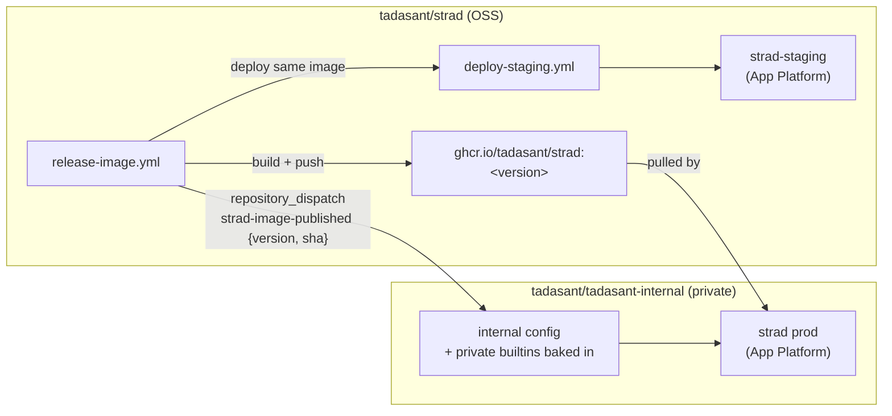
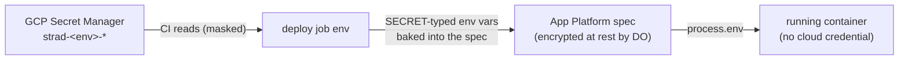

strad's deploy model separates **the image** from **the deployment**. The
open-source repo builds and publishes the image; a private repo consumes that
image with its own config to run production. This is the same seam zimmer uses —
the OSS core is a reusable artifact, and the private repo is where the real
config, private servers, and prod secrets live.

## The two repos

- **`tadasant/strad` mints the image.** `release-image.yml` builds and pushes
  `ghcr.io/tadasant/strad:<version>` (plus `:latest` and `:sha-<sha>`) using the
  built-in `GITHUB_TOKEN` — which can write packages owned by the repo, so no
  personal access token is needed for the push.
- **`tadasant/strad` also runs staging** from the same image, via
  `deploy-staging.yml`, using `infra/strad.staging.yaml` as its config.
- **`tadasant-internal` runs prod.** It is a separate, deliberate act with a
  different DigitalOcean token. It consumes the published image plus its **own
  internal config** — private `builtin` modules baked into its own image, or a
  `STRAD_CONFIG` path — and deploys it.

## Versioning

The scheme is deterministic with no commit-back (borrowed from zimmer):

- A committed **`VERSION`** file is the manual floor (currently `0.1.0`).
- The **effective version** is `MAJOR.MINOR.(BASE_PATCH + commits_since_VERSION_last_changed)`.
- To bump minor or major, edit `VERSION` in a PR — which resets the patch offset.

## The cross-repo handshake

On each release, strad fires a cross-repo `repository_dispatch` to
`tadasant/tadasant-internal`:

- `event_type: strad-image-published`, payload `{ version, sha }`.
- Sent via `GH_STRAD_SYNC_TOKEN_TADASANT_INTERNAL`.

The dispatch is **best-effort**: a no-op if the token is unset, and a _warning_
(never a build failure) if it's rejected — "tadasant-internal polls on its own
schedule." The OSS release never depends on the private repo being reachable.

## The secrets seam

Secrets never live in the repo or in a running container's credentials:

`scripts/render-spec.ts` reads `strad-<env>-*` from GCP Secret Manager into the
job env, then renders SECRET-typed env vars into the App Platform spec (encrypted
at rest by DigitalOcean). The container just reads `process.env`. `render-spec`'s
output contains secret values, so it is written to a file and **never logged**.
`collectSecretRefs` walks the _parsed_ config (not raw YAML — so `${…}` inside a
comment isn't mistaken for a real ref), and an unresolved `${…}` fails the render
loudly instead of producing a crash-looping deploy.

## App Platform: the hard-won facts

These are encoded in `src/deploy/appspec.ts` because each one cost something to
learn:

- **Internal components use `internal_ports: [8080]` and must _omit_
  `http_port`.** `http_port` is what mints a public route; setting both is a hard
  API rejection. Omitting it is what keeps a bundle private.
- **Don't hand-write `ingress` rules** — let App Platform derive them.
- **`${bundle.PRIVATE_URL}` → `http://bundle-name:8080`** — a private in-VPC hop
  (~3.9ms) with no public-edge hairpin (~58ms).
- **Deploy from a registry image, not a GitHub source.** App Platform's GitHub
  integration needs an interactive OAuth handshake and can't be driven headlessly
  from CI.
- The **core** service gets `STRAD_MODE=core`, `NODE_ENV=production`, a `/healthz`
  health check, and a `STRAD_BUNDLE_URL_<BUNDLE>` env per bundle (bound to
  `${bundle.PRIVATE_URL}`).
- **Bundle** components get `STRAD_MODE=bundle` and `STRAD_BUNDLE=<name>`. A
  builtin bundle runs the strad image itself; a supplementary bundle runs the
  image from its own `image:` ref (`parseImage` handles GHCR / DOCR / Docker
  Hub).

For the workflows that drive all of this, see [Operations &
CI](/operate/operations/). For the domain wiring, see [DNS &
domains](/operate/dns/).
