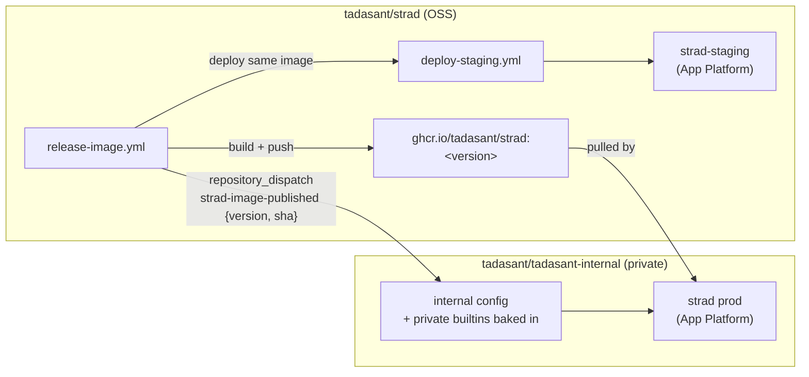
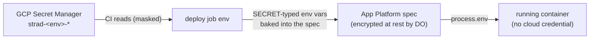
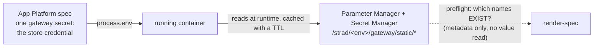

strad's deploy model separates **the image** from **the deployment**. The
open-source repo builds and publishes the image; a private repo consumes that
image with its own config to run production. This is the same seam zimmer uses —
the OSS core is a reusable artifact, and the private repo is where the real
config, private servers, and prod secrets live.

## The two repos



- **`tadasant/strad` mints the image.** `release-image.yml` builds and pushes
  `ghcr.io/tadasant/strad:<version>` (plus `:latest` and `:sha-<sha>`) using the
  built-in `GITHUB_TOKEN` — which can write packages owned by the repo, so no
  personal access token is needed for the push.
- **`tadasant/strad` also runs staging** from the same image, via
  `deploy-staging.yml`, using `infra/strad.staging.yaml` as its config. Dispatched
  on a feature branch with `build: true`, the same workflow builds that branch's
  core and bundle images under branch-scoped tags and deploys them — without
  moving `:latest` or touching the handshake below. See [deploying a
  branch](/operate/operations/#deploying-a-branch-to-staging).
- **`tadasant-internal` runs prod.** It is a separate, deliberate act with a
  different DigitalOcean token. It consumes the published image plus its **own
  internal config** — private `builtin` modules baked into its own image, or a
  `STRAD_CONFIG` path — and deploys it.

## Versioning

The scheme is deterministic with no commit-back (borrowed from zimmer):

- A committed **`VERSION`** file is the manual floor (currently `0.1.0`).
- The **effective version** is `MAJOR.MINOR.(BASE_PATCH + commits_since_VERSION_last_changed)`.
- To bump minor or major, edit `VERSION` in a PR — which resets the patch offset.

## The cross-repo handshake

On each release, strad fires a cross-repo `repository_dispatch` to
`tadasant/tadasant-internal`:

- `event_type: strad-image-published`, payload `{ version, sha }`.
- Sent via `GH_STRAD_SYNC_TOKEN_TADASANT_INTERNAL`.

The dispatch is **best-effort**: a no-op if the token is unset, and a _warning_
(never a build failure) if it's rejected — "tadasant-internal polls on its own
schedule." The OSS release never depends on the private repo being reachable.

## The secrets seam

Secrets never live in the repo. Which of two paths they take is declared by the
config's `gateway.secrets.provider`, and a deployment gets exactly one — see
[Secrets](/operate/secrets/) for the full model.

### `provider: env` (the default)



`scripts/render-spec.ts` reads `strad-<env>-*` from GCP Secret Manager into the
job env, then renders SECRET-typed env vars into the App Platform spec (encrypted
at rest by DigitalOcean). The container just reads `process.env`. `render-spec`'s
output contains secret values, so it is written to a file and **never logged**.
`collectSecretRefs` walks the _parsed_ config (not raw YAML — so `${…}` inside a
comment isn't mistaken for a real ref), and an unresolved `${…}` fails the render
loudly instead of producing a crash-looping deploy.

The cost of this path is that **a rotated secret does nothing until the deploy
workflow runs again.** The value is in the spec, not read at boot.

### `provider: gcp-parameter-store`



The gateway needs one credential in the spec — the service-account key it uses to
reach the store. Everything the gateway resolves is read while it runs, so adding
or rotating one of those needs no deploy: a rotation lands
within `ttlSeconds` (default 60s), an addition within `negativeTtlSeconds`
(default 10s).

`render-spec` still fails loudly on a reference to a secret that does not exist —
that is the **preflight**, which asks the store which names exist and never asks
for a value. What it does not do is bake one: a baked copy would silently outrank
a rotated stored one, and there would be two ways again.

### Deploy-time parameter resolution

A `supplementary-image` server with `params: true` gets its managed parameters —
everything under `/strad/{env}/mcp/{slug}/static/*` in the [parameters
system](/intro/architecture/#the-secrets-and-parameters-system) — resolved **here,
at render time**, by the **resolver** credential (`STRAD_PARAMS_*`, read from the
deploy environment). `render-spec` calls `resolveServerParams()` for each such
server, pulling non-secret values from Parameter Manager and secret values from
Secret Manager, and hands the resulting map to `renderAppSpec` as `resolvedParams`.
Those values land as SECRET env vars **scoped onto that server's bundle** — the same
per-bundle scoping as a `${REF}` in `env:`, and the running container still holds no
cloud credential.

The resolver is **optional by design**: with no `STRAD_PARAMS_*` credential set,
`resolverFromEnv()` returns `null`, resolution is a no-op, and a `params: true`
server boots without those values rather than failing the render. That is what lets
the feature ship ahead of the resolver service account existing — see [Known
limitations](/limitations/).

Deploy-time is the _only_ option for a supplementary image, and the reason is
architectural rather than incidental: its `env:` is the environment of a container
the gateway process does not run, so nothing inside strad can change it while it
runs. A `bundle: core` builtin with `params: true` resolves **at runtime**, on
every call, and does pick up a change without a restart.

## App Platform: the hard-won facts

These are encoded in `src/deploy/appspec.ts` because each one cost something to
learn:

- **A spec update is a full REPLACE. An omitted field is a deletion.** This is the
  one that has actually bitten. Omitting `domains` from an update _detaches the
  custom domain_, and the app stays perfectly healthy on its `*.ondigitalocean.app`
  ingress while the real hostname fails its TLS handshake — so nothing alerts.
  `render-spec` now always emits `domains`, defaulting it from
  `gateway.publicUrl`. Verify the custom domain still serves after any deploy. See
  `HACKS.md` #18.
- **Internal components use `internal_ports: [8080]` and must _omit_
  `http_port`.** `http_port` is what mints a public route; setting both is a hard
  API rejection. Omitting it is what keeps a bundle private.
- **Don't hand-write `ingress` rules** — let App Platform derive them.
- **`${bundle.PRIVATE_URL}` → `http://bundle-name:8080`** — a private in-VPC hop
  (~3.9ms) with no public-edge hairpin (~58ms).
- **Deploy from a registry image, not a GitHub source.** App Platform's GitHub
  integration needs an interactive OAuth handshake and can't be driven headlessly
  from CI.
- The **core** service gets `STRAD_MODE=core`, `NODE_ENV=production`, the whole
  config inline as `STRAD_CONFIG_YAML`, a `/healthz` health check, and a
  `STRAD_BUNDLE_URL_<BUNDLE>` env per bundle (bound to `${bundle.PRIVATE_URL}`).
- **What a bundle component gets depends on whose image it runs.** A bundle of
  `builtin` servers runs the strad image and gets `STRAD_MODE=bundle` +
  `STRAD_BUNDLE=<name>`. A bundle of `supplementary-image` servers runs _their_
  image and gets only its own resolved `env:` map (SECRET-typed), any
  `params: true`-resolved parameters (also SECRET-typed), the identity vars
  (`STRAD_COMPONENT`, `STRAD_ENV`, `STRAD_VERSION`), and the telemetry vars — never
  `STRAD_MODE`, never the config, never the token secrets it has no use for. A
  server's `consoleEnv:` is pointedly **not** here — it lands on core alone. The
  blast radius of a compromised upstream image is bounded by what it was handed.
  (`parseImage` handles GHCR / DOCR / Docker Hub refs.)

## What strad's own config renders to

`infra/strad.staging.yaml` produces exactly **two** components — `core` and
`bundle` — and `test/staging-config.test.ts` asserts that. `core` runs
`ghcr.io/tadasant/strad` with `http_port: 8080`; `bundle` runs
`ghcr.io/tadasant/strad-bundle` at `apps-s-1vcpu-2gb` with `internal_ports: [8080]`
and no public route.

Prod, in `tadasant-internal`, is a separate config against the same renderer.

## Checking a config before it deploys

`scripts/check-config.ts` validates a config the way a deploy would, without
deploying and without a single credential. `render-spec` needs the real secrets
and emits the real spec; this needs neither, which is what makes it runnable on
every pull request — including from a repo that holds a config but no cloud
access.

```bash
node --experimental-transform-types scripts/check-config.ts \
  --config infra/strad.staging.yaml

# or, from this repo
npm run config:check -- --config infra/strad.staging.yaml
```

| Flag              | Meaning                                           |
| ----------------- | ------------------------------------------------- |
| `--config <path>` | **required** — the config file to check           |
| `--image <ref>`   | image ref to render with; only affects the render |
| `--app <name>`    | app name to render with; only affects the render  |

| Exit | Meaning                                                          |
| ---- | ---------------------------------------------------------------- |
| `0`  | the config is valid; the referenced secret **names** are printed |
| `1`  | at least one problem; every problem is printed and annotated     |
| `2`  | the script was called wrong (no `--config`, unreadable file)     |

Every problem is emitted as a `::error file=<config>::…` workflow command on
stderr, so GitHub annotates the run, and repeated as a list on stdout. Output is
names and structure only — it never prints a value, and the values it renders
with are dummies anyway.

Four checks, in order:

1. **Schema.** The same `parseConfig` the gateway boots with — types, required
   fields, and the cross-field rules (an undefined role, two images in one bundle,
   a `tools:` block with neither `allow` nor `deny`).
2. **Unknown keys.** The check the others cannot do. Zod strips what it does not
   recognise, so `consoleEnvs:` for `consoleEnv:` passes every other check here and
   does nothing at runtime. Detection is a **diff**, not a second strict schema: the
   document is parsed with the real schema, and any key present in the YAML but
   absent from the result was stripped. A copy of the schema would have to be edited
   in lockstep with the real one, and forgetting would mean a check that quietly
   stopped checking; a diff has nothing to drift from. Keys inside an open map
   (`env:`, `consoleEnv:`, `roles:`, a builtin's `options:`) are the server's
   vocabulary, not the schema's, and are never flagged.
3. **Render.** The full `renderAppSpec`, with a dummy value substituted for every
   `${NAME}` — so a config that is individually valid but cannot produce a spec
   fails on the PR rather than mid-deploy.
4. **Console scope.** Every key a server declares under `consoleEnv:` must actually
   appear on the rendered `core` component. That is the invariant `/ui` depends on,
   and asserting it against the real config is what keeps a renderer change from
   quietly detaching the console from its credential.

**It is strict where the gateway is lenient, and that asymmetry is deliberate.**
`parseConfig` at boot keeps ignoring unknown keys, because the config and the image
version independently: an image that refused to boot on a key it had never heard of
would turn a rollback into an outage — the older image would reject the config the
newer one wrote. A false failure at boot costs an outage; a false pass at deploy
costs a silent misconfiguration. So the strictness lives at the gate.

For the workflows that drive all of this, see [Operations &
CI](/operate/operations/). For the domain wiring, see [DNS &
domains](/operate/dns/).
