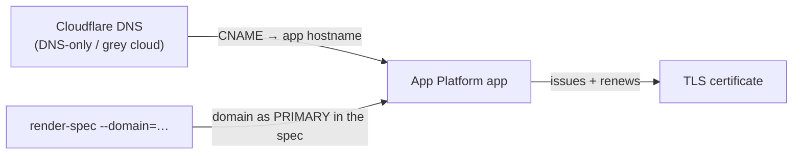

strad's public hostnames are custom domains pointed at a DigitalOcean App Platform
app, with the TLS certificate issued by App Platform itself. DNS is managed in
Cloudflare, **DNS-only** (grey cloud) — Cloudflare is not proxying the gateway.

## The current names

| Environment | Hostname                     | Points at                                |
| ----------- | ---------------------------- | ---------------------------------------- |
| Staging     | `staging.strad.tadasant.com` | `strad-staging-wy9v5.ondigitalocean.app` |
| Prod        | `strad.tadasant.com`         | `strad-prod-qple6.ondigitalocean.app`    |
| These docs  | `docs.strad.tadasant.com`    | `strad.pages.dev` (Cloudflare Pages)     |

The gateway hostnames are **DNS-only**; the docs hostname is **proxied**. That
difference is load-bearing — App Platform can only issue its own certificate if it
sees the real TLS handshake, while Pages needs the orange cloud to serve one.

`gateway.publicUrl` is not cosmetic. It builds the OAuth redirect URI
(`…/console/oauth/callback`) and the `authorize_url` in every
[424 response](/intro/concepts/#the-424-contract). If the hostname is wrong, OAuth
and the fail-closed hints break, so it must match the domain App Platform serves.

## How a gateway domain is wired

1. The domain is passed into the App Platform spec as a `PRIMARY` domain (via
   `render-spec --domain=<host>`, defaulted from `gateway.publicUrl`). Omit it and
   the app falls back to its `*.ondigitalocean.app` hostname.
2. In Cloudflare, a **DNS-only** record CNAMEs the hostname at the App Platform app.
   Cloudflare does not proxy — App Platform terminates TLS, and it can only do that
   if it sees the real handshake.
3. **App Platform issues and renews the certificate** for the custom domain.

The default region is `nyc`.

:::caution[The domain is why staging is archived and not deleted]
Staging is [on demand](/operate/operations/#teardown-stagingyml--put-it-to-sleep),
and the teardown archives the app rather than deleting it. Both halves of the
wiring above are per-app and neither survives a recreation:

- The CNAME target is the app's **own** starter hostname
  (`strad-staging-wy9v5.ondigitalocean.app`), assigned per app after its first
  successful deployment. A recreated app answers on different characters, and the
  record is in Cloudflare — a zone nothing in `tadasant/strad` holds a credential
  for, so fixing it is a human editing DNS.
- DigitalOcean instructs you to remove a custom domain **before** deleting its
  app, because one left attached may keep pointing at the deleted app for up to
  24 hours and be unavailable to a new app meanwhile.

Certificate issuance is the third cost: `strad.tadasant.com`'s certificate carries
`notBefore` 77 minutes after that app was created. An archive keeps the app, so
none of the three applies — the offline page is served over the same live
certificate.
:::

:::danger[An omitted `domains` field deletes the domain]
An App Platform spec update is a **full replace**. Omitting `domains` detaches the
custom domain — and the app stays healthy on its `*.ondigitalocean.app` ingress
while the real hostname fails its TLS handshake, so nothing alerts. This has
happened once, to `staging.strad.tadasant.com`. `render-spec` now always emits
`domains`, but verify the custom domain still serves a 200 after any deploy. See
`HACKS.md` #18.
:::

## This docs site: Cloudflare Pages

The docs are the one hostname Cloudflare **does** proxy, because Pages terminates
TLS at the Cloudflare edge rather than at an origin.

| Setting        | Value                                                                 |
| -------------- | --------------------------------------------------------------------- |
| Pages project  | `strad`, connected to `tadasant/strad`, production branch `main`      |
| Root directory | `docs`                                                                |
| Build command  | `npm ci && npm run build`                                             |
| Build output   | `dist`                                                                |
| Env var        | `SITE_URL = https://docs.strad.tadasant.com` (production and preview) |
| DNS            | `CNAME docs.strad → strad.pages.dev`, **proxied** (orange cloud)      |

Every branch gets a preview deployment, so a PR that changes the docs can be read
before it merges.

`SITE_URL` overrides the `site` value in `docs/astro.config.mjs`, which is what Astro
uses to build canonical URLs and the sitemap. The fallback in that file is the same
hostname, so an unset `SITE_URL` still produces a correct site — but pin it anyway, so
the code and the deployment can't drift apart silently.

:::caution[`SITE_URL` must be an absolute URL, scheme included]
A malformed value (`ttps://…`, say) does not degrade gracefully. Astro passes `site`
to `new URL()` while generating pages, so a bad one fails the build with a bare
`Invalid URL` and a stack trace into Astro's internals — naming neither the variable
nor the value. `astro.config.mjs` validates it up front and throws a message that
says what to fix. If a Pages build dies on this, the typo is in **Settings → Variables
and Secrets**, and it has to be corrected in the production _and_ preview
environments.
:::

Preview deployments get a per-branch `*.pages.dev` hostname while `SITE_URL` stays
fixed, so a preview build emits canonical URLs pointing at production. That is
harmless for previews and expected.
