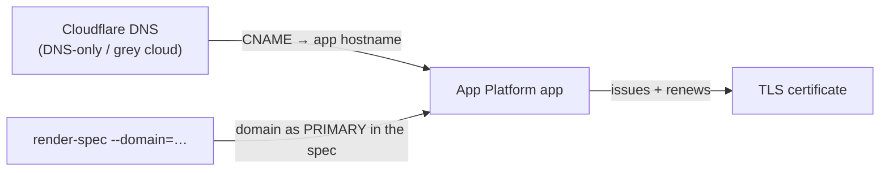

strad's public hostnames are custom domains pointed at a DigitalOcean App Platform
app, with the TLS certificate issued by App Platform itself. DNS is managed in
Cloudflare, **DNS-only** (grey cloud) — Cloudflare is not proxying the gateway.

## The current names

| Environment | Hostname                     | Points at                                  |
| ----------- | ---------------------------- | ------------------------------------------ |
| Staging     | `staging.strad.tadasant.com` | `strad-staging-wy9v5.ondigitalocean.app`   |
| Prod        | `strad.tadasant.com`         | `strad-prod-qple6.ondigitalocean.app`      |
| These docs  | `docs.strad.tadasant.com`    | Cloudflare Pages (**pending** — see below) |

`gateway.publicUrl` is not cosmetic. It builds the OAuth redirect URI
(`…/console/oauth/callback`) and the `authorize_url` in every
[424 response](/intro/concepts/#the-424-contract). If the hostname is wrong, OAuth
and the fail-closed hints break, so it must match the domain App Platform serves.

## How a gateway domain is wired

1. The domain is passed into the App Platform spec as a `PRIMARY` domain (via
   `render-spec --domain=<host>`, defaulted from `gateway.publicUrl`). Omit it and
   the app falls back to its `*.ondigitalocean.app` hostname.
2. In Cloudflare, a **DNS-only** record CNAMEs the hostname at the App Platform app.
   Cloudflare does not proxy — App Platform terminates TLS, and it can only do that
   if it sees the real handshake.
3. **App Platform issues and renews the certificate** for the custom domain.

The default region is `nyc`.

:::danger[An omitted `domains` field deletes the domain]
An App Platform spec update is a **full replace**. Omitting `domains` detaches the
custom domain — and the app stays healthy on its `*.ondigitalocean.app` ingress
while the real hostname fails its TLS handshake, so nothing alerts. This has
happened once, to `staging.strad.tadasant.com`. `render-spec` now always emits
`domains`, but verify the custom domain still serves a 200 after any deploy. See
`HACKS.md` #18.
:::

## This docs site: Cloudflare Pages

The docs are the one hostname Cloudflare **does** proxy, because Pages terminates
TLS at the Cloudflare edge rather than at an origin.

:::caution[Not stood up yet]
Creating the Pages project and its DNS record is a human step — an agent session has
read-only Cloudflare access, and DNS writes on this zone are supervised. The settings
below are the target, matched to how `docs.zimmer.tadasant.com` is wired today. Until
someone creates the project, the `docs_site` CI job is what keeps this site honest,
and you read it locally with `cd docs && npm run build && npm run preview`.
:::

| Setting        | Value                                                                 |
| -------------- | --------------------------------------------------------------------- |
| Pages project  | `strad`, connected to `tadasant/strad`, production branch `main`      |
| Root directory | `docs`                                                                |
| Build command  | `npm ci && npm run build`                                             |
| Build output   | `dist`                                                                |
| Env var        | `SITE_URL = https://docs.strad.tadasant.com` (production and preview) |
| DNS            | `CNAME docs.strad → <project>.pages.dev`, **proxied** (orange cloud)  |

`SITE_URL` overrides the `site` value in `docs/astro.config.mjs`, which is what
Astro uses to build canonical URLs and the sitemap. The fallback in that file is the
same hostname, so an unset `SITE_URL` produces a correct site — but pin it anyway,
so the code and the deployment can't drift apart silently.

Preview deployments get a per-branch `*.pages.dev` hostname while `SITE_URL` stays
fixed, so a preview build emits canonical URLs pointing at production. That is
harmless for previews and expected.
