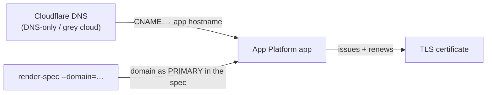

strad's public hostname is a custom domain pointed at a DigitalOcean App Platform
app, with the TLS certificate issued by App Platform itself. DNS is managed in
Cloudflare, **DNS-only** (grey cloud) — Cloudflare is not proxying.

## The current names

| Environment | Hostname                                      | Notes                                              |
| ----------- | --------------------------------------------- | -------------------------------------------------- |
| Staging     | `https://staging.strad.tadasant.com`          | `gateway.publicUrl` in `infra/strad.staging.yaml`. |
| Prod        | `https://strad-prod-qple6.ondigitalocean.app` | Custom domain `strad.tadasant.com` is DNS-pending. |

`gateway.publicUrl` is not just cosmetic — it is used to build the OAuth redirect
URI (`…/console/oauth/callback`) and the `authorize_url` in every
[424 response](/intro/concepts/#the-424-contract). If the hostname is wrong, OAuth
and the fail-closed hints break, so it must match the domain App Platform serves.

## How a custom domain is wired

1. The domain is passed into the App Platform spec as a `PRIMARY` domain (via
   `render-spec --domain=<host>`). Omit it and the app uses its default
   `*.ondigitalocean.app` hostname.
2. In Cloudflare, a **DNS-only** record points the hostname at the App Platform
   app. Cloudflare does not proxy — App Platform terminates TLS.
3. **App Platform issues and renews the certificate** for the custom domain.

The default region is `nyc`.

## Hosting these docs — a follow-up

This documentation site is **not yet hosted**. Standing up
`docs.strad.tadasant.com` is deliberate future work and needs:

- A **Cloudflare DNS** record for `docs.strad.tadasant.com` (DNS-only), and
- A static-site deploy for the built `docs/dist/` output — either an **App
  Platform static site** or a **Cloudflare Pages** deploy (the `SITE_URL`
  build-time override in `astro.config.mjs` already anticipates Pages'
  per-branch preview hostnames).

Until then, the site is built and served **locally** (`npm run build && npm run
preview`), which is all this phase set out to prove.
