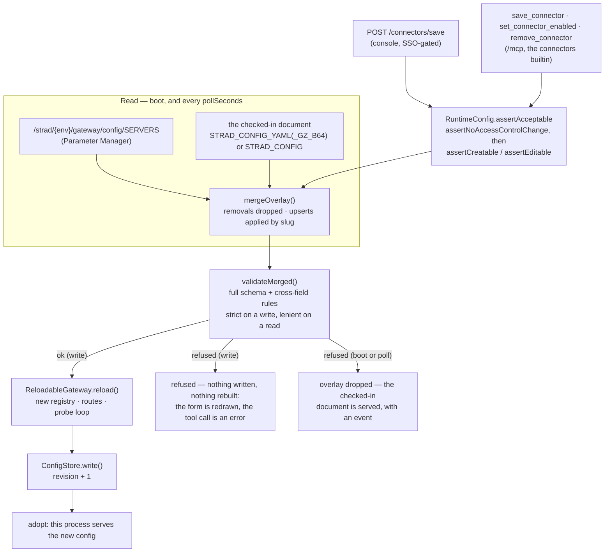

A strad config is one document, validated at boot, changed by a deploy. That is
the right shape for everything in it except the server roster, which is the part
a human wants to change while they are thinking about it: add a connector, point
it somewhere, use it.

`gateway.configStore.enabled` adds a second layer for exactly that part. Core
reads an **overlay** — a small document holding only the differences to
`servers:` — merges it over the checked-in one, and serves the result. The
console at `/connectors` writes it, and so does the `connectors` builtin over
`/mcp` on a deployment that mounts it. A change takes effect on the next
request: no redeploy, no restart, and no step performed by hand on a container.

It is **off by default**, and off means the behaviour described everywhere else
in these docs, unchanged.

```yaml
gateway:
  env: prod
  secrets:
    provider: gcp-parameter-store # required — see below
  configStore:
    enabled: false # default
    pollSeconds: 60 # default; floor 10, ceiling 86400
```

## The overlay is a diff, not a replacement

The stored document holds two lists: `upserts`, entries to add or to override a
checked-in entry of the same slug, and `removals`, slugs in the checked-in
document to drop.

An overlay that held the whole config would make the checked-in file decorative
the moment anyone pressed Save, and a deployment's YAML would stop describing
what it runs. A diff keeps the file authoritative for everything nobody has
touched, makes "what did the console change?" a question with a short answer,
and makes an **absent** overlay byte-for-byte the same roster as no overlay at
all — which is what keeps this off the existing path for every deployment that
leaves it off.

The merge happens at the **document** level, before Zod ever sees it
(`src/config/overlay.ts`). The overlay carries raw entries as they were written,
not parsed ones, so defaults are applied exactly once — by the root schema, to
the merged document. A stored entry can never carry a default baked in by the
image version that wrote it, and an older image reading an overlay a newer one
wrote applies its own defaults. That is what a rollback needs.

Position is preserved. A replacement lands where the original was; only a
genuinely new slug is appended. `registry.slugs` is in config order, the console
roster sorts from it, and a selection is reported in it, so an edit that moved an
entry to the bottom would reshuffle pages nobody asked to reshuffle.

## Where the document lives

One non-secret parameter, in the same store the secrets provider already reads:

```
/strad/{env}/gateway/config/SERVERS
```

```json
{
  "version": 1,
  "revision": 7,
  "updatedAt": "2026-09-11T18:04:22.114Z",
  "updatedBy": "someone@example.com",
  "servers": {
    "upserts": [{ "slug": "gmail-personal", "kind": "remote-http" }],
    "removals": ["deepwiki"]
  }
}
```

`version` is the overlay format's own version, not strad's config version.
`revision` advances by one on every write and is what the concurrency check
compares. `updatedBy` names the door the write came through: a console identity,
or `mcp` for a write made by a tool call. It is never a credential and never a
value.

A row per server would be the obvious shape and is the wrong one: the roster's
invariants are cross-entry (slugs are unique, a bundle is declared, two servers
may not mint from one refresh token), so a write has to be atomic across the
whole thing or the config can be observed in a state the schema forbids. One
parameter, one version, one write.

The stored document is capped at **64 KiB** (`MAX_OVERLAY_BYTES`), the same bound
the [parameter write-back
route](/operate/secrets/#paramswritable--a-credential-that-rotates-on-use)
applies to a value arriving over the private network. One number in the
deployment rather than two. A roster large enough to reach it is a roster that
belongs in the checked-in document.

Note the namespace: `/strad/{env}/gateway/config/`, not
`/strad/{env}/gateway/static/`. A parameter under `static/` is a candidate for
every `${NAME}` the config references; the overlay is a document, and putting it
one segment away means it can never resolve as one.

## The credentials are the ones core already holds

Nothing new is provisioned for this feature.

| Operation | Credential                                                              | Where it is                                 |
| --------- | ----------------------------------------------------------------------- | ------------------------------------------- |
| Read      | the **resolver** key (`STRAD_PARAMS_RESOLVER_SERVICE_ACCOUNT_KEY_JSON`) | every store-backed container already has it |
| Write     | the **admin** key (`SECRETS_ADMIN_SERVICE_ACCOUNT_KEY_JSON`)            | core only, delivered by `consoleEnv:`       |

A deployment that holds the resolver key and not the admin key gets a **read-only
roster page that says so** — the entries it is serving, where each came from, and
a banner naming the credential that is missing. That is the correct answer for a
component that should not be editing config anyway.

Reading costs two API calls per poll per core instance: Parameter Manager has no
`latest` alias, so a read lists the versions and gets the ranked one. It
deliberately does not go through the day-old process snapshot the secret
provider slices — a day-stale roster is not a roster.

### It requires `gcp-parameter-store`

`gateway.configStore.enabled: true` under `gateway.secrets.provider: env` is a
**config error**, refused by the schema's `superRefine`, not a silent no-op:

```
gateway.configStore.enabled requires gateway.secrets.provider: gcp-parameter-store
(got "env"). The runtime server overlay is stored as a parameter, and the env
provider has no store to write it to.
```

Under the `env` provider there is no store client, no credential and nowhere to
put a write. A console whose Save button looks like it worked and vanishes at the
next restart is worse than no console at all.

### Core only

Bundles do not read the overlay. The kinds it can add are mounted by core and by
nothing else, a bundle mounts only the builtins compiled into its image, and no
overlay entry can produce one of those. A bundle reading this would be a store
read per interval to learn about servers it does not serve.

## The path a change takes



The order is **validate, rebuild, store, adopt**, and each position is load-bearing.
A refusal at validation changes nothing. A rebuild that throws leaves the process
serving exactly what it was serving, because the new instance is never assigned.
The store write is second-to-last on purpose: storing first and failing to rebuild
would leave a document the next boot picks up and dies on, and a config change
that works until you restart is the worst of the available failures.

`apply` and `poll` are serialised against each other in the process, so two
console tabs, or a tab and a tool call, cannot interleave a rebuild.

### The socket outlives the rebuild

`http.createServer` is handed a stable dispatch function, and the gateway behind
it is replaced by an atomic pointer swap (`src/gateway/reload.ts`). Nothing about
the listening socket changes, so in-flight connections are undisturbed and the
next request routes on the new roster.

The outgoing registry is **drained**, not closed: its adapters hold live MCP
connections, and a request that was mid-`tools/call` when the swap happened is
still holding one. It is closed 30 seconds later. That window only has to outlast
a request already in flight, and every adapter carries its own `timeoutMs`
(120s by default), so a call still running at the end of it gets its transport
closed — the same thing a redeploy would have done to it.

### Lenient on the way in, strict on the way out

| Path    | Validation                        | A document that does not pass                                     |
| ------- | --------------------------------- | ----------------------------------------------------------------- |
| Boot    | full schema, unknown keys allowed | dropped; the checked-in document is served, with an event         |
| Poll    | full schema, unknown keys allowed | not adopted; the process keeps serving what it has, with an event |
| A write | full schema **and** unknown keys  | refused before anything is stored, with the reason                |

The split is the same argument `src/config/strict.ts` makes about a deploy. On a
write the caller is standing in front of the answer, so a key the schema does not
know is an error they can fix in five seconds. On a boot, an unreadable,
malformed or no-longer-valid overlay must not take the gateway down: a gateway
that refuses to start because of something a console wrote is a gateway one bad
edit can break permanently, and the point of keeping the file authoritative is
that it is always there to fall back to. The poll picks up a store that recovers,
so a dropped overlay is a delay rather than a dead end.

Because the whole merged config is validated, a refusal can name a rule about a
**different** entry — a duplicate slug, a role nothing declares, two servers
minting from one refresh token.

### Two writers can still lose one

The console form carries the `revision` it rendered. A Save whose revision no
longer matches is refused with **409** and nothing is written:

> The roster changed while this form was open. This form was built on revision 6;
> the gateway is now on 7. Nothing was written. Reload the roster and re-apply
> your change.

The write tools take the same revision as `expectedRevision`, optionally; see
[below](#expectedrevision-is-optional). Either way it
catches the collision a human actually causes — a second tab, a second console
process. It is **not a lock on the store**: Parameter Manager has no
compare-and-swap, so two writes landing inside one read-modify-write window can
still lose one. What bounds it is that there is one writer in practice, a human
in a console. See [Known limitations](/limitations/) #93.

## What can be added, and what cannot

The boundary is enforced in `src/config/overlay.ts`, on the write path, before
the merge is validated — so the message names the thing you can change rather
than the schema error it would eventually cause.

| Kind                  | Creatable at runtime, from either door                                                                                     |
| --------------------- | -------------------------------------------------------------------------------------------------------------------------- |
| `remote-http`         | Yes, fully.                                                                                                                |
| `local-tunnel`        | Yes, fully.                                                                                                                |
| `supplementary-image` | Against a mount this deployment already runs with no deploy-only field, or as a store-served instance with `params: true`. |
| `builtin`             | Never.                                                                                                                     |

`remote-http` and `local-tunnel` are unhosted: `renderAppSpec` skips them
entirely, so they occupy no container, no component and no deploy-time
environment. Everything they need is config data and a `${NAME}` the store
already resolves per request. The registry can build an adapter for one and the
next request uses it.

A `builtin` cannot ever be added here: `loadBuiltin` dynamic-imports `module:`
out of the running image, so a builtin nobody compiled in has nothing to load.

A `supplementary-image` is the interesting case. A **new slug pointed at a mount
that is already deployed** works — that is the `gmail-ro` / `gmail-rw` pattern,
two entries on one `path:` differing only by `tools:` — because the adapter is an
HTTP call to a container that is already running. Three conditions:

- the entry's `bundle:` is declared under `bundles:` in the checked-in config;
- that bundle's component is reachable from this process, meaning the deploy has
  bound its private URL;
- the entry declares **none** of `env`, `params`, `paramsWritable`,
  `paramsRefresh`, `consoleEnv`, `consoleStores`, `mcpStores`;
- and **none** of `confirmations`, `confirmationHeaders`, `skipConfirmations`.

The first seven are baked onto the container at render time and fixed at
process spawn. A value added here would be a variable nothing on that container
ever reads, so the save is refused rather than accepted and quietly ignored.

The last three are refused for a different reason. `confirmations:` hands a
caller's approval URL to a mount. `confirmationHeaders:` sends a value core
resolves out of the store to that URL, a path the caller picks under
`gateway.elicitation.allowedUrlPrefixes`. A roster write could otherwise aim any
`${NAME}` the namespace or the shared layer resolves off the box, so where a
stored credential is sent is left to the checked-in config
([confirmations](/servers/confirmations/#the-edge-in-front-of-the-approval-url)).
`skipConfirmations:` takes the human out of a confirmed tool, which is the same
kind of decision.

**The one supplementary shape that brings its own credential is a store-served
instance**: `path: /_instance/{tree}/{its own slug}` for `telegram`,
`google-sheets` or `grafana`, with `params: true`. Nothing about it is baked, so
nothing needs a deploy — the bundle host learns about it from core and reads its
credentials out of its own namespace (see [Store-served
instances](/operate/secrets/#store-served-instances--a-mount-credentialed-from-its-own-namespace)).
On one, `params: true` is accepted and the other six are still refused, each for
its own reason: `env:` and `consoleEnv:` would be baked where no instance reads
them, `paramsRefresh:` repeats what every sync does, no instance tree writes a
credential back, and the store declarations belong to the secrets server.

So "add a second account and use it" works for those three trees: seed the
credential under the new slug's namespace in `/ui/secrets` (or complete its
connector's consent), save the entry, and the next request for it is served. For
a tree that reads `process.env` once at start-up — gmail, calendar, docs and most
third-party images — it still does not, and no runtime config changes that: a
second credential there needs a second process.

### What an edit may not move

| On a…                 | Frozen                                                                                                                     |
| --------------------- | -------------------------------------------------------------------------------------------------------------------------- |
| anything              | `kind`                                                                                                                     |
| `supplementary-image` | `image`, `bundle`, `path`, the seven deploy-only fields above, `confirmations`, `confirmationHeaders`, `skipConfirmations` |
| `builtin`             | `module`, `bundle`, `params`                                                                                               |

A `remote-http` server's `url:` is re-pointable, because the adapter resolves it
per operation. A supplementary server's `image:` is not: the image is what the
App Platform component is running, and only a deploy changes that.

`path:` is frozen for a different reason, and it is the sharper one. A bundle is
one container serving many mounts, each with the credential the deploy baked in
for it and each fronted by its own slug with its own `entitlements:` and its own
`tools:`. Re-pointing a slug's `path:` at a neighbouring mount inherits
**neither** of that neighbour's protections: an allow-list stays attached to the
slug that declares it, while the credential on the other end does not. So a
widely-entitled slug that could be re-pointed at a narrowly-entitled mount is
that mount's access control undone — and since `?servers=` is a filter and not
an authorization, everyone the re-pointed slug's roles name can reach it. Point
a **new** slug at the mount you want instead; that is the `gmail-ro` /
`gmail-rw` pattern and it still works.

For a slug the checked-in document declares, the three fields that decide WHICH
UPSTREAM it is — `kind:`, and a supplementary `bundle:` and `path:` — are bound
however the write arrives — see
[below](#a-runtime-write-cannot-move-access-control-the-deploy-authorised).

### Removing

Two different deletions wear one verb on the roster page. Removing an entry the
console **added** drops its upsert, and the roster returns to what the file says
— which, for a slug the file never named, is nothing. Removing an entry the
**file** declares records a removal: a standing instruction to subtract it from
the checked-in roster, which survives until someone deletes it from the file or
re-adds it through the console.

## Who may write, and what a write may reach

Three layers decide **who** may make a runtime write: what the process can do at
all, the `tools:` policy on the slug that carries the write tools, and that
slug's `entitlements:`. They are described [below](#three-layers-decide-what-a-caller-can-reach),
and all three gate the door. None of them says anything about the **content** of
a write that comes through it, and the content is chosen by the caller: the
field names, the URL they are interpolated into, the roles on the entry. Four
bounds cover that half.

### A runtime-authored entry reads only its own namespace

An ordinary server's `${NAME}` refs resolve down a chain: the slug's own
`/strad/{env}/mcp/{slug}/static/` namespace first, then the shared provider —
the gateway namespace, then the process environment. For an entry a deploy put
in the config that is right. A human wrote the ref and a human reviewed where it
points.

For an entry authored at runtime it is wrong, because the caller of the write
chooses both the name and the URL it lands in. A connector at
`https://elsewhere.example/?k=${SOME_NAME}` would resolve `SOME_NAME` all the
way down to core's process environment — which holds the store's own admin and
resolver keys — and send the result off-box on the first tool call. That path
was verified reachable before the fix: an end-to-end probe against a local sink
received the value.

`forServerIsolated` in `src/secrets/provider/index.ts` closes it. A slug the
overlay authored resolves against that slug's own namespace and nothing else, so
it reads the values somebody filed under it and no others. `src/gateway/registry.ts`
picks the provider per slug from the roster's source map, and the registry is
rebuilt on every roster change, so that set is never stale. Under the `env`
provider the isolated provider resolves nothing at all — fail closed, and
unreachable anyway, because `gateway.configStore:` requires the store provider.

The bound is about provenance, not about the ref syntax. A `${NAME}` in an entry
the checked-in document declares keeps resolving down the full chain exactly as
it did.

### A runtime write names a credential, it never carries one

The overlay is a **non-secret** parameter — `src/config/store.ts` creates it with
`secret: false`, because a server roster is not a secret. So a credential typed
into a connector and saved would be a credential at rest in the clear, handed
back by every read of the roster. `src/config/secret-position.ts` refuses it on
the way in.

The rule is that a credential-carrying value must be a **reference**: one
`${NAME}`, optionally introduced by an auth scheme — `Bearer`, `Basic`, `Token`,
`Bot` or `ApiKey`. That is the shape every `headers:` value in this repo's configs
already has:

```yaml
headers:
  Authorization: "Bearer ${GRANOLA_TOKEN}" # accepted
  CF-Access-Client-Id: "${ANKI_CF_ACCESS_CLIENT_ID}" # accepted
  X-Api-Key: "abc123" # refused
```

It covers `headers:` on every kind that has one, `url:`'s userinfo (the
`user:password@` before the host), and `oauthRefresh:`'s `clientSecret` and
`refreshToken` — which the schema already bound to exactly one `${NAME}`, and
which the runtime path refuses earlier and with a message that names the fix.

A **literal that is not a secret is refused too**. `Notion-Version: 2022-06-28`
is harmless and strad cannot tell it from `sk-live-…`; a rule that tried would
be a heuristic wearing a guarantee's clothes. The escape is the one the product
already has — put the value in the slug's own namespace as an ordinary
non-secret parameter and reference it. Both doors can do that, so it costs a
step rather than a deploy.

Two positions are **not** covered, and the reason is the same in both: a
ref-only rule there would refuse the ordinary case. A **URL query parameter**
(`?key=abc`) is a literal credential and is accepted, because there is no way to
tell it from `?version=2` without refusing every URL that carries a query at
all — userinfo is different, because `user:pass@` is a credential by definition.
And a **builtin's `options:`** is an untyped bag whose normal contents are
non-secret literals; a builtin cannot be created at runtime, so the reachable
surface there is editing the options of one the checked-in document declares.
Both are in [Known limitations](/limitations/) #96.

The check runs twice, on purpose. `RuntimeConfig.assertAcceptable` judges the
entry a caller composed, which is what attaches the refusal to the field the
human is looking at. `RuntimeConfig.apply` then judges everything the write
would newly place in the store — because `toggle` and `set_connector_enabled`
re-upsert an entry read straight out of the merged document, so without it a
literal in a checked-in `headers:` would be copied into the overlay by a button
that only meant to disable something.

The second check is scoped to what a write **changes**. A literal already in the
stored overlay is still served — boot and poll stay lenient on purpose, so that
an image rollback cannot be taken down by something a console wrote — and
refusing every later write because of it would let one old entry freeze the
roster. It is refused on the next write that touches its entry, which is where
somebody can act on it.

That includes **disabling** it. Disable re-upserts the entry with `enabled:
false`, so a connector carrying a literal — a checked-in one or a stored one —
cannot be disabled from either door until its value is moved into the store.
**Remove** is always allowed: it stores no entry, so there is nothing to judge,
and it is the way to stop serving a connector nobody can fix right now. The
refusal says so.

### A runtime write cannot move access control the deploy authorised

`entitlements:` and `tools:` are strad's two access-control decisions: who
reaches a server, and which of its tools they get there. The slug's **upstream
identity** is the third, because it decides the same thing from the far end —
which upstream, and so which of the container's credentials, the slug's roles
actually reach. That is `kind:` on any entry, plus `bundle:` and `path:` on a
supplementary one. On a slug the checked-in document declares, a runtime write
may not move any of them. `assertNoAccessControlChange` in
`src/config/overlay.ts` refuses it, and both doors refuse it the same way — a
`409` in the console, an error result from `save_connector` — because both call
`RuntimeConfig.assertAcceptable`.

The two halves of a [flow-through](/servers/flow-through/) grant, `reaches:`
and `reachableFrom:`, are bound harder than that. A runtime write may not declare
or change either one on **any** slug, including one only the overlay declares.
Its value must equal the checked-in entry's, which for an overlay-only slug is
none. A grant lets one server call another's tools as itself, and a roster
editor that could write either half could write the pair.

`kind:` is in that set because a checked-in `local-tunnel`, re-created as a
`supplementary-image`, is the `path:` move wearing a different field: the slug
name keeps the reach the deploy granted it while the thing on the other end
becomes a mount nobody granted. All three identity fields were already frozen on
the **edit** path by `immutableFields`, so binding them here costs no workflow —
it makes a move that is refused as one call refused as two.

For a server the deploy authorised, that authority stays with the deploy. The
rule is keyed on the checked-in document rather than on edit-versus-create,
deliberately: removing a file-declared slug and re-creating it through the
overlay is structurally a create, so a rule that only bound edits would be walked
around with two calls instead of one. A slug the file names stays bound however
the write arrives, and stays bound while a removal against it is standing.

A slug only the **overlay** declares is unbound. Giving a connector you just
created a role is the feature, and nothing in the checked-in document is being
overruled. Every other field on a file-declared entry still moves — `url:`,
`title:`, `timeoutMs:`, `enabled:` — and the comparison ignores ordering,
absent-versus-empty and `path:`'s `/mcp` default, so re-saving an unchanged
entry is never a refusal.

The console does not render a control the save path would reject. On a
file-declared entry the role checkboxes and both `tools:` fields are **disabled**,
with the reason beside them; on any supplementary edit, so are `image:`,
`bundle:` and `path:`. A disabled input submits nothing, so the save hands those
fields back to the entry being carried rather than reading an empty form as "the
human cleared the roles".

### A runtime write reaches no mount its author cannot already reach

The three bounds above are about the **content** of a write. This one is about
its **author**, and it is what lets the write tools be granted to a role narrower
than the one that may reach everything.

Without it, the write tools are worth admin access to every mount in a declared
bundle, whatever narrower `entitlements:` and `tools:` the writer's own slugs
carry. A slug only the overlay declares is unbound by design — giving a connector
you just created a role is the feature — so one `save_connector` call creates a
`supplementary-image` entry on the `path:` of an admin-only mount, entitled to the
writer's own role, carrying no `tools:` of its own. It serves that mount's whole
tool surface under the credential the deploy baked onto the container.

`assertWithinReach` in `src/config/overlay.ts` bounds it, in two places:

- **A new supplementary slug** may only land on a `bundle:` + `path:` its author
  **already reaches** through a slug the checked-in config declares. It is asked
  on a create, which is where a mount is chosen; an edit cannot move a mount,
  because `immutableFields` freezes `bundle:` and `path:` on every supplementary
  edit.

  A **store-served instance on its own path** is the exception, because it
  reaches no mount a deploy credentialed: `/_instance/` is a prefix no
  conventional mount has, and the instance holds its own namespace and nothing
  from the container. It is asked something weaker instead — that the author
  reaches **some** checked-in slug on that component — because an instance still
  runs a server inside a container, and a writer the deploy gave no part of that
  container has no business placing one there.

- **A credential's destination on a checked-in slug** may only be moved by an
  author that slug's `entitlements:` admit. These fields cannot simply be frozen
  — re-pointing a quick tunnel without a deploy is a reason the roster is
  editable at all — but what they name is a host strad sends a credential to, so
  moving one on a slug you were never granted reaches a credential you were never
  given.

There are **four** destination fields, not one, and the difference matters:
`url:`, `oauthRefresh.tokenUrl`, and a connector's `oauth.tokenUrl` and
`oauth.authorizeUrl`. `url:` is the obvious one — the slug's `headers:` follow it.
The OAuth endpoints carry a better credential than the bearer they mint:
`oauthRefresh.tokenUrl` is POSTed the **client secret and the long-lived refresh
token** on every mint, and a connector's endpoints carry the console's consent
exchange. A bound that watched `url:` alone would be one field wide — the same
write, aimed one key over, still walks the credential off-box. `oauth:` is
declared on every server kind, so this bound is **not** scoped to the unhosted
ones: a `supplementary-image` can carry a connector too.

Reach is measured against the **checked-in** config, not the merged roster: an
overlay entry's own `entitlements:` were written by a runtime write, so letting
them vouch for what the next write reaches would be circular. It is the same
two-way intersection `/mcp` computes — a role names the slug, and the slug's
`entitlements:` name the role — minus the `enabled` filter, because the question
is what the deploy **authorised** rather than what is switched on today.

Both doors supply the author: the console hands over the signed-in session, and
the `connectors` builtin hands over the principal that authenticated the `/mcp`
request. That is what `RuntimeConfig.assertAcceptable` gained a third argument
for.

**This narrows nobody who could already reach everything.** A role written
`servers: ["*"]` whose slugs all name it reaches every mount a deployment
declares, so neither half ever fires for it — adding a second slug to a deployed
mount and re-pointing a quick tunnel both work exactly as before. What it removes
is the case the bound exists for: a **narrower** writer reaching past what the
checked-in config gave it.

**What it deliberately does not do**, in two places.

It does not carry the `tools:` policy along. The bounds are measured in mounts,
so a writer that already reaches a mount may create a second slug on it with a
**wider** tool surface than the checked-in slug it reaches that mount through — a
role given read-only access to a container can hand itself the write tools on it.
Closing that would also narrow the role that reaches everything, on any mount
whose only checked-in slug is the narrow one: it could no longer create the wider
half of a `-ro` / `-rw` pair without a deploy. That is a workflow traded against a
residual widening rather than a free tightening, so it is an operator's decision.
It was taken on 2026-09-13 in favour of keeping the workflow, and it comes back
if a `connectors` write tool is ever granted to a role other than `admin`:
[the runtime-config plan](/operate/runtime-config-plan/) carries both the
decision and that condition as the open half of phase 2.

And it does not bound **disable and remove**. Those two tools compose no entry,
so they never reach `assertAcceptable` at all: a writer holding them can disable
or remove any connector in the roster, including one it cannot reach. That is
availability rather than disclosure — nothing is served that was not served
before, a removal of a checked-in slug is a standing instruction the console
shows and `restore_connector` undoes, and refusing a removal is what would leave
a broken connector nobody can switch off. Worth knowing before the write tools
are granted to a narrow role: it bounds what a write may **reach**, not what a
writer may **stop**.

## The console flow

`/connectors`, behind the same Google Workspace SSO gate as the rest of the
console, and one of the four destinations on its [shared nav
bar](/auth/overview/#what-the-console-serves-and-how-you-get-between-the-pages).
It is at the top level rather than under `/ui` because `/ui/:server` is a
wildcard — `/ui/connectors` would be one config entry away from being shadowed by
a server that happens to be called `connectors`.

**It is also the console's only view of the servers.** The roster, each entry's
scope, and whether the secrets it needs are seeded are all on this page; `/ui` and
`/secrets`, which used to carry the second and third renderings of that same list,
are `302`s to it. What that means for this page is that the roster half is served
on **every** deployment, including one that sets no `gateway.configStore:` — every
row, every badge, every popout. Only the **editor** needs a store, and where there
is none the page says so in place of the controls rather than withholding the
whole view.

1. **`/connectors`** lists every entry the gateway is serving, grouped **needs
   attention**, **inactive**, **unverified**, **ready**, then **disabled** — issues first, because the
   entries something has to be done about are why anyone opens it. A row carries
   the name (linking to that server's own `/ui/<slug>` page), the slug where a
   `title:` differs from it, a source chip (`console` or `config file`, and only
   where there is a runtime holder to ask), the kind and roles it is scoped to,
   its `READY` / `ISSUE` / `INACTIVE` / `UNVERIFIED` [secret badge](/operate/secrets/#four-badges-and-where-they-sit) with the popout behind
   it, and a playground and copy-URL icon where each is offered. Edit,
   Enable/Disable and Remove join them **only** where the store exists and can be
   written. Above the table, beside the counts, sits the roster's
   provenance: `runtime roster · revision N` with who last changed it and when,
   or `roster from the checked-in config` where there is no store.
2. **Removed** lists the slugs the checked-in config declares and the overlay
   subtracts, each with a Restore. A standing instruction to subtract something
   has to be visible to whoever reasons about the file.
3. **Add a connector** offers the three creatable kinds, each with what it can
   and cannot do.
4. **Copy from an existing entry of the same kind** is optional and is a GET, so
   the prefilled form is a bookmarkable URL and a reload re-posts nothing. It
   copies every field except the slug, which is how a second account or a
   narrower tool policy starts from one that already works.
5. **Fill in the form.** Fields are read and written **raw** — what somebody
   wrote, not what Zod filled in around it. Fields the form does not render are
   carried through untouched, so "change the title" never means "delete four
   fields".
6. **Save.** Validated, rebuilt, stored, adopted. A refusal redraws the form with
   what you typed still in it and the reason above it.

No secret is typed into this form. Anything credential-shaped is a `${NAME}` ref,
created on that server's own [secrets page](/operate/secrets/) and resolved from
the store on every call.

## The same roster, over `/mcp`

The console is one door onto the roster. The other is a builtin MCP server,
`src/servers/connectors.ts`, which puts the same roster in front of an agent in
the middle of a session. "Add a connector for this API and use it" is a thing a
session gets asked to do, and a version of it that needs somebody to open a
browser stalls.

It is opt-in: nothing mounts it unless a config entry names it, and a deployment
that wants it adds one like any other builtin's:

```yaml
servers:
  - slug: connectors
    kind: builtin
    module: "./servers/connectors.js"
    bundle: core
    entitlements: [admin]
```

### The tools

Three read:

| Tool                               | What it answers                                                                                                                                                                                                                                                                    |
| ---------------------------------- | ---------------------------------------------------------------------------------------------------------------------------------------------------------------------------------------------------------------------------------------------------------------------------------- |
| `list_connectors`                  | every entry this gateway serves — slug, kind, source (`file` or `store`), enabled, roles, title, `tools:` — plus the roster's `revision` and `writable`, whether this process can persist a change.                                                                                |
| `get_connector`                    | one entry exactly as it is written: the fields somebody set, not the defaults the schema fills in around them, with `immutableFields` for its kind. It is also how you copy one — take the returned entry, change the slug and whatever else differs, hand it to `save_connector`. |
| `describe_connector_authorization` | what it takes to credential one connector, and which half a human owns. See below.                                                                                                                                                                                                 |

Three write:

| Tool                    | What it does                                                                                                                                                                       |
| ----------------------- | ---------------------------------------------------------------------------------------------------------------------------------------------------------------------------------- |
| `save_connector`        | creates an entry, or replaces one that exists. `previousSlug` makes it a rename; without it the old slug is left behind as a second entry. `expectedRevision` is optional — below. |
| `set_connector_enabled` | turns an entry off without removing it. It stays in the roster and stops being routed, and a client that selects it is told it is disabled rather than that it does not exist.     |
| `remove_connector`      | drops an entry added at runtime, or records a removal against one the checked-in file declares. The same two deletions the roster page's one verb covers.                          |

A write that lands is live on this gateway when the call returns: the next
`/mcp` request can select the new slug. Everything after the tool schema is the
console's path — the same validation, the same rebuild, the same drain — because
it is the same call.

### Three layers decide what a caller can reach

None of them is new machinery.

1. **What the process can do.** The server's `visibleTools` derives its list from
   the roster holder. A gateway without `gateway.configStore.enabled` lists
   nothing at all: its servers come from the checked-in document, so there is
   nothing here to read or write that `tools/list` on the gateway does not
   already say. A gateway that can read the overlay and not persist a change —
   the resolver key, no admin key — lists the three read tools and not the three
   write ones. That is the read-only roster page's answer, in tool form, and the
   same shape the `secrets` server derives from its IAM probe. A tool that is
   listed and refuses every call is worse than one that is absent.
2. **The `tools:` policy on the slug.** An `allow:` naming only the three read
   tools mounts the read half and nothing else.
   `src/gateway/toolPolicy.ts` enforces it on `tools/list` **and** on
   `tools/call`, so the write tools are missing from the list and refused on the
   call. A second switch in `options:` would be a second answer to the same
   question.
3. **The slug.** It carries its own `entitlements:`, and a deployment that does
   not want an agent editing its roster does not mount it.

All three gate the door. What a write that comes through it may reach is bounded
separately, by the four bounds in [Who may write, and what a write may
reach](#who-may-write-and-what-a-write-may-reach) — and the last of those is the
one that reads WHO came through the door, rather than only what they sent.

### One set of rules, both doors

`RuntimeConfig.assertAcceptable` decides what may be created and what may be
edited, and both doors call it: the console form, and `save_connector`, over the
same rules in `src/config/overlay.ts`. `RuntimeConfig.apply` validates the whole
merged document either way. Two implementations of "may I add this" would be two
answers, and the one a human saw and the one an agent saw would eventually
differ.

So everything on this page about what can be added, what an edit may not move,
and what a refusal can name holds for a tool call exactly as it holds for the
form.

### `expectedRevision` is optional

The console form was rendered from a revision, so it always has one to carry and
a stale Save is a `409`. A tool call has no such history. An agent creating an
entry from scratch never read the roster and has nothing to be stale about, and
making it fetch a revision for the sake of fetching one buys nothing. So the
three write tools **accept** `expectedRevision` rather than require it:

- supplied, and the roster has moved since, the write is refused and nothing is
  written;
- omitted, the write applies to whatever the roster is when the call arrives.

Supply it whenever you read before you wrote. `list_connectors` and
`get_connector` both return the `revision` to pass back.

Neither door is a lock on the store. Parameter Manager has no compare-and-swap,
so the cross-process window described above is the same for both. See
[Known limitations](/limitations/) #93.

### The OAuth leg is a handoff, not a flow

`describe_connector_authorization` does not perform an OAuth flow, and cannot:
granting consent is a browser handshake with the provider, and an agent has no
browser. A tool that claimed to do it would be a tool that lies. What it returns
instead is the handoff, computed from the config entry alone:

| Field            | What it is                                                                                                                                                               |
| ---------------- | ------------------------------------------------------------------------------------------------------------------------------------------------------------------------ |
| `flow`           | `google-connector` (the [Connect button](/operate/connectors/) on the console page), `oauth-refresh` (strad mints access tokens from a stored refresh token), or `none`. |
| `completedBy`    | `human`, or `null` when there is no flow to complete.                                                                                                                    |
| `humanUrl`       | the console page where a person finishes, built from `gateway.publicUrl`. A gateway that declares none gets the path, and is told that is all it has.                    |
| `credentialPath` | where the resulting credential is read from: `/strad/{env}/mcp/{slug}/static/{VARIABLE}`.                                                                                |
| `instructions`   | what to say to the person, in words.                                                                                                                                     |

The agent's job is to put `humanUrl` and `credentialPath` in front of the person
it is working with, and carry on. Whether the credential is actually there is a
different question with a different door — the [secrets
surface](/operate/secrets/) — and this tool reports what the config asks for,
not what the store holds.

## Telemetry

Three events, on the [allowlisted event
channel](/operate/telemetry/):

| Event                        | Fields                                       | When                                       |
| ---------------------------- | -------------------------------------------- | ------------------------------------------ |
| `strad.config_applied`       | `revision`, `servers`, `upserts`, `removals` | a console Save landed                      |
| `strad.config_reloaded`      | `revision`, `servers`                        | this process picked up another one's write |
| `strad.config_reload_failed` | `reason`, `revision`                         | an overlay was not adopted                 |

`reason` is a closed vocabulary: `unreadable` (the store would not answer, or the
payload would not parse), `invalid` (the merged document does not validate), and
`rebuild_failed` (it validated and the gateway could not be built on it).

Both success events ship the resulting slug list, because "which servers does
this gateway serve" is the question an incident asks, and `strad.listening` only
answers it at boot. **Who** made the change is deliberately absent: it is a
console identity, and the stored overlay already carries it for the console to
show.

## Adopting it on an existing deployment

Set `gateway.configStore.enabled: true` in the config document and deploy once.
That is the whole of it. No new secret, no new IAM grant, no one-off script, no
edit to the live app spec.

Until somebody presses Save the roster is identical, because an empty overlay and
no overlay are the same document. Turning it back off is the same one-line change
in the other direction; the parameter stays where it is and stops being read.

## What this is not

- **It does not make `env:` or `params:` reachable without a deploy.** Those
  arrive as environment variables baked onto a container by the renderer and
  fixed when the process spawns. A credential for a new account on a
  `supplementary-image` mount is still a deploy. See
  [Known limitations](/limitations/) #93.
- **It does not add a mount to a container image.** A `supplementary-image` entry
  added here points at a mount that already exists; the bundle's mount list comes
  from its own image.
- **It is not a second config file.** The checked-in document is still the
  contract, still what CI validates, and still what a fresh deployment boots on.
