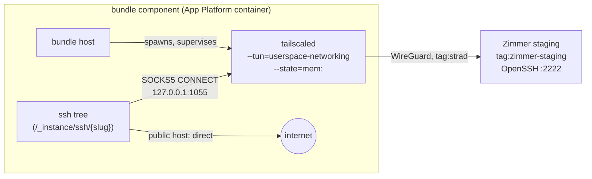

Some hosts strad has to reach are not on the internet at all. Zimmer's
droplets accept nothing on their public interface: every way in, SSH
included, rides the Tailscale tailnet, and their DNS names resolve to
tailnet addresses (`100.x`). A container on App Platform has no route to
those, so an [SSH slug](/servers/ssh/) pointed at one connects, lists its
tools, and answers every call with an error.

A bundle can join the tailnet for this. It is **off by default**, it is
configured per bundle, and while it is on, the only thing in the container
that uses it is the `ssh` tree, and only for hosts that resolve into the
tailnet.

```yaml
bundles:
  - name: bundle
    instanceSizeSlug: apps-s-1vcpu-2gb
    tailnet:
      authKey: "${STRAD_TAILNET_OAUTH_CLIENT_SECRET}"
      tags: [tag:strad]
      # hostname: strad-prod-bundle   # default: strad-<gateway.env>-<bundle>
      # enabled: false                # the rollback
```

## How it works



- **A process, not a container.** App Platform runs one container per
  component and gives it no TUN device, so there is no `tailscale0`
  interface and no sidecar container to share a network namespace with.
  `tailscaled --tun=userspace-networking` needs neither: it terminates the
  tailnet in user space and exposes it as a SOCKS5 listener on
  `127.0.0.1:1055`. The bundle host (`servers/bundle/host/src/tailnet.ts`)
  starts it at boot when the component carries a key, restarts it with
  backoff if it dies or fails to join, and never takes the container down
  over it. The image carries `tailscaled` and `tailscale`, pinned and
  checksum-verified, on every component; only one rendered with `tailnet:`
  runs them.
- **Routing is by address.** The `ssh` tree resolves `SSH_HOST`. A MagicDNS
  name (`*.ts.net`), an address in `100.64.0.0/10`, or one in
  `fd7a:115c:a1e0::/48` goes through the SOCKS5 listener; anything else
  dials direct, exactly as it did before. Those ranges are not routable on
  the internet, so there is no host that could go either way, and no per-slug
  switch to get wrong. The host-key pin is checked the same way on both
  routes.
- **No other tree is pointed at it.** Nothing else in the image is given the
  listener's address. Anything in the container could still dial loopback;
  the tailnet policy, below, is what bounds what that would reach.
- **Each container is an ephemeral node.** State is in memory, so a restart
  or a redeploy is a new node, and the control plane removes the old one. On
  `SIGTERM` the host runs `tailscale logout` first, so a clean stop removes
  it at once.

When the tailnet is configured, the bundle's `/healthz` carries a `tailnet`
field: `starting`, `up`, or `down` with a reason, and how many times it has
restarted. While joined, the host asks `tailscaled` for its backend state every
30 seconds, so a node removed or logged out in the admin console reads `down`
too, even though its daemon is still running. It is reported and never folded into `ok`: a tailnet that will
not come up costs the tailnet hosts, and a liveness restart would cost every
mount in the container.

An SSH call to a tailnet host gets one of three answers when the tailnet is
the problem, each with a different next move:

| What is wrong                                                    | The call says                                                                                                               |
| ---------------------------------------------------------------- | --------------------------------------------------------------------------------------------------------------------------- |
| The bundle has no `tailnet:` block (or `enabled: false`)         | `Not configured`: the host is a tailnet address and this container has no tailnet egress. Nothing is dialed.                |
| `tailscaled` is not accepting connections (starting, restarting) | the tailnet sidecar is not up; retry in a minute, and `/healthz` says why.                                                  |
| The tailnet could not reach the host                             | `UNREACHABLE`: the host is down or offline on the tailnet, or the tailnet policy does not let strad's node reach that port. |

## What it may reach: the tailnet policy

The node joins with the tags in `tags:`, and the tailnet policy decides
everything it can do. strad does not edit the policy; a tailnet admin does.
For the Tadasant deployment the change is:

```diff
 "grants": [
-  // Allow all connections.
-  { "src": ["*"], "dst": ["*"], "ip": ["*"] },
+  // Allow all connections -- from every source EXCEPT tag:strad. This list is
+  // every source "*" matched before tag:strad existed.
+  {
+    "src": ["autogroup:member", "tag:ci", "tag:zimmer-ci", "tag:zimmer-staging",
+            "tag:zimmer-production", "tag:strad-mcp"],
+    "dst": ["*"],
+    "ip":  ["*"],
+  },
+  // strad's bundle -> Zimmer STAGING's OpenSSH, and nothing else.
+  { "src": ["tag:strad"], "dst": ["tag:zimmer-staging"], "ip": ["tcp:2222"] },
 ],
 ...
 "tagOwners": {
   ...
+  "tag:strad": ["autogroup:admin"],
 },
+"tests": [
+  {
+    "src": "tag:strad",
+    "accept": ["tag:zimmer-staging:2222"],
+    "deny": ["tag:zimmer-staging:22", "tag:zimmer-staging:443",
+             "tag:zimmer-production:2222", "tag:zimmer-production:22",
+             "tag:ci:22", "tag:zimmer-ci:22"],
+  },
+],
```

Why each part is there:

- **The allow-all grant has to narrow first.** Grants only ever allow. Under
  `"src": ["*"]` a `tag:strad` node can reach every device on the tailnet,
  Zimmer production and personal machines included. That was checked against
  the live policy with Tailscale's validator before this page was written. So
  the policy change lands **before** any key for `tag:strad` exists.
- **Port 2222, not 22.** On Zimmer's droplets, tailnet port 22 is Tailscale
  SSH, which authenticates by tailnet identity and ignores public keys. Real
  OpenSSH, which the `ssh` tree speaks, listens on 2222. Granting only 2222
  means the node gets no Tailscale SSH, and the policy has no `ssh` rule
  naming `tag:strad`.
- **Staging only.** `ssh-tadasant-zimmer-prod` is root on the host Zimmer's
  agent sessions run on, and it is not served by this deployment. Production
  stays out of the grant. Widening it is a separate decision.
- **No inbound.** The node runs with `--shields-up`, which refuses every
  incoming tailnet connection at the node. That matters more in userspace
  mode than in kernel mode: an accepted inbound connection is forwarded to
  the same port on the container's loopback, where the bundle listens. The
  diff above leaves `"dst": ["*"]` alone, so the policy itself would still
  let a member's device try. Shields-up is what refuses it.

## Node authorization and the credential

Use a **Tailscale OAuth client**, not an auth key:

| Setting     | Value                                       |
| ----------- | ------------------------------------------- |
| Scopes      | `auth_keys` (write), nothing else           |
| Tags        | `tag:strad` only                            |
| Description | strad prod bundle: ephemeral tailnet egress |

Its secret (`tskey-client-…`) is what `authKey` names. `tailscale up` uses it
to mint a node key on each start, asking for an **ephemeral, pre-authorized**
node. The host adds `?ephemeral=true&preauthorized=true` to an OAuth client
secret. So:

- **Redeploys need no human.** Every new container mints its own node, joins
  pre-approved, and the previous one is removed by the control plane.
- **Nothing expires under a running deploy.** An OAuth client does not expire.
  An auth key expires after at most 90 days and is consumed per node, and a
  reused one-off key fails the next restart. An ordinary auth key is accepted
  if it is tagged, reusable, ephemeral and pre-authorized, but it is the
  weaker choice.
- **Node keys do not expire in practice.** Tagged nodes have key expiry
  disabled by default, and an ephemeral node lives only as long as its
  container.
- **What the secret can do if it leaks:** mint `tag:strad` nodes, and so
  reach exactly what the policy grants `tag:strad`, which is one port on one
  host. It cannot mint any other tag, read the policy, or list devices.

### Where it lives

- **In the store**, at `/strad/{env}/gateway/static/STRAD_TAILNET_OAUTH_CLIENT_SECRET`
  under `gcp-parameter-store`, or in the deploy environment under `env`. A
  human seeds it. `render-spec` reads it like a supplementary server's `env:`
  and bakes it onto **that one component** as a SECRET. It is never in the
  broadcast, and core does not hold it. `store:check` counts it.
- **In the container**, it is not in the environment Node starts with. A
  conventional mount reads the whole environment, and deleting a name from
  `process.env` would not help: the kernel keeps a process's starting
  environment in `/proc/<pid>/environ`, which every server loaded into the
  host can read. So the image's entrypoint (`servers/bundle/scripts/boot.sh`)
  moves the key into a `0600` file before Node starts, and the host reads that
  file and deletes it before any mount is built. It reaches
  `tailscale up` through a `0600` file in a `0700` directory that is deleted
  as soon as `up` returns. It is never on a command line, where `ps` would
  show it, and never in `tailscaled`'s environment.
- **In logs**, never. Every line the host forwards from `tailscaled` and
  every failure reason is scrubbed of anything shaped like `tskey-…` and of
  the literal key.
- **Rotation** is: create a new client secret in the admin console, seed it,
  redeploy, then revoke the old one. Because it is baked, a rotation is a
  redeploy, not a restart.

## Audit

| Record                                                       | Where                           | What it holds                                                                                                             |
| ------------------------------------------------------------ | ------------------------------- | ------------------------------------------------------------------------------------------------------------------------- |
| Tailscale configuration audit log                            | Tailscale admin console         | every node `tag:strad` mints and every removal, OAuth client creation and revocation, every policy change                 |
| Tailscale network flow logs (Premium/Enterprise, if enabled) | Tailscale admin console / SIEM  | each connection from the strad node: source, destination, port, bytes. Needs the node's log upload, which strad leaves on |
| strad's tool-call telemetry                                  | the deployment's OTLP collector | every call on an SSH slug: slug, tool, outcome, latency. Never the command, path or content (`src/telemetry/redact.ts`)   |
| The bundle log (`[bundle] tailnet: …`, `[tailscaled] …`)     | the container's stderr          | joins, failures, restarts. The stdout/stderr stream is not shipped; read it with `doctl apps logs` during an incident     |
| The target host's `sshd` log                                 | the host's journal              | each login, by key fingerprint and source tailnet address                                                                 |

Which command ran is in the target host's own logs, not in strad's: commands
are tool arguments, and strad's telemetry rule keeps those out of every
channel.

## Rollback

Each step is independent, and any one of them is enough to cut strad off the
tailnet:

1. **`tailnet: { enabled: false, … }`, or remove the block, and deploy.** The
   component renders without the key, the host starts nothing, and SSH slugs
   behave as before: a tailnet host is answered with "no tailnet egress"
   without anything being dialed.
2. **Revoke the OAuth client** in the Tailscale admin console. No new node can
   join. A running one keeps its node key until it restarts.
3. **Remove the node** (Machines → the `strad-…` node → Remove), or drop the
   `tag:strad` grant from the policy. That takes effect at once, with no
   deploy. The host sees the removal, reports `down`, and does not re-join on
   its own. A `tailscaled` crash or a container restart does mint a new node,
   so pair a removal with step 2 if it has to last.

A key the control plane refuses (revoked or expired) is retried at most every
10 minutes, so a revoked client does not turn into a stream of failed mints.

## Compared with a public SSH port

The alternative was to open SSH on the Zimmer hosts' public interface and
allow strad's address through.

|                    | Tailnet (this)                                              | Public SSH port                                                                                        |
| ------------------ | ----------------------------------------------------------- | ------------------------------------------------------------------------------------------------------ |
| Internet exposure  | none added; the hosts keep zero public TCP ingress          | sshd on the internet again. Zimmer closed its public `22` after a brute-force flood made SSH unusable  |
| Who can connect    | one tag, one port, decided by the tailnet policy            | anything that can reach the address, filtered by a firewall                                            |
| Allowlisting strad | by identity (`tag:strad`)                                   | by source IP, and App Platform's egress address is not fixed, so the allowlist is either wrong or wide |
| Host key churn     | unchanged: the pin is checked on either route               | unchanged                                                                                              |
| Moving parts       | a supervised `tailscaled`, an OAuth client, a policy change | a firewall rule and a port                                                                             |

## Risks

- **strad becomes a tailnet node.** Anything that can run code in the bundle
  container (one of its thirty-four servers, a compromised dependency) can
  dial the SOCKS5 listener. Code running inside the host process could also
  read the key from the host's memory before it is used; keeping it out of
  the environment and off disk closes the easy routes, not that one. What that buys is what `tag:strad` is granted:
  OpenSSH on Zimmer staging, which still wants a key it does not have. The
  policy is the boundary, which is why it has to narrow before the first key
  exists.
- **The OAuth client secret leaks.** It mints `tag:strad` nodes and nothing
  else. Revoke it; a minted node lasts until removed.
- **The policy is widened later.** Any grant whose `src` includes `tag:strad`,
  or a return to `"src": ["*"]`, widens this node with it. The `tests` block
  above fails such an edit when it is validated.
- **The SSH key on the slug.** The tailnet only carries bytes. The SSH slug's
  key and the host-key pin are what log in, as before. A rebuilt staging
  droplet presents a new host key unless Zimmer's Terraform seeds a fixed one
  (`ssh_host_ed25519_key`), and staging leaves that empty today, so a rebuild
  is a `host_key_mismatch` until someone re-pins. The fix is in Zimmer's
  Terraform, not here.
- **Proven only against fakes.** CI drives the SOCKS5 path through the real
  `ssh2` client against a real SSH server behind a fake proxy, and the
  sidecar's supervision against stand-in binaries. A real `tailscaled` joining
  a real tailnet from App Platform's gVisor sandbox has not run yet. See
  [Known limitations](/limitations/) #139.
