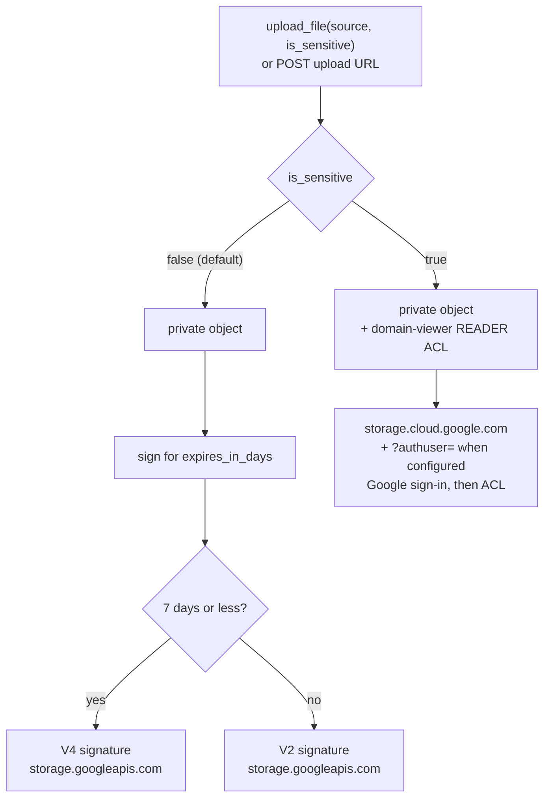

An agent takes a screenshot. A person needs to look at it. Everything between
those two facts is this server.

`remote-filesystem-tmp-public` is strad's own MCP server — source in
`servers/remote-filesystem/`, mounted inside the bundle image. It stores an
artifact in one Google Cloud Storage bucket and returns a URL. **Link ergonomics
and sensitivity handling are the whole product**, so both are decided here rather
than left to the caller.

## Two kinds of link

One boolean picks between them.

| `is_sensitive` | object state                             | link                                                                                        | expires                                 |
| -------------- | ---------------------------------------- | ------------------------------------------------------------------------------------------- | --------------------------------------- |
| `false`        | private                                  | signed URL on `storage.googleapis.com`                                                      | after `expires_in_days`, default **14** |
| `true`         | private + `domain-<viewer>` `READER` ACL | `storage.cloud.google.com/<bucket>/<path>`, plus `?authuser=` when an account is configured | never                                   |

A **signed** link opens instantly for whoever holds it, with no Google account.
That is the good experience and it is what a screenshot should get.

A **restricted** link carries no signature at all. `storage.cloud.google.com` is
GCS's cookie-authenticated browser front door: an anonymous request is redirected
to the Google sign-in page, and after sign-in the object's ACL decides. Only
members of the configured Workspace domain get in. It does not expire because
nothing about it is time-limited — the grant is.

`storage.googleapis.com` is **not** interchangeable for the restricted case. It
authenticates bearer tokens and signatures only, so it answers an unauthenticated
browser with a bare `403` and no way forward. The two hosts look like aliases and
are not.

### A restricted link names an account

Cookie authentication resolves against **one** of the reader's signed-in Google
accounts, and a bare URL gets the browser profile's default — account 0, usually
a personal `gmail.com` address. That account is not in the granted Workspace
domain, so Google answers `403`.

This is the failure mode that looks exactly like a broken grant and is not: the
ACL is correct, the URL is correct, and the reader is signed in to an account
that would open it. Google simply never asked that account. There is no error
text separating the two cases.

So when `_SENSITIVE_VIEWER_ACCOUNT` is set, a restricted link carries
`?authuser=<address>` — Google's account selector — and opens against that
account regardless of which one is default:

```
https://storage.cloud.google.com/<bucket>/<path>?authuser=dana%40example.com
```

The account is a **hint, never a grant**. The `domain-<viewer>` ACL is what
authorises, so the artifact stays readable by the whole domain — a different
member opens it by replacing the `authuser` value in the URL with their own
address. Without the setting no `authuser` is emitted: naming an account the
reader is not signed in to bounces them to a sign-in page, which is worse than
the bare URL for anyone whose default account is already right.

Either way, a restricted response carries a `sign_in_hint` field saying which
account opens the link and what to do about a `403`. That text is the answer to
"your link is broken", and it exists because nothing about this failure is
visible from the server.



## Steering agents away from `is_sensitive`

Having to log in is bad UX, so `false` is the right answer almost every time. The
steer lives in the `is_sensitive` parameter description — the copy an agent
actually reads at call time — and it is one-directional, with concrete examples on
both sides: security findings, credentials on screen, net worth, medical or legal
documents on the `true` side; UI screenshots, logs, charts, PR evidence and
everything else routine on the `false` side, **including artifacts from a private
repo or an internal admin page**.

That copy is defined once and used by both `upload_file` and `set_sensitivity`; a
test asserts the two are identical, because an agent reading two versions of the
guidance will follow the more permissive one.

## The seven-day problem

**GCS's V4 signing process caps expiry at seven days** (604800s), enforced by
Google and by the Node SDK, which throws rather than clamps. A fourteen-day
default is therefore not achievable with V4.

It **is** achievable with **V2**, the older signing process, which has no such
cap. Verified against a real bucket: 14-day and 365-day V2 URLs both serve `200`
anonymously.

So the server picks by duration — **V4 for 7 days or less, V2 beyond it** — and
reports which in `signing_version`. V4 stays the path for the common case.

The tradeoff, stated plainly: V2 is legacy, Google recommends V4, and Google could
retire V2. If that happens, links longer than seven days stop being mintable and
the default has to drop to 7. `refresh_link` is what makes that survivable — a
dead link is one tool call away from being alive again. The server never silently
downgrades a 14-day request to 7; handing back a link that expires in half the
time the caller asked for is the failure this design exists to avoid. See [Known
limitations](/limitations/).

## The query string is the credential

A signed URL's signature lives in its query string, and that query string is most
of the URL's length. **Altering it is loud for the reader and silent for whoever
published it** — the link still looks like a link, and it 403s in someone else's
browser.

That has already cost an incident. An agent uploaded an artifact, got a working
URL, and published it to a human bolded in markdown with everything after the `?`
dropped. The human got a 403. The 403 was misdiagnosed and escalated as _"the
bucket is not public, every artifact tonight has been unreachable"_ — a false
infrastructure incident, from a formatting bug, with someone sent to look at a
bucket ACL.

So `upload_file`, `get_upload_url` and `refresh_link` all carry the same guidance
in their tool descriptions, from one shared constant: pass the URL through
verbatim, check it with `curl` before publishing it, and read the error code
correctly. `[text](url)` is the safe markdown form because nothing can be glued to
the end of it; Slack renders that literally, so there the bare URL or `<url|text>`.

A `path` cannot be turned back into a URL. There is no signature to reconstruct —
only a tool can mint one.

**This is about signed links only.** A `restricted` artifact's URL carries no
signature at all: its query string is the `?authuser=` account selector, and
[`sign_in_hint`](#a-restricted-link-names-an-account) is what diagnoses a 403 on
one — by telling the reader to _replace_ that value, which is the opposite of the
advice above.

**What the error actually means.** Observed against a production bucket. Read the
code rather than the status, because the two disagree:

| Code                    | HTTP | Cause                                                                                     |
| ----------------------- | ---- | ----------------------------------------------------------------------------------------- |
| `AccessDenied`          | 403  | The request carried no signature at all — the query string was dropped, or cut at the `?` |
| `SignatureDoesNotMatch` | 403  | Characters were added or removed (markdown `**` glued onto the end, a line wrap)          |
| `MissingSecurityHeader` | 400  | A partly-kept query string — some signing parameters survived, some did not               |
| `ExpiredToken`          | 400  | The link aged out. `refresh_link` mints a fresh one                                       |

**None of them means the bucket is misconfigured.** Objects here are private by
design, whatever the bucket or the mount is called — and the mount being called
`remote-filesystem-tmp-public` refers to its _links_ being shareable without a
sign-in, not to its objects being world-readable.

## Expiry kills the link, never the artifact

`refresh_link` takes an artifact's `path` and mints a fresh URL. Nothing is
re-uploaded, nothing about the stored object changes, and sensitivity is preserved
rather than re-decided: a restricted artifact gets its sign-in URL back and
`expires_in_days` is ignored.

**The `path` is the durable handle. The URL is not.** An agent that keeps the path
can always produce a working link; one that keeps only the URL cannot.

## Large uploads use a temporary POST URL

`upload_file` still accepts bytes inside the MCP tool call, but that is the wrong
shape for anything that would become a meaningful amount of base64 or text in the
transcript. `get_upload_url` creates a short-lived, unguessable POST target and
returns a `curl --data-binary` command. The caller uploads from the shell, and
the POST response is the same artifact JSON `upload_file` returns.

The upload URL is not a GCS credential. It is a strad route:
`/mcp-upload/<slug>/<token>`. Core proxies that route to the private bundle, and
the remote-filesystem server consumes the lease there. That keeps bucket
credentials, ACL cleanup and sensitivity normalization behind the same boundary
as the existing upload path while keeping large bytes out of MCP.

Upload leases expire after 15 minutes by default, may be shortened or extended
up to 60 minutes, and accept one successful POST. A failed POST can be retried
until the lease expires; a successful one consumes the token. The POST body limit
is 100 MB.

The lease store is process-local memory. That is deliberate for now: upload URLs
are short-lived bearer capabilities, not durable credentials. A restart
invalidates outstanding upload URLs, and a bundle scaled beyond one instance
needs sticky routing or a single upload-capable replica. The default staging
bundle is one instance, so the common flow is: call `get_upload_url`, run the
returned curl command immediately, keep the artifact `path` from the POST
response.

## What can and cannot be revoked

| action                  | effect on a URL already pasted into a message |
| ----------------------- | --------------------------------------------- |
| link expires            | stops working at the expiry                   |
| `set_sensitivity(true)` | **keeps working** until it expires            |
| `delete_file`           | stops working immediately                     |

A signature is valid until it expires, independently of the object's ACL.
Restricting an artifact stops _new_ readers and stops new signed links being
minted; it cannot recall one already handed out. `delete_file` is the only true
revoke, and `set_sensitivity`'s description says so.

One more wrinkle, measured rather than assumed: **an object that was ever
`public` keeps being served from Google's edge cache for up to an hour after it is
restricted.** A cache-busting query string gets the true `403` immediately; the
bare URL does not. This server never creates a public object, so the exposure is
bounded to pre-existing ones — but `set_sensitivity(true)` on one of those means
"no new readers", not "no readers".

## Storage layout

**No root prefix, on purpose.** `GCS_ROOT_PATH` is supported but unset in
production, so uploads land at bucket root and every object ever written to the
bucket stays addressable by `refresh_link`. Confining the server to a prefix would
make "dig up that screenshot from June" fail for everything older than the change
that introduced it.

When `path` is omitted, uploads land at
`uploads/<YYYY>/<MM>/<DD>/<HHMMSS>-<nonce><ext>` — date-partitioned so the bucket
stays browsable, nonce-suffixed so two uploads in one second cannot overwrite each
other.

**Sensitive artifacts are not segregated by prefix.** The protection is a
per-object ACL; a `sensitive/` prefix would imply an enforcement that does not
exist, and an object with a mis-set ACL sitting under it would look safe while
being readable.

## `access` has four values, and the last two are the interesting ones

`upload_file` never creates a world-readable object, but the bucket already
contains some — written before this server existed, by a tool that set `allUsers`.

- `public` — reachable by `allUsers` (anyone) or `allAuthenticatedUsers` (any
  Google account). Reported with no expiry rather than dressed up as private,
  because calling a world-readable object `restricted` would be the most dangerous
  thing this server could say. `set_sensitivity(true)` strips the broad grant
  before granting the domain, since a public grant would otherwise win.
- `unknown` — the object's ACL could not be read. **No link is issued for one.**
  Returning a signed URL here would be the fail-open answer: signing is what a
  `link` gets, so a deployment that switched on uniform bucket-level access, or a
  credential that lost ACL read, would silently turn every sign-in-gated artifact
  into an anonymous URL mintable by a read-only tool. The call fails and names
  UBLA instead.

The same reasoning runs one level down. An ACL change that GCS _refuses_ — a `403`
on removing an `allUsers` grant, say — fails the call rather than being swallowed:
the alternative is `upload_file` reporting `restricted` for an object it did not
manage to make private.

## Uploading over an existing path

An explicit `path` overwrites. GCS's `save` replaces an object's bytes and leaves
its ACL alone, so every upload re-reads the ACL and brings it in line with the
`is_sensitive` being asked for — otherwise a sensitive artifact written over a
world-public path would be stored world-readable and reported `restricted`, and a
routine one written over a restricted path would keep a domain grant the response
never mentions. The reported `access` is derived from what was found and changed,
never from what was requested.

One asymmetry, on purpose: restricting an artifact removes a broad grant, but
uploading a **non**-sensitive artifact over a public path leaves it and reports
`public`. Silently de-publishing an object would break a URL someone may already
be relying on, and this server was not the one that published it.

## Configuration

Every key is read under a **slug-namespaced prefix** — the bundle host constructs
the server with `envPrefix: "REMOTE_FILESYSTEM_TMP_PUBLIC"`. It never reads the
bare `GCS_*` names: the `gcs` server owns those in the same container and points
at a different bucket, and one process cannot hold two values of `GCS_BUCKET`.

The host also hands each instance a
[slug-scoped view](/operate/secrets/#what-a-servers-variables-are-called-on-the-box)
of the environment rather than `process.env`, so a second slug of this server on its own
`path:` can point at a second bucket from the same container. The two prefixes
stack — that slug reads `REMOTE_FS_ARCHIVE__REMOTE_FILESYSTEM_TMP_PUBLIC_GCS_BUCKET`
— and both are load-bearing: the view falls back to bare names, and the bare
`GCS_BUCKET` is the `gcs` server's.

| variable (after the prefix) | required              | meaning                                              |
| --------------------------- | --------------------- | ---------------------------------------------------- |
| `_GCS_BUCKET`               | yes                   | the one bucket every operation is scoped to          |
| `_GCS_PROJECT_ID`           | no                    | project for billing/quota                            |
| `_GCS_CLIENT_EMAIL`         | no                    | service-account email                                |
| `_GCS_PRIVATE_KEY`          | no                    | service-account PEM; escaped newlines handled        |
| `_GCS_ROOT_PATH`            | no                    | prefix confinement. Unset in production              |
| `_SENSITIVE_VIEWER_DOMAIN`  | for sensitive uploads | Workspace domain that may open a restricted artifact |
| `_SENSITIVE_VIEWER_ACCOUNT` | no                    | address a restricted link names via `?authuser=`     |
| `_LINK_DEFAULT_DAYS`        | no                    | default link life. Defaults to 14                    |

Without `_SENSITIVE_VIEWER_DOMAIN`, an `is_sensitive: true` upload is **refused**
rather than stored, and the mount reports itself `degraded` on `/healthz`. Storing
a sensitive artifact nobody can open is a worse outcome than a loud failure.

`_SENSITIVE_VIEWER_ACCOUNT` is validated when the store is first built — the
first tool call after a deploy, since config is read lazily. It must be a full
address, and it must be inside `_SENSITIVE_VIEWER_DOMAIN`. Both mistakes would
otherwise fail only in a reader's browser, days later, as a `403` with no
server-side trace, so a bad value fails every tool instead of silently degrading
one link.

The two credentials come from the parameters system, not from hand-written
`${REF}` entries — see [`params: true`](/servers/adding/).

## Bucket requirements

- **Uniform bucket-level access must be OFF.** The restricted path is a per-object
  ACL, and UBLA disables object ACLs. IAM Conditions are not an alternative: they
  require UBLA _on_. With UBLA on, every artifact reads as `access: "unknown"` and
  no link is issued — a loud failure rather than a quiet loss of the sign-in gate.
- The service account needs object read/write, `storage.objects.update` to set
  ACLs, and a private key so URLs can be signed locally.

## Tools

| tool              | group     | what it does                                      |
| ----------------- | --------- | ------------------------------------------------- |
| `upload_file`     | readwrite | store bytes from the MCP call, return a link      |
| `get_upload_url`  | readwrite | mint a temporary curl-friendly POST upload target |
| `refresh_link`    | readonly  | mint a fresh link for an existing artifact        |
| `list_files`      | readonly  | browse one directory level, to find a path        |
| `download_file`   | readonly  | read an artifact's bytes back                     |
| `set_sensitivity` | readwrite | re-classify an artifact and re-link it            |
| `delete_file`     | readwrite | permanently delete (the only true revoke)         |

`refresh_link` is `readonly` even though it mints a credential-bearing URL: it
changes nothing about the object, and withholding it from a read-only role would
leave that role able to list artifacts it could never open.

`list_files` deliberately returns neither links nor access levels. Both cost a
round trip to Google per object, so a fifty-file listing would be fifty extra
calls for data the caller usually does not want.

`upload_file` takes a `file://` URI, which means it reads from the bundle
container's filesystem — a container that also holds twenty other servers'
credentials in its environment. Paths under `/proc`, `/sys`, `/dev`, `/app`,
`/root` and `/etc` are refused, so `file:///proc/self/environ` is not a one-call
way to publish every secret in the bundle. An artifact lives in a working
directory, not in process state.

`get_upload_url` avoids that filesystem read entirely. The agent uploads from
its own shell with `curl`, so this is the path tool descriptions steer agents
toward for screenshots, recordings, PDFs, archives, logs and reports.

`download_file` refuses a base64 read over 5 MB rather than truncating it: half a
PNG decodes to nothing, and a 50 MB recording would be a 67 MB tool result. Text
truncates at 200 KB, on a codepoint boundary.
