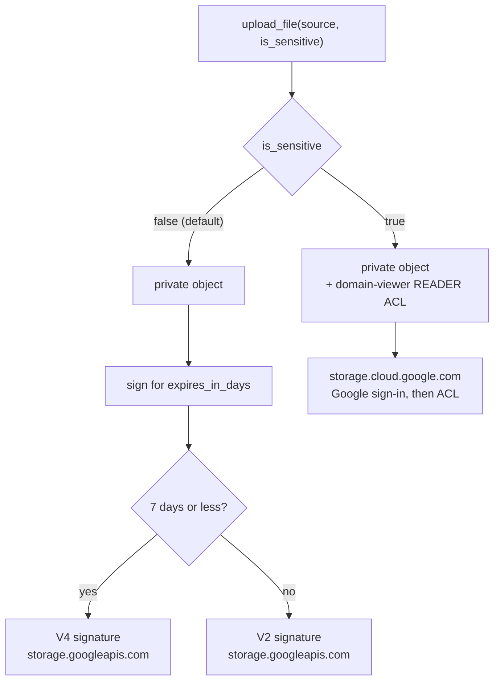

An agent takes a screenshot. A person needs to look at it. Everything between
those two facts is this server.

`remote-filesystem-tmp-public` is strad's own MCP server — source in
`servers/remote-filesystem/`, mounted inside the bundle image. It stores an
artifact in one Google Cloud Storage bucket and returns a URL. **Link ergonomics
and sensitivity handling are the whole product**, so both are decided here rather
than left to the caller.

It replaced a vendored copy of pulsemcp's `remote-filesystem-mcp-server`, which
had no notion of sensitivity, hard-coded a seven-day link, and offered no way to
revive an expired one.

## Two kinds of link

One boolean picks between them.

| `is_sensitive` | object state                             | link                                       | expires                                 |
| -------------- | ---------------------------------------- | ------------------------------------------ | --------------------------------------- |
| `false`        | private                                  | signed URL on `storage.googleapis.com`     | after `expires_in_days`, default **14** |
| `true`         | private + `domain-<viewer>` `READER` ACL | `storage.cloud.google.com/<bucket>/<path>` | never                                   |

A **signed** link opens instantly for whoever holds it, with no Google account.
That is the good experience and it is what a screenshot should get.

A **restricted** link carries no signature at all. `storage.cloud.google.com` is
GCS's cookie-authenticated browser front door: an anonymous request is redirected
to the Google sign-in page, and after sign-in the object's ACL decides. Only
members of the configured Workspace domain get in. It does not expire because
nothing about it is time-limited — the grant is.

`storage.googleapis.com` is **not** interchangeable for the restricted case. It
authenticates bearer tokens and signatures only, so it answers an unauthenticated
browser with a bare `403` and no way forward. The two hosts look like aliases and
are not.

## Steering agents away from `is_sensitive`

Having to log in is bad UX, so `false` is the right answer almost every time. The
steer lives in the `is_sensitive` parameter description — the copy an agent
actually reads at call time — and it is one-directional, with concrete examples on
both sides: security findings, credentials on screen, net worth, medical or legal
documents on the `true` side; UI screenshots, logs, charts, PR evidence and
everything else routine on the `false` side, **including artifacts from a private
repo or an internal admin page**.

That copy is defined once and used by both `upload_file` and `set_sensitivity`; a
test asserts the two are identical, because an agent reading two versions of the
guidance will follow the more permissive one.

## The seven-day problem

**GCS's V4 signing process caps expiry at seven days** (604800s), enforced by
Google and by the Node SDK, which throws rather than clamps. A fourteen-day
default is therefore not achievable with V4.

It **is** achievable with **V2**, the older signing process, which has no such
cap. Verified against a real bucket: 14-day and 365-day V2 URLs both serve `200`
anonymously.

So the server picks by duration — **V4 for 7 days or less, V2 beyond it** — and
reports which in `signing_version`. V4 stays the path for the common case.

The tradeoff, stated plainly: V2 is legacy, Google recommends V4, and Google could
retire V2. If that happens, links longer than seven days stop being mintable and
the default has to drop to 7. `refresh_link` is what makes that survivable — a
dead link is one tool call away from being alive again. The server never silently
downgrades a 14-day request to 7; handing back a link that expires in half the
time the caller asked for is the failure this design exists to avoid. See [Known
limitations](/limitations/).

## Expiry kills the link, never the artifact

`refresh_link` takes an artifact's `path` and mints a fresh URL. Nothing is
re-uploaded, nothing about the stored object changes, and sensitivity is preserved
rather than re-decided: a restricted artifact gets its sign-in URL back and
`expires_in_days` is ignored.

**The `path` is the durable handle. The URL is not.** An agent that keeps the path
can always produce a working link; one that keeps only the URL cannot.

## What can and cannot be revoked

| action                  | effect on a URL already pasted into a message |
| ----------------------- | --------------------------------------------- |
| link expires            | stops working at the expiry                   |
| `set_sensitivity(true)` | **keeps working** until it expires            |
| `delete_file`           | stops working immediately                     |

A signature is valid until it expires, independently of the object's ACL.
Restricting an artifact stops _new_ readers and stops new signed links being
minted; it cannot recall one already handed out. `delete_file` is the only true
revoke, and `set_sensitivity`'s description says so.

One more wrinkle, measured rather than assumed: **an object that was ever
`public` keeps being served from Google's edge cache for up to an hour after it is
restricted.** A cache-busting query string gets the true `403` immediately; the
bare URL does not. This server never creates a public object, so the exposure is
bounded to pre-existing ones — but `set_sensitivity(true)` on one of those means
"no new readers", not "no readers".

## Storage layout

**No root prefix, on purpose.** `GCS_ROOT_PATH` is supported but unset in
production, so uploads land at bucket root and every object ever written to the
bucket stays addressable by `refresh_link`. Confining the server to a prefix would
make "dig up that screenshot from June" fail for everything older than the change
that introduced it.

When `path` is omitted, uploads land at
`uploads/<YYYY>/<MM>/<DD>/<HHMMSS>-<nonce><ext>` — date-partitioned so the bucket
stays browsable, nonce-suffixed so two uploads in one second cannot overwrite each
other.

**Sensitive artifacts are not segregated by prefix.** The protection is a
per-object ACL; a `sensitive/` prefix would imply an enforcement that does not
exist, and an object with a mis-set ACL sitting under it would look safe while
being readable.

## `access` has a third value, and this deployment needs it

`upload_file` never creates a world-readable object, but the bucket already
contains some — written before this server existed, by a tool that set
`allUsers`. `refresh_link` reports those as `access: "public"` with no expiry
rather than pretending they are private, because reporting `restricted` for a
world-readable object would be the most dangerous thing this server could say.

`set_sensitivity(true)` strips `allUsers` before granting the domain, since a
public grant would otherwise win and make the tool a lie.

## Configuration

Every key is read under a **slug-namespaced prefix** — the bundle host constructs
the server with `envPrefix: "REMOTE_FILESYSTEM_TMP_PUBLIC"`. It never reads the
bare `GCS_*` names: the `gcs` server owns those in the same container and points
at a different bucket, and one process cannot hold two values of `GCS_BUCKET`.

| variable (after the prefix) | required              | meaning                                              |
| --------------------------- | --------------------- | ---------------------------------------------------- |
| `_GCS_BUCKET`               | yes                   | the one bucket every operation is scoped to          |
| `_GCS_PROJECT_ID`           | no                    | project for billing/quota                            |
| `_GCS_CLIENT_EMAIL`         | no                    | service-account email                                |
| `_GCS_PRIVATE_KEY`          | no                    | service-account PEM; escaped newlines handled        |
| `_GCS_ROOT_PATH`            | no                    | prefix confinement. Unset in production              |
| `_SENSITIVE_VIEWER_DOMAIN`  | for sensitive uploads | Workspace domain that may open a restricted artifact |
| `_LINK_DEFAULT_DAYS`        | no                    | default link life. Defaults to 14                    |

Without `_SENSITIVE_VIEWER_DOMAIN`, an `is_sensitive: true` upload is **refused**
rather than stored, and the mount reports itself `degraded` on `/healthz`. Storing
a sensitive artifact nobody can open is a worse outcome than a loud failure.

The two credentials come from the parameters system, not from hand-written
`${REF}` entries — see [`params: true`](/servers/adding/).

## Bucket requirements

- **Uniform bucket-level access must be OFF.** The restricted path is a per-object
  ACL, and UBLA disables object ACLs. IAM Conditions are not an alternative: they
  require UBLA _on_.
- The service account needs object read/write, `storage.objects.update` to set
  ACLs, and a private key so URLs can be signed locally.

## Tools

| tool              | group     | what it does                               |
| ----------------- | --------- | ------------------------------------------ |
| `upload_file`     | readwrite | store bytes, return a link                 |
| `refresh_link`    | readonly  | mint a fresh link for an existing artifact |
| `list_files`      | readonly  | browse one directory level, to find a path |
| `download_file`   | readonly  | read an artifact's bytes back              |
| `set_sensitivity` | readwrite | re-classify an artifact and re-link it     |
| `delete_file`     | readwrite | permanently delete (the only true revoke)  |

`refresh_link` is `readonly` even though it mints a credential-bearing URL: it
changes nothing about the object, and withholding it from a read-only role would
leave that role able to list artifacts it could never open.

`list_files` deliberately returns neither links nor access levels. Both cost a
round trip to Google per object, so a fifty-file listing would be fifty extra
calls for data the caller usually does not want.
