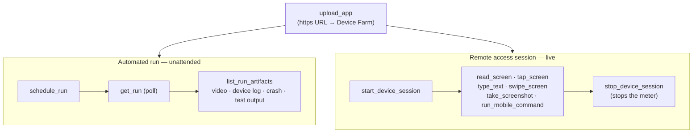

Drive a real, physical iPhone from an agent: put a build on it, tap the screen,
read what the app is showing, and pull back video, device logs and screenshots.

`aws-device-farm` is strad's own MCP server — source in
`servers/aws-device-farm/`, mounted at `/aws-device-farm` inside the bundle
image. It exists because a class of iOS bug is only findable on real hardware,
and every one of those otherwise costs a round trip through a human holding a
phone.

:::caution[No slug points at it yet]
The mount is in the image and **no environment declares a server for it**, because
the AWS credential has not been minted. An unresolved `${NAME}` fails the whole
spec render, so the config block ships in
[the setup guide](/servers/aws-device-farm-setup/) instead, ready to paste once
the credential exists.
:::

## What a device farm can and cannot prove

Start here, because the expectation gap is expensive.

**A device farm sells you the device, not the output signal.** AWS's artifact
list for a test run is pass/fail information, crash reports, test logs, device
logs, screenshots, videos and performance data; for a remote access session it is
logs and a video of the session. **Audio is in neither list** — the phones are in
a rack and the sound goes to a speaker nobody is recording. Appium's XCUITest
driver does offer `mobile: startAudioRecording`, and what it records is the HOST
machine's audio input: using it on a real phone means physically wiring the
handset into the Mac's microphone jack. Appetize, the obvious alternative, is
explicit in the other direction — audio output on iOS "has since been
deprecated", and audio input "is not supported on any platform."

So **"is audio playing" is not something to shop for a vendor over.** The answer
that works is instrumentation inside the app: an `AVAudioEngine` or
`MTAudioProcessingTap` tap reducing rendered audio to an RMS level, beside
`timeControlStatus`, `currentTime` and the `AVAudioSession` route. That makes it
a number, and a number is reachable two ways from here:

| Where the app puts the number | How an agent reads it |
| --- | --- |
| On screen, behind a debug flag | [`read_screen`](#the-interactive-loop) reads it as an element label |
| A file at a customer-artifact path in an automated run | `list_run_artifacts` hands it back with a download URL |

**What needs no app change at all**, and covers most of the bug class: that the
app launched, that a screen rendered, that a button is enabled, that Play becomes
Pause, and that a timer label reads `0:42` and then `0:45` three seconds later.
Calling `read_screen` twice with a pause between is how "the timer doesn't move"
stops being an opinion.

## Two modes

Device Farm has exactly two programmatic ways onto a phone, and they are not
interchangeable.



| | **Automated run** | **Remote access session** |
| --- | --- | --- |
| What it is | An unattended job on 1-5 devices | One physical phone, held, up to 150 minutes |
| Who drives | A test package you upload, or Device Farm's built-in fuzzer | **You do, live, over the session's Appium endpoint** |
| Evidence | Video, device system log, crash report, test output, screenshots, customer artifacts | The screen and the accessibility hierarchy, plus a session video in the AWS console |
| Latency | Minutes | Seconds per command |
| Can assert "audio is playing" | Only via the app's own instrumentation, written to a customer-artifact path | Only via the app's own instrumentation, read off the screen |

**The interactive mode is programmatically drivable**, which is the fact the whole
server turns on. A remote access session publishes
`endpoints.remoteDriverEndpoint`: a plain HTTPS **WebDriver** URL that AWS's own
documentation demonstrates with `curl <endpoint>/status`. strad speaks W3C
WebDriver to it directly — no Appium client library, no browser.

:::danger[That URL is a credential]
It authorises by the opaque segment in its PATH — no signature, no header — so
anyone holding the string can drive the phone. strad never returns it from a tool
and never writes it to a log; `redact()` scrubs it out of every message.
`start_device_session` reports `drivable: true` instead.
:::

## The nineteen tools

Three groups, and the groups are about **money** rather than damage. An access key
scoped to Device Farm cannot break anything else in the AWS account; a
remote-access session bills $0.17 a minute for as long as something keeps it
alive — five idle minutes end it, 150 minutes is the cap.

| Tool | Group | What it does |
| --- | --- | --- |
| `get_account_status` | readonly | Free-trial minutes left, unmetered slots, the metered rate. **Call it first** |
| `list_devices` | readonly | Real iOS hardware, defaulting to free-now and remote-access capable |
| `list_device_pools` | readonly | Saved device selections a run can name |
| `list_uploads` | readonly | Builds already uploaded — reusing one is free |
| `get_run` | readonly | A run's status, per-device outcome, minutes and estimated cost |
| `list_run_artifacts` | readonly | Video, device log, crash report, screenshots, customer artifacts |
| `list_device_sessions` | readonly | What is running, and what it has cost |
| `stop_run` | **every group** | Stops a run, and its meter |
| `stop_device_session` | **every group** | Stops a session, and its meter |
| `upload_app` | automation, interactive | Fetches a build from an https URL and waits for Device Farm to finish checking it |
| `schedule_run` | automation | An unattended run; `BUILTIN_FUZZ` needs no test package |
| `start_device_session` | interactive | Takes a phone, installs the build, waits until it is drivable |
| `install_app` | interactive | A different build on the same phone |
| `read_screen` | interactive | The accessibility hierarchy — the assertion channel |
| `take_screenshot` | interactive | A PNG, returned as an image |
| `tap_screen` | interactive | By label (preferred) or by coordinate |
| `type_text` | interactive | Into a named field, or into whatever a tap focused |
| `swipe_screen` | interactive | A drag, with a duration that reads as a drag rather than a flick |
| `run_mobile_command` | interactive | One Appium `mobile:` verb — home, relaunch, app state, alerts |

**Both `stop_` tools are in the read-only group**, which is the one deliberate
exception to "read-only means no writes". Stopping can only ever reduce a bill,
and a slug that can see a runaway session and cannot end it is the worst
arrangement available here.

Nothing here creates or deletes a project, deletes a run or an upload, or
purchases an unmetered device slot — the last is a $250/month decision that is one
API call away. The tool surface is the boundary, and the tests assert it.

## The interactive loop

```
get_account_status            → 827 free minutes left, 0 unmetered slots
list_devices                  → arn:…:device:… "Apple iPhone 15 Pro", iOS 17.5.1
upload_app(source_url, name)  → arn:…:upload:…   SUCCEEDED
start_device_session(device, app) → arn:…:session:…  drivable: true
read_screen(query: "play")    → Button "Play", enabled, center {x:197, y:642}
tap_screen(label: "Play")
read_screen(query: "elapsed") → StaticText "0:03"
…wait…
read_screen(query: "elapsed") → StaticText "0:06"   ← playback is progressing
stop_device_session           → 4.2 metered minutes, ≈ $0.71
```

`session_arn` is optional on every driving tool: when exactly one session is
RUNNING it is used automatically, and when two are, the tool refuses rather than
guessing — driving the wrong phone is the one failure here that looks like a
passing test.

### The two coordinate systems

`read_screen` reports **points**, which is what `tap_screen` and `swipe_screen`
take. A screenshot of the same phone is two to three times larger in each
direction. A coordinate taken off the IMAGE lands near the top-left of what was
aimed at, the tap does nothing visible, and the failure reads as the app ignoring
input. Use an element's `center`, or better, its `label`.

## Getting a build onto a phone

**A TestFlight build is not directly usable** — TestFlight is a distribution
channel, not a file strad can fetch. Device Farm needs an `.ipa` at an https URL
that strad's container can read without a login, whose `Info.plist` has
`CFBundleSupportedPlatforms = ["iPhoneOS"]`.

A **simulator** build is the most common rejection, and it fails
asynchronously: `CreateUpload` succeeds, the PUT succeeds, and the upload goes to
FAILED minutes later with `IOS_APP_WRONG_PLATFORM_DEVICE_VALUE` in a field
nobody reads. `upload_app` therefore waits for the check and reports Device
Farm's own message as an error, rather than handing back an ARN that will fail on
a phone somebody is paying for.

**Device Farm re-signs the app** on public devices, replacing the embedded
provisioning profile with a wildcard one. That STRIPS these entitlements: App
Group, Associated Domains, Game Center, HealthKit, HomeKit, Wireless Accessory
Configuration, In-App Purchase, Inter-App Audio, Apple Pay, **Push
Notifications**, and VPN Configuration & Control. An app that depends on one of
those behaves differently here than on a real user's phone.

[The setup guide](/servers/aws-device-farm-setup/) has what a CI job must produce.

## What a minute costs

$0.17 per device-minute, metered, for both modes. The first **1,000 device
minutes are free**, once, and do not renew. The alternative is an unmetered slot
at **$250/month per concurrent device** — and automation slots and remote-access
slots are bought separately, so "interactive *and* real-device CI" unmetered is
$500/month. The crossover is around 24 hours of device time a month.

Default concurrency is **two** metered remote-access devices and five metered
automation devices. The usual cause of hitting either is a session nobody
stopped, which is why `list_device_sessions` reports what each one has billed and
why a `LimitExceededException` says so in its message.

Every result that can report `deviceMinutes` does, with an estimate and the basis
of it. `get_account_status` is the only thing that says whether the minutes are
free.

## Credentials

Five variables; three are required.

| Variable | What it is |
| --- | --- |
| `AWS_DEVICE_FARM_ACCESS_KEY_ID` | An IAM access key id for a Device-Farm-only user |
| `AWS_DEVICE_FARM_SECRET_ACCESS_KEY` | Its secret. Never logged, never returned |
| `AWS_DEVICE_FARM_PROJECT_ARN` | The Device Farm project this mount works in |
| `AWS_DEVICE_FARM_REGION` | `us-west-2`, and only that. Optional; it is the default |
| `AWS_DEVICE_FARM_MAX_UPLOAD_MB` | How much of a build strad holds in memory. Optional; 192 by default |

**The AWS default credential chain is never consulted.** The SDK would read
`AWS_ACCESS_KEY_ID` straight out of the process environment, and this server
shares a process with thirty-one others — a stray AWS variable that arrived for
some other reason must not become the identity that spends device minutes.

**The region is a closed set of one.** Device Farm's device cloud is served from
`us-west-2` and nowhere else. Setting anything else is not choosing a nearer
rack, it is choosing a hostname that does not answer.

Values go into the store through the console at `/ui/secrets`, by a human. See
[Secrets](/operate/secrets/).

## Not configured is a supported state

The mount comes up with no credentials at all, marked `degraded` on `/healthz`.
`tools/list` works, so the console and an agent can see what the deployment would
offer, and every call fails with an error naming the variables. One server's
missing config must not cost the other thirty their boot.

## Tests

The suite runs with no AWS account, no network and no device. Every seam is an injected
interface: the SDK seam is a `send` function, so the suite asserts the inputs
this server builds against the real `@aws-sdk/client-device-farm` command
classes; the HTTP seam is a `fetch`, covering both the build download and the
phone's WebDriver endpoint.

**Never verified against a live account.** Everything here is built from AWS's
published API and documented behaviour; the first live call is the last step of
[the setup guide](/servers/aws-device-farm-setup/). See
[limitations](/limitations/#103-the-device-farm-server-has-never-made-a-live-call).
