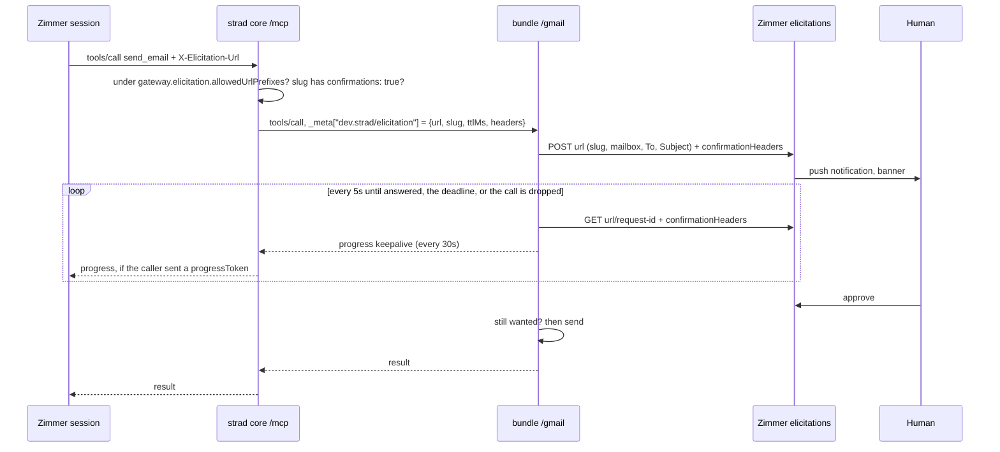

Some tools should not act until a human says yes. A sent email cannot be
recalled, so gmail's `send_email` asks first. A revealed password cannot be
un-revealed, so 1Password's `onepassword_get_item` asks before it shows one
([below](#1password-every-reveal-and-every-write)). In strad the question goes
to the session that made the call, and nowhere else. If the call names no
session to ask, the tool refuses and nothing is sent or revealed.

## The protocol

The question travels over the pulsemcp fallback-elicitation protocol, the one
the vendored `@pulsemcp/mcp-elicitation` library speaks:

1. `POST <url>` with the question: a message, a form schema, and `_meta`
   carrying a request id and an expiry.
2. `GET <url>/<request-id>` every five seconds until the answer is `accept`,
   `decline`, `cancel` or `expired`.

Only `accept`, with the confirm box still ticked, sends the mail. Every other
answer, an unrecognised one included, sends nothing.

Zimmer serves this protocol at `/api/v1/elicitations/session/<token>`. The
token names one session. It is minted from Zimmer's own secret, so it cannot be
guessed, and Zimmer takes the session from the token rather than from anything
the caller claims. The token can create and poll a prompt but cannot answer
one: the answer comes from a human in Zimmer's UI.

## Why the address travels with the call

Upstream's deployment runs one gmail server process per agent session and
reads the URL from `ELICITATION_REQUEST_URL` in that process's environment. In
that setup the environment is the session.

strad's bundle is one process serving every caller, so a container-wide URL
cannot name the calling session. It would send every confirmation to one place,
whoever asked. So the caller names its URL on each request instead:

```http
POST /mcp?servers=gmail-rw-external
Authorization: Bearer strad_prod_…
X-Elicitation-Url: https://zimmer.tadasant.com/api/v1/elicitations/session/22867-…
```



## What core does with the header

`src/gateway/elicitation.ts` handles all three steps.

- **Reads it** off every `/mcp` request. The header is a credential, since the
  token in its path lets a POST raise a prompt on that session. strad never
  logs it. A value that is not exactly one URL is refused; that includes a
  repeated header, which Node joins with a comma.
- **Holds it to an allowlist of URL prefixes**,
  `gateway.elicitation.allowedUrlPrefixes`. The bundle will fetch this URL. An
  unchecked header would be a request the caller could aim anywhere on strad's
  private network. An origin alone would still let the caller pick any path on
  a trusted host. So the URL, after the parser has resolved any `..` or
  `%2e%2e` segments, must sit strictly under a listed prefix. It must also be
  `https`; plain `http` is accepted only for a loopback host. The list is
  empty by default, and then every confirmed tool refuses. A URL that fails is
  not dropped silently: it reaches the bundle as a refusal carrying the reason,
  and the tool's error repeats it.
- **Forwards it** on the upstream `tools/call` as
  `_meta["dev.strad/elicitation"]`, and only to a `supplementary-image` slug
  that declares `confirmations: true`. The other mounts in the same bundle
  never receive it, and neither does a `remote-http` or `local-tunnel` server.
  Most of those mounts are third-party code, and the URL is a credential. Core
  never forwards a client's own `_meta`, so an upstream can treat that key as
  core's word.

The forwarded entry also carries a deadline, `ttlMs`: the slug's `timeoutMs`
less a margin of a quarter of it, at most 15 seconds. It carries the slug's
`confirmationHeaders:` too, resolved by core, when the slug declares any (see
[the edge](#the-edge-in-front-of-the-approval-url)).

Core also ties the upstream request to the caller. A confirmed slug's
`tools/call` is torn down the moment the caller's `/mcp` response closes, or the
hop's `timeoutMs` runs out. That means the HTTP request to the bundle itself,
not only the promise core was waiting on. The MCP SDK's own cancel does not do
that: it sends `notifications/cancelled`, which a stateless bundle receives on a
new request at a new server instance that never saw the call, and it leaves the
original request open. So core aborts that request's own fetch, and closing it
is what tells the bundle the call is gone.

## What the bundle does with it

`images/bundle-google/src/confirm.ts` is strad's own layer over the gmail
tree. The confirmation logic stays out of both the tree and the library. The
layer uses a
seam the library already has: its native tier asks the server object whether
the client supports elicitation, then calls `server.elicitInput()`. The gmail
tools are registered on a proxy of the real server.

- The `tools/call` handler runs inside a scope holding that call's channel and
  deadline. Two sessions sending at once never see each other's address.
- `getClientCapabilities()` reports elicitation support exactly when the
  current call carries a channel.
- `elicitInput()` speaks the protocol itself, against the channel's URL.
  Nothing reads the address from `process.env`.

The protocol is spoken there rather than through the library's own HTTP
client because that client is built for an address its operator chose, and
this one comes from a caller:

- **A redirect is an error.** It is never followed, so an open redirect on an
  allowed host cannot carry the POST somewhere else.
- **A failure names a status, never a body.** Nothing the endpoint returns on
  an error reaches the caller, so the confirmation path cannot be used to read
  what the bundle's network position can see.
- **Every request is aborted at the deadline, and an answer read after it
  counts as `expired`.** The bundle stops accepting answers a margin before core
  stops waiting for the call.
- **A dropped call never sends.** The call's own abort signal fires when its
  response to core closes, whether core's hop timed out, core's caller went
  away, or the caller cancelled. It aborts the approval requests and the wait
  between polls, and it turns any answer into `cancel`. Then the send itself is
  checked twice. The mailbox refuses `sendMessage` and `sendDraft`, which
  covers the reads the tool makes between the approval and the send: a reply
  looks up the original message first. And the Gmail send request is gated on
  the same signal, which covers the token mint and sender lookup the vendored
  client does inside `sendMessage`. A send request for a dropped call never
  leaves, and one in flight is aborted with the call. Without these, an
  approval landing after the caller was told the call failed would still send,
  and send twice if the caller retried.
- **A long wait stays open.** While a human decides, nothing else crosses the
  wire, and Node's `fetch` in core drops a response body that has been silent
  for 300 seconds. So the bundle sends a progress notification every 30
  seconds, against the progressToken core puts on every confirmed call. Core
  relays it to its own caller when that caller sent a progressToken of its own.

What is left is a send whose request had already reached Gmail when the drop
arrived. Anything that drops before that point is a cancel.

The prompt names the strad slug and the mailbox, then the vendored message's
To, Cc, Bcc and Subject. A send of a saved draft (`from_draft_id`) would
otherwise show only the draft's id, which a human cannot judge, so the layer
reads the draft and adds its recipients, subject and attachment names. If the
draft cannot be read, the prompt says so and advises declining.

A send with `attachments` downloads or decodes them before the prompt, so bad
input fails without asking anyone and the prompt lists the filenames that will
actually go out. A message over 5 MB goes to Gmail's upload URI rather than as
inline JSON; the send-request gate matches that URL too, and two tests in
`images/bundle-google/test/confirm.test.ts` hold it to that. A draft send
takes no `attachments` of its own; the draft's files are the ones listed.
Every filename has its control characters, line separators and bidi overrides
replaced, so a name cannot forge a line in the prompt or disguise its
extension.

## 1Password: every reveal, and every write

The 1Password mounts ask through the same channel, for five tools:

| Tool                                | Asks before                                                                |
| ----------------------------------- | -------------------------------------------------------------------------- |
| `onepassword_get_item`              | showing a password, token, key or other sensitive field on any item asked for |
| `onepassword_create_login`          | creating the logins                                                        |
| `onepassword_create_secure_note`    | creating the notes                                                         |
| `onepassword_create_api_credential` | creating the API-credential items                                          |
| `onepassword_share_item`            | minting share links to existing items, which reveal them to whoever opens the link |

One prompt covers a whole batch: the vendored tool lists every item in it. The
prompt is prefixed with the strad slug, so a human holding several 1Password
slugs can tell which account is asking. Only `accept`, with the confirm box
still ticked, reveals or writes. On a decline, an expiry, a cancel, an unticked
box or an answer it does not recognise, `onepassword_get_item` returns the items
with every sensitive field `[REDACTED]` and `_credentialsRevealed: false`, and a
write or share reports `declined` or `expired` and creates nothing. An approval
endpoint that cannot be reached or answers an error fails the call, naming the
HTTP status and nothing from the body; nothing is revealed or written then
either.

What counts as sensitive is the vendored tool's call: a field of a concealed
type (password, secret, card number and CVV), or one whose label mentions a
password, secret, token, key, credential, CVV or PIN. A field outside that test,
such as a secure note's body, is returned by `onepassword_get_item` and by
`onepassword_get_item_metadata` without a prompt. The listing tools return
titles, categories and tags only.

`servers/onepassword/remote/src/confirm.ts` is strad's layer over the vendored
tree. It is gmail's layer applied to these five tools: the same `_meta` key,
the same native-elicitation seam, the same four protocol rules (no redirect, a
status and never a body, the deadline, a dropped call is a `cancel`). A write
for a dropped call is refused at the 1Password client too, so an approval that
lands after the caller gave up does not create the item.

**strad decides whether to ask, not the vendored tool.** That tool reads its
posture from the process environment, and every 1Password mount in the bundle
shares one. So the bundle host pins it to "ask about everything" at boot:
`OP_ELICITATION_READ` and `OP_ELICITATION_WRITE` are forced to `true`, and
`DANGEROUSLY_SKIP_ELICITATIONS` and `OP_WHITELISTED_ITEMS` are removed, with a
warning naming each, and pins it again at the start of every call, since a
parameter refresh can write the environment after boot. No bundle config
reveals a secret unasked. (The standalone `strad-server-onepassword` image is a
different entrypoint and still honours the upstream variables.)

What a mount does with the question is per slug, and there is one knob:

- **A reveal always goes to a human**: `onepassword_get_item`, and
  `onepassword_share_item`, because a share link to an existing item reveals it
  to whoever opens the link. There is no per-slug way out.
- **A create goes to a human** (`create_login`, `create_secure_note`,
  `create_api_credential`) unless the slug sets
  `<SLUG>__OP_ELICITATION_WRITE: "false"` under its own name. Then its creates
  are answered `accept` inside the bundle, unasked, with or without a channel.
  This is the provisioning posture: mint a key and store it in one unattended
  pass. Sharing it still asks, which is stricter than the npx
  `1password-pulsemcp-provisioning` entry, where `OP_ELICITATION_WRITE=false`
  also skipped the share prompt. Only the exact word `false` turns it off, and
  only the slug's own variable is read. A bare `OP_ELICITATION_WRITE` on the
  container belongs to whichever sibling declared it, and is ignored.

The calls refuse before 1Password is read or written, exactly as `send_email`
does, when the call carries no channel, when core refused the caller's, or when
the container sets a container-wide `ELICITATION_REQUEST_URL` or
`ELICITATION_POLL_URL`. The refusal points at `onepassword_get_item_metadata` for
a caller that only wanted to know an item exists.

### One token, one mount

A 1Password service-account token is one account at one vault scope, and one
process holds one bare `OP_SERVICE_ACCOUNT_TOKEN`. So a slug with a token of its
own sits on `path: /<its own slug>`, and the bundle host mounts an instance there
holding exactly `<SLUG>__OP_SERVICE_ACCOUNT_TOKEN`. That instance never falls
back to the bare token: that is another account, and answering for its vaults
under this slug's name would fail nowhere. Slugs sharing `/onepassword` read the
bare token, as they always have.

```yaml
  - slug: onepassword-pulsemcp-provisioning
    kind: supplementary-image
    image: ghcr.io/tadasant/strad-bundle:latest
    bundle: bundle
    path: /onepassword-pulsemcp-provisioning
    entitlements: [admin, zimmer]
    confirmations: true
    timeoutMs: 240000
    env:
      ONEPASSWORD_PULSEMCP_PROVISIONING__OP_SERVICE_ACCOUNT_TOKEN: "${OP_SERVICE_ACCOUNT_TOKEN_PULSEMCP}"
      ONEPASSWORD_PULSEMCP_PROVISIONING__OP_ELICITATION_WRITE: "false"
    confirmationHeaders:
      CF-Access-Client-Id: "${ZIMMER_APPROVAL_CF_ACCESS_CLIENT_ID}"
      CF-Access-Client-Secret: "${ZIMMER_APPROVAL_CF_ACCESS_CLIENT_SECRET}"
```

The keys are written already per-slug because the config schema refuses two
slugs on one bundle declaring one bare name with different values, own path or
not. The renderer also emits a doubled
`ONEPASSWORD_PULSEMCP_PROVISIONING__ONEPASSWORD_PULSEMCP_PROVISIONING__…` copy,
which the host cannot mistake for a slug and ignores.

## The edge in front of the approval URL

The approval service can sit behind an edge that wants strad's own credential
before it lets a request through. Cloudflare Access with a service token is the
case: without `CF-Access-Client-Id` and `CF-Access-Client-Secret`, the POST
gets a 401 from Access and the approval service never sees it.

The slug declares those headers, and core resolves them on every call, the same
way it resolves `headers:`: from the slug's own namespace first, then the shared
one.

```yaml
  - slug: gmail-rw-external
    confirmations: true
    confirmationHeaders:
      CF-Access-Client-Id: "${ZIMMER_CF_ACCESS_CLIENT_ID}"
      CF-Access-Client-Secret: "${ZIMMER_CF_ACCESS_CLIENT_SECRET}"
```

- They go on the POST and on every poll, and only to a URL core has already held
  to `gateway.elicitation.allowedUrlPrefixes`. The caller picks the URL, so
  they reach any path under an allowed prefix. Keep the prefix as narrow as the
  approval route (`…/api/v1/elicitations/session/`), never a whole host.
- They are strad's credential, never the caller's: nothing in them comes from
  the `/mcp` request.
- The bundle sets `content-type` itself. A `confirmationHeaders:` name that
  would collide with what the bundle owns (`content-type`, `content-length`,
  `transfer-encoding`, `connection`, `host`) is a config error.
- If a ref cannot be resolved, the channel reaches the bundle as a refusal that
  names the variable, so `send_email` refuses and says why. The slug's other
  tools are unaffected. List the names in `mayBeUnseeded:` to deploy before they
  are seeded.
- `confirmationHeaders:` without `confirmations: true` is a config error,
  because nothing would ever send them.
- Only the checked-in config sets either field. A runtime roster write may not
  add, change or remove `confirmations:` or `confirmationHeaders:`, on a new
  entry or an existing one, because together they decide where a stored
  credential is sent.

## When it refuses

`send_email` is refused before it runs, with an error saying why, when:

| Situation                                                                       | Why                                                                                            |
| ------------------------------------------------------------------------------- | ---------------------------------------------------------------------------------------------- |
| The `/mcp` request had no `X-Elicitation-Url`                                   | There is no one to ask.                                                                        |
| The header is not under `gateway.elicitation.allowedUrlPrefixes`                | strad will not fetch it.                                                                       |
| The slug does not declare `confirmations: true`                                 | Core forwards no channel to it.                                                                |
| The call came from the console playground, or through a flow-through grant      | Neither has a session to ask. The console is a human, but it has no prompt surface.           |
| The bundle container sets `ELICITATION_ENABLED=false`                           | The vendored tool would skip the prompt entirely.                                              |
| The bundle container sets `ELICITATION_REQUEST_URL` or `ELICITATION_POLL_URL`   | The vendored tool would prefer that container-wide URL, which cannot name the calling session. |
| A `confirmationHeaders:` ref is not seeded                                      | Without the edge credential the approval request would be refused at the edge.                 |

An `admin` token is not an exception. It holds every role and still has no
human attached, so it gets the same refusal unless it names a channel.

`DANGEROUSLY_SKIP_ELICITATIONS` is not in the table because the gmail tree
never reads it. That flag belongs to 1Password, and setting it for the
`onepassword-*` slugs does not reach this mount.

Only `send_email` is confirmed. `CONFIRMED_TOOLS` in `confirm.ts` names it, and
`images/bundle-google/test/confirm.test.ts` fails if the vendored tree gains
another tool that calls `requestConfirmation` without the list changing with it.

## Configuring it

```yaml
gateway:
  elicitation:
    allowedUrlPrefixes:
      - https://zimmer.tadasant.com/api/v1/elicitations/session/

servers:
  - slug: gmail-rw-external
    kind: supplementary-image
    # …
    confirmations: true
    # How long a human has to answer, plus the margin. The default 120s gives
    # a human 105s. See "How long a window can be" below before raising it.
    timeoutMs: 240000
    # Only when an edge in front of the approval URL wants strad's credential.
    confirmationHeaders:
      CF-Access-Client-Id: "${ZIMMER_CF_ACCESS_CLIENT_ID}"
      CF-Access-Client-Secret: "${ZIMMER_CF_ACCESS_CLIENT_SECRET}"
```

A prefix is an `https` URL in normal form whose path ends in `/`, so it cannot
match a sibling path that merely starts the same way. `https://host/` allows
the whole host, which is rarely what you want.

On the client side, the caller sends its session's URL in `X-Elicitation-Url`
on every `/mcp` request to a slug with a confirmed tool. A Zimmer session has
that URL as `ELICITATION_REQUEST_URL` in its environment. Zimmer resolves
`${VAR}` in an MCP entry's headers from its own secrets rather than from the
session, so the header has to be written by Zimmer when it renders a session's
MCP config, not referenced from the catalog.

## How long a window can be

Two hops carry the call, and strad controls one of them.

- **Core to the bundle** holds any `timeoutMs`. The keepalives keep its body
  from going silent, so the 300-second limit in Node's `fetch` never fires.
- **The caller to core** is the caller's own client, and whatever proxies sit in
  front of strad's public URL. strad cannot see their limits. If the caller sent
  a progressToken, the relayed keepalives cross this hop too. If it did not,
  core's response stays silent until the human answers, and a client or
  ingress that drops a silent response ends the call there.

A window longer than the caller's hop can hold is not unsafe: the drop reaches
the bundle, and the call becomes a `cancel` that sends nothing. It is just a
window nobody can use. So size `timeoutMs` to the caller's hop. strad has no
config guard for this, because the limit belongs to the caller and not to the
config.

## Why not native elicitation

MCP has its own way for a server to ask the client a question,
`elicitation/create`. strad does not relay it, for two reasons.

- strad's `/mcp` is stateless. A server-to-client request sent mid-call needs
  the client's answer routed back to the same in-flight call, and with no
  session there is nothing to route it by.
- In a headless Zimmer session the client is Claude Code with no human
  attached. It advertises elicitation and answers on its own, and Zimmer sets
  `ELICITATION_PREFER_HTTP_FALLBACK` on its own servers for exactly that
  reason.

The HTTP fallback reaches a person. That is the property this feature exists
for.
