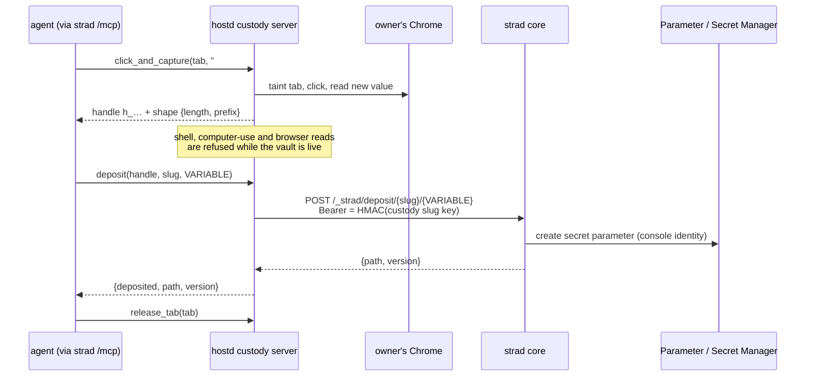

An agent can click through a provider's "generate token" page in your
browser. It must not read the token. Anything a tool returns goes to the model
provider and into Zimmer's transcript, and a transcript keeps it. So the only
control that works is that the tool never returns the value.

The `custody` server in strad-hostd does that. It captures a credential into
an opaque handle that stays on the Mac, and its `deposit` tool posts the value
straight to strad, which stores it as a new secret parameter. The agent works
with the handle and the value's shape. It never sees the value itself.



## The tools

The server is `/custody/mcp`, slug `custody-<suffix>`. It uses the same
`request_control` → `grant_id` → `end_control` consent flow as every hostd
server. Its consent dialog says it can capture a credential and send it to
strad.

| Tool                | What it does                                                                                                       |
| ------------------- | ------------------------------------------------------------------------------------------------------------------ |
| `list_tabs`         | The owner's tabs, each marked `tainted` or not. A tainted tab's title and URL are hidden.                                                                    |
| `click_and_capture` | Taints the tab, clicks, and captures the value that appears. Returns a handle and a shape.                         |
| `capture_download`  | Clicks a download, reads the new file from the Downloads folder into a handle, and deletes the file.               |
| `release_tab`       | Navigates a tainted tab to `about:blank` and lifts its taint.                                                      |
| `generate_keypair`  | Generates an ed25519 SSH keypair. Holds the private key as a handle; returns the public key and its fingerprint.  |
| `list_handles`      | This grant's handles: held, deposited (with path and version), discarded, burned or expired.                       |
| `discard_handle`    | Drops a handle and zeroes its bytes.                                                                               |
| `deposit`           | Posts a handle's value to a strad, named by `destination` (default: this machine's own), as `/strad/<env>/mcp/<slug>/static/<VARIABLE>`. Returns the destination, the path and the version. |

A shape is the value's length, its kind (`token`, `json`, `pem`, `text`), a
well-known non-secret prefix (`ghp_`, `lin_api_`, `sk-ant-` and similar) and,
for JSON, its top-level key names. It is enough to check that you captured
the right thing.

`click_and_capture` finds the value in one of two ways. With
`capture_selector`, it reads that element: an input's value, a copy button's
`data-clipboard-text`, or the element's text. Without it, it takes the one new
credential-shaped string the click produced: 16 or more printable characters,
letters and digits, no spaces, not a URL. If several appear it keeps none and
returns their selectors, so the next call can name one. Navigation to the
provider's page is the browser server's job, as before.

### Generating a key instead of capturing one

Some credentials are not shown on any page. strad's [SSH server](/servers/ssh/)
logs in with a private key, and its public half has to be installed on the
host. `generate_keypair` makes that key inside custody:

```text
generate_keypair(comment: "strad ssh-example-staging", label: "staging login key")
→ {"handle":"h_…","shape":{"kind":"pem","length":411,"lines":7},
   "key_type":"ed25519",
   "public_key":"ssh-ed25519 AAAAC3Nza… strad ssh-example-staging",
   "fingerprint":"SHA256:…"}
```

The private key is an unencrypted OpenSSH `ed25519` key, the same thing
`ssh-keygen -t ed25519 -N ''` writes. It goes straight into the vault and is
held exactly like a captured value: the same hold, the same egress filter, the
same expiry, ended by `discard_handle` or the grant, burned if it shows up in
a result or an argument. It is refused while a shell command is running, for
the same reason a capture is. No tab is involved, so nothing is tainted.

The public key and fingerprint are public and meant to travel. Deposit the
handle (for an SSH slug, as `SSH_PRIVATE_KEY`), and put `public_key` in the
host's `authorized_keys`, or in whatever installs it there. The filter only
matches the private key's forms, so the public line passes through results
and arguments untouched. Only `ed25519` is offered.

## What hostd enforces

This is enforced in the daemon. It is not a convention a skill asks agents to
follow. One vault is shared by every server on the daemon, and every tool
call on every server goes through one place
(`hostd/src/mcp/server.ts`, `hostd/src/custody/enforce.ts`).

**The vault is live** while it holds a handle, while a tab is tainted, or
while a capture is running. While it is live:

- **shell** refuses every call. It runs as you, so it could read the Downloads
  folder, the clipboard, Chrome's profile and the daemon's own state.
- **computer** and **computer-headless** refuse every call. A screenshot or an
  Accessibility read of a window showing the token is the token.
- **browser** refuses `read_page`, `evaluate_script`, `take_screenshot` and
  `list_tabs` on every tab (`list_tabs` because it carries each page's own
  title). On a tainted tab it also refuses everything except `navigate_tab`
  and `close_tab`. Reads are refused on every tab because the DevTools route
  and the extension route name the same tab differently, so "is this the
  tainted tab" cannot be answered across them.
- **messages** is not affected. It reads the Messages database, not the
  screen.

Two things lift a tab's taint: closing it, and custody's `release_tab`, which
navigates it to `about:blank`. A navigation through the browser server does
not, because a `#fragment` navigation leaves the page and the secret where
they were. When a custody grant ends for any reason (`end_control`, expiry,
idle, the kill switch), the daemon blanks every tab that grant tainted and
drops every handle it held. If a tab cannot be blanked but is still open, it
stays tainted until a custody grant releases it.

A capture also **will not start while a shell command is running**. The hold is
checked when a call begins, so a command started before the capture
(`sleep 20; pbpaste`) would otherwise run straight through it.

**The egress filter** is the backstop. Every result any server returns, and
every set of arguments any caller sends, is checked for the exact value of
every live handle, and of every handle deposited or discarded under a custody
grant that is still running: the value itself, its JSON-escaped, base64, base64url and
URL-encoded forms, and for a JSON or PEM credential, its secret fields and
the long lines of a PEM body, and any credential-shaped word in a value that
was captured with text around it. A match withholds the result and **burns** a
handle still held. A burned handle cannot be deposited, because a value that
reached the model is a leaked credential. Revoke it at the provider and capture
a new one. A match on a deposited value means the copy in strad has leaked,
and it needs rotating. Values stay watched after a deposit because the token
may still be on the clipboard or in a window.
This is an exact match on a known value, so it does not guess what looks
secret.

The cost: from capture until release, other sessions on the same Mac cannot
use shell or computer-use. A refusal says why and how to end the hold. The
status page shows how many secrets custody holds and how many tabs are
tainted.

## The deposit route

`POST /_strad/deposit/{slug}/{VARIABLE}` on strad core, with body
`{"value": "…"}`. It only writes:

- **No read.** There is no GET, any other verb is a 405, and no answer
  contains a value.
- **Create-only, and no shadowing.** The answer is 409 if the name already
  exists under `static/` or `oauth/`, and also if it already resolves for that
  slug from any layer: the gateway namespace, or core's environment. A new
  `static/` copy would outrank those, which is an overwrite in everything but
  name. A write-only door that could replace a live credential could point an
  agent's traffic at an attacker's account, so that is ruled out entirely. To
  rotate a credential, use the console.
- **Not a name that steers.** The answer is 403 for any of these:
  - A name that is part of the target slug's `url:`, because that value decides
    where its traffic goes.
  - A name a process reads as configuration rather than as a credential:
    `NODE_*`, `LD_*`, `DYLD_*`, `STRAD_*`, `OTEL_*`, the `*_PROXY` names, `PATH`
    and similar.
  - A slug that is itself a `local-tunnel` machine, whose keys a human places.
  - A `params: true` slug, unless the caller names it in `deposit.into:` or
    names that exact slug and variable in `deposit.paramsVariables:`. Such a
    slug loads its whole namespace into its container's environment, so a
    deposit there is a new environment variable on a container. A
    `paramsVariables:` pair grants exactly one name. It still meets every
    other refusal on this list, so it can never be a `STRAD_*`, `NODE_*` or
    proxy name.
- **One namespace.** The path is always `/strad/<env>/mcp/<slug>/static/<VAR>`,
  built from the literal `static` kind and two shape-checked segments. No
  spelling reaches a gateway name or `oauth/`.
- **Secret parameters only.** The value is stored in Secret Manager behind a
  `__REF__`, with the per-parameter `secretAccessor` grant, like any secret
  created in the console.

Core performs the write through `store.create()` with the console's own admin
credential, so the encoding, the version and the grant come from the same
code as a console create. No new IAM is involved. See
[secrets IAM](/operate/secrets-iam/). The answer is
`{"protocol":1,"path":"…","version":"v1"}`.

### Who may call it: a derived bearer

The custody server is a `local-tunnel` slug, so strad already holds its bearer
key: the `${NAME}` in that entry's `Authorization` header. The daemon holds
the same key. The deposit bearer is `HMAC-SHA256(key, "strad-deposit-v1")`,
base64url-encoded. Both sides compute it and neither stores it, so **nothing
new is seeded anywhere**. The bearer does not open the slug, so a deposit
bearer seen in transit is not a way into the Mac. The other direction does
hold: **whoever holds the slug key can deposit.** That is strad, the Mac's
`~/.strad-hostd/config.json`, and so a shell-server grant on the Mac while
custody holds nothing. Custody deposits are therefore only as private as the
other hostd servers' keys, which that file already holds. Core identifies the
caller by which entry's key matched, never by anything the caller claims. The
derivation lives in `src/secrets/deposit-wire.ts`, vendored into hostd by
`npm run deposit:sync`.

A minted bearer was the alternative. It would have meant one more credential
for a human to create, paste into the Mac's config and store in strad, for the
same exposure: both copies would sit in the same file on the same machine.

Turn it on in the checked-in config:

```yaml
- slug: custody-my-mbp
  kind: local-tunnel
  url: https://hostd.example.com/custody/mcp
  entitlements: [admin]
  timeoutMs: 120000
  headers:
    CF-Access-Client-Id: "${HOSTD_CF_ACCESS_CLIENT_ID}"
    CF-Access-Client-Secret: "${HOSTD_CF_ACCESS_CLIENT_SECRET}"
    Authorization: "Bearer ${HOSTD_CUSTODY_KEY}"
  deposit:
    into: [linear, granola] # optional; omitted, any slug
    paramsVariables: # optional; exact pairs on params: true slugs
      ssh-example-staging: [SSH_PRIVATE_KEY]
```

- The `Authorization` header must be exactly `Bearer ${NAME}`. The schema
  refuses `deposit:` otherwise.
- `into:` narrows the slugs the machine may deposit into. `paramsVariables:`
  only widens: each entry lets one `params: true` slug take one named variable,
  even if `into:` leaves the slug out, and it changes nothing for any other
  slug. The schema refuses a listed slug that is not `params: true`, and a
  listed name the route would refuse anyway. A listed slug that does not exist grants nothing.
- `deposit:` is honoured from the **checked-in** config only. A runtime
  roster write that adds or changes it is refused.
- **To revoke it,** remove the `deposit:` block (a deploy), or rotate the
  slug's key in the console. Rotating takes effect at once, and the Mac needs
  the new key before its custody slug works again.

On the Mac:

```bash
strad-hostd add custody --suffix my-mbp   # mints the custody key; off by default
# then set custody.stradUrl in ~/.strad-hostd/config.json, e.g. "https://strad.example.com"
strad-hostd keys                          # prints the key to store under HOSTD_CUSTODY_KEY
```

`custody` is the one server that `init` and the installer do **not** turn on.
Enabling it creates the key the deposit bearer is derived from, and a
credential that can write into strad's store should go on a machine because
someone decided it should, not because the installer was re-run.

## Another strad: named destinations

By default `deposit` goes to one strad, `custody.stradUrl`. A machine can also
deposit into other strad deployments, such as another organisation's, without
that strad getting any access to the machine. Each one is a named entry in the
Mac's own config:

```json
"custody": {
  "stradUrl": "https://strad.example.com",
  "stradName": "mine",
  "destinations": {
    "pulsemcp": {
      "url": "https://strad.pulsemcp.com",
      "key": "<minted by strad-hostd destination add>",
      "title": "PulseMCP's strad"
    }
  }
}
```

- **A name, never a URL.** `deposit` takes `destination: "pulsemcp"`. Its
  input schema lists exactly these names (the default's, then each
  configured one), and any other value is
  refused before anything is sent: `No deposit destination named "…"`. A
  prompt cannot add a host. Only the owner, editing this file, can.
- **Omitting it means the default.** No `destination` means `stradUrl` with the
  custody slug's derived bearer. `stradName` (default `"default"`)
  is the name that destination also answers to, so a list a human approved can
  say "mine" out loud.
- **Each destination has its own key.** The bearer is
  `depositToken(destination key)`, the same derivation as the default, so the
  other strad's route needs no change. The key is a fresh random string, not
  the custody slug key, and the schema refuses one equal to any server or
  client key on the machine. The strad holding it can deposit and can open
  nothing on the Mac.
- `list_handles` and the deposit result say which destination a handle went to.

Add one on the Mac:

```bash
strad-hostd destination add pulsemcp --url https://strad.pulsemcp.com --title "PulseMCP's strad"
# prints:  custody deposit → pulsemcp (strad.pulsemcp.com)  <key>
strad-hostd keys        # prints it again later
# restart the daemon to serve the new destination
```

`strad-hostd destination remove pulsemcp` drops it, and a running daemon
stops depositing there at once. Delete the key from that strad too. A
destination added while the daemon runs can be deposited into straight away,
but the tool's list of names updates at the next restart.

### What the other strad needs

The deposit route accepts a bearer derived from the `${NAME}` key of an
enabled `local-tunnel` entry that declares `deposit:`. The other strad has no
tunnel to this machine and should not have one, so its entry is a deposit
caller only. Its `url` is a name that never resolves, so strad never dials
anything:

```yaml
- slug: custody-my-mbp
  kind: local-tunnel
  title: The owner's Mac (custody deposits only)
  description: Lets strad-hostd custody on the owner's Mac deposit secrets here, write-only. Never dialled.
  url: https://custody-my-mbp.invalid/
  entitlements: []
  headers:
    Authorization: "Bearer ${HOSTD_CUSTODY_DEPOSIT_KEY}"
  deposit:
    into: [linear, granola] # optional; omitted, any slug
```

- `HOSTD_CUSTODY_DEPOSIT_KEY` is the key `destination add` printed, stored in
  that strad's own store under the entry's namespace
  (`/strad/<env>/mcp/custody-my-mbp/static/HOSTD_CUSTODY_DEPOSIT_KEY`) through
  its console. A deposit cannot seed it: the route refuses a `local-tunnel` slug.
  Store it **before** the entry deploys, because the deploy's preflight refuses
  an unseeded `${NAME}`, or list it in the entry's `mayBeUnseeded:` until it
  lands. On a strad using the `env` secrets provider it is an App Platform
  secret instead.
- `entitlements: []` means no role can reach the slug through `/mcp`. The
  `.invalid` name reads as `offline` on that strad, which is not degraded
  ([limitation #152](/limitations/)).
- No Cloudflare Access headers and no custody slug key. Those open the Mac,
  and this strad has no reason to hold them.
- To revoke it there, delete the entry or the key. On the Mac,
  `destination remove`.

### Verifying a deposit into another strad

The deposit answers `201` with the path and version only after that strad's
`store.create()` succeeded, so the receipt is the other strad's own account of
the write. An independent check is `list_parameters` on **that** strad's
`secrets` server. This strad's `secrets` server cannot do it, because it reads
this deployment's store. If the other strad's `secrets` slug is console-only
(no `env:`, no viewer key), its admins can see the parameter and its timestamp
in its console. For an agent to check it, that strad needs a viewer key on its
`secrets` slug (`parametermanager.parameterViewer`, never `parameterAccessor`),
a role that allows only `list_parameters` there, and a token for that role in
the agent's MCP config.

## Verifying a deposit

Check for the parameter and its timestamp with the `secrets` server's
`list_parameters` (a viewer can do it). Never verify a deposit by reading the
value back.

## Limits

Read [limitation #141](/limitations/) before relying on this. In brief: a
daemon restart loses every handle; capture is a heuristic that a page can
defeat; `capture_download` watches the Downloads folder rather than Chrome's
download events; a value that reached the model in some way the filter does
not cover is not caught; and the macOS halves have run only on the owner's
Mac, not in CI.

**Background tabs.** A capture is meant to run in a background tab, so it
never takes the owner's focus. Chrome does not deliver DevTools mouse input to
a hidden page: `mouseMoved` never answers, and the page's click listener never
fires. That is why the first background-tab captures on the owner's Mac timed
out after 30 seconds. hostd works around it by wrapping each click in
`Emulation.setFocusEmulationEnabled`. For that one click, the page sees itself
as visible and focused, and the click arrives with `isTrusted: true`. The tab
does not come forward, and emulation is switched off as soon as the click is
sent. A page that checks `document.visibilityState` during the click sees
`visible`. If the page still reads hidden under emulation, hostd sends no input
and the call fails at once: "The tab is hidden … Bring the tab to the front".
The taint is lifted, because nothing was clicked. Emulation is for the click only: once it is sent, the page gets `blur` and reads `hidden` again. A provider that closes its reveal dialog on blur, or puts the token only on the clipboard, can still defeat a background capture. Bring that tab forward with the browser server's `activate_tab` and capture there. The fix has been tested
against a windowed Chrome on Linux. It has not yet been tested on the owner's
Mac or through the extension route.

## Not built yet

- **A CI caller.** A second kind of caller with its own bearer and its own
  namespace fence, so a workflow can move a GitHub Actions secret into strad.
- **Zimmer's production store.** Letting the same route write to
  `/zimmer/production/mcp/static/`.
- **Rotation.** Overwriting stays in the console.
