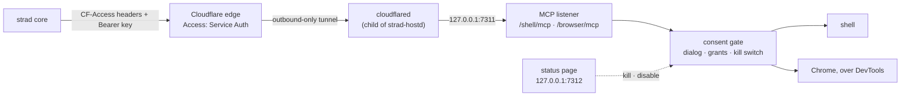

`strad-hostd` serves MCP servers that operate the machine it runs on. Two are
built: a shell server and a browser server that drives the Chrome you already
have open. strad reaches them as [`kind: local-tunnel`](/servers/local-tunnel-host/)
slugs. [The design page](/servers/hostd-design/) has the reasoning. To run it on
any machine with no tunnel, read `hostd/README.md`.



The status page is a separate listener. The tunnel's ingress names port 7311 and
nothing else.

## Install

On the Mac, with Node 22.4 or newer and `cloudflared` installed
(`brew install node cloudflared`):

```bash
git clone https://github.com/tadasant/strad && cd strad
./hostd/install/install.sh --machine "My MacBook Pro" --suffix my-mbp \
  --hostname hostd.example.com
```

`--suffix` names the servers: `shell-my-mbp` and `browser-use-my-mbp-headless`.
Those names appear in the consent dialog, so make them the strad slugs. The script
opens a browser for `cloudflared tunnel login` the first time, creates a named
tunnel called `strad-hostd`, routes the hostname to it, and installs the
LaunchAgent `com.strad.hostd`. Leave out `--hostname` for a loopback-only daemon.

Re-run it to upgrade. It keeps the config, the keys and the tunnel.
`./hostd/install/uninstall.sh` removes it, and `--purge` also deletes
`~/.strad-hostd`.

:::caution[These steps happen on the machine, by hand]
strad's rule is that operating a feature never needs a shell on a box. This one
cannot meet it: the box is a personal laptop, and installing software on it,
answering its TCC prompts and logging it in to Cloudflare are things only its
owner can do. See [limitation #101](/limitations/). Everything after install goes
through a deploy or strad's console.
:::

## Lock the hostname

The hostname is public and discoverable from Certificate Transparency logs.
Follow [Locking the tunnel down](/servers/local-tunnel-host/#locking-the-tunnel-down): a
self-hosted Access application for the hostname, a service token, and a policy
whose action is **Service Auth**. `Allow` sends a service token to a login page.

## Let Chrome be driven

In the Chrome you use, open `chrome://inspect/#remote-debugging` and turn on
remote debugging for the running browser. This needs Chrome 144 or newer.
Launching Chrome with `--remote-debugging-port` does not work for your default
profile: Chrome has ignored that flag there since version 136, without an error.

Chrome asks "Allow remote debugging?" each time the daemon connects, and shows a
banner while it is attached.

## Register the slugs

One entry per server. They share the hostname and differ by path and by key:

```yaml
- slug: shell-my-mbp
  kind: local-tunnel
  url: https://hostd.example.com/shell/mcp
  entitlements: [admin]
  timeoutMs: 330000
  headers:
    CF-Access-Client-Id: "${HOSTD_CF_ACCESS_CLIENT_ID}"
    CF-Access-Client-Secret: "${HOSTD_CF_ACCESS_CLIENT_SECRET}"
    Authorization: "Bearer ${HOSTD_SHELL_KEY}"
  recovery:
    machine: "My MacBook Pro"
    commands:
      - "launchctl kickstart -k gui/$(id -u)/com.strad.hostd"
    notes: "Check http://127.0.0.1:7312 on that machine: if it says remote control is OFF, its owner switched it off on purpose."
```

`timeoutMs` is above the default because `run_command` can wait up to 300
seconds. `strad-hostd keys` on the Mac prints each server's bearer key. Seed it,
and the Access token's id and secret, under that slug's `static/` namespace at
`/ui/secrets` **before** the config that references them deploys: an unset
`${NAME}` fails the render, and the render is the whole spec.

Keep these slugs `admin`-only unless you have read
[what entitlement means here](/servers/hostd-design/#security-model).

## Using it

Every server starts the same way:

1. `request_control` with a `purpose` of at most two sentences. A dialog appears
   on the machine and the call blocks for up to five seconds.
2. Pass the returned `grant_id` to every other tool.
3. `end_control` when done.

An unanswered dialog is a **denial** by default. To let requests through when
nobody objects, set `"consent": { "onTimeout": "allow" }` in
`~/.strad-hostd/config.json` and restart. Read the design page's consent section
first: with that setting and nobody at the screen, the dialog protects nothing.

## See it, stop it, turn it off

| | |
| --- | --- |
| What is in control right now | `http://127.0.0.1:7312`, or `strad-hostd status` |
| Stop one grant and what it started | the grant's **Kill** button, or `strad-hostd kill <grant_id>` |
| Turn everything off | **Disable everything**, `strad-hostd disable`, or `touch ~/.strad-hostd/DISABLED` |
| Turn it back on | **Turn back on**, or `strad-hostd enable` |

The machine posts a notification when a grant starts and when it ends, naming
the server and the purpose. There is no persistent on-screen banner.

Disabling ends every grant, kills what they started, stops the tunnel, and
survives a reboot. A `touch`ed file takes effect within two seconds. A command
that moved itself into a new session (`setsid`, a launchd job) is out of reach of
all of these: this is an unsandboxed shell. strad then reports the slugs `offline`.

`~/.strad-hostd/audit.jsonl` records each request, decision and tool call,
including the commands that ran. It stays on the machine.
