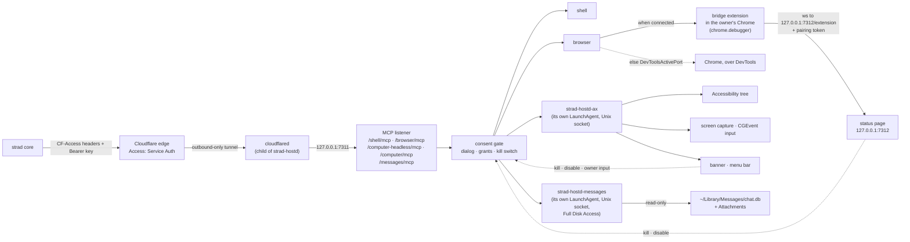

`strad-hostd` serves MCP servers that operate the machine it runs on. Five are
built: a shell server, a browser server that drives the Chrome you already have
open, a computer-use server that operates apps through macOS Accessibility
without touching your mouse, a computer-use server that sees the screen and
drives the real mouse and keyboard, and a read-only Messages server that reads
your iMessage and SMS history. strad reaches them as
[`kind: local-tunnel`](/servers/local-tunnel-host/) slugs.
[The design page](/servers/hostd-design/) has the reasoning. To run it on any
machine with no tunnel, read `hostd/README.md`.



The status page is a separate listener. The tunnel's ingress names port 7311 and
nothing else, which is also why the Chrome extension connects there: its
socket, and the CRX a policy-installed Chrome fetches, are on the port nothing
outside the machine can reach. `strad-hostd-ax` and `strad-hostd-messages` are
LaunchAgents of their own that the daemon talks to over sockets in
`~/.strad-hostd`, because that is the only arrangement under which macOS
attributes their permission grants to the helper and not to `node`.

## Install

On the Mac, with Node 22.4 or newer and `cloudflared` installed
(`brew install node cloudflared`):

```bash
git clone https://github.com/tadasant/strad && cd strad
./hostd/install/install.sh --machine "My MacBook Pro" --suffix my-mbp \
  --hostname hostd.example.com
```

`--suffix` names the servers: `shell-my-mbp`, `browser-use-my-mbp-headless`,
`computer-use-my-mbp-headless`, `computer-use-my-mbp` and `imessage-my-mbp`. Those names appear in
the consent dialog, so make them the strad slugs. The script opens a browser for
`cloudflared tunnel login` the first time, creates a named tunnel called
`strad-hostd`, routes the hostname to it, and installs the LaunchAgent
`com.strad.hostd`. Leave out `--hostname` for a loopback-only daemon.

With `swift` on the Mac (`xcode-select --install`) it also builds the two
native helpers, `strad-hostd-ax` and `strad-hostd-messages`, signs them, copies
them to `~/.strad-hostd/bin`, and installs a LaunchAgent for each,
`com.strad.hostd-ax` and `com.strad.hostd-messages`. Without `swift` the
computer-use and Messages servers are served and refuse every request until
their helper exists; `--no-helper` skips the build on purpose.

Re-run it to upgrade. It keeps the config, the keys and the tunnel, and adds any
server the config predates. `./hostd/install/uninstall.sh` removes it, and
`--purge` also deletes `~/.strad-hostd`.

:::caution[These steps happen on the machine, by hand]
strad's rule is that operating a feature never needs a shell on a box. This one
cannot meet it: the box is a personal laptop, and installing software on it,
answering its TCC prompts and logging it in to Cloudflare are things only its
owner can do. See [limitation #101](/limitations/). Everything after install goes
through a deploy or strad's console.
:::

## Lock the hostname

The hostname is public and discoverable from Certificate Transparency logs.
Follow [Locking the tunnel down](/servers/local-tunnel-host/#locking-the-tunnel-down): a
self-hosted Access application for the hostname, a service token, and a policy
whose action is **Service Auth**. `Allow` sends a service token to a login page.

## Sign the helper, then grant it

macOS decides who holds Accessibility and Screen Recording by the code
signature. The install signs `strad-hostd-ax` with the first of: an identity
you name (`--sign-identity` or `STRAD_HOSTD_SIGN_IDENTITY`), a Developer ID
Application certificate already in the keychain, or a self-signed certificate
called `strad-hostd-ax` that it creates in your login keychain and trusts for
code signing, which asks for your login password in a dialog once. Any of those
is stable across rebuilds; an ad-hoc signature is not, and would drop both
grants every time you upgrade.

Then grant it. `strad-hostd helper --request-access` asks the running helper
to make macOS put up its own prompts for **Accessibility** (both computer-use
servers) and **Screen & System Audio Recording** (`computer-use-*` only, for
screenshots); asking through the helper's own connection is what attributes
the prompts to the helper rather than to your terminal. Or add
`~/.strad-hostd/bin/strad-hostd-ax` by hand under both headings in System
Settings › Privacy & Security. Restart the helper afterwards:

```bash
launchctl kickstart -k gui/$(id -u)/com.strad.hostd-ax
strad-hostd helper
```

The second line reports what the helper holds. Until Accessibility is granted,
`request_control` on either computer-use server refuses with
`helper_unavailable` and shows no dialog: nothing the person at the screen can
click in ten seconds would fix it.

macOS 15 asks again, roughly monthly, whether the helper may keep recording the
screen. Every capture that does not go through the system's own picker gets
that prompt, and only the person at the Mac can answer it. A screenshot taken
while the approval has lapsed fails with `screen_recording_denied`.

## Give the Messages helper Full Disk Access

The Messages server reads `~/Library/Messages/chat.db`, which macOS lets no
program read without **Full Disk Access**. The grant goes to
`strad-hostd-messages` and to nothing else: not to `node`, not to the shell
server, not to `strad-hostd-ax`. There is no API that asks for it, so it is
one drag at the Mac:

```bash
strad-hostd messages --grant
```

That opens System Settings › Privacy & Security › Full Disk Access and shows
`~/.strad-hostd/bin/strad-hostd-messages` in Finder. Drag it into the list (or
press **+**, then ⌘⇧G and paste the path), switch it on, and restart the helper:

```bash
launchctl kickstart -k gui/$(id -u)/com.strad.hostd-messages
strad-hostd messages
```

The second line says whether `chat.db` is readable. Until it is,
`request_control` on the Messages server refuses with `helper_unavailable` and
shows no dialog. The grant is keyed on the helper's signature (identifier
`com.strad.hostd-messages`), so an upgrade signed by the same certificate keeps
it.

Two settings on the Mac decide how complete and how fresh the history is:

- **Messages in iCloud** (Messages › Settings › iMessage › Enable Messages in
  iCloud). With it on, a Mac that was asleep or off catches up when it wakes,
  and history from your other devices lands here. With it off, what arrived
  while the Mac slept may never reach it.
- **The Mac awake.** iMessage exists only on Apple hardware, and a sleeping Mac
  receives nothing. A read run while the Mac sleeps does not reach it at all:
  the tunnel is down and strad reports the slug `offline`. A nightly sweep
  needs the Mac awake when it runs (plugged in with **Prevent automatic
  sleeping when the display is off**, or `caffeinate`), or it reads the gap
  the next time it runs. An always-on Mac signed in to the same Apple ID
  removes the question.

## Let Chrome be driven

The browser server has two ways into the Chrome you use, and takes the first
that is there.

**The extension, for a machine nobody is at.** `strad-hostd extension` on the
Mac prints the install with your paths and pairing token: `chrome://extensions`
› Developer mode › Load unpacked › `~/.strad-hostd/app/extension`, then the
token pasted into its options page. It stays installed while developer mode
does, and shows a "started debugging this browser" bar on each tab it
attaches unless Chrome runs with `--silent-debugger-extension-api`. The daemon
must be running, and the status page says "Chrome extension: connected" once
it is paired. The command also writes a configuration profile that
force-installs the extension from the daemon with the token in managed
storage, for a Mac Chrome considers managed: on a personal Mac Chrome filters
a force-install from outside the Web Store as a sensitive policy and installs
nothing, so that file is for an MDM-enrolled or domain-bound machine only.

**DevTools, otherwise.** Open `chrome://inspect/#remote-debugging` and turn on
remote debugging for the running browser (Chrome 144 or newer). Chrome asks
"Allow remote debugging?" each time the daemon connects, and only a person can
answer, so this route cannot run unattended. Launching Chrome with
`--remote-debugging-port` does not work for your default profile: Chrome has
ignored that flag there since version 136, without an error.

:::caution[What the extension hands over]
With it installed, every account that Chrome is signed in to can be driven by
anything that holds a browser key and gets past the consent dialog, with no
prompt from Chrome. Under the unattended setting below, the dialog refuses
nothing. A prompt injection in one agent's page reaches all of those accounts.
What remains is the daemon's: a key per server, a grant per task, the audit
log, and the kill switch, which also detaches the debugger from every tab.
Keep these slugs `admin`-only. See [limitation #112](/limitations/).
:::

## Register the slugs

One entry per server. They share the hostname and differ by path and by key:

```yaml
- slug: shell-my-mbp
  kind: local-tunnel
  url: https://hostd.example.com/shell/mcp
  entitlements: [admin]
  timeoutMs: 330000
  headers:
    CF-Access-Client-Id: "${HOSTD_CF_ACCESS_CLIENT_ID}"
    CF-Access-Client-Secret: "${HOSTD_CF_ACCESS_CLIENT_SECRET}"
    Authorization: "Bearer ${HOSTD_SHELL_KEY}"
  recovery:
    machine: "My MacBook Pro"
    commands:
      - "launchctl kickstart -k gui/$(id -u)/com.strad.hostd"
    notes: "Check http://127.0.0.1:7312 on that machine: if it says remote control is OFF, its owner switched it off on purpose."
```

`timeoutMs` is above the default because `run_command` can wait up to 300
seconds. The computer-use servers are `/computer-headless/mcp` and
`/computer/mcp`, with the default timeout. The Messages server is
`/messages/mcp` (`imessage-my-mbp`), with the default timeout and the same
headers: its own `Authorization: Bearer` key, the shared Access token. No
tunnel or Access change is needed for it, because the tunnel routes every path
on the daemon's port. `strad-hostd keys` on the Mac prints
each server's bearer key. Seed it, and the Access token's id and secret, under
that slug's `static/` namespace at `/ui/secrets` **before** the config that
references them deploys: an unset `${NAME}` fails the render, and the render is
the whole spec.

Keep these slugs `admin`-only unless you have read
[what entitlement means here](/servers/hostd-design/#security-model).

## Using it

Every server starts the same way:

1. `request_control` with a `purpose` of at most two sentences. A dialog appears
   on the machine and the call blocks for up to ten seconds. Only a mouse
   click on **Allow**, **Reject** or **Disallow and cool down** answers it: no
   key does, so someone typing in another app when it appears cannot decide it
   by accident.
2. Pass the returned `grant_id` to every other tool.
3. `end_control` when done.

A plain **Reject** refuses that one request and nothing more: the next
`request_control` gets a fresh dialog. A server is held off, with no dialog, for
`consent.rejectCooldownSeconds` (60) only when you kill one of its grants or
answer **Disallow and cool down**; it is refused as `cooldown` until then.

An unanswered dialog is a **denial** by default. To let requests through when
nobody objects, set `"consent": { "onTimeout": "allow" }` in
`~/.strad-hostd/config.json` and restart. Read the design page's consent section
first: with that setting and nobody at the screen, the dialog protects nothing.

### Reading Messages

`imessage-*` serves three tools after the three control tools, all read-only:
`imessage_list_chats`, `imessage_get_messages` and `imessage_get_attachment`.
It cannot send, and reading marks nothing as read.

`imessage_get_messages` pages by `rowid`, the database's own row number, which
only grows. Pass the `next_after_rowid` of the last call as `after_rowid` and
you get exactly the message rows stored since, in the order this Mac stored
them, across every chat or within one. That is the cursor a nightly sweep
stores. Two things it does not give you: chronological order (messages a woken
Mac syncs from iCloud get new rowids, so `sent_at` can go backwards across a
page), and an edit or unsend made later to a message the sweep already read.
Without a cursor you get the newest messages, and `before_rowid` pages back
from there. A cursor past every rowid the database has ever handed out comes
back with a `warning`, because it means the database was rebuilt and its
numbering restarted.

Senders are phone numbers and email addresses, and each comes with the name
your Contacts on the Mac give it: `sender_name` on a message, `name` on each
of a chat's `participants`. A number matches on E.164, with the Mac's region
supplying a country code the contact or the handle lacks; an email matches
lowercased. No match leaves the name `null` and the handle as it was. The
names come from Contacts' own files, read under the same Full Disk Access
grant, so there is no second prompt; the book is re-read every ten minutes,
and when it cannot be read the result carries a `contacts_warning`: names are
`null` if the book has never been read, or the last read's if a re-read
failed. A short code (fewer than seven digits) is never named. Attachments come back by `attachment_id`; HEIC, HEIF and TIFF
photos, and any JPEG, PNG or WebP over 3.5 MB, are converted to a JPEG at most
2048 pixels on a side on the Mac, and anything else comes back as a file with
its MIME type. An attachment Messages in iCloud has not downloaded to this
Mac is an error saying so.

`init` and `add` write `"onTimeout": "allow"` on this server alone, so a read
with nobody at the screen is granted when the dialog's window closes. The
dialog still shows, the grant still notifies and is audited, and the kill
switch still ends it; the rest of the machine keeps `deny`. Set it to `"deny"`
under `capabilities.messages` in `~/.strad-hostd/config.json` to require
someone at the screen.

### Unattended

The configuration for a Mac nobody is sitting at, all of it:

```json
{ "consent": { "onTimeout": "allow", "windowSeconds": 3 } }
```

plus the extension above. Three seconds is the shortest window the daemon
accepts. Every `request_control` then succeeds after three seconds unless
someone happens to be there to reject it, and `approved_by` says `"timeout"`.
The default stays `deny`; this is the owner's setting, in a file only they can
write.

## Several sessions from the same Mac

Claude Code sessions on the Mac itself reach the same daemon over HTTP, each
with a key of its own, rather than each spawning a `stdio` process: a `stdio`
process cannot use the extension, and on a Mac with the helper's LaunchAgent
installed it cannot reach the helper either, which takes one controller.

```bash
strad-hostd key add browser claude-1
claude mcp add --transport http hostd-browser http://127.0.0.1:7311/browser/mcp \
  --header "Authorization: Bearer <the key it printed>"
```

One `key add` per session and per server; the daemon picks a new key up at
once. The dialog and the status page show the client's name after the
server's, so a grant reads `browser-use-my-mbp-headless (claude-1)`. Grants are
independent: several sessions can hold the browser at once, they share one
`chrome.debugger` attachment per tab, and a tab one grant opened is not
closable by another. `key revoke browser claude-1` ends that session's access
without touching the rest.

The two computer-use servers differ on one axis. `computer-use-*-headless`
reads and operates apps through the Accessibility tree: `read_ui_tree` shows a
window's buttons, fields and menus with ids, `perform_action` presses one,
`set_value` fills one, and the mouse never moves. Its dialog is the ordinary
one. `computer-use-*` takes the machine: `take_screenshot`, then `click`,
`type_text` and `press_keys` on the real cursor and keyboard. Its dialog says
so, its banner is red, and your first key or click ends the grant.

## See it, stop it, turn it off

| | |
| --- | --- |
| What is in control right now | `http://127.0.0.1:7312`, or `strad-hostd status` |
| Stop one grant and what it started | the grant's **Kill** button, or `strad-hostd kill <grant_id>` |
| Keep a server from asking again for a minute | **Kill** its grant (any of the kill routes above, or the banner's), or answer its dialog with **Disallow and cool down** |
| Turn everything off | **Disable everything**, `strad-hostd disable`, or `touch ~/.strad-hostd/DISABLED` |
| Turn it back on | **Turn back on**, or `strad-hostd enable` |
| Whether the Chrome extension is paired | the status page's header, `strad-hostd status`, or `get_control_status` |

The machine posts a notification when a grant starts and when it ends, naming
the server and the purpose. With the helper installed, a banner also sits at
the top of the screen for the life of every grant, on every Space and above
every window, naming the server and the purpose, with **Kill** and **Disable
everything** buttons, and the menu bar shows the same state with the same
buttons. Orange means background control (shell, browser, Accessibility, Messages); red
means the mouse and keyboard are taken, and any key or click you make ends
that grant. The daemon re-sends the banner's state every two seconds, so a
helper that restarts redraws it on the next tick, and the helper acts for one
connection only: it refuses to read a tree, capture the screen or post input
unless the daemon that reported the grants is the one asking, and unless a
grant that covers it is in force.

That is a gate against the daemon's own bugs and against another process
driving the helper around the grant table while the daemon is up. It is not a
privilege boundary. A command run through the shell slug runs as you, and can
stop the daemon, edit `~/.strad-hostd/config.json`, unload either LaunchAgent
or replace the helper — which is the shell slug's blast radius, and why it
stays `admin`-only.

Disabling ends every grant, kills what they started, detaches the Chrome
extension from every tab, stops the tunnel, and survives a reboot. A `touch`ed file takes effect within two seconds. A command
that moved itself into a new session (`setsid`, a launchd job) is out of reach of
all of these: this is an unsandboxed shell. strad then reports the slugs `offline`.

`~/.strad-hostd/audit.jsonl` records each request, decision and tool call,
including the commands that ran. It stays on the machine.
