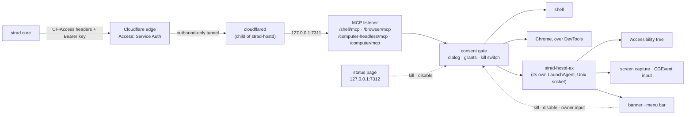

`strad-hostd` serves MCP servers that operate the machine it runs on. Four are
built: a shell server, a browser server that drives the Chrome you already have
open, a computer-use server that operates apps through macOS Accessibility
without touching your mouse, and a computer-use server that sees the screen and
drives the real mouse and keyboard. strad reaches them as
[`kind: local-tunnel`](/servers/local-tunnel-host/) slugs.
[The design page](/servers/hostd-design/) has the reasoning. To run it on any
machine with no tunnel, read `hostd/README.md`.



The status page is a separate listener. The tunnel's ingress names port 7311 and
nothing else. `strad-hostd-ax` is a second LaunchAgent the daemon talks to over
a socket in `~/.strad-hostd`, because that is the only arrangement under which
macOS attributes its permission grants to the helper and not to `node`.

## Install

On the Mac, with Node 22.4 or newer and `cloudflared` installed
(`brew install node cloudflared`):

```bash
git clone https://github.com/tadasant/strad && cd strad
./hostd/install/install.sh --machine "My MacBook Pro" --suffix my-mbp \
  --hostname hostd.example.com
```

`--suffix` names the servers: `shell-my-mbp`, `browser-use-my-mbp-headless`,
`computer-use-my-mbp-headless` and `computer-use-my-mbp`. Those names appear in
the consent dialog, so make them the strad slugs. The script opens a browser for
`cloudflared tunnel login` the first time, creates a named tunnel called
`strad-hostd`, routes the hostname to it, and installs the LaunchAgent
`com.strad.hostd`. Leave out `--hostname` for a loopback-only daemon.

With `swift` on the Mac (`xcode-select --install`) it also builds the native
helper `strad-hostd-ax`, signs it, copies it to `~/.strad-hostd/bin`, and
installs a second LaunchAgent, `com.strad.hostd-ax`. Without `swift` the two
computer-use servers are served and refuse every request until the helper
exists; `--no-helper` skips the build on purpose.

Re-run it to upgrade. It keeps the config, the keys and the tunnel, and adds any
server the config predates. `./hostd/install/uninstall.sh` removes it, and
`--purge` also deletes `~/.strad-hostd`.

:::caution[These steps happen on the machine, by hand]
strad's rule is that operating a feature never needs a shell on a box. This one
cannot meet it: the box is a personal laptop, and installing software on it,
answering its TCC prompts and logging it in to Cloudflare are things only its
owner can do. See [limitation #101](/limitations/). Everything after install goes
through a deploy or strad's console.
:::

## Lock the hostname

The hostname is public and discoverable from Certificate Transparency logs.
Follow [Locking the tunnel down](/servers/local-tunnel-host/#locking-the-tunnel-down): a
self-hosted Access application for the hostname, a service token, and a policy
whose action is **Service Auth**. `Allow` sends a service token to a login page.

## Sign the helper, then grant it

macOS decides who holds Accessibility and Screen Recording by the code
signature. The install signs `strad-hostd-ax` with the first of: an identity
you name (`--sign-identity` or `STRAD_HOSTD_SIGN_IDENTITY`), a Developer ID
Application certificate already in the keychain, or a self-signed certificate
called `strad-hostd-ax` that it creates in your login keychain and trusts for
code signing, which asks for your login password in a dialog once. Any of those
is stable across rebuilds; an ad-hoc signature is not, and would drop both
grants every time you upgrade.

Then, in System Settings › Privacy & Security, add `~/.strad-hostd/bin/strad-hostd-ax`
under **Accessibility** (both computer-use servers) and under **Screen & System
Audio Recording** (`computer-use-*` only, for screenshots). Running
`~/.strad-hostd/bin/strad-hostd-ax --request-access` makes macOS put up its own
prompts for both. Restart the helper afterwards:

```bash
launchctl kickstart -k gui/$(id -u)/com.strad.hostd-ax
strad-hostd helper
```

The second line reports what the helper holds. Until Accessibility is granted,
`request_control` on either computer-use server refuses with
`helper_unavailable` and shows no dialog: nothing the person at the screen can
click in five seconds would fix it.

macOS 15 asks again, roughly monthly, whether the helper may keep recording the
screen. Every capture that does not go through the system's own picker gets
that prompt, and only the person at the Mac can answer it. A screenshot taken
while the approval has lapsed fails with `screen_recording_denied`.

## Let Chrome be driven

In the Chrome you use, open `chrome://inspect/#remote-debugging` and turn on
remote debugging for the running browser. This needs Chrome 144 or newer.
Launching Chrome with `--remote-debugging-port` does not work for your default
profile: Chrome has ignored that flag there since version 136, without an error.

Chrome asks "Allow remote debugging?" each time the daemon connects, and shows a
banner while it is attached.

## Register the slugs

One entry per server. They share the hostname and differ by path and by key:

```yaml
- slug: shell-my-mbp
  kind: local-tunnel
  url: https://hostd.example.com/shell/mcp
  entitlements: [admin]
  timeoutMs: 330000
  headers:
    CF-Access-Client-Id: "${HOSTD_CF_ACCESS_CLIENT_ID}"
    CF-Access-Client-Secret: "${HOSTD_CF_ACCESS_CLIENT_SECRET}"
    Authorization: "Bearer ${HOSTD_SHELL_KEY}"
  recovery:
    machine: "My MacBook Pro"
    commands:
      - "launchctl kickstart -k gui/$(id -u)/com.strad.hostd"
    notes: "Check http://127.0.0.1:7312 on that machine: if it says remote control is OFF, its owner switched it off on purpose."
```

`timeoutMs` is above the default because `run_command` can wait up to 300
seconds. The computer-use servers are `/computer-headless/mcp` and
`/computer/mcp`, with the default timeout. `strad-hostd keys` on the Mac prints
each server's bearer key. Seed it, and the Access token's id and secret, under
that slug's `static/` namespace at `/ui/secrets` **before** the config that
references them deploys: an unset `${NAME}` fails the render, and the render is
the whole spec.

Keep these slugs `admin`-only unless you have read
[what entitlement means here](/servers/hostd-design/#security-model).

## Using it

Every server starts the same way:

1. `request_control` with a `purpose` of at most two sentences. A dialog appears
   on the machine and the call blocks for up to five seconds.
2. Pass the returned `grant_id` to every other tool.
3. `end_control` when done.

An unanswered dialog is a **denial** by default. To let requests through when
nobody objects, set `"consent": { "onTimeout": "allow" }` in
`~/.strad-hostd/config.json` and restart. Read the design page's consent section
first: with that setting and nobody at the screen, the dialog protects nothing.

The two computer-use servers differ on one axis. `computer-use-*-headless`
reads and operates apps through the Accessibility tree: `read_ui_tree` shows a
window's buttons, fields and menus with ids, `perform_action` presses one,
`set_value` fills one, and the mouse never moves. Its dialog is the ordinary
one. `computer-use-*` takes the machine: `take_screenshot`, then `click`,
`type_text` and `press_keys` on the real cursor and keyboard. Its dialog says
so, its banner is red, and your first key or click ends the grant.

## See it, stop it, turn it off

| | |
| --- | --- |
| What is in control right now | `http://127.0.0.1:7312`, or `strad-hostd status` |
| Stop one grant and what it started | the grant's **Kill** button, or `strad-hostd kill <grant_id>` |
| Turn everything off | **Disable everything**, `strad-hostd disable`, or `touch ~/.strad-hostd/DISABLED` |
| Turn it back on | **Turn back on**, or `strad-hostd enable` |

The machine posts a notification when a grant starts and when it ends, naming
the server and the purpose. With the helper installed, a banner also sits at
the top of the screen for the life of every grant, on every Space and above
every window, naming the server and the purpose, with **Kill** and **Disable
everything** buttons, and the menu bar shows the same state with the same
buttons. Orange means background control (shell, browser, Accessibility); red
means the mouse and keyboard are taken, and any key or click you make ends
that grant. The daemon re-sends the banner's state every two seconds, so a
caller that kills the helper from the shell slug gets it back on the next tick.

Disabling ends every grant, kills what they started, stops the tunnel, and
survives a reboot. A `touch`ed file takes effect within two seconds. A command
that moved itself into a new session (`setsid`, a launchd job) is out of reach of
all of these: this is an unsandboxed shell. strad then reports the slugs `offline`.

`~/.strad-hostd/audit.jsonl` records each request, decision and tool call,
including the commands that ran. It stays on the machine.
