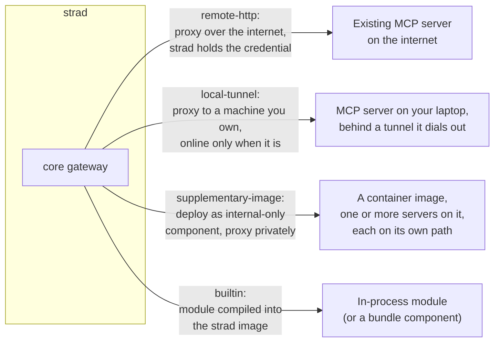

The core ships with **zero** MCP servers. Attaching one is a single entry under
`servers:` in your config. That entry is a **discriminated union on `kind`**, and
there are exactly four kinds. This is the whole extension surface of strad.

## What every server shares

Every server, regardless of kind, has these base fields (from
`src/config/schema.ts`):

| Field                  | Default      | Meaning                                                                               |
| ---------------------- | ------------ | ------------------------------------------------------------------------------------- |
| `slug`                 | _(required)_ | Identifier, `^[a-z0-9]+(-[a-z0-9]+)*$`, max 63. Goes in `?servers=`, prefixes every tool, and [names this server's variables on the container](/operate/secrets/#what-a-servers-variables-are-called-on-the-box) — which is why a dash may not double up, lead or trail. |
| `kind`                 | _(required)_ | `remote-http` \| `supplementary-image` \| `builtin`.                                  |
| `entitlements`         | `[]`         | Roles allowed to reach this server. **Empty = nobody** (fail closed).                 |
| `enabled`              | `true`       | Set `false` to configure without exposing.                                            |
| `tools`                | —            | The capability policy: `{ allow?: [...], deny?: [...] }`. Omitted = every tool.       |
| `timeoutMs`            | `120000`     | Per-hop upstream timeout. The MCP SDK's own default is 60s at every hop.              |
| `oauth`                | —            | This server authenticates as a **person**, and strad's console runs the consent. See below. |
| `mayBeUnseeded`        | `[]`         | `${NAME}`s this server may **deploy without**, staying inactive until they land. See below. |
| `title`, `description` | —            | Human-facing metadata.                                                                |

`tools` is `.strict()` and must set at least one of `allow` / `deny`. `allow` is
exhaustive, `deny` subtracts and wins over `allow`, and the gateway enforces the
result on `tools/list` **and** on `tools/call` — a withheld tool is refused with
JSON-RPC `-32600` before the adapter is touched. This is what makes a read-only and
a read-write variant of one upstream two entries against the *same* container; see
[Adding a server](/servers/adding/#3b-give-it-a-capability-if-it-has-one).

<aside class="starlight-aside starlight-aside--tip">

`entitlements` on the server is only **half** of access. A role must _also_ name
the server under `roles.<role>.servers`. Both directions must agree — see
[Auth](/auth/overview/).

</aside>

### `mayBeUnseeded:` — deploy the server, seed the token later

An unseeded `${NAME}` used to fail the deploy for the whole fleet, so adding a
server meant seeding its credential before the config PR could merge. Naming the
reference here waives that, for that name only:

```yaml
- slug: apify
  kind: remote-http
  url: https://mcp.apify.com/mcp
  entitlements: [admin]
  headers:
    Authorization: "Bearer ${APIFY_TOKEN}"
  mayBeUnseeded: [APIFY_TOKEN]
```

It is not a claim that the server works without the value — it is permission for
the **deploy** to proceed without it. The slug comes up `unconfigured`, says so on
`/healthz` and in the console, refuses a named `tools/list` with a message naming
the credential, and starts serving on its own once a value is seeded.

Three rules keep it from becoming the silence it replaces:

- a name **no** referencing server waives still fails the deploy, exactly as before;
- a name is waived only when **every** enabled server referencing it waives it;
- an entry naming a `${NAME}` this server references nowhere is a **hard error** —
  which is why this is a list of names and not a boolean. A flag beside a typo'd
  `${APIFY_TOKN}` would degrade forever in silence; a list leaves the typo
  unwaived and reports the useless entry.

Full behaviour, including how fast a seeded value takes effect, is in
[Secrets](/operate/secrets/#maybeunseeded--deploying-a-server-ahead-of-its-credential).

### `oauth:` — a credential a human consents to, in strad's console

Some upstreams authenticate as a person rather than as a service account, and the
artifact is an OAuth refresh token somebody has to mint in a browser. `oauth:` is
what lets that happen inside strad — **Connect Google** on the slug's console
page — instead of through an OAuth Playground round trip and a hand-seeded
parameter.

```yaml
- slug: google-sheets-tadas412-ro
  kind: supplementary-image
  image: ghcr.io/tadasant/strad-bundle:latest
  bundle: bundle
  path: /google-sheets-tadas412-ro
  entitlements: [zimmer]
  oauth:
    provider: google
    account: tadas412@gmail.com
    scopes:
      - https://www.googleapis.com/auth/spreadsheets.readonly
```

| Field                  | Default                              | Meaning                                                                          |
| ---------------------- | ------------------------------------ | -------------------------------------------------------------------------------- |
| `provider`             | _(required)_                         | `google`. A literal, not an open enum: a config cannot name a provider strad has no implementation for. |
| `account`              | _(required)_                         | The Google account this slug is pinned to. Checked against the verified `email` claim on the ID token, and a mismatch is refused with nothing written. |
| `scopes`               | _(required)_                         | The exact capability scopes to request, at least one. strad adds `openid` and `email` itself, and the config gate refuses an identity scope written by hand. |
| `clientIdVariable`     | `GOOGLE_SHEETS_OAUTH_CLIENT_ID`      | Names a variable in **this slug's own** `/strad/{env}/mcp/{slug}/static/` namespace. |
| `clientSecretVariable` | `GOOGLE_SHEETS_OAUTH_CLIENT_SECRET`  | Same.                                                                            |
| `refreshTokenVariable` | `GOOGLE_SHEETS_OAUTH_REFRESH_TOKEN`  | The one the console flow **writes**, on connect and on reconnect.                |

The three are variable NAMES, never paths: core composes
`/strad/{env}/mcp/{slug}/static/{VARIABLE}` from the slug and these strings and
from nothing else. The read/write **tier** is derived from the scopes rather than
declared — every capability scope ending in `.readonly` is read-only, anything
else is read-write — because a label would be a second source of truth for
something the scopes already say.

**Do not reference these variables as `${NAME}`.** The renderer injects all three
from the slug's own namespace, each one only if the store holds it, and the config
gate refuses a reference by name. The reason is a genuine ordering cycle:
`render-spec` fails the whole app spec on one unresolvable `${NAME}`, the refresh
token cannot exist until a human has consented in the console, and the console
page does not exist until the slug is deployed. Injection breaks it — an
unconnected slug deploys, mounts and reports itself degraded, costing its own
capability and nobody else's. See [Connectors](/operate/connectors/).

## The four kinds



### 1. `remote-http`

Proxy an MCP server that **already exists on the internet**. strad holds the
credential; the client never sees it. No container is deployed.

Fields: `url` (required), `headers` (a map of header name → value, where values
may reference secrets as `${NAME}`).

```yaml
servers:
  # remote-http — proxy an MCP server that already exists on the internet.
  - slug: granola
    kind: remote-http
    url: https://mcp.granola.ai/mcp
    entitlements: [admin]
    headers:
      Authorization: "Bearer ${GRANOLA_TOKEN}" # ${...} = a secret reference
```

`${NAME}` resolves through the deployment's [secret
provider](/operate/secrets/) — from the environment by default, or from the
parameter store at runtime. A `remote-http` server's url and headers are
re-resolved on every operation, so rotating `GRANOLA_TOKEN` in a store-backed
deployment takes effect on the running gateway: the adapter notices the endpoint
changed and rebuilds its upstream connection.

### 2. `local-tunnel`

Proxy an MCP server running on **a machine you own** — a laptop, a desktop —
reached over a tunnel that machine dials out to (Cloudflare Tunnel, ngrok,
Tailscale Funnel). On the wire it is Streamable HTTP, exactly like
`remote-http`; strad never dials in and holds no inbound route to your machine.

Use it for servers that are machine-bound by nature: an application's own MCP
add-on, computer use, browser automation driving a real logged-in profile.

Fields: `url` (required), `headers`, `connectTimeoutMs` (default `5000`),
`recovery`.

```yaml
servers:
  # local-tunnel — an MCP server on a machine you own.
  - slug: anki
    kind: local-tunnel
    url: https://your-tunnel-host.example/mcp
    entitlements: [admin]
    recovery:
      machine: "the MacBook"
      commands:
        - "launchctl kickstart -k gui/$(id -u)/com.cloudflare.cloudflared"
      notes: "Anki itself must be open — the MCP server lives inside the app."
```

#### It is offline most of the time, and that is the point

This is the only kind whose upstream is **expected to be absent**. A closed
laptop is not an outage, so three things behave differently:

- **The handshake is bounded** by `connectTimeoutMs` rather than by the MCP
  SDK's 60-second default. An offline machine fails in about five seconds
  instead of a minute. The bound is applied both as a request timeout and as an
  abort on the underlying socket — only the second covers a host that accepts a
  connection and then says nothing, which is how a dead tunnel usually presents.
- **The failure names the machine.** A client gets `the machine hosting "anki"
  is not reachable … it works only while that machine is running the server and
  its tunnel is up`, rather than a generic upstream error — followed by your
  `recovery:` block, so the commands are in the error too.
- **It does not take its neighbours down, and it does not vanish either.**
  `?servers=anki,slack` with the laptop asleep returns Slack's tools, none of
  Anki's, and one tool called `anki__troubleshoot_host` explaining the gap. Every
  other kind fails the whole listing when a *named* server cannot be listed — see
  [architecture](/intro/architecture/) — and this is the one exception, because
  for this kind there is no fault being hidden. Selecting it **alone** returns
  that one tool rather than an error.

#### `troubleshoot_host`: the tool a machine that is off still serves

When the machine behind a `local-tunnel` is not answering, strad replaces that
slug's tools with exactly one of its own:

```
anki__troubleshoot_host   (no arguments)
```

Calling it re-checks the machine and answers with which machine is down, which
of the two failures it is, and the commands to run there. It is **listed** only
while the host is unavailable — in a `?servers=` listing and in an unfiltered
"everything I'm entitled to" one alike — but it is **answerable** whenever, so
somebody who has just run the commands can ask again and be told the machine is
back. On a `local-tunnel` slug it therefore shadows an upstream tool of the same
name; see [limitations](/limitations/#60-a-local-tunnel-that-is-not-answering-answers-with-a-tool-about-itself).

`recovery:` is what fills the answer in:

| Field      | What it is                                                        |
| ---------- | ----------------------------------------------------------------- |
| `machine`  | Whose machine, for a human reading the result — `"the MacBook"`.   |
| `commands` | Exact commands to run **on that machine**, in order.              |
| `notes`    | Anything else its owner needs to know (a GUI app to open, …).     |

All of it is optional, and the tool exists without it: with no `recovery:` block
strad falls back to generic guidance built from the slug and the tunnel hostname,
plus a link to [Running a local-tunnel host](/servers/local-tunnel-host/). It
will **not** guess a command — a tunnel name inferred from a hostname is right
often enough to be trusted and wrong often enough to waste an afternoon.

`recovery:` is returned verbatim to every client entitled to the slug, so it is
for commands and machine names — not credentials. Nothing in it is
secret-resolved, deliberately: a `${NAME}` written there reaches a caller as
those six characters, not as a value.

Two failures reach this surface, and the tool tells them apart because their
remedies have nothing in common:

- **offline** — `502/503/504`, Cloudflare's `52x`, a refused connection, or a
  handshake that does not finish inside `connectTimeoutMs`. The machine is not
  there. Go and start it.
- **refused** — a `401` or `403` from the far side. The machine **is** there and
  said no, which means a credential went stale: an access service token, or the
  bearer the server on that machine checks. Restarting the tunnel does nothing.

Anything else a machine answers with — a `404` on a wrong path, a `500` from a
server that ran and threw — is an ordinary broken upstream and still fails a
named listing. Nobody at that machine can fix those, so sending them there would
be a lie.

A machine that is off does **not** read as a broken deployment. On `/healthz`
that slug's state is `offline` — its own word, not `unreachable` — and it is left
out of the `degraded` list, so a fleet with a sleeping laptop in it still reports
nothing to go and look at. The state is still there to read; it has simply
stopped being filed as a problem.

A host that **refuses** is filed as a problem, deliberately: it is answering, a
credential has gone stale, and it will not clear until somebody rotates it. Same
for a `404` or a `500`. Only "the machine is off" is exempt.

strad deploys nothing for it — no component, no bundle, no `env:`. `${NAME}`
references in `url` and `headers` resolve in strad's own process, so a tunnel
hostname that rotates can live in the secret store instead of the config.

Those refs resolve from **this server's own namespace first** —
`/strad/{env}/mcp/{slug}/static/{NAME}` — and the shared gateway namespace only as
a fallback, so a tunnel's credentials live under the server they belong to and can
be rotated without a redeploy. See [Secrets](/operate/secrets/).

Running the machine at the other end — a named tunnel, a login item, Cloudflare
Access in front of it — is its own page:
[Running a local-tunnel host](/servers/local-tunnel-host/).

### 3. `supplementary-image`

A server **served by a container image**. strad deploys the image as an
internal-only component and proxies to it over the private network.

One bundle runs one image, but that image may host **many** servers — each on its
own `path`. strad's own bundle image mounts twenty-one MCP servers in one process,
and staging's slugs land on nineteen `path`s of one container.

Two servers may also share a `path` in one bundle — that is the capability-variant
pattern (`gmail-ro` and `gmail-rw`, told apart by their `tools:` policy). What they
cannot share is a value: a bundle is one `process.env`, so two servers in one
bundle declaring the same `env:` key with **different** values is a schema error,
and two whose `${NAME}` is spelled the same but resolves differently out of
[their own namespaces](/operate/secrets/#a-servers-secrets-live-in-that-servers-namespace) is a
render error — for servers that share a `path`. A slug on a path of its own
(`path: /<its own slug>`) is a separate instance in the container, so it reads
[its own per-slug names](/operate/secrets/#what-a-servers-variables-are-called-on-the-box)
and can hold its own value. Those names exist for every server either way.

Fields: `image` (required), `bundle` (required), `path` (defaults to `/mcp`, must
start with `/`), `env` and `headers` (maps whose values may be `${NAME}` secrets),
plus two that shape how this server gets its values:

- **`consoleEnv`** — env for the **core gateway only**, the human console's half of
  this server. `env:` lands on the component that answers `/mcp`; `consoleEnv:`
  lands on core, which serves the SSO-gated `/ui` and nothing an agent can reach.
  That asymmetry is what lets the `secrets` server hold a viewer key on the bundle
  and a stronger admin key on core, with the two never meeting. See [Adding a
  server](/servers/adding/#4b-a-credential-the-agent-must-not-hold--consoleenv).

  It has a second, duller use: if this server has a **browser view** in `/ui`, that
  view renders in core and needs the credential too. Repeat the same `${REF}` under
  `consoleEnv:` — the same value in both scopes, not a stronger one. Omit it and you
  get a confusing pair of symptoms: the MCP tools work fine while the console reports
  the credentials as unavailable, because the key is on the bundle and the page is
  not. `gcs` in `infra/strad.staging.yaml` is the worked example.

  The deploy layer resolves a `consoleEnv:` `${REF}` at **render** time and lands the
  resolved value on core under the declared KEY — the ref name itself is never
  injected anywhere, which is what keeps the admin credential off the bundle. The
  console therefore reads the key, not the ref.

  **The two scopes have different collision rules, and this is the trap.** `env:`
  is per-bundle; `consoleEnv:` is merged into the one `core` component along with
  every other server's. So two servers can safely use the same `env:` key in
  different bundles, and cannot safely use the same `consoleEnv:` key anywhere. A
  second server of a kind that already exists (a second `secrets` slug, say)
  therefore keeps bare names under `env:` and **slug-namespaces** anything it adds
  under `consoleEnv:` — `ZIMMER_SECRETS_SECRETS_ADMIN_SERVICE_ACCOUNT_KEY_JSON`,
  which the console maps back down to `SECRETS_ADMIN_SERVICE_ACCOUNT_KEY_JSON` for
  that slug alone. The mapping is a **fallback** (`??=`) applied after the two maps
  are merged, so a namespaced key whose bare form `env:` already sets is inert —
  declare under `consoleEnv:` only what the console alone needs. `check-config`
  enforces the collision rules; see [Two stores, one
  gateway](/operate/secrets/#two-stores-one-gateway) for the worked example.
- **`params`** (default `false`) — opt into parameter resolution. When `true`,
  everything under `/strad/{env}/mcp/{slug}/static/*` in the [secrets and parameters
  system](/intro/architecture/#the-secrets-and-parameters-system) is resolved and
  injected as this server's env — for a supplementary image at deploy time, scoped
  onto its bundle. It injects the namespace **wholesale**: the variable names come
  from the store, not from the config.

  It is not the only thing that reads that namespace. A `${NAME}` under `env:`
  resolves from `/strad/{env}/mcp/{slug}/static/` **before** the shared
  `/strad/{env}/gateway/static/`, with no flag and for every server — which is what
  lets two servers write the same `${NAME}` and be given different values. See
  [two servers, one variable name](/operate/secrets/#a-servers-secrets-live-in-that-servers-namespace).
  The two paths differ in what they inject: `params:` injects everything it finds,
  substitution injects only names the config already references.

  Every supplementary server's `env:` lands under `<SLUG>__<NAME>` as well as the
  bare names, unconditionally. Whether two servers on **one bundle** can hold two
  values for one name is decided by `path:`, not by the namespace: a slug that is
  the only one on `path: /<its own slug>` is its own instance in the container and
  reads its own names; two slugs on one path are one instance, and the render
  fails rather than pick a winner.

- **`paramsWritable`** (default `[]`) — the variables this server may **write
  back** to its own `/strad/{env}/mcp/{slug}/static/` namespace, and read fresh at
  boot rather than trusting the value the deploy baked.

  For credentials that rotate **on use** — an OAuth refresh token that is
  single-use, a session token the upstream reissues — where holding the baked
  value across a restart means holding one the upstream has already invalidated.
  The server persists each new value through core, which owns the store-admin
  credential; the container itself still holds none.

  It requires `params: true`, and each entry is a **variable name**, never a path:
  core composes the store path from the config's own slug and name, so there is no
  spelling of one that reaches another server's namespace. A component hosting a
  server with a non-empty list may not have `instanceCount` above 1 — a rotating
  credential has one valid value at a time, and the render refuses the topology
  rather than let two replicas invalidate each other. `supplementary-image` only.

  ```yaml
  - slug: x-twitter
    kind: supplementary-image
    params: true
    paramsWritable: [X_OAUTH_REFRESH_TOKEN]
  ```

  See [a credential that rotates on
  use](/operate/secrets/#paramswritable-a-credential-that-rotates-on-use) for the
  transport, the failure modes and what the grant actually is.

- **`paramsRefresh`** (default `[]`) — the variables this server **re-reads at
  runtime**, so rotating one takes effect on the running container instead of on
  the next deploy.

  This is the answer to the one credential path in strad that was still
  deploy-time. A `${NAME}` on a `remote-http` server, a `builtin`'s `params:`, and
  a gateway reference all resolve while the process runs; a
  `supplementary-image`'s managed parameters are resolved by the renderer and
  baked onto the component as environment, and process environment is fixed at
  spawn. So rotating the token behind such a slug meant redeploying by hand.

  Listing a name here puts it on a manifest the renderer bakes onto the
  component. The container polls core for those names on
  `gateway.secrets.paramRefreshSeconds` (default 300, floor 30) and updates its
  own environment when a value has moved. It requires `params: true` — which is
  also what makes it disclose nothing, since that flag already baked the whole
  namespace onto this component; what the re-read adds is freshness.

  ```yaml
  - slug: strad-fetch
    kind: supplementary-image
    params: true
    paramsRefresh: [BRIGHTDATA_API_KEY]
  ```

  **A listed name may not be another server's variable on the same bundle.** One
  bundle is one container with one environment, so a refresh that wrote a name a
  sibling owns would overwrite that sibling's credential — and it would do it
  when a human seeds the value, not when anything deploys. `renderAppSpec`
  refuses that config, whether or not the name is seeded yet.

  **A listed name that nobody has seeded yet is included on purpose**: it bakes no
  variable, and the first poll after somebody seeds it is what puts it on the
  container — so "seed a credential after the deploy" stops needing a redeploy
  too. What still needs one is adding a name to this list, which keeps the
  rendered spec the record of every variable the component may ever hold.

  **Whether the upstream notices is a property of that upstream.** One that reads
  its key when it builds a client per request picks the new value up on the next
  call; one that snapshots a credential at mount time and memoises a connection
  keeps the boot value until the next restart. The bundle host says which at boot
  rather than leaving it silent. `supplementary-image` only.

  See [`paramsRefresh:` — a rotation that lands without a
  deploy](/operate/secrets/#paramsrefresh--a-rotation-that-lands-without-a-deploy).

```yaml
servers:
  # supplementary-image — a server served by a container image, on one path of it.
  - slug: good-eggs
    kind: supplementary-image
    image: ghcr.io/tadasant/strad-bundle:latest
    bundle: bundle
    path: /good-eggs
    entitlements: [admin]
```

Two entries may even share a `path` — that is the capability-variant case, where
`acme-ro` and `acme-rw` are the same upstream behind different `tools:` policies.

At deploy time this component gets `internal_ports: [8080]` and **no**
`http_port` — which is what keeps it off the public edge (see [Deploy
model](/operate/deploy-model/) for why setting both is a hard API rejection).

### 4. `builtin`

A module **compiled into a strad image**. This is how private / internal servers
ship: `tadasant-internal` builds its own image with its modules and registers them
with entries exactly like this. The same config interface as the public kinds —
nothing special.

Fields: `module` (a specifier resolved at boot; must default-export a
`BuiltinModule` = `{ tools, call(name, args, ctx) }`), `bundle` (defaults to
`core` = in the gateway process; any other value runs the strad image in bundle
mode as a separate component), `options` (an arbitrary map passed to the module;
may contain `${SECRET}` refs), and `params` (default `false` — when `true`, the
server's `/strad/{env}/mcp/{slug}/static/*` parameters are resolved and merged into
`options` at launch; for a `core` builtin that happens in-process at runtime).

```yaml
servers:
  # builtin — a module compiled into a strad image (for private/internal
  #    servers). The same interface as the public kinds; nothing special.
  - slug: echo
    kind: builtin
    module: "./servers/echo.js"
    bundle: core
    entitlements: [admin]
```

## Validation refuses to boot on

strad validates the whole config strictly at boot (a Zod `superRefine` in
`src/config/schema.ts`). It **refuses to start** if any of these hold:

- Two servers share a `slug`.
- A server grants a role that isn't defined under `roles:`.
- **Two servers in the same bundle name different `image`s.** One bundle is one
  App Platform component, and a component runs one image. Many servers per bundle
  is fine — many *images* per bundle is not.
- A bundle holding a `supplementary-image` also holds a server of another kind.
- A `supplementary-image` is placed in the `core` bundle.
- A server references a `bundle` that isn't declared under `bundles:`.
- **A bundle's `instanceSizeSlug` names an App Platform plan DigitalOcean does
  not sell.** See below.
- A `tools:` policy is present but sets neither `allow` nor `deny`.
- **Two enabled servers declare the same env key with different values, in a
  scope where one would silently overwrite the other.** See below — the scope is
  not the same for the two maps.
- An `oauth:` connector names a variable that is not a legal environment variable
  name, or points two of its three fields at names that
  [fold to one parameter](/operate/secrets/) (a path lowercases before it hashes,
  so `TOKEN` and `token` are one stored value — connecting would overwrite one of
  the connector's own inputs).
- An `oauth:` connector lists an identity scope (`openid`, `email`, `profile`)
  under `scopes:`, or lists a scope twice. strad requests the identity scopes
  itself; `scopes:` is for capability.
- **An `oauth:` connector on a kind nothing injects for** (anything but
  `supplementary-image`), or on a path other than `/<its own slug>`. The second
  is what makes the credential deliverable: a connector's variables are emitted
  under the per-slug name alone, and the bundle host reads those only for the
  server that is alone on its own path.
- **A server references one of its own connector's variables as a `${NAME}`.**
  Those three are injected from the slug's own namespace, and a reference to the
  refresh token would fail every server's deploy until a human had completed a
  console flow that needs the deploy to have happened. See
  [Connectors](/operate/connectors/).

Note what is deliberately **not** an error: many servers in one bundle, and two
servers on the same `path` of one bundle. Both are load-bearing — the first is how
twenty-one MCP servers fit in one container, the second is how a read-only and a
read-write variant share it.

Nor is repeating one env key across servers with the **same value**. That is the
capability-variant pattern working as designed: `gmail-ro` and `gmail-rw` repeat
their whole `env:` on purpose, because putting the credential on only one of them
means disabling *that* one strips it from its sibling. The rule is same key,
*different* value.

Failing loudly at boot is the point: a misconfigured gateway never comes up
half-wired.

### `env:` may be bare; `consoleEnv:` must be slug-namespaced

The two maps land on different components, so they collide in different scopes —
and getting the asymmetry backwards is the easy mistake.

| Map | Lands on | Collides | So a bare name is |
| --- | --- | --- | --- |
| `env:` | the server's own **bundle** | within that bundle only | **fine**, unless a sibling on the *same* bundle declares it differently |
| `consoleEnv:` | the one **`core`** component | **globally**, whatever bundle each server is on | **wrong** as soon as a second server wants the same key |

A bundle is a component is a container is one `process.env` — and `bundles:` is a
list. So two servers on two bundles may both read a bare `SECRETS_PROJECT_ID` and
mean different stores: the gateway resolves the private URL **per bundle**
(`registry.ts`) and the renderer keys its env map by `server.bundle`
(`appspec.ts`), so even an identical `path:` on each reaches its own container.

`core` has no such fence. `consoleEnvVars()` merges every enabled server's
`consoleEnv:` into one flat environment, so a second server declaring a bare
`SECRETS_PROJECT_ID` there makes `/ui/<one-of-them>` render one store's project
while holding the **other** store's admin service account — a working-looking page
pointed at the wrong identity. Slug-namespace it
(`ZIMMER_SECRETS_SECRETS_PROJECT_ID`); `withNamespacedFallback()` in
`src/ui/resolve.ts` maps it back down to the bare name for that slug alone.

Both halves are enforced, and the error names both servers, the key, the scope,
and the namespaced spelling that fixes it:

```
servers "secrets" and "zimmer-secrets" both declare SECRETS_PROJECT_ID under
env: with different values, and they share the "bundle" bundle — one bundle is
one container with one environment, which is the union of its servers' env:
maps. One silently overwrites the other. Give one of them a slug-namespaced
name (e.g. ZIMMER_SECRETS_SECRETS_PROJECT_ID).
```

### `instanceSizeSlug` is a closed set

`bundles[].instanceSizeSlug` accepts only a plan DigitalOcean actually serves —
the fourteen [current
plans](https://docs.digitalocean.com/products/app-platform/details/pricing/)
plus the ten legacy `basic-*` / `professional-*` ones. Anything else fails to
parse, and the error names every accepted value:

```
bundles.1.instanceSizeSlug: unknown App Platform instance size
"apps-s-1vcpu-512mb". DigitalOcean rejects a size it does not sell at deploy
time, after the merge, so the set is closed here. Current plans:
apps-s-1vcpu-0.5gb, apps-s-1vcpu-1gb-fixed, …
```

The set is closed because the alternative failure is the worst-shaped one this
repo has. An unchecked string reaches `instance_size_slug` verbatim, so a
plausible-but-wrong `apps-s-1vcpu-512mb` — the 512 MiB plan is really
`apps-s-1vcpu-0.5gb` — satisfies every gate, renders a spec, merges, and then
fails at `doctl apps update` with `unknown instance size`. And it fails *late*: a
bundle whose component is not yet rendered is never sent to DigitalOcean at all,
so the wrong slug sits dormant until some unrelated change enables a server on
that bundle, weeks later. Checking in the schema fires the moment the value is
written.

Legacy plans parse, because they are real names on an app old enough to use one —
App Platform accepts them only for apps created before **7 May 2024**, and
DigitalOcean intends to deprecate them. Neither strad app qualifies (both were
created 2026-07-12), so `render-spec` emits a `::warning::` naming the component
and the slug rather than refusing: the renderer cannot know an app's creation
date, and refusing would make a valid old app undeployable.

:::caution[The list is a snapshot, so it can be wrong in the tight direction]
DigitalOcean publishes the plans as an API (`GET /v2/apps/tiers/instance_sizes`)
and strad reads none of it — the two arrays in `src/config/schema.ts` were
transcribed from the pricing page. So the day a plan is added, a config naming it
is rejected here and would have been accepted by App Platform, and the fix is one
line in this repo rather than in the config being edited. See
[Known limitations](/limitations/) #75.
:::

### What boot does *not* catch: a key that isn't a key

An **unknown** key is not an error at boot. Zod strips what it does not recognise,
so `consoleEnvs:` where you meant `consoleEnv:` parses clean, renders clean, and
deploys clean — and does nothing. That is not a hypothetical; it is the shape of a
misconfiguration that has shipped.

Boot stays lenient on purpose (an image that rejected a key from a newer config
would turn a rollback into an outage), so the strictness lives one layer up:
[`check-config`](/operate/deploy-model/#checking-a-config-before-it-deploys) treats
an unknown key as a hard failure and is meant to run on every PR that touches a
config. If you edit a config anywhere, run it:

```bash
npm run config:check -- --config infra/strad.staging.yaml
```

## `gateway.secrets`

Where `${NAME}` resolves from, and when. One block, one provider, per deployment.

```yaml
gateway:
  name: strad
  env: prod
  secrets:
    provider: gcp-parameter-store # default: env
    ttlSeconds: 60 # bounds how long a ROTATION — and the console's store diagnosis — can go unnoticed
    negativeTtlSeconds: 10 # bounds how long an ADDITION can go unnoticed
    envFallback: true # keep process.env behind the store, for migration
```

`provider: env` is the default and involves no vendor. `gcp-parameter-store`
reads `/strad/{env}/gateway/static/` at runtime, so a secret added or rotated in
the store reaches a running gateway without a deploy. Setting it to
`gcp-parameter-store` without a store credential is a hard boot failure, not a
silent downgrade to env vars. Full model: [Secrets](/operate/secrets/).

## `auth.staticTokens`

The credential agents present to `/mcp`.

```yaml
auth:
  staticTokens:
    enabled: true # default
    store: env # default, and the only value
```

`enabled: false` builds an empty token store rather than turning the check off:
`/mcp` still demands a token, and no token can satisfy one. Fail closed.

`store` is a reserved field, and no code reads it. `env` — a JSON array of token
records in `STRAD_TOKENS` — is the only implementation, and the gateway builds it
from `enabled` alone. The field is declared so that a database-backed token store
lands as a second enum value instead of as a new key in the config contract, and
it is a single-value enum so a config cannot name a store strad does not have.
That datastore is the subject of [known limitation #6](/limitations/#6-token-records-live-in-an-env-var-not-a-database).
The token model is in [Auth](/auth/overview/#mcp--static-system-tokens-agents).

## Where the config comes from

Config is loaded from two sources, in priority order (`src/config/load.ts`):

1. **`STRAD_CONFIG_YAML`** — an inline YAML document. This is how the stock OSS
   image is configured with **zero rebuild**: hand it a config via env and it
   runs.
2. **`STRAD_CONFIG`** — a path to a file. This is how an image that **bakes its
   config in** works (e.g. `tadasant-internal`).

`STRAD_CONFIG_YAML` is the config **document**, not the config **file**: a spec
rendered by `render-spec` carries it re-emitted without its comments, because an
App Platform spec has a size the API refuses past and a strad config is mostly
prose. The values are identical — the round trip is checked before it is used —
so nothing about how a config is written changes. See [the deploy
model](/operate/deploy-model/#the-config-travels-without-its-prose-and-the-spec-has-a-size).

The full, annotated example lives at
[`strad.config.example.yaml`](https://github.com/tadasant/strad/blob/main/strad.config.example.yaml)
in the repo. To actually wire a server end-to-end, see [Adding a
server](/servers/adding/).
