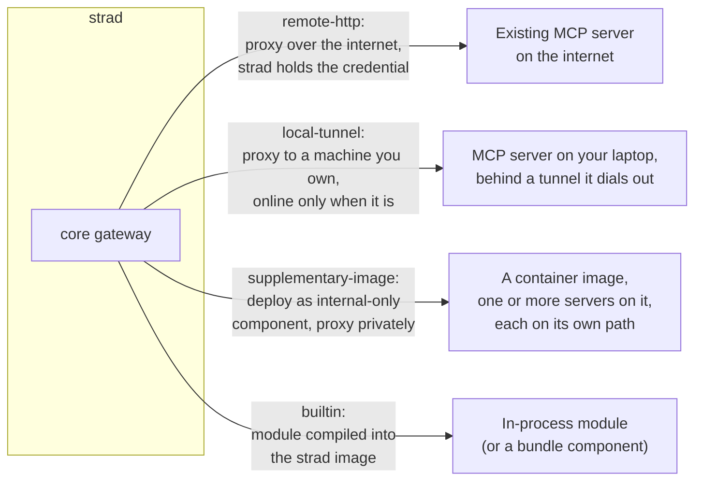

The core ships with **zero** MCP servers. Attaching one is a single entry under
`servers:` in your config. That entry is a **discriminated union on `kind`**, and
there are exactly four kinds. This is the whole extension surface of strad.

## What every server shares

Every server, regardless of kind, has these base fields (from
`src/config/schema.ts`):

| Field                  | Default      | Meaning                                                                               |
| ---------------------- | ------------ | ------------------------------------------------------------------------------------- |
| `slug`                 | _(required)_ | Identifier, `^[a-z0-9]+(-[a-z0-9]+)*$`, max 63. Goes in `?servers=`, prefixes every tool, and [names this server's variables on the container](/operate/secrets/#what-a-servers-variables-are-called-on-the-box) — which is why a dash may not double up, lead or trail. |
| `kind`                 | _(required)_ | `remote-http` \| `local-tunnel` \| `supplementary-image` \| `builtin`.                |
| `entitlements`         | `[]`         | Roles allowed to reach this server. **Empty = nobody** (fail closed).                 |
| `enabled`              | `true`       | Set `false` to configure without exposing.                                            |
| `tools`                | —            | The capability policy: `{ allow?: [...], deny?: [...] }`. Omitted = every tool.       |
| `timeoutMs`            | `120000`     | Per-hop upstream timeout. The MCP SDK's own default is 60s at every hop.              |
| `oauth`                | —            | This server authenticates as a **person**, and strad's console runs the consent. See below. |
| `mayBeUnseeded`        | `[]`         | `${NAME}`s this server may **deploy without**, staying inactive until they land. See below. |
| `title`, `description` | —            | Human-facing metadata.                                                                |

`tools` is `.strict()` and must set at least one of `allow` / `deny`. `allow` is
exhaustive, `deny` subtracts and wins over `allow`, and the gateway enforces the
result on `tools/list` **and** on `tools/call` — a withheld tool is refused with
JSON-RPC `-32600` before the adapter is touched. This is what makes a read-only and
a read-write variant of one upstream two entries against the *same* container; see
[Adding a server](/servers/adding/#3b-give-it-a-capability-if-it-has-one).

<aside class="starlight-aside starlight-aside--tip">

`entitlements` on the server is only **half** of access. A role must _also_ name
the server under `roles.<role>.servers`. Both directions must agree — see
[Auth](/auth/overview/).

</aside>

### `mayBeUnseeded:` — deploy the server, seed the token later

An unseeded `${NAME}` used to fail the deploy for the whole fleet, so adding a
server meant seeding its credential before the config PR could merge. Naming the
reference here waives that, for that name only:

```yaml
- slug: apify
  kind: remote-http
  url: https://mcp.apify.com/mcp
  entitlements: [admin]
  headers:
    Authorization: "Bearer ${APIFY_TOKEN}"
  mayBeUnseeded: [APIFY_TOKEN]
```

It is not a claim that the server works without the value — it is permission for
the **deploy** to proceed without it. The slug comes up `unconfigured`, says so on
`/healthz` and in the console, refuses a named `tools/list` with a message naming
the credential, and starts serving on its own once a value is seeded.

Three rules keep it from becoming the silence it replaces:

- a name **no** referencing server waives still fails the deploy, exactly as before;
- a name is waived only when **every** enabled server referencing it waives it;
- an entry naming a `${NAME}` this server references nowhere is a **hard error** —
  which is why this is a list of names and not a boolean. A flag beside a typo'd
  `${APIFY_TOKN}` would degrade forever in silence; a list leaves the typo
  unwaived and reports the useless entry.

Full behaviour, including how fast a seeded value takes effect, is in
[Secrets](/operate/secrets/#maybeunseeded--deploying-a-server-ahead-of-its-credential).

### `oauth:` — a credential a human consents to, in strad's console

Some upstreams authenticate as a person rather than as a service account, and the
artifact is an OAuth refresh token somebody has to mint in a browser. `oauth:` is
what lets that happen inside strad — a **Connect** button on the slug's console
page — instead of through an OAuth Playground round trip and a hand-seeded
parameter. The credential lands under the slug's
[`oauth` kind](/operate/secrets/#the-two-kinds-static-and-oauth).

```yaml
- slug: google-sheets-tadas412-ro
  kind: supplementary-image
  image: ghcr.io/tadasant/strad-bundle:latest
  bundle: bundle
  path: /google-sheets-tadas412-ro
  entitlements: [zimmer]
  oauth:
    provider: google
    account: tadas412@gmail.com
    scopes:
      - https://www.googleapis.com/auth/spreadsheets.readonly
```

| Field                  | Default                              | Meaning                                                                          |
| ---------------------- | ------------------------------------ | -------------------------------------------------------------------------------- |
| `provider`             | _(required)_                         | `google` or `generic`. A discriminated union, not an open enum: it decides which other fields the block carries, and a config cannot name a provider strad has no implementation for. |
| `account`              | _(required)_                         | The Google account this slug is pinned to. Checked against the verified `email` claim on the ID token, and a mismatch is refused with nothing written. |
| `scopes`               | _(required)_                         | The exact capability scopes to request, at least one. strad adds `openid` and `email` itself, and the config gate refuses an identity scope written by hand. |
| `clientIdVariable`     | `GOOGLE_SHEETS_OAUTH_CLIENT_ID`      | Names a variable in **this slug's own** namespace, read `oauth/` first then `static/`. Required, with no default, on `provider: generic`. |
| `clientSecretVariable` | `GOOGLE_SHEETS_OAUTH_CLIENT_SECRET`  | Same.                                                                            |
| `refreshTokenVariable` | `GOOGLE_SHEETS_OAUTH_REFRESH_TOKEN`  | The one the console flow **writes**, on connect and on reconnect — always under the `oauth` kind. |

`provider: generic` carries six more fields — `authorizeUrl` and `tokenUrl`
(both required), `label`, `authorizeParams`, `clientAuth` and `credential` — and
requires all three variable names. They are documented with their failure modes
in [Connectors](/operate/connectors/#provider-generic--any-oauth-20-provider).

The three are variable NAMES, never paths: core composes
`/strad/{env}/mcp/{slug}/{kind}/{VARIABLE}` from the slug, a kind and these
strings, and from nothing else. The read/write **tier** is derived from the scopes rather than
declared — every capability scope ending in `.readonly` is read-only, anything
else is read-write — because a label would be a second source of truth for
something the scopes already say.

**Do not reference these variables as `${NAME}`.** The renderer injects all three
from the slug's own namespace, each one only if the store holds it, and the config
gate refuses a reference by name. The reason is a genuine ordering cycle:
`render-spec` fails the whole app spec on one unresolvable `${NAME}`, the refresh
token cannot exist until a human has consented in the console, and the console
page does not exist until the slug is deployed. Injection breaks it — an
unconnected slug deploys, mounts and reports itself degraded, costing its own
capability and nobody else's. See [Connectors](/operate/connectors/).

## The four kinds



### 1. `remote-http`

Proxy an MCP server that **already exists on the internet**. strad holds the
credential; the client never sees it. No container is deployed.

Fields: `url` (required), `headers` (a map of header name → value, where values
may reference secrets as `${NAME}`).

```yaml
servers:
  # remote-http — proxy an MCP server that already exists on the internet.
  - slug: granola
    kind: remote-http
    url: https://mcp.granola.ai/mcp
    entitlements: [admin]
    headers:
      Authorization: "Bearer ${GRANOLA_TOKEN}" # ${...} = a secret reference
```

`${NAME}` resolves through the deployment's [secret
provider](/operate/secrets/) — from the environment by default, or from the
parameter store at runtime. A `remote-http` server's url and headers are
re-resolved on every operation, so rotating `GRANOLA_TOKEN` in a store-backed
deployment takes effect on the running gateway: the adapter notices the endpoint
changed and rebuilds its upstream connection.

#### `oauthRefresh:` — a bearer that expires, minted by strad

A static bearer works until it expires. An upstream that authenticates each
user with OAuth hands out short-lived access tokens and one long-lived refresh
token, and a static header cannot follow that. `oauthRefresh:` holds the refresh
token and has strad mint the access token itself:

```yaml
- slug: granola
  kind: remote-http
  url: https://mcp.granola.ai/mcp
  entitlements: [admin]
  oauthRefresh:
    tokenUrl: https://mcp-auth.granola.ai/oauth2/token
    clientId: ${GRANOLA_CLIENT_ID}
    refreshToken: ${GRANOLA_REFRESH_TOKEN}
    resource: https://mcp.granola.ai/mcp
  mayBeUnseeded: [GRANOLA_REFRESH_TOKEN] # deploy before anyone has authorized
```

| Field          | Default      | Meaning                                                                                                                                        |
| -------------- | ------------ | ---------------------------------------------------------------------------------------------------------------------------------------------- |
| `tokenUrl`     | _(required)_ | The token endpoint. `https`, or `http` to a loopback host. A literal or a `${NAME}`.                                                           |
| `clientId`     | _(required)_ | The OAuth client id. A literal or a `${NAME}`.                                                                                                 |
| `clientSecret` | _(none)_     | For a confidential client, as exactly one `${NAME}`. Omit it for a public client (dynamic registration + PKCE, the MCP authorization shape). |
| `clientAuth`   | `basic`      | How a client secret is sent: `basic` (HTTP Basic, RFC 6749's default) or `post` (in the form body). Ignored without a secret.                  |
| `refreshToken` | _(required)_ | Exactly one `${NAME}`. The reference is also the name a rotated token is written back to.                                                      |
| `scope`        | _(none)_     | Sent on every refresh. Omit it to keep what was granted.                                                                                      |
| `resource`     | _(none)_     | RFC 8707 `resource`, sent on every refresh. An MCP-spec authorization server expects it; set it to the server's `url`.                        |

Every field resolves like `url:` and `headers:`: per operation, through the
server's own namespace first. strad sends `Authorization: Bearer <access token>`
itself, so a configured `Authorization` header beside it is refused.

**When it mints.** Once, on first use. Again 60 seconds before `expires_in`
runs out (a tenth of the lifetime for a token shorter than ten minutes), so a
request never carries a token that is about to lapse. And again when the
upstream answers `401`: the refused token is dropped, a new one is minted, and
the operation is tried once more. A `401` means the upstream refused the request
before running it, so the retry cannot run a tool twice. A token with no
`expires_in` is used until the upstream refuses it.

**It does not stampede.** Concurrent requests share one exchange. A burst of
`401`s on one stale token costs one refresh. A token minted less than 30 seconds
ago is not dropped on a `401`, because a token that fresh was not refused for
its age.

**A failed refresh is this server's failure alone.** A refused refresh token
(`invalid_grant`), a refused client, or a token endpoint that does not answer
fails this slug's calls with a sentence strad wrote. The reachability probe
marks the slug degraded, and every other server carries on. A refusal is
remembered for 60 seconds and an outage for 5, so a dead refresh token does not
cost a token-endpoint round trip per request. Seeding a new refresh token clears
the backoff on the next call. A token still inside its lifetime keeps being
served through a failed refresh.

**One refresh token, one server.** Each slug gets its own minter. No cache is
shared between servers, and everything a minter holds is tied to the refresh
token the store handed it. Re-seed the slug with another account's token and
the old account's access token is dropped before the next request, along with
any refresh still in flight for it. Two enabled servers minting from one
`${NAME}` are refused, because a provider that rotates on use would have each
one revoke the other's token.

**Rotation is written back.** When the token endpoint issues a new refresh
token, core writes it to the store, to the parameter the reader reads, so a
restart reads the live one. Where there is no store to write to, the rotation is
held in memory and a restart reads a token the provider has already killed. See
[Secrets](/operate/secrets/#oauthrefresh--a-rotating-refresh-token-on-a-remote-http-server)
for where it writes, and [Limitations](/limitations/) #91.

**What it does not do.** strad does not run the authorization for a `remote-http`
server. The first refresh token comes from an out-of-band consent (for Granola,
dynamic client registration and PKCE against its authorize endpoint), and a human
seeds it in `/ui/secrets`.

strad *does* run an in-console authorize flow for arbitrary providers — that is
`oauth: { provider: generic }` — but only on a `supplementary-image` slug, because
the renderer delivers a connector's variables by injecting them onto a container
and a `remote-http` server has none. Wiring the two together, so a `remote-http`
upstream could be authorized from the console and then refreshed, is still open.

### 2. `local-tunnel`

Proxy an MCP server running on **a machine you own** — a laptop, a desktop —
reached over a tunnel that machine dials out to (Cloudflare Tunnel, ngrok,
Tailscale Funnel). On the wire it is Streamable HTTP, exactly like
`remote-http`; strad never dials in and holds no inbound route to your machine.

Use it for servers that are machine-bound by nature: an application's own MCP
add-on, computer use, browser automation driving a real logged-in profile.

Fields: `url` (required), `headers`, `connectTimeoutMs` (default `5000`),
`recovery`.

```yaml
servers:
  # local-tunnel — an MCP server on a machine you own.
  - slug: anki
    kind: local-tunnel
    url: https://your-tunnel-host.example/
    entitlements: [admin]
    recovery:
      machine: "the MacBook"
      commands:
        - "launchctl kickstart -k gui/$(id -u)/com.cloudflare.cloudflared"
      notes: "Anki itself must be open — the MCP server lives inside the app."
```

#### It is offline most of the time, and that is the point

This is the only kind whose upstream is **expected to be absent**. A closed
laptop is not an outage, so three things behave differently:

- **The handshake is bounded** by `connectTimeoutMs` rather than by the MCP
  SDK's 60-second default. An offline machine fails in about five seconds
  instead of a minute. The bound is applied both as a request timeout and as an
  abort on the underlying socket — only the second covers a host that accepts a
  connection and then says nothing, which is how a dead tunnel usually presents.
- **The failure names the machine.** A client gets `the machine hosting "anki"
  is not reachable … it works only while that machine is running the server and
  its tunnel is up`, rather than a generic upstream error — followed by your
  `recovery:` block, so the commands are in the error too.
- **It does not take its neighbours down, and it does not vanish either.**
  `?servers=anki,slack` with the laptop asleep returns Slack's tools, none of
  Anki's, and one tool called `anki__troubleshoot_host` explaining the gap. Every
  other kind fails the whole listing when a *named* server cannot be listed — see
  [architecture](/intro/architecture/) — and this is the one exception, because
  for this kind there is no fault being hidden. Selecting it **alone** returns
  that one tool rather than an error.

#### Get the path right — a wrong one is the failure the exemption skips

`url` carries the **path** as well as the host, and the exemption above covers
only a machine that is not answering. A machine that answers `404` because the
path is wrong is an ordinary upstream error, so it fails a named listing and
takes its neighbours with it — the exact outcome the kind exists to avoid, from
a typo rather than from a closed laptop.

Take the path from the server you are tunnelling to, not from habit. `/mcp` is a
common convention and plenty of servers use it, but the Anki add-on above serves
streamable HTTP at the **root** of its port — its `http_path` setting defaults to
the empty string — so its URL ends at the hostname. When in doubt, read the
server's own docs for the URL it tells clients to connect to, and use that.

#### `troubleshoot_host`: the tool a machine that is off still serves

When the machine behind a `local-tunnel` is not answering, strad replaces that
slug's tools with exactly one of its own:

```
anki__troubleshoot_host   (no arguments)
```

Calling it re-checks the machine and answers with which machine is down, which
of the two failures it is, and the commands to run there. It is **listed** only
while the host is unavailable — in a `?servers=` listing and in an unfiltered
"everything I'm entitled to" one alike — but it is **answerable** whenever, so
somebody who has just run the commands can ask again and be told the machine is
back. On a `local-tunnel` slug it therefore shadows an upstream tool of the same
name; see [limitations](/limitations/#60-a-local-tunnel-that-is-not-answering-answers-with-a-tool-about-itself).

`recovery:` is what fills the answer in:

| Field      | What it is                                                        |
| ---------- | ----------------------------------------------------------------- |
| `machine`  | Whose machine, for a human reading the result — `"the MacBook"`.   |
| `commands` | Exact commands to run **on that machine**, in order.              |
| `notes`    | Anything else its owner needs to know (a GUI app to open, …).     |

All of it is optional, and the tool exists without it: with no `recovery:` block
strad falls back to generic guidance built from the slug and the tunnel hostname,
plus a link to [Running a local-tunnel host](/servers/local-tunnel-host/). It
will **not** guess a command — a tunnel name inferred from a hostname is right
often enough to be trusted and wrong often enough to waste an afternoon.

`recovery:` is returned verbatim to every client entitled to the slug, so it is
for commands and machine names — not credentials. Nothing in it is
secret-resolved, deliberately: a `${NAME}` written there reaches a caller as
those six characters, not as a value.

Two failures reach this surface, and the tool tells them apart because their
remedies have nothing in common:

- **offline** — `502/503/504`, Cloudflare's `52x`, a refused connection, or a
  handshake that does not finish inside `connectTimeoutMs`. The machine is not
  there. Go and start it.
- **refused** — a `401` or `403` from the far side. The machine **is** there and
  said no, which means a credential went stale: an access service token, or the
  bearer the server on that machine checks. Restarting the tunnel does nothing.

Anything else a machine answers with — a `404` on a wrong path, a `500` from a
server that ran and threw — is an ordinary broken upstream and still fails a
named listing. Nobody at that machine can fix those, so sending them there would
be a lie.

A machine that is off does **not** read as a broken deployment. On `/healthz`
that slug's state is `offline` — its own word, not `unreachable` — and it is left
out of the `degraded` list, so a fleet with a sleeping laptop in it still reports
nothing to go and look at. The state is still there to read; it has simply
stopped being filed as a problem.

A host that **refuses** is filed as a problem, deliberately: it is answering, a
credential has gone stale, and it will not clear until somebody rotates it. Same
for a `404` or a `500`. Only "the machine is off" is exempt.

strad deploys nothing for it — no component, no bundle, no `env:`. `${NAME}`
references in `url` and `headers` resolve in strad's own process, so a tunnel
hostname that rotates can live in the secret store instead of the config.

Those refs resolve from **this server's own namespace first** —
`/strad/{env}/mcp/{slug}/static/{NAME}` — and the shared gateway namespace only as
a fallback, so a tunnel's credentials live under the server they belong to and can
be rotated without a redeploy. See [Secrets](/operate/secrets/).

Running the machine at the other end — a named tunnel, a login item, Cloudflare
Access in front of it — is its own page:
[Running a local-tunnel host](/servers/local-tunnel-host/).

### 3. `supplementary-image`

A server **served by a container image**. strad deploys the image as an
internal-only component and proxies to it over the private network.

One bundle runs one image, but that image may host **many** servers — each on its
own `path`. strad's own bundle image mounts twenty-two MCP servers in one process,
and staging's slugs land on twenty `path`s of one container.

Two servers may also share a `path` in one bundle — that is the capability-variant
pattern (`gmail-ro` and `gmail-rw`, told apart by their `tools:` policy). What they
cannot share is a value: a bundle is one `process.env`, so two servers in one
bundle declaring the same `env:` key with **different** values is a schema error,
and two whose `${NAME}` is spelled the same but resolves differently out of
[their own namespaces](/operate/secrets/#a-servers-secrets-live-in-that-servers-namespace) is a
render error — for servers that share a `path`. A slug on a path of its own
(`path: /<its own slug>`) is a separate instance in the container, so it reads
[its own per-slug names](/operate/secrets/#what-a-servers-variables-are-called-on-the-box)
and can hold its own value. Those names exist for every server either way.

Fields: `image` (required), `bundle` (required), `path` (defaults to `/mcp`, must
start with `/`), `env` and `headers` (maps whose values may be `${NAME}` secrets),
plus two that shape how this server gets its values:

- **`consoleEnv`** — env for the **core gateway only**, the human console's half of
  this server. `env:` lands on the component that answers `/mcp`; `consoleEnv:`
  lands on core, which serves the SSO-gated `/ui` and nothing an agent can reach.
  That asymmetry is what lets the `secrets` server hold a viewer key on the bundle
  and a stronger admin key on core, with the two never meeting. See [Adding a
  server](/servers/adding/#4b-a-credential-the-agent-must-not-hold--consoleenv).

  It has a second, duller use: if this server has a **browser view** in `/ui`, that
  view renders in core and needs the credential too. Repeat the same `${REF}` under
  `consoleEnv:` — the same value in both scopes, not a stronger one. Omit it and you
  get a confusing pair of symptoms: the MCP tools work fine while the console reports
  the credentials as unavailable, because the key is on the bundle and the page is
  not. `gcs` in `infra/strad.staging.yaml` is the worked example.

  The deploy layer resolves a `consoleEnv:` `${REF}` at **render** time and lands the
  resolved value on core under the declared KEY — the ref name itself is never
  injected anywhere, which is what keeps the admin credential off the bundle. The
  console therefore reads the key, not the ref.

  **The two scopes have different collision rules, and this is the trap.** `env:`
  is per-bundle; `consoleEnv:` is merged into the one `core` component along with
  every other server's. So two servers can safely use the same `env:` key in
  different bundles, and cannot safely use the same `consoleEnv:` key anywhere. A
  second server of a kind that already exists (a second `secrets` slug, say)
  therefore keeps bare names under `env:` and **slug-namespaces** anything it adds
  under `consoleEnv:` — `ZIMMER_SECRETS_SECRETS_ADMIN_SERVICE_ACCOUNT_KEY_JSON`,
  which the console maps back down to `SECRETS_ADMIN_SERVICE_ACCOUNT_KEY_JSON` for
  that slug alone. The mapping is a **fallback** (`??=`) applied after the two maps
  are merged, so a namespaced key whose bare form `env:` already sets is inert —
  declare under `consoleEnv:` only what the console alone needs. `check-config`
  enforces the collision rules; see [Two stores, one
  gateway](/operate/secrets/#two-stores-one-gateway) for the worked example.
- **`consoleStores`** — the parameter **stores** this server's console page can
  switch between. One page, N GCP projects, selected with `?project=<id>`.

  Absent (the default) the page resolves a single store out of
  `SECRETS_PROJECT_ID` / `SECRETS_NAMESPACES` / the `SECRETS_*` flags, exactly as
  before. Present, it **replaces** that reading: the page renders a store picker
  and every list, create, rotate, note, reveal and delete is scoped to the
  selected entry. The two shapes are not merged — a config that says what its
  stores are does not also get an env-derived one.

  ```yaml
  consoleStores:
    - project: strad-secrets-prod
      label: strad prod # optional; defaults to the project id
      namespaces: [/strad/prod/mcp/, /strad/prod/gateway/static/]
      adminKeyVar: SECRETS_ADMIN_SERVICE_ACCOUNT_KEY_JSON
      namespacesStrict: true
    - project: zimmer-secrets-prod
      label: zimmer prod
      namespaces: [/zimmer/production/mcp/]
      adminKeyVar: ZIMMER_SECRETS_ADMIN_SERVICE_ACCOUNT_KEY_JSON
      reveal: true
  ```

  **Every store carries its own credential.** `adminKeyVar` is required per entry,
  and `check-config` rejects two entries that name the **same** one: two projects
  behind one identity is a strictly larger blast radius than the two identities it
  replaces, so the collapse cannot be written as one shared key name.

  Two entries whose **different** names resolve to one `${REF}` is the same
  collapse, and it is a **warning** rather than a refusal — because that shape is
  sometimes right. One service account granted on `strad-secrets-prod` and
  `strad-secrets-staging` is two projects inside one system, and a ban would
  reject it. `check-config` and `render-spec` name the projects and the ref, and a
  reviewer decides whether they are one system or two. The `mcpStores:` twin
  below **refuses** the same shape, deliberately: a shared viewer key collapses
  the per-store capability probe, and there is no correct form of that.

  Two entries may not declare **overlapping namespaces**. A path both stores could
  claim is a console write — create, rotate, delete — landing in whichever project
  was declared first; `storeForPath` refuses such a path at request time, so
  without this rule the first symptom is a write failing on a deployment that
  rendered and deployed clean.

  A `SECRETS_PROJECT_ID` left over from the single-store shape is **warned** about
  when it names a project other than the first store. `storeProject()` prefers it
  over this server's `consoleStores:`, so the roster's copy-pasteable `gcloud`
  commands describe one project while the store page defaults to another. Both
  the shared-`${REF}` warning and an overlapping-namespace warning also span the
  **whole deployment**, because two secrets slugs are two components and
  `storeForPath` resolves a write against all of their stores at once.

  `adminKeyVar` names a **`consoleEnv:` key**, not a `${REF}` of its own, and
  `check-config` enforces three things about it. The key must be declared under
  this server's `consoleEnv:`. It must **not** be a key of any server's `env:`.
  And the `${NAME}` it resolves from must not appear in any server's `env:`
  **either**, under any key — the key name is the variable, but the ref is the
  credential, and a name-only check would wave through the same admin key baked
  onto a bundle as `GOOGLE_APPLICATION_CREDENTIALS_JSON`. `consoleEnv:` is the one
  scope the renderer lands on core and stops, so naming it is what keeps a
  store-admin credential off the component that answers `/mcp`.

  `namespacesStrict` and `reveal` are **per store**, not per page. A page-level
  `namespacesStrict` would be checked against the union of every store's
  namespaces, so a namespace belonging to a sibling project would pass while this
  one is selected — a bound that does not bind. `namespacesStrict` bounds
  **create** and not rotate/note/delete, which is the single-store flag's existing
  behaviour, unchanged.

  **This is a console-only field.** The `/mcp` half has a list of its own —
  `mcpStores:` below — because the credential each carries is different. See [One
  console page, many stores](/operate/secrets/#one-console-page-many-stores).
- **`mcpStores`** — the parameter **stores** this server's `/mcp` half can
  address. One container, N GCP projects, selected by the **namespace a
  parameter path starts with**.

  Absent (the default) the container resolves a single store out of
  `SECRETS_PROJECT_ID` / `SECRETS_NAMESPACES` / `SECRETS_SERVICE_ACCOUNT_KEY_JSON`
  under `env:`, exactly as before. Present, it **replaces** that reading:
  `renderAppSpec` emits a non-secret `SECRETS_STORES` descriptor onto this
  server's bundle — project ids, namespaces, and the NAME of each store's key —
  and the container reads that. Declaring both shapes is refused rather than
  resolved to one of them.

  ```yaml
  env:
    SECRETS_SERVICE_ACCOUNT_KEY_JSON: "${SECRETS_VIEWER_KEY_JSON}"
    ZIMMER_SECRETS_VIEWER_SERVICE_ACCOUNT_KEY_JSON: "${ZIMMER_SECRETS_VIEWER_KEY_JSON}"
  mcpStores:
    - project: strad-secrets-prod
      label: strad prod # optional; defaults to the project id
      namespaces: [/strad/prod/mcp/]
      viewerKeyVar: SECRETS_SERVICE_ACCOUNT_KEY_JSON
    - project: zimmer-secrets-prod
      label: zimmer prod
      namespaces: [/zimmer/production/mcp/]
      viewerKeyVar: ZIMMER_SECRETS_VIEWER_SERVICE_ACCOUNT_KEY_JSON
  ```

  **Every store carries its own VIEWER credential.** `viewerKeyVar` names an
  `env:` key — the scope rendered onto this server's bundle, which is the
  component that answers `/mcp` — and `check-config` rejects two entries that
  name the same key **or** whose keys carry the same `${REF}`. That is a stronger
  rule here than on the console side: the secrets server derives what each store
  may do from a `projects:testIamPermissions` probe of that store's own
  credential, so one identity on two projects is two stores that cannot have
  different capabilities. The container checks the same thing at boot by
  `client_email`.

  It also rejects two entries naming one **project id** (the store's address in
  every refusal and in the capability report), two entries with **overlapping
  namespaces** (a path both could claim is a path whose capability depends on
  declaration order), a hand-written `SECRETS_STORES` under `env:` (it is derived
  from this field, and one written by hand passes none of these rules), and a
  second server on the same bundle declaring `mcpStores:` (one container, one
  bare `SECRETS_STORES`, so one list would answer under both slugs).

  An admin key cannot be borrowed here. `viewerKeyVar` must be a key of this
  server's own `env:`, and the `consoleStores:` rules above already refuse an
  `adminKeyVar` whose key or whose `${REF}` appears in any server's `env:`.

  There is no `reveal` and no `namespacesStrict`. `/mcp` has no UI to offer a
  reveal in, and it has no lax namespace mode to turn off: a path outside every
  store's namespaces is always refused. See [the `/mcp`
  half](/operate/secrets/#the-mcp-half-mcpstores) for what the tool surface does
  when two stores disagree about whether a secret value may be read.
- **`params`** (default `false`) — opt into parameter resolution. When `true`,
  everything under `/strad/{env}/mcp/{slug}/static/*` in the [secrets and parameters
  system](/intro/architecture/#the-secrets-and-parameters-system) is resolved and
  injected as this server's env — for a supplementary image at deploy time, scoped
  onto its bundle. It injects the namespace **wholesale**: the variable names come
  from the store, not from the config.

  It is not the only thing that reads that namespace. A `${NAME}` under `env:`
  resolves from `/strad/{env}/mcp/{slug}/static/` **before** the shared
  `/strad/{env}/gateway/static/`, with no flag and for every server — which is what
  lets two servers write the same `${NAME}` and be given different values. See
  [two servers, one variable name](/operate/secrets/#a-servers-secrets-live-in-that-servers-namespace).
  The two paths differ in what they inject: `params:` injects everything it finds,
  substitution injects only names the config already references.

  Every supplementary server's `env:` lands under `<SLUG>__<NAME>` as well as the
  bare names, unconditionally. Whether two servers on **one bundle** can hold two
  values for one name is decided by `path:`, not by the namespace: a slug that is
  the only one on `path: /<its own slug>` is its own instance in the container and
  reads its own names; two slugs on one path are one instance, and the render
  fails rather than pick a winner.

- **`paramsWritable`** (default `[]`) — the variables this server may **write
  back** to its own `/strad/{env}/mcp/{slug}/` namespace, and read fresh at boot
  rather than trusting the value the deploy baked. A name the same server also
  declares on its `oauth:` connector is written under `oauth/` when a console
  consent has minted it there, and under `static/` otherwise; every other name
  under `static/`. The request never picks the kind, so one variable can be both
  consented in the console and rotated on use.

  For credentials that rotate **on use** — an OAuth refresh token that is
  single-use, a session token the upstream reissues — where holding the baked
  value across a restart means holding one the upstream has already invalidated.
  The server persists each new value through core, which owns the store-admin
  credential; the container itself still holds none.

  It requires `params: true`, and each entry is a **variable name**, never a path:
  core composes the store path from the config's own slug and name, so there is no
  spelling of one that reaches another server's namespace. A component hosting a
  server with a non-empty list may not have `instanceCount` above 1 — a rotating
  credential has one valid value at a time, and the render refuses the topology
  rather than let two replicas invalidate each other. `supplementary-image` only.

  ```yaml
  - slug: x-twitter
    kind: supplementary-image
    params: true
    paramsWritable: [X_OAUTH_REFRESH_TOKEN]
  ```

  See [a credential that rotates on
  use](/operate/secrets/#paramswritable--a-credential-that-rotates-on-use) for the
  transport, the failure modes and what the grant actually is.

- **`paramsRefresh`** (default `[]`) — the variables this server **re-reads at
  runtime**, so rotating one takes effect on the running container instead of on
  the next deploy.

  This is the answer to the one credential path in strad that was still
  deploy-time. A `${NAME}` on a `remote-http` server, a `builtin`'s `params:`, and
  a gateway reference all resolve while the process runs; a
  `supplementary-image`'s managed parameters are resolved by the renderer and
  baked onto the component as environment, and process environment is fixed at
  spawn. So rotating the token behind such a slug meant redeploying by hand.

  Listing a name here puts it on a manifest the renderer bakes onto the
  component. The container polls core for those names on
  `gateway.secrets.paramRefreshSeconds` (default 300, floor 30) and updates its
  own environment when a value has moved. It requires `params: true` — which is
  also what makes it disclose nothing, since that flag already baked the whole
  namespace onto this component; what the re-read adds is freshness.

  ```yaml
  - slug: strad-fetch
    kind: supplementary-image
    params: true
    paramsRefresh: [BRIGHTDATA_API_KEY]
  ```

  **A listed name may not be another server's variable on the same bundle.** One
  bundle is one container with one environment, so a refresh that wrote a name a
  sibling owns would overwrite that sibling's credential — and it would do it
  when a human seeds the value, not when anything deploys. `renderAppSpec`
  refuses that config, whether or not the name is seeded yet.

  **A listed name that nobody has seeded yet is included on purpose**: it bakes no
  variable, and the first poll after somebody seeds it is what puts it on the
  container — so "seed a credential after the deploy" stops needing a redeploy
  too. What still needs one is adding a name to this list, which keeps the
  rendered spec the record of every variable the component may ever hold.

  **Whether the upstream notices is a property of that upstream.** One that reads
  its key when it builds a client per request picks the new value up on the next
  call; one that snapshots a credential at mount time and memoises a connection
  keeps the boot value until the next restart. The bundle host says which at boot
  rather than leaving it silent. `supplementary-image` only.

  See [`paramsRefresh:` — a rotation that lands without a
  deploy](/operate/secrets/#paramsrefresh--a-rotation-that-lands-without-a-deploy).

```yaml
servers:
  # supplementary-image — a server served by a container image, on one path of it.
  - slug: good-eggs
    kind: supplementary-image
    image: ghcr.io/tadasant/strad-bundle:latest
    bundle: bundle
    path: /good-eggs
    entitlements: [admin]
```

Two entries may even share a `path` — that is the capability-variant case, where
`acme-ro` and `acme-rw` are the same upstream behind different `tools:` policies.

At deploy time this component gets `internal_ports: [8080]` and **no**
`http_port` — which is what keeps it off the public edge (see [Deploy
model](/operate/deploy-model/) for why setting both is a hard API rejection).

### 4. `builtin`

A module **compiled into a strad image**. This is how private / internal servers
ship: `tadasant-internal` builds its own image with its modules and registers them
with entries exactly like this. The same config interface as the public kinds —
nothing special.

Fields: `module` (a specifier resolved at boot; must default-export a
`BuiltinModule` = `{ tools, call(name, args, ctx) }`), `bundle` (defaults to
`core` = in the gateway process; any other value runs the strad image in bundle
mode as a separate component), `options` (an arbitrary map passed to the module;
may contain `${SECRET}` refs), and `params` (default `false` — when `true`, the
server's `/strad/{env}/mcp/{slug}/static/*` parameters are resolved and merged into
`options` at launch; for a `core` builtin that happens in-process at runtime).

```yaml
servers:
  # builtin — a module compiled into a strad image (for private/internal
  #    servers). The same interface as the public kinds; nothing special.
  - slug: echo
    kind: builtin
    module: "./servers/echo.js"
    bundle: core
    entitlements: [admin]
```

The strad image itself ships two: `./servers/echo.js`, and
`./servers/connectors.js` — the server roster as MCP tools, the counterpart to
the console at `/connectors`. Neither is mounted unless a config entry names it,
so a deployment that wants an agent to be able to add, edit, disable and remove
a connector opts in:

```yaml
servers:
  - slug: connectors
    kind: builtin
    module: "./servers/connectors.js"
    bundle: core
    entitlements: [admin]
```

It serves nothing at all unless `gateway.configStore.enabled` is set, it lists
its three write tools only where core holds the credential that persists a
roster change, and an ordinary `tools:` `allow:` naming only its read tools
mounts the read half by itself. Full model:
[Runtime config](/operate/runtime-config/#the-same-roster-over-mcp).

## Validation refuses to boot on

strad validates the whole config strictly at boot (a Zod `superRefine` in
`src/config/schema.ts`). It **refuses to start** if any of these hold:

- Two servers share a `slug`.
- A server grants a role that isn't defined under `roles:`.
- **Two servers in the same bundle name different `image`s.** One bundle is one
  App Platform component, and a component runs one image. Many servers per bundle
  is fine — many *images* per bundle is not.
- A bundle holding a `supplementary-image` also holds a server of another kind.
- A `supplementary-image` is placed in the `core` bundle.
- A server references a `bundle` that isn't declared under `bundles:`.
- A `tools:` policy is present but sets neither `allow` nor `deny`.
- **Two enabled servers declare the same env key with different values, in a
  scope where one would silently overwrite the other.** See below — the scope is
  not the same for the two maps.
- A `paramsWritable:` or `paramsRefresh:` entry is not a legal environment
  variable name (letters, digits and underscores; not starting with a digit; at
  most 200 characters). Those entries compose a store path, so the rule is
  checked here rather than at the route — it is the same rule the console applies
  to a variable a human creates, from `src/config/env-name.ts`.
- An `oauth:` connector names a variable that is not a legal environment variable
  name, or points two of its three fields at names that
  [fold to one parameter](/operate/secrets/) (a path lowercases before it hashes,
  so `TOKEN` and `token` are one stored value — connecting would overwrite one of
  the connector's own inputs).
- A **Google** `oauth:` connector lists an identity scope (`openid`, `email`,
  `profile`) under `scopes:`, or any connector lists a scope twice. strad requests
  the identity scopes itself for Google; `scopes:` is for capability. A `generic`
  connector gets no identity scopes added, so `profile` there is an ordinary
  capability scope and is allowed.
- A **generic** `oauth:` connector whose `authorizeUrl` or `tokenUrl` is not https
  (http is allowed only to a loopback host) — an authorization code and a client
  secret travel over both — or whose `authorizeParams:` sets one of the
  authorization parameters strad composes itself (`client_id`, `redirect_uri`,
  `response_type`, `scope`, `state`, `code_challenge`, `code_challenge_method`).
- **An `oauth:` connector on a kind nothing injects for** (anything but
  `supplementary-image`), or on a path other than `/<its own slug>`. The second
  is what makes the credential deliverable: a connector's variables are emitted
  under the per-slug name alone, and the bundle host reads those only for the
  server that is alone on its own path.
- A `remote-http` server's `oauthRefresh.refreshToken`, or its `clientSecret`,
  is anything but exactly one `${NAME}`: a literal would be a credential
  committed to the config, and the write-back needs a name. Also refused: an
  `Authorization` header beside `oauthRefresh:`, a literal `tokenUrl` that is
  neither `https` nor loopback `http`, and two enabled servers minting from one
  refresh-token `${NAME}`.
- **A server references one of its own connector's variables as a `${NAME}`.**
  Those three are injected from the slug's own namespace, and a reference to the
  refresh token would fail every server's deploy until a human had completed a
  console flow that needs the deploy to have happened. See
  [Connectors](/operate/connectors/).

Note what is deliberately **not** an error: many servers in one bundle, and two
servers on the same `path` of one bundle. Both are load-bearing — the first is how
twenty-two MCP servers fit in one container, the second is how a read-only and a
read-write variant share it.

Nor is repeating one env key across servers with the **same value**. That is the
capability-variant pattern working as designed: `gmail-ro` and `gmail-rw` repeat
their whole `env:` on purpose, because putting the credential on only one of them
means disabling *that* one strips it from its sibling. The rule is same key,
*different* value.

Failing loudly at boot is the point: a misconfigured gateway never comes up
half-wired.

### `env:` may be bare; `consoleEnv:` must be slug-namespaced

The two maps land on different components, so they collide in different scopes —
and getting the asymmetry backwards is the easy mistake.

| Map | Lands on | Collides | So a bare name is |
| --- | --- | --- | --- |
| `env:` | the server's own **bundle** | within that bundle only | **fine**, unless a sibling on the *same* bundle declares it differently |
| `consoleEnv:` | the one **`core`** component | **globally**, whatever bundle each server is on | **wrong** as soon as a second server wants the same key |

A bundle is a component is a container is one `process.env` — and `bundles:` is a
list. So two servers on two bundles may both read a bare `SECRETS_PROJECT_ID` and
mean different stores: the gateway resolves the private URL **per bundle**
(`registry.ts`) and the renderer keys its env map by `server.bundle`
(`appspec.ts`), so even an identical `path:` on each reaches its own container.

`core` has no such fence. `consoleEnvVars()` merges every enabled server's
`consoleEnv:` into one flat environment, so a second server declaring a bare
`SECRETS_PROJECT_ID` there makes `/ui/<one-of-them>` render one store's project
while holding the **other** store's admin service account — a working-looking page
pointed at the wrong identity. Slug-namespace it
(`ZIMMER_SECRETS_SECRETS_PROJECT_ID`); `withNamespacedFallback()` in
`src/ui/resolve.ts` maps it back down to the bare name for that slug alone.

Both halves are enforced, and the error names both servers, the key, the scope,
and the namespaced spelling that fixes it:

```
servers "secrets" and "zimmer-secrets" both declare SECRETS_PROJECT_ID under
env: with different values, and they share the "bundle" bundle — one bundle is
one container with one environment, which is the union of its servers' env:
maps. One silently overwrites the other. Give one of them a slug-namespaced
name (e.g. ZIMMER_SECRETS_SECRETS_PROJECT_ID).
```

### What boot does *not* catch: a key that isn't a key

An **unknown** key is not an error at boot. Zod strips what it does not recognise,
so `consoleEnvs:` where you meant `consoleEnv:` parses clean, renders clean, and
deploys clean — and does nothing. That is not a hypothetical; it is the shape of a
misconfiguration that has shipped.

Boot stays lenient on purpose (an image that rejected a key from a newer config
would turn a rollback into an outage), so the strictness lives one layer up:
[`check-config`](/operate/deploy-model/#checking-a-config-before-it-deploys) treats
an unknown key as a hard failure and is meant to run on every PR that touches a
config. If you edit a config anywhere, run it:

```bash
npm run config:check -- --config infra/strad.staging.yaml
```

### Nor an `instanceSizeSlug` that names no plan — and that is the same split

`bundles[].instanceSizeSlug` is a plain string in the schema, and `renderAppSpec`
copies it into `instance_size_slug` verbatim. So a plausible-but-nonexistent
`apps-s-1vcpu-512mb` — the 512 MiB plan is really `apps-s-1vcpu-0.5gb` — parses
clean, renders clean, merges, and fails at the very last step:

```
error validating app spec field "services.instance_size_slug":
unknown instance size "apps-s-1vcpu-512mb"
```

That is how prod deploys went down on 2026-08-30, and it fails **late twice
over**: a bundle carrying no server renders no component, so it is never sent to
DigitalOcean at all, and a wrong slug on one sits dormant until some unrelated
change places a server there — weeks later, past the merge.

So the closed set lives at the deploy gate, in `src/deploy/instance-size.ts`, and
both halves of that gate check the **declaration** rather than a rendered spec —
which is what makes an empty bundle answer for its slug on the pull request that
writes it:

- [`check-config`](/operate/deploy-model/#checking-a-config-before-it-deploys)
  makes it a hard failure, naming the bundle, the slug and every accepted value.
- [`render-spec`](/operate/deploy-model/) refuses before the deploy does any
  work, beside the check that refuses a mutable core image.

Accepted are the fourteen current App Platform plans plus the ten legacy
`basic-*` / `professional-*` ones, from the two tables on the
[pricing page](https://docs.digitalocean.com/products/app-platform/details/pricing/).
A legacy plan is a **warning**, not a refusal: App Platform accepts one only from
an app created before 7 May 2024, and nothing in a config says when its app was
created — refusing would make a valid config for such an app undeployable. Both
strad apps were created 2026-07-12, so on either one a legacy slug would fail the
deploy, and the warning says so.

Why the schema stays lenient is the same argument as for unknown keys, with one
addition: nothing at runtime reads `instanceSizeSlug`. Only the renderer does. A
field with no runtime meaning must not be able to stop a container from starting,
and a schema that refused a plan it had not heard of would do exactly that to
every container running an image older than the config.

:::caution[The list is a snapshot, so it can be wrong in the tight direction]
DigitalOcean publishes the plans as an API (`GET /v2/apps/tiers/instance_sizes`)
and strad reads none of it — the two arrays were transcribed from the pricing
page. So the day a plan is added, a config naming it is refused here and would
have been accepted by App Platform, and the fix is one line in this repo rather
than in the config being edited. See [Known limitations](/limitations/) #75.
:::

## `gateway.secrets`

Where `${NAME}` resolves from, and when. One block, one provider, per deployment.

```yaml
gateway:
  name: strad
  env: prod
  secrets:
    provider: gcp-parameter-store # default: env
    ttlSeconds: 3600 # how long one reading of the store is reused per process; bounds a ROTATION made outside the console
    negativeTtlSeconds: 600 # bounds how long an ADDITION made outside the console can go unnoticed
    envFallback: true # keep process.env behind the store, for migration
```

`provider: env` is the default and involves no vendor. `gcp-parameter-store`
reads `/strad/{env}/gateway/static/` at runtime, so a secret added or rotated in
the store reaches a running gateway without a deploy. Setting it to
`gcp-parameter-store` without a store credential is a hard boot failure, not a
silent downgrade to env vars. Full model: [Secrets](/operate/secrets/).

## `gateway.configStore`

Whether the `servers:` list above is the whole roster, or the base a console can
edit at runtime.

```yaml
gateway:
  env: prod
  secrets:
    provider: gcp-parameter-store
  configStore:
    enabled: false # default
    pollSeconds: 60 # default; floor 10, ceiling 86400
```

`enabled: false` is the default and means one document, one source, changed by a
deploy. `enabled: true` adds an **overlay** — entries added, entries overridden,
entries removed — stored as one non-secret parameter at
`/strad/{env}/gateway/config/SERVERS` and merged over this document before the
schema sees it. The console at `/connectors` writes it, as does the `connectors`
builtin above on a deployment that mounts it, and a change takes effect on the
next request with no redeploy and no restart. The file stays authoritative
for everything nobody has touched.

`pollSeconds` is how often core re-reads the overlay. The process that wrote a
change reloads at once and does not wait for it; the poll is what carries a
change to the other instances of core.

Two constraints the config itself enforces or implies:

- It requires `gateway.secrets.provider: gcp-parameter-store`. Declaring it under
  the `env` provider is a validation error, not a silent no-op — there is no
  store to write the overlay to.
- Writing needs the console's admin credential
  (`SECRETS_ADMIN_SERVICE_ACCOUNT_KEY_JSON`) on core, which `consoleEnv:` already
  puts there for the secrets pages. Without it the roster page renders read-only
  and says so.

What an overlay may carry is narrower than what this page documents, because a
running process cannot be given a container variable: `remote-http` and
`local-tunnel` fully, a `supplementary-image` slug pointed at a mount that is
already deployed and declaring none of `env:`, `params:`, `paramsWritable:`,
`paramsRefresh:`, `consoleEnv:`, `consoleStores:` or `mcpStores:`, and a
`builtin` never. Full model: [Runtime config](/operate/runtime-config/).

## `auth.staticTokens`

The credential agents present to `/mcp`.

```yaml
auth:
  staticTokens:
    enabled: true # default
    store: env # default | parameter-store
```

`enabled: false` builds an empty token store rather than turning the check off:
`/mcp` still demands a token, and no token can satisfy one. Fail closed.

`store` says where the records live. Both values read the **same name** and the
**same JSON array**, so moving between them is a config change with no data to
move:

| Value                   | The records are…                                                | Mint / revoke                               |
| ----------------------- | --------------------------------------------------------------- | ------------------------------------------- |
| `env` (default)         | the `STRAD_TOKENS` environment variable, read **once at boot**   | edit the deployment's secret, redeploy      |
| `parameter-store`       | `/strad/{env}/gateway/static/STRAD_TOKENS`, read **per request** | the console at `/tokens` — live, no deploy  |

`parameter-store` requires `gateway.secrets.provider: gcp-parameter-store`, and
the schema refuses the combination without it: the records would be a parameter
with no parameter store to hold them, and the console would offer forms backed by
nothing. A deployment whose parameter does not exist yet has it created — as a
**secret** parameter — at the first mint, seeded from whatever the gateway is
currently serving, so a flip does not drop the fleet's existing credentials.

What remains under `parameter-store` is [known limitation
#6](/limitations/#6-token-records-live-in-an-env-var-not-a-database). The token
model is in [Auth](/auth/overview/#mcp--static-system-tokens-agents), and the
console page in [Managing
tokens](/auth/overview/#managing-tokens-the-tokens-console).

## `auth.google.session`

How long a Google sign-in keeps the console open. Both fields are optional.

```yaml
auth:
  google:
    enabled: true
    hostedDomain: tadasant.com
    roles: [admin]
    session:
      slidingTtlSeconds: 172800 # default, 48h: each cookie's lifetime, renewed past half
      absoluteTtlSeconds: 604800 # default, 7d: from the Google sign-in, which renewal never moves
```

`slidingTtlSeconds` is how long one session cookie lives. Once more than half of
it has run, the next request through the console gate re-issues the cookie with a
fresh one, so an active human is not signed out. `absoluteTtlSeconds` is the cap:
counted from the sign-in itself, and past it the session is refused however
recently it was renewed.

Both are read on every request, not baked into the cookie, so changing either
applies to sessions already issued: lowering one ends sessions sooner, and
raising the cap extends every live session, a stolen one included. Setting them equal gives a fixed session that
never slides. The parse refuses a value under 60 seconds (a small number of
hours written as seconds) or over 30 days (milliseconds written as seconds, or a cap raised until
it stops being one), and an `absoluteTtlSeconds` below `slidingTtlSeconds`. What
the numbers trade, and why the defaults are these, is in
[Auth](/auth/overview/#the-console-session).

## `auth.mcpOAuth`

strad's own OAuth 2.1 authorization server, in front of `/mcp`. It is what lets
an interactive MCP client — one handed a URL and nothing else — connect through
a Google sign-in instead of a pasted token.

```yaml
auth:
  mcpOAuth:
    enabled: false # default
    hostedDomain: tadasant.com # optional; falls back to auth.google.hostedDomain
    roles: [admin] # default []
    accessTokenTtlSeconds: 3600 # default; min 300, max 86400
```

It is **additive**. `auth.staticTokens` is untouched by it, `/mcp` accepts either
credential, and a machine client holding a long-lived
`strad_<env>_<pubid>_<secret>` is unaffected whether this is on or off.

`enabled: true` is not enough on its own, for the same reason it is not for
`auth.google`: `GOOGLE_CLIENT_ID` and `GOOGLE_CLIENT_SECRET` must both be set,
and there must be at least 24 characters of key material — `STRAD_OAUTH_KEY`,
else `CONSOLE_SESSION_SECRET`, else `GOOGLE_CLIENT_SECRET`. A deployment missing
a half runs no authorization server, publishes no metadata, serves a `404` at
every `/oauth/*` path, and says which half at boot. The Google OAuth client must
also list `<publicUrl>/oauth/callback/google` among its authorized redirect URIs;
that one cannot be checked from inside the process.

`hostedDomain` is the Workspace whose members may hold a token, verified against
the ID token's `hd` claim **and** the email suffix, on every authorization and on
every refresh. Omitting it falls back to `auth.google.hostedDomain`, because the
two doors of one deployment normally answer to one Workspace. Enabling the flow
with **neither** declared is a hard error at `npm run config:check` — a flow with
no domain to enforce admits the first Google account that arrives at it.

`roles` is what a verified member holds at `/mcp`, and from there `?servers=`
behaves exactly as it does for a static token. It is deliberately **not**
defaulted from `auth.google.roles`: that grant is the console's, and inheriting
it would mean enabling this flag silently widened what `/mcp` hands out. The
default `[]` is fail-closed — the flow completes, the token verifies, and every
`?servers=` gets the ordinary `424` — and boot warns when it is empty. A role no
`roles:` block defines is a config error.

`accessTokenTtlSeconds` is also the revocation window, because an access token is
verified with no lookup and cannot be revoked before it expires. That is what the
five-minute floor is for. Refresh tokens carry no expiry at all and are revoked
at Google. The whole model is in
[Auth](/auth/overview/#mcp--oauth-21-interactive-clients).


## `mcpServers:` — the draft SEP-2633 input dialect

strad accepts a second **input dialect** for the same server list: the
`mcpServers` map from
[draft SEP-2633](https://github.com/modelcontextprotocol/modelcontextprotocol/pull/2633),
the proposed standard for the `mcp.json` file an MCP client writes to say which
servers it connects to.

It is a **dialect, not a replacement.** Entries under `mcpServers:` are
**desugared into `servers:`** before the schema above sees the document, so
nothing downstream of the parser knows the dialect exists: the
`kind` union is unchanged, `servers:` remains the contract, and a config that
does not write `mcpServers:` is parsed by exactly the code path it always was.

<aside class="starlight-aside starlight-aside--caution">

SEP-2633 is an **open draft**, not a merged standard. Its `oauth` object is being
renegotiated upstream ([SEP-2742](https://github.com/modelcontextprotocol/modelcontextprotocol/pull/2742)),
and its reference-implementation section is a `TODO` — **there is no published
JSON schema for it**, which is why nothing in strad, and nothing on this page,
names a `$schema` URL.

</aside>

### What it looks like

```yaml
version: 1
gateway: { name: strad, env: staging }
auth: { staticTokens: { enabled: true } }
roles:
  agent: { servers: ["*"] }

mcpServers:
  granola:
    title: Granola
    description: Meeting notes.
    type: streamable-http
    url: https://mcp.granola.ai/mcp
    headers:
      Authorization: "Bearer ${env:GRANOLA_TOKEN}"
    strad:
      entitlements: [agent]
```

That is exactly this, in the YAML interface:

```yaml
servers:
  - slug: granola
    kind: remote-http
    title: Granola
    description: Meeting notes.
    url: https://mcp.granola.ai/mcp
    headers:
      Authorization: "Bearer ${GRANOLA_TOKEN}"
    entitlements: [agent]
```

Not "equivalent to" — **identical**, field for field and default for default.
`test/mcp-json.catalog-parity.test.ts` asserts it over every `remote-http` entry
the dialect can carry in the configs this repo ships (one with `oauth:` or
`oauthRefresh:` stays in the YAML interface, and is skipped there).

### The mapping, and where it stops

| SEP-2633                             | strad                                          |
| ------------------------------------ | ---------------------------------------------- |
| the `mcpServers` key                 | `slug`                                         |
| `type: "streamable-http"` + `url`    | `kind: remote-http` + `url`                    |
| `headers`                            | `headers`                                      |
| `title`, `description`               | `title`, `description`                         |
| `${env:NAME}`                        | `${NAME}`                                      |
| `${value:literal}`                   | the literal — which may not contain `$`, `{` or `}` |

**One of the four kinds is expressible, and it is the one the format was
designed for.** The rest is refused by name rather than guessed at:

| Written                       | What happens                                                                                                     |
| ----------------------------- | ---------------------------------------------------------------------------------------------------------------- |
| `type: "stdio"`               | refused — strad runs no local processes. A container image is `kind: supplementary-image`; a module is `kind: builtin`. |
| `type: "sse"`                 | refused — strad proxies Streamable HTTP only.                                                                    |
| `oauth: { ... }`              | refused — the draft is renegotiating it, and it describes a client driving a consent flow, which is the console's job here. Use `oauthRefresh:` or `oauth:` in the YAML interface. |
| `command` / `args` / `env`    | refused — the SEP itself forbids them on a remote entry.                                                         |
| `${env:A \| value:b}`         | refused — SEP-2633 takes the first non-empty value of a chain; strad resolves a reference **once**, and the renderer that bakes it at deploy time cannot see the fallback the request-time provider would take. |
| `${input:name}`               | refused — the client is asked to collect the value from a human. strad's doors are `/mcp` and the console; a boot has nobody to ask. |
| `${op://vault/item/field}`    | refused — strad's backends are the two named in `gateway.secrets.provider:`. 1Password is reachable *through* strad as a mounted server, which is a tool an agent calls, not a value the config layer resolves. |
| bare `${NAME}`                | refused — that is the Claude Code dialect. SEP-2633 makes the scheme explicit, including for `env`. The error names the fix. |
| `${...}` in `title` / `description` | refused — strad resolves references in `url` and `headers` only, so one here would ship as literal text.     |

### `strad:` — the gateway fields the format has no slot for

`mcp.json` is a **single-principal** file: it assumes the config's reader is the
config's only user, and a gateway's whole job is that they are not. So
`entitlements`, `roles`, the `tools:` policy, `timeoutMs` and `enabled` have
nowhere to live in it. One optional key per entry carries them:

```yaml
mcpServers:
  gmail-ro:
    type: streamable-http
    url: https://mcp.example.com/mcp
    strad:
      slug: gmail-ro          # only needed when the key is not a legal slug
      entitlements: [agent]
      enabled: true
      timeoutMs: 120000
      tools: { allow: [list_email_conversations] }
      mayBeUnseeded: [GMAIL_TOKEN]
```

It is namespaced under one key so the rest of the entry stays a conforming
`mcp.json` entry. `oauth:` and `oauthRefresh:` are deliberately **not** here — a
server that authenticates as a person is configured in the YAML interface.

### The cliff: an entry with no `strad:` reaches nobody

An entry that omits `entitlements` gets `[]`, which is fail closed and correct —
and it means the server is configured, routed, and **reachable by nobody**. That
is what a `mcp.json` *means* on a gateway, so it is not defaulted away and it is
not left silent:

- `npm run config:check` prints a **warning** naming every such slug and the two
  halves of the fix, on the run that introduced it;
- boot emits `strad.mcp_json_unentitled` with the slugs
  ([telemetry](/operate/telemetry/#logs--strads-own-events-and-only-those)).

Neither fails anything. An `mcp.json` with no entitlements is a valid config, not
a broken one — it is just one that does nothing yet.

### Slugs: what happens to a name strad cannot express

SEP-2633 server names match `^[a-zA-Z0-9_[\]-]+$`. strad slugs match
`^[a-z0-9]+(-[a-z0-9]+)*$`, max 63 — **no uppercase, no `_`, no `[]`**. A key
outside strad's charset is a **hard error**, and the error offers the slug it
would have been:

```
mcpServers.My_Server: "My_Server" is a legal mcp.json server name and not a
legal strad slug … Write it explicitly: strad: { slug: my-server }.
```

It is never transliterated automatically, because `My_Server` and `my-server` are
two distinct, legal SEP names that fold to **one** slug — and a slug is not a
label. It prefixes every tool name (`<slug>__<tool>`), selects the server in
`?servers=`, and [names this server's variables on the
container](/operate/secrets/#what-a-servers-variables-are-called-on-the-box).
Silently folding two names into one identity is the same failure a doubled dash
is refused to prevent.

### Two ways in

**Beside `servers:`.** A `mcpServers:` key in an ordinary strad config. The
desugared entries are **appended** to `servers:`, so `roles:`, `auth:` and
`bundles:` are in the same document and the cliff above is one line from closed.
This is the form to reach for.

**On its own.** A file that is *just* an `mcp.json` — `mcpServers` and none of
`version:`, `gateway:`, `bundles:` or `servers:` — is also a config strad loads.
`version: 1` and an empty `auth:` are supplied, which are the only two root
fields with no default. JSON is a subset of YAML, so it is the same parser and
there is no second one. `roles:` and `auth:` may be added to such a file without
leaving this mode — they are the two keys it gains on its way to being reachable:

```json
{
  "roles": { "agent": { "servers": ["deepwiki"] } },
  "mcpServers": {
    "deepwiki": {
      "type": "streamable-http",
      "url": "https://mcp.deepwiki.com/mcp",
      "strad": { "entitlements": ["agent"] }
    }
  }
}
```

`npm run config:check -- --config ./mcp.json` validates one the way a deploy
would. A `$schema` key at the root is reported as unknown there, like any other
key the config does not define — SEP-2633 publishes no schema to name.

### Unknown keys

Same split as the YAML interface: an unrecognised key in an `mcpServers` entry is
**ignored at boot** and **reported by `npm run config:check`**, against the key
path you wrote it under (`mcpServers.x.timeout`). Boot stays lenient on purpose —
an image that refused to start on a key it had not heard of would turn a rollback
into an outage, and this dialect's upstream is a draft, so new keys are expected.


## Where the config comes from

Config is loaded from two sources, in priority order (`src/config/load.ts`):

1. **`STRAD_CONFIG_YAML`** — an inline YAML document. This is how the stock OSS
   image is configured with **zero rebuild**: hand it a config via env and it
   runs.
2. **`STRAD_CONFIG`** — a path to a file. This is how an image that **bakes its
   config in** works (e.g. `tadasant-internal`).

Either source may be written in the YAML interface or in the [`mcp.json`
dialect](#mcpservers--the-draft-sep-2633-input-dialect), or in both at once —
JSON is a subset of YAML, so the one parser reads both and the dialect is a
document transform rather than a second parse.

`STRAD_CONFIG_YAML` is the config **document**, not the config **file**: a spec
rendered by `render-spec` carries it re-emitted without its comments, because an
App Platform spec has a size the API refuses past and a strad config is mostly
prose. The values are identical — the round trip is checked before it is used —
so nothing about how a config is written changes. See [the deploy
model](/operate/deploy-model/#the-config-travels-without-its-prose-and-the-spec-has-a-size).

The full, annotated example lives at
[`strad.config.example.yaml`](https://github.com/tadasant/strad/blob/main/strad.config.example.yaml)
in the repo. To actually wire a server end-to-end, see [Adding a
server](/servers/adding/).
