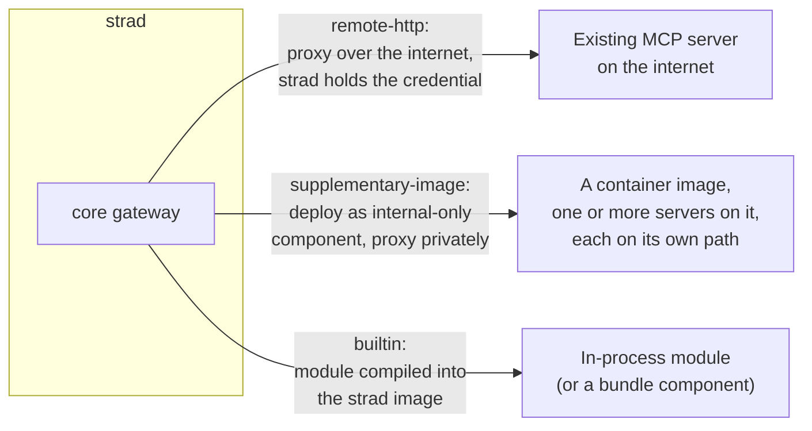

The core ships with **zero** MCP servers. Attaching one is a single entry under
`servers:` in your config. That entry is a **discriminated union on `kind`**, and
there are exactly three kinds. This is the whole extension surface of strad.

## What every server shares

Every server, regardless of kind, has these base fields (from
`src/config/schema.ts`):

| Field                  | Default      | Meaning                                                                               |
| ---------------------- | ------------ | ------------------------------------------------------------------------------------- |
| `slug`                 | _(required)_ | Identifier, `^[a-z0-9]+(-[a-z0-9]+)*$`, max 63. Goes in `?servers=`, prefixes every tool, and [names this server's variables on the container](/operate/secrets/#where-the-two-values-actually-land) — which is why a dash may not double up, lead or trail. |
| `kind`                 | _(required)_ | `remote-http` \| `supplementary-image` \| `builtin`.                                  |
| `entitlements`         | `[]`         | Roles allowed to reach this server. **Empty = nobody** (fail closed).                 |
| `enabled`              | `true`       | Set `false` to configure without exposing.                                            |
| `tools`                | —            | The capability policy: `{ allow?: [...], deny?: [...] }`. Omitted = every tool.       |
| `timeoutMs`            | `120000`     | Per-hop upstream timeout. The MCP SDK's own default is 60s at every hop.              |
| `title`, `description` | —            | Human-facing metadata.                                                                |

`tools` is `.strict()` and must set at least one of `allow` / `deny`. `allow` is
exhaustive, `deny` subtracts and wins over `allow`, and the gateway enforces the
result on `tools/list` **and** on `tools/call` — a withheld tool is refused with
JSON-RPC `-32600` before the adapter is touched. This is what makes a read-only and
a read-write variant of one upstream two entries against the *same* container; see
[Adding a server](/servers/adding/#3b-give-it-a-capability-if-it-has-one).

<aside class="starlight-aside starlight-aside--tip">

`entitlements` on the server is only **half** of access. A role must _also_ name
the server under `roles.<role>.servers`. Both directions must agree — see
[Auth](/auth/overview/).

</aside>

## The three kinds



### 1. `remote-http`

Proxy an MCP server that **already exists on the internet**. strad holds the
credential; the client never sees it. No container is deployed.

Fields: `url` (required), `headers` (a map of header name → value, where values
may reference secrets as `${NAME}`).

```yaml
servers:
  # remote-http — proxy an MCP server that already exists on the internet.
  - slug: granola
    kind: remote-http
    url: https://mcp.granola.ai/mcp
    entitlements: [admin]
    headers:
      Authorization: "Bearer ${GRANOLA_TOKEN}" # ${...} = a secret reference
```

`${NAME}` resolves through the deployment's [secret
provider](/operate/secrets/) — from the environment by default, or from the
parameter store at runtime. A `remote-http` server's url and headers are
re-resolved on every operation, so rotating `GRANOLA_TOKEN` in a store-backed
deployment takes effect on the running gateway: the adapter notices the endpoint
changed and rebuilds its upstream connection.

### 2. `supplementary-image`

A server **served by a container image**. strad deploys the image as an
internal-only component and proxies to it over the private network.

One bundle runs one image, but that image may host **many** servers — each on its
own `path`. strad's own bundle image mounts seventeen MCP servers in one process, so
seventeen `path`s on one container.

Two servers may also share a `path` in one bundle — that is the capability-variant
pattern (`gmail-ro` and `gmail-rw`, told apart by their `tools:` policy). What they
cannot share is a value: a bundle is one `process.env`, so two servers in one
bundle declaring the same `env:` key with **different** values is a schema error,
and two whose `${NAME}` is spelled the same but resolves differently out of
[their own namespaces](/operate/secrets/#two-servers-one-variable-name) is a
render error — for servers that share a `path`. A slug on a path of its own
(`path: /<its own slug>`) is a separate instance in the container and can be given
[variables of its own](/operate/secrets/#where-the-two-values-actually-land).

Fields: `image` (required), `bundle` (required), `path` (defaults to `/mcp`, must
start with `/`), `env` and `headers` (maps whose values may be `${NAME}` secrets),
plus two that shape how this server gets its values:

- **`consoleEnv`** — env for the **core gateway only**, the human console's half of
  this server. `env:` lands on the component that answers `/mcp`; `consoleEnv:`
  lands on core, which serves the SSO-gated `/ui` and nothing an agent can reach.
  That asymmetry is what lets the `secrets` server hold a viewer key on the bundle
  and a stronger admin key on core, with the two never meeting. See [Adding a
  server](/servers/adding/#4b-a-credential-the-agent-must-not-hold--consoleenv).

  It has a second, duller use: if this server has a **browser view** in `/ui`, that
  view renders in core and needs the credential too. Repeat the same `${REF}` under
  `consoleEnv:` — the same value in both scopes, not a stronger one. Omit it and you
  get a confusing pair of symptoms: the MCP tools work fine while the console reports
  the credentials as unavailable, because the key is on the bundle and the page is
  not. `gcs` in `infra/strad.staging.yaml` is the worked example.

  The deploy layer resolves a `consoleEnv:` `${REF}` at **render** time and lands the
  resolved value on core under the declared KEY — the ref name itself is never
  injected anywhere, which is what keeps the admin credential off the bundle. The
  console therefore reads the key, not the ref.

  **The two scopes have different collision rules, and this is the trap.** `env:`
  is per-bundle; `consoleEnv:` is merged into the one `core` component along with
  every other server's. So two servers can safely use the same `env:` key in
  different bundles, and cannot safely use the same `consoleEnv:` key anywhere. A
  second server of a kind that already exists (a second `secrets` slug, say)
  therefore keeps bare names under `env:` and **slug-namespaces** anything it adds
  under `consoleEnv:` — `ZIMMER_SECRETS_SECRETS_ADMIN_SERVICE_ACCOUNT_KEY_JSON`,
  which the console maps back down to `SECRETS_ADMIN_SERVICE_ACCOUNT_KEY_JSON` for
  that slug alone. The mapping is a **fallback** (`??=`) applied after the two maps
  are merged, so a namespaced key whose bare form `env:` already sets is inert —
  declare under `consoleEnv:` only what the console alone needs. `check-config`
  enforces the collision rules; see [Two stores, one
  gateway](/operate/secrets/#two-stores-one-gateway) for the worked example.
- **`params`** (default `false`) — opt into parameter resolution. When `true`,
  everything under `/strad/{env}/mcp/{slug}/static/*` in the [secrets and parameters
  system](/intro/architecture/#the-secrets-and-parameters-system) is resolved and
  injected as this server's env — for a supplementary image at deploy time, scoped
  onto its bundle. It injects the namespace **wholesale**: the variable names come
  from the store, not from the config.

  It is not the only thing that reads that namespace. A `${NAME}` under `env:`
  resolves from `/strad/{env}/mcp/{slug}/static/` **before** the shared
  `/strad/{env}/gateway/static/`, with no flag and for every server — which is what
  lets two servers write the same `${NAME}` and be given different values. See
  [two servers, one variable name](/operate/secrets/#two-servers-one-variable-name).
  The two paths differ in what they inject: `params:` injects everything it finds,
  substitution injects only names the config already references.

  Whether two servers on **one bundle** can then hold two values for one name is
  decided by `path:`, not by the namespace. A slug that is the only one on its
  path, and whose path is `/<its own slug>`, can be its own instance in the
  container and gets its variables under `<SLUG>__<NAME>` as well as the bare
  ones; two slugs on one path are one instance, and the render fails rather than
  pick a winner.

```yaml
servers:
  # supplementary-image — a server served by a container image, on one path of it.
  - slug: good-eggs
    kind: supplementary-image
    image: ghcr.io/tadasant/strad-bundle:latest
    bundle: bundle
    path: /good-eggs
    entitlements: [admin]
```

Two entries may even share a `path` — that is the capability-variant case, where
`acme-ro` and `acme-rw` are the same upstream behind different `tools:` policies.

At deploy time this component gets `internal_ports: [8080]` and **no**
`http_port` — which is what keeps it off the public edge (see [Deploy
model](/operate/deploy-model/) for why setting both is a hard API rejection).

### 3. `builtin`

A module **compiled into a strad image**. This is how private / internal servers
ship: `tadasant-internal` builds its own image with its modules and registers them
with entries exactly like this. The same config interface as the public kinds —
nothing special.

Fields: `module` (a specifier resolved at boot; must default-export a
`BuiltinModule` = `{ tools, call(name, args, ctx) }`), `bundle` (defaults to
`core` = in the gateway process; any other value runs the strad image in bundle
mode as a separate component), `options` (an arbitrary map passed to the module;
may contain `${SECRET}` refs), and `params` (default `false` — when `true`, the
server's `/strad/{env}/mcp/{slug}/static/*` parameters are resolved and merged into
`options` at launch; for a `core` builtin that happens in-process at runtime).

```yaml
servers:
  # builtin — a module compiled into a strad image (for private/internal
  #    servers). The same interface as the public kinds; nothing special.
  - slug: echo
    kind: builtin
    module: "./servers/echo.js"
    bundle: core
    entitlements: [admin]
```

## Validation refuses to boot on

strad validates the whole config strictly at boot (a Zod `superRefine` in
`src/config/schema.ts`). It **refuses to start** if any of these hold:

- Two servers share a `slug`.
- A server grants a role that isn't defined under `roles:`.
- **Two servers in the same bundle name different `image`s.** One bundle is one
  App Platform component, and a component runs one image. Many servers per bundle
  is fine — many *images* per bundle is not.
- A bundle holding a `supplementary-image` also holds a server of another kind.
- A `supplementary-image` is placed in the `core` bundle.
- A server references a `bundle` that isn't declared under `bundles:`.
- A `tools:` policy is present but sets neither `allow` nor `deny`.
- **Two enabled servers declare the same env key with different values, in a
  scope where one would silently overwrite the other.** See below — the scope is
  not the same for the two maps.

Note what is deliberately **not** an error: many servers in one bundle, and two
servers on the same `path` of one bundle. Both are load-bearing — the first is how
seventeen MCP servers fit in one container, the second is how a read-only and a
read-write variant share it.

Nor is repeating one env key across servers with the **same value**. That is the
capability-variant pattern working as designed: `gmail-ro` and `gmail-rw` repeat
their whole `env:` on purpose, because putting the credential on only one of them
means disabling *that* one strips it from its sibling. The rule is same key,
*different* value.

Failing loudly at boot is the point: a misconfigured gateway never comes up
half-wired.

### `env:` may be bare; `consoleEnv:` must be slug-namespaced

The two maps land on different components, so they collide in different scopes —
and getting the asymmetry backwards is the easy mistake.

| Map | Lands on | Collides | So a bare name is |
| --- | --- | --- | --- |
| `env:` | the server's own **bundle** | within that bundle only | **fine**, unless a sibling on the *same* bundle declares it differently |
| `consoleEnv:` | the one **`core`** component | **globally**, whatever bundle each server is on | **wrong** as soon as a second server wants the same key |

A bundle is a component is a container is one `process.env` — and `bundles:` is a
list. So two servers on two bundles may both read a bare `SECRETS_PROJECT_ID` and
mean different stores: the gateway resolves the private URL **per bundle**
(`registry.ts`) and the renderer keys its env map by `server.bundle`
(`appspec.ts`), so even an identical `path:` on each reaches its own container.

`core` has no such fence. `consoleEnvVars()` merges every enabled server's
`consoleEnv:` into one flat environment, so a second server declaring a bare
`SECRETS_PROJECT_ID` there makes `/ui/<one-of-them>` render one store's project
while holding the **other** store's admin service account — a working-looking page
pointed at the wrong identity. Slug-namespace it
(`ZIMMER_SECRETS_SECRETS_PROJECT_ID`); `withNamespacedFallback()` in
`src/ui/resolve.ts` maps it back down to the bare name for that slug alone.

Both halves are enforced, and the error names both servers, the key, the scope,
and the namespaced spelling that fixes it:

```
servers "secrets" and "zimmer-secrets" both declare SECRETS_PROJECT_ID under
env: with different values, and they share the "bundle" bundle — one bundle is
one container with one environment, which is the union of its servers' env:
maps. One silently overwrites the other. Give one of them a slug-namespaced
name (e.g. ZIMMER_SECRETS_SECRETS_PROJECT_ID).
```

### What boot does *not* catch: a key that isn't a key

An **unknown** key is not an error at boot. Zod strips what it does not recognise,
so `consoleEnvs:` where you meant `consoleEnv:` parses clean, renders clean, and
deploys clean — and does nothing. That is not a hypothetical; it is the shape of a
misconfiguration that has shipped.

Boot stays lenient on purpose (an image that rejected a key from a newer config
would turn a rollback into an outage), so the strictness lives one layer up:
[`check-config`](/operate/deploy-model/#checking-a-config-before-it-deploys) treats
an unknown key as a hard failure and is meant to run on every PR that touches a
config. If you edit a config anywhere, run it:

```bash
npm run config:check -- --config infra/strad.staging.yaml
```

## `gateway.secrets`

Where `${NAME}` resolves from, and when. One block, one provider, per deployment.

```yaml
gateway:
  name: strad
  env: prod
  secrets:
    provider: gcp-parameter-store # default: env
    ttlSeconds: 60 # bounds how long a ROTATION — and the console's store diagnosis — can go unnoticed
    negativeTtlSeconds: 10 # bounds how long an ADDITION can go unnoticed
    envFallback: true # keep process.env behind the store, for migration
```

`provider: env` is the default and involves no vendor. `gcp-parameter-store`
reads `/strad/{env}/gateway/static/` at runtime, so a secret added or rotated in
the store reaches a running gateway without a deploy. Setting it to
`gcp-parameter-store` without a store credential is a hard boot failure, not a
silent downgrade to env vars. Full model: [Secrets](/operate/secrets/).

## `auth.staticTokens`

The credential agents present to `/mcp`.

```yaml
auth:
  staticTokens:
    enabled: true # default
    store: env # default, and the only value
```

`enabled: false` builds an empty token store rather than turning the check off:
`/mcp` still demands a token, and no token can satisfy one. Fail closed.

`store` is a reserved field, and no code reads it. `env` — a JSON array of token
records in `STRAD_TOKENS` — is the only implementation, and the gateway builds it
from `enabled` alone. The field is declared so that a database-backed token store
lands as a second enum value instead of as a new key in the config contract, and
it is a single-value enum so a config cannot name a store strad does not have.
That datastore is the subject of [known limitation #6](/limitations/#6-token-records-live-in-an-env-var-not-a-database).
The token model is in [Auth](/auth/overview/#mcp--static-system-tokens-agents).

## Where the config comes from

Config is loaded from two sources, in priority order (`src/config/load.ts`):

1. **`STRAD_CONFIG_YAML`** — an inline YAML document. This is how the stock OSS
   image is configured with **zero rebuild**: hand it a config via env and it
   runs.
2. **`STRAD_CONFIG`** — a path to a file. This is how an image that **bakes its
   config in** works (e.g. `tadasant-internal`).

The full, annotated example lives at
[`strad.config.example.yaml`](https://github.com/tadasant/strad/blob/main/strad.config.example.yaml)
in the repo. To actually wire a server end-to-end, see [Adding a
server](/servers/adding/).
