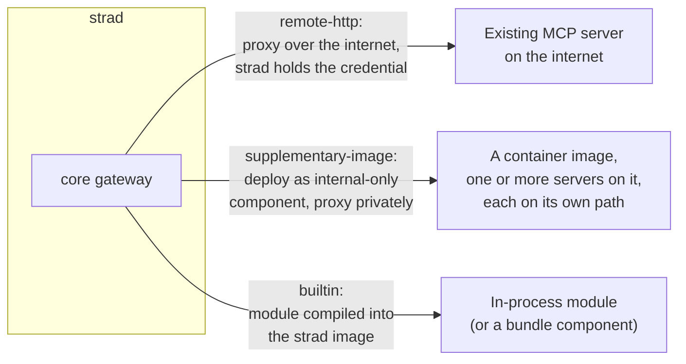

The core ships with **zero** MCP servers. Attaching one is a single entry under
`servers:` in your config. That entry is a **discriminated union on `kind`**, and
there are exactly three kinds. This is the whole extension surface of strad.

## What every server shares

Every server, regardless of kind, has these base fields (from
`src/config/schema.ts`):

| Field                  | Default      | Meaning                                                                               |
| ---------------------- | ------------ | ------------------------------------------------------------------------------------- |
| `slug`                 | _(required)_ | Identifier, `^[a-z0-9][a-z0-9-]{0,62}$`. Goes in `?servers=` and prefixes every tool. |
| `kind`                 | _(required)_ | `remote-http` \| `supplementary-image` \| `builtin`.                                  |
| `entitlements`         | `[]`         | Roles allowed to reach this server. **Empty = nobody** (fail closed).                 |
| `enabled`              | `true`       | Set `false` to configure without exposing.                                            |
| `tools`                | —            | The capability policy: `{ allow?: [...], deny?: [...] }`. Omitted = every tool.       |
| `timeoutMs`            | `120000`     | Per-hop upstream timeout. The MCP SDK's own default is 60s at every hop.              |
| `title`, `description` | —            | Human-facing metadata.                                                                |

`tools` is `.strict()` and must set at least one of `allow` / `deny`. `allow` is
exhaustive, `deny` subtracts and wins over `allow`, and the gateway enforces the
result on `tools/list` **and** on `tools/call` — a withheld tool is refused with
JSON-RPC `-32600` before the adapter is touched. This is what makes a read-only and
a read-write variant of one upstream two entries against the *same* container; see
[Adding a server](/servers/adding/#3b-give-it-a-capability-if-it-has-one).

<aside class="starlight-aside starlight-aside--tip">

`entitlements` on the server is only **half** of access. A role must _also_ name
the server under `roles.<role>.servers`. Both directions must agree — see
[Auth](/auth/overview/).

</aside>

## The three kinds



### 1. `remote-http`

Proxy an MCP server that **already exists on the internet**. strad holds the
credential; the client never sees it. No container is deployed.

Fields: `url` (required), `headers` (a map of header name → value, where values
may reference secrets as `${NAME}`).

```yaml
servers:
  # remote-http — proxy an MCP server that already exists on the internet.
  - slug: granola
    kind: remote-http
    url: https://mcp.granola.ai/mcp
    entitlements: [admin]
    headers:
      Authorization: "Bearer ${GRANOLA_TOKEN}" # ${...} = a secret, injected at deploy
```

### 2. `supplementary-image`

A server **served by a container image**. strad deploys the image as an
internal-only component and proxies to it over the private network.

One bundle runs one image, but that image may host **many** servers — each on its
own `path`. strad's own bundle image mounts fourteen MCP servers in one process, so
fourteen `path`s on one container.

Fields: `image` (required), `bundle` (required), `path` (defaults to `/mcp`, must
start with `/`), `env` and `headers` (maps whose values may be `${NAME}` secrets).

```yaml
servers:
  # supplementary-image — a server served by a container image, on one path of it.
  - slug: good-eggs
    kind: supplementary-image
    image: ghcr.io/tadasant/strad-bundle:latest
    bundle: bundle
    path: /good-eggs
    entitlements: [admin]
```

Two entries may even share a `path` — that is the capability-variant case, where
`acme-ro` and `acme-rw` are the same upstream behind different `tools:` policies.

At deploy time this component gets `internal_ports: [8080]` and **no**
`http_port` — which is what keeps it off the public edge (see [Deploy
model](/operate/deploy-model/) for why setting both is a hard API rejection).

### 3. `builtin`

A module **compiled into a strad image**. This is how private / internal servers
ship: `tadasant-internal` builds its own image with its modules and registers them
with entries exactly like this. The same config interface as the public kinds —
nothing special.

Fields: `module` (a specifier resolved at boot; must default-export a
`BuiltinModule` = `{ tools, call(name, args, ctx) }`), `bundle` (defaults to
`core` = in the gateway process; any other value runs the strad image in bundle
mode as a separate component), `options` (an arbitrary map passed to the module;
may contain `${SECRET}` refs).

```yaml
servers:
  # builtin — a module compiled into a strad image (for private/internal
  #    servers). The same interface as the public kinds; nothing special.
  - slug: echo
    kind: builtin
    module: "./servers/echo.js"
    bundle: core
    entitlements: [admin]
```

## Validation refuses to boot on

strad validates the whole config strictly at boot (a Zod `superRefine` in
`src/config/schema.ts`). It **refuses to start** if any of these hold:

- Two servers share a `slug`.
- A server grants a role that isn't defined under `roles:`.
- **Two servers in the same bundle name different `image`s.** One bundle is one
  App Platform component, and a component runs one image. Many servers per bundle
  is fine — many *images* per bundle is not.
- A bundle holding a `supplementary-image` also holds a server of another kind.
- A `supplementary-image` is placed in the `core` bundle.
- A server references a `bundle` that isn't declared under `bundles:`.
- A `tools:` policy is present but sets neither `allow` nor `deny`.

Note what is deliberately **not** an error: many servers in one bundle, and two
servers on the same `path` of one bundle. Both are load-bearing — the first is how
fourteen MCP servers fit in one container, the second is how a read-only and a
read-write variant share it.

Failing loudly at boot is the point: a misconfigured gateway never comes up
half-wired.

## Where the config comes from

Config is loaded from two sources, in priority order (`src/config/load.ts`):

1. **`STRAD_CONFIG_YAML`** — an inline YAML document. This is how the stock OSS
   image is configured with **zero rebuild**: hand it a config via env and it
   runs.
2. **`STRAD_CONFIG`** — a path to a file. This is how an image that **bakes its
   config in** works (e.g. `tadasant-internal`).

The full, annotated example lives at
[`strad.config.example.yaml`](https://github.com/tadasant/strad/blob/main/strad.config.example.yaml)
in the repo. To actually wire a server end-to-end, see [Adding a
server](/servers/adding/).
