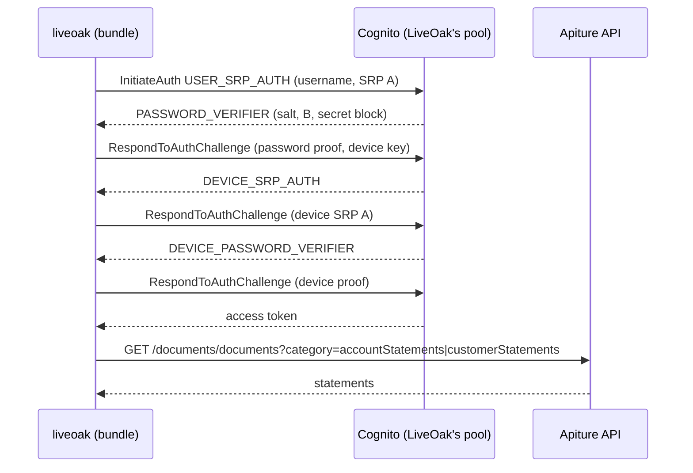

Pull a month's LiveOak Bank statements without the account password ever
reaching a model. That requirement decides the design: the login happens inside
strad, and an agent sees statements, not credentials.

`liveoak` is strad's own MCP server. The source is in `servers/liveoak/`, and it
is mounted at `/liveoak` inside the bundle image. It covers the legacy portal at
`secure.liveoak.bank` ("Personal & Business Accounts"). The newer portals
(`online.liveoak.bank`, `onlinebanking.liveoak.bank`) sign in through Auth0 and
are not supported.

:::caution
LiveOak publishes no API. Everything this server sends was read out of the
portal's own public JavaScript, and none of it has run against LiveOak's real
pool yet. See [What has and has not been proven](#what-has-and-has-not-been-proven).
:::

## Why server-side

The password lives in strad's secret store and in this container, and nowhere
else. The alternatives all route it somewhere an agent can reach: a browser an
agent drives, a fill-the-form helper, or a tool argument. Here:

- **The login is SRP.** LiveOak's portal signs in to AWS Cognito with Secure
  Remote Password. What crosses the wire is a proof derived from the password,
  not the password, so not even Cognito receives the value.
- **No tool takes or returns it.** There is no `password` argument, and every
  error a tool returns is scrubbed of the password's literal value, as well as
  of anything shaped like a token. An upstream that echoed it back would still
  not put it in a transcript.
- **The bank's API is reached with GET and nothing else.** The client in
  `apiture.ts` has no method that sends anything else, so no tool can move money
  or change a setting. The Cognito access token it carries is the account's full
  token, whose scopes include writes, so that file is the boundary rather than
  the token.

## Tools

| Tool              | Group    | What it does                                                                |
| ----------------- | -------- | --------------------------------------------------------------------------- |
| `get_status`      | readonly | Configured? Device enrolled? Storage readable? Code pending? No login       |
| `list_statements` | readonly | Statements whose end date falls in a range, newest first, every account     |
| `get_statement`   | readonly | Fetch one statement's PDF; return its size, SHA-256 and a single-use link   |
| `enrol_device`    | admin    | Log in and have LiveOak text a code to the account holder (step 1 of 2)     |
| `confirm_device`  | admin    | Answer that code; this server becomes a remembered device (step 2 of 2)     |

`list_statements` defaults to the first of the month a year ago through today.
For last month's statement, pass that month's first and last day. One call
covers at most 84 months.

`get_statement` does not return the PDF inline. It returns a link, valid for 15
minutes and good for one download, which needs no credential. Hand it to
whatever attaches or stores the file.

## Setup

Six values, in the store (`/ui/secrets`), on the slug that points at `/liveoak`:

| Variable                       | What it is                                                         |
| ------------------------------ | ------------------------------------------------------------------ |
| `LIVEOAK_USERNAME`             | The login for `secure.liveoak.bank`                                 |
| `LIVEOAK_PASSWORD`             | Its password                                                        |
| `LIVEOAK_STATE_ENCRYPTION_KEY` | 32 random bytes (`openssl rand -base64 32`). Seals the device state |
| `LIVEOAK_GCS_BUCKET`           | A private bucket the sealed device state lives in                   |
| `LIVEOAK_GCS_CLIENT_EMAIL`     | A service account with `roles/storage.objectAdmin` on that bucket   |
| `LIVEOAK_GCS_PRIVATE_KEY`      | Its key: the JSON key file, or its `private_key` (below)            |

Two more are plain config:

- `LIVEOAK_GCS_PREFIX` is the folder in the bucket. The default is `liveoak`.
  Give each environment its own, so staging can never overwrite production's
  device.
- `LIVEOAK_PUBLIC_SLUG` is the gateway slug download links are addressed to.
  Without it, `get_statement` still fetches and checksums the statement, and
  says why there is no link.

The staging entry in `infra/strad.staging.yaml` ships `enabled: false`. There is
no staging bank, so its references would resolve to the one real account.

### What to paste for `LIVEOAK_GCS_PRIVATE_KEY`

Create a JSON key for the service account
(`gcloud iam service-accounts keys create key.json --iam-account=…`) and paste
either of these:

- **The whole file.** Its `client_email` must match `LIVEOAK_GCS_CLIENT_EMAIL`,
  and a mismatch is refused, naming both.
- **Its `private_key` value**, from the `BEGIN PRIVATE KEY` line through the
  `END PRIVATE KEY` line.

The server rebuilds the key from what is between the two armour lines, so the
usual damage from copying it around is harmless: the surrounding JSON quotes,
`\n` escapes, `\r\n` line ends, line breaks stripped or turned into spaces (a
password field does that), or the whole thing base64-encoded once more. It
then loads the key and checks that it is RSA, when the server starts and again
on the first tool call. A value that is still not a key is reported by
`get_status` and every other tool as
`LIVEOAK_GCS_PRIVATE_KEY is set but is not a usable private key: …`, with what is
wrong with it: no armour, a public key, an EC or OpenSSH key, a passphrase, a missing END
line, or base64 that does not decode. The value itself is never quoted. The same
sentence is logged at boot.

With the values seeded and the slug enabled, `get_status` answers
`device_enrolled: false` until the next step is done. It reads the device
storage, so a service account that cannot reach the bucket shows up there as
`device_store_error`, before anyone is texted a code.

## Enrolling the device

LiveOak asks for a code sent to the account holder's phone on every login from
a device it does not remember. The portal's "remember this device" box is a
Cognito remembered device: three keys Cognito issues once the code is accepted,
which let later logins skip the code. This server enrols itself the same way,
once, with a human in the loop:

1. Call `enrol_device`. It first writes and deletes a throwaway object
   (`{LIVEOAK_GCS_PREFIX}/write-probe`) to prove the device can be stored. If
   that fails it stops with `No code was sent: …` and never logs in. Otherwise
   it logs in with the stored credentials, and LiveOak texts a code. The result
   names the masked destination (`"+*******1234"`).
2. Ask the account holder for the code, then call `confirm_device` with it
   within about three minutes. Three minutes is Cognito's default, and LiveOak's
   pool may set it differently. A wrong code can be retried against the same
   challenge.
3. The device keys are sealed with `LIVEOAK_STATE_ENCRYPTION_KEY` and written to
   `{LIVEOAK_GCS_PREFIX}/device.sealed`. From then on `list_statements` and
   `get_statement` log in with no code.

Both calls go to strad's console playground or an agent with the `admin` tools.
Neither needs a shell on the container.

**No device, no login.** A read with no device enrolled is refused before
LiveOak is contacted, because that login would text the account holder a code
every time. Only `enrol_device` starts a login without a device.

**When LiveOak stops honouring the device**, for example after the account
holder removes it, the next read fails and LiveOak has already sent a code. The
server holds that challenge, so `confirm_device` with that code re-enrols with
no second text.

**While a challenge waits for its code, reads refuse.** A read logs in, and
another login would text a new code and void the one the account holder is
about to type. So `list_statements` and `get_statement` refuse until
`confirm_device` answers it or the challenge expires.

The pending challenge lives in this container's memory. A deploy or restart
between the two calls drops it; call `enrol_device` again.

**When the device is confirmed but cannot be stored.** Cognito confirms and
remembers the device before this server writes its keys, so a write that fails
then leaves a device LiveOak knows and the bucket does not. `confirm_device`
says so, and the server keeps the keys in memory: reads use them, and
`get_status` shows `device_unsaved: true`. Fix the storage problem, then call
`enrol_device` without `force`. It stores the held device and sends no code. If
the container restarts first the keys are gone, and `enrol_device` with
`force: true` enrols a new device for one more code. The orphaned device stays
on the LiveOak account and does nothing; the account holder can remove it in
the portal.

**`force: true` neither reads nor deletes the stored device.** Not reading is
what lets it recover from a changed `LIVEOAK_STATE_ENCRYPTION_KEY`, which
`get_status` reports as `device_state_unreadable`. Not deleting means a forced
enrolment nobody confirms leaves a working device working: the object is
overwritten only once a new device exists.

## How a login works

Every read logs in fresh, as the portal does: LiveOak keeps no session between
visits, and the portal logs a browser out after 59 idle seconds. A login is then
reused for up to ten minutes, so a list, a fetch and a download cost one login
rather than three. Each Cognito exchange has 30 seconds to answer. Logins run
one at a time, and a request that hung would otherwise stall every tool.

The client is `amazon-cognito-identity-js`, the library the portal itself runs,
with the portal's pool (`us-east-1_RDbe8eaw5`) and app client. A login is three
legs:

During enrolment the third leg is an `SMS_MFA` challenge instead. Answering it
returns new device metadata, which the library confirms (`ConfirmDevice`) and
this server marks remembered (`UpdateDeviceStatus`), the call the portal makes
when its box is ticked.

## Statements

LiveOak's statements are Apiture documents. The portal's document center asks
for them as `GET /documents/documents` with
`category=accountStatements|customerStatements`, an ISO `startOn` and an ISO 8601
`period` (`P7M` for its "last 6 months"). This server sends the same query and
cuts the answer to the range asked for. It follows `_links.next` for up to 20
pages.

A statement's bytes come from its `_links["apiture:document"].href`, the URL the
portal opens in a new tab. That URL carries its own authority, so it is fetched
with no `Authorization` header. A document with no such link falls back to
`GET /documents/documents/{id}/content` with the bearer token. Bytes that are
not a PDF, such as a login page served with a 200, are refused rather than
handed over.

`get_statement` first asks `GET /documents/documents/{id}`. The portal never
calls that route, so if LiveOak's deployment does not serve it, the server finds
the statement in the 84-month list instead.

### The link

The same shape as the [WhatsApp](/servers/whatsapp/#attachments) and
[Slack](/servers/slack-attachments/) links:
`{STRAD_PUBLIC_URL}/mcp-download/{LIVEOAK_PUBLIC_SLUG}/{token}`, served through
core's unauthenticated `/mcp-download` route and this mount's
`/liveoak/download/:token`. The token is sealed (AES-256-GCM), not merely
signed, so no access log shows a statement id. Its key is derived from the
component's `STRAD_INTERNAL_TOKEN`, the slug and the username, so a link fails
to open on another deployment or for another login. It expires in 15 minutes
and is spent on first use.

The bytes `get_statement` fetched are held in memory (64 MB at most) until the
link is used. A link presented to a process that does not hold them (another
instance, or after a restart) logs in and fetches the statement again.

## What has and has not been proven

**Proven in CI**, against local fakes:

- The full login, through the real `amazon-cognito-identity-js`, against a fake
  pool that does the server half of SRP and device SRP from verifiers. A wrong
  password, a wrong code, a tampered device password and a forgotten device are
  each refused the way Cognito refuses them.
- The password never appears in any request body sent to Cognito, and never in
  a tool result, even when the fake pool echoes it back in an error.
- Enrol, confirm, list, fetch and download end to end through an MCP client,
  including a restart between enrolment and the next read.
- Every request to the API fake is a GET, and the signed document host on a
  second origin never receives the bearer token.

**Not proven**, because nothing here holds the credential:

- That LiveOak's pool behaves like the fake: that it issues device metadata,
  that a remembered device skips the code, and how long a challenge lives.
- The Apiture response shapes beyond the three fields the portal's code reads:
  `_id`, `endOn` and `_links["apiture:document"]`. The other fields in a
  statement (`name`, `account`, `start_on`, …) are read from a few plausible
  names and omitted when absent.
- What `_links["apiture:document"].href` points at, and whether it needs
  anything the portal's browser has and this server does not.

The first real enrolment is the test of all three. See
[Limitations #116](/limitations/).

## Logging

The container logs one line per enrolment step and per failed download, with no
username, account number, statement id or token in them. Every line goes
through the same scrub as a tool error.
