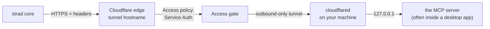

A [`kind: local-tunnel`](/servers/interface/) server is an MCP server running on a
machine a human owns, reached over a tunnel that machine dials out to. strad never
dials in. This page is the other end of that entry: what to run on the machine, how
to lock it down, and what strad does when it goes away.

Everything here is generic to the kind. Nothing on this page is specific to any one
server or account.

## The shape



Three things have to be true at once, and each is a separate decision:

1. The machine reaches the internet through a **named** tunnel with a stable
   hostname.
2. Something starts that tunnel without you thinking about it.
3. The hostname is not an open door.

## Use a named tunnel, not a quick tunnel

`cloudflared tunnel --url http://localhost:PORT` mints a `trycloudflare.com`
hostname and is fine for a five-minute test. It is not what you put in a config: the
hostname changes every restart, so `url:` goes stale the first time the machine
reboots, and there is no way to put an access policy in front of it.

A **named tunnel** has a hostname you choose, a UUID that does not change, and a
credentials file that authorises running it. Create it once:

```bash
brew install cloudflared
cloudflared tunnel login            # writes ~/.cloudflared/cert.pem
cloudflared tunnel create <name>    # writes ~/.cloudflared/<UUID>.json
cloudflared tunnel route dns <name> mcp.example.com
```

Then a `~/.cloudflared/config.yml` that points the hostname at the local server:

```yaml
tunnel: <UUID>
credentials-file: /Users/you/.cloudflared/<UUID>.json

ingress:
  - hostname: mcp.example.com
    service: http://127.0.0.1:PORT
  - service: http_status:404
```

## Install it as a login item, not a boot daemon

On macOS, `cloudflared service install` installs **two different things** depending
on whether you use `sudo`, and the difference decides whether the tunnel works at
all:

| Command                          | Installs       | Starts at | Reads              |
| -------------------------------- | -------------- | --------- | ------------------ |
| `cloudflared service install`    | a LaunchAgent  | login     | `~/.cloudflared/`  |
| `sudo cloudflared service install` | a LaunchDaemon | boot      | `/etc/cloudflared` |

**Without `sudo` is the right one for this.** A LaunchDaemon starts before anyone
logs in, which is exactly when the thing it is meant to reach does not exist yet —
see the next section. It also reads a different config directory, so a daemon
installed by reflex will not find the `config.yml` and credentials you just wrote
under `~/.cloudflared/`.

The service is a single launchd job named `com.cloudflare.cloudflared`, so a machine
has one of them: installing a second replaces the first. One machine, one
`cloudflared` service, however many hostnames its `ingress:` list routes.

## The GUI-app constraint

When the MCP server lives inside a desktop application — an add-on, a plugin, a
built-in local HTTP server — **the tool surface exists only while that application
is running**, and a desktop application runs only while somebody is logged in with
a session. There is no daemon mode to switch on, and no supervisor that can start
it headlessly.

Say that out loud when you write the runbook, because the tunnel will happily come
up without it and report itself healthy while every request 502s. The answer is a
**login item** for the application (System Settings → General → Login Items) paired
with the LaunchAgent above, so the two come up together and in the right order:
log in, app starts, tunnel starts, slug goes live.

This is a real constraint on the kind, not a gap in your setup. It is why
`local-tunnel` exists as its own kind: a machine that is off much of the time is
the normal state, and everything downstream is built to treat it that way.

## Moving to a new machine

Two categories, and only one of them is a copy:

**Reinstall:** `cloudflared` itself (`brew install cloudflared`), the desktop
application, and the service registration (`cloudflared service install`).

**Copy:** `~/.cloudflared/config.yml` and the per-tunnel credentials file
`~/.cloudflared/<UUID>.json`.

:::caution[The credentials JSON is the one unrecreatable artifact]
`<UUID>.json` is a secret: it authorises running that specific tunnel. If you lose
it you cannot regenerate it — you delete the tunnel and create a new one, which
means a new UUID, a new DNS route, and a config change on the strad side. Treat it
like any other credential: move it over a channel you would move a password
through, and `chmod 600` it on arrival.
:::

`cert.pem` is **not** in the copy list. It is the account certificate, and it is
needed to *create, delete and route* tunnels — not to run one. A machine that only
runs an existing tunnel does not need it, and leaving it off is a smaller blast
radius: the credentials file can run one tunnel and do nothing else, while
`cert.pem` can manage every tunnel on the account.

## Locking the tunnel down

**A named tunnel's hostname is discoverable.** Cloudflare issues a TLS certificate
for it, and issued certificates are published to public Certificate Transparency
logs. So "nobody knows the URL" is not a control: an unauthenticated
`local-tunnel` host is a public door to every tool it exposes, on a machine
somebody owns personally.

Two layers, and use both:

1. **Cloudflare Access with a Service Auth policy.** Put an Access application in
   front of the hostname and give it a policy whose action is **Service Auth** —
   not Allow, which prompts for an identity-provider login that a gateway cannot
   complete. Issue a service token and send its two headers on every request:
   `CF-Access-Client-Id` and `CF-Access-Client-Secret`. This rejects unauthorised
   callers **at Cloudflare's edge**, before anything reaches the machine.

2. **An app-level bearer token**, checked by the MCP server itself. It is a second
   layer for a reason: it survives an Access misconfiguration, and it is the layer
   that still applies if you ever reach the origin by another route.

In strad, all three are `${NAME}` refs on the server entry:

```yaml
- slug: <slug>
  kind: local-tunnel
  url: https://mcp.example.com/mcp
  headers:
    CF-Access-Client-Id: "${<SLUG>_CF_ACCESS_CLIENT_ID}"
    CF-Access-Client-Secret: "${<SLUG>_CF_ACCESS_CLIENT_SECRET}"
    Authorization: "Bearer ${<SLUG>_MCP_API_KEY}"
```

Those three credentials belong to this one server, so on a store-backed deployment
they live in **this server's own namespace** —
`/strad/{env}/mcp/<slug>/static/<NAME>` — and not in the shared gateway namespace.
strad reads a server's own namespace first and the gateway namespace only as a
fallback, and because these are resolved on the request path, rotating one needs no
redeploy. See [Secrets](/operate/secrets/).

## Health and logs

```bash
cloudflared tunnel list              # every tunnel on the account, and its connections
cloudflared tunnel info <name>       # this tunnel's active connector(s) and edge locations
```

`info` showing no connections means the tunnel is registered and nothing is running
it — the machine is off, asleep, or the service is stopped. That is the same thing
strad sees.

Logs, for a LaunchAgent or LaunchDaemon installed by `cloudflared service install`:

```
/Library/Logs/com.cloudflare.cloudflared.out.log
/Library/Logs/com.cloudflare.cloudflared.err.log
```

Stopping and starting the service:

```bash
sudo launchctl stop  com.cloudflare.cloudflared
sudo launchctl start com.cloudflare.cloudflared
```

## What strad sees when it fails

This is the part worth internalising, because the two failure shapes are treated
very differently and only one of them is graceful.

### The machine is offline — the slug drops out

strad reads these as "that machine is not there":

- `502`, `503`, `504` — a plain reverse proxy with nothing behind it;
- `521`, `522`, `523`, `524`, `530` — Cloudflare's own origin-unreachable codes;
- a connection refused, a DNS failure, or a handshake that does not finish inside
  `connectTimeoutMs` (5s by default).

The tunnel edge stays up and answers on the machine's behalf, which is why this
comes back as an HTTP response rather than a dead socket, and why it has to be
recognised by status.

When it happens, the slug **degrades cleanly**: it drops out of a multi-server
`?servers=` listing and the servers that _are_ up keep working. `/healthz` reports
it as degraded, and the reachability monitor logs the change. A request naming
_only_ the offline slug still fails, with strad's own sentence — an empty toolset
would be indistinguishable from a server that legitimately has no tools.

### A 403 from the origin fails the whole listing

**A `403` is not an offline verdict, and this asymmetry is deliberate.** Any 4xx
means something answered and said no: a `404` is a wrong path, a `500` is the
server running and throwing, and a `403` is Cloudflare Access rejecting your
credentials. None of those is a closed lid, and calling them one would send someone
to check a laptop that was never the problem.

The consequence is worth stating plainly: **a 403 fails the entire `?servers=`
listing**, taking the healthy servers named alongside it down with it — where an
offline machine would only have removed itself.

That is the right trade, because a 403 here almost always means a **broken or
expired service token**, and a broken credential that silently removed one server
from a fleet is exactly the failure that goes unnoticed for weeks. But it does mean
that rotating an Access service token badly is a fleet-wide outage rather than a
one-slug one. Rotate the parameter first, confirm the slug lists, and only then
revoke the old token.

## Checklist for a new host

- [ ] `brew install cloudflared`
- [ ] Copy `~/.cloudflared/config.yml` and `~/.cloudflared/<UUID>.json` from the
      old machine; `chmod 600` the credentials file
- [ ] `cloudflared service install` — **no `sudo`**
- [ ] Add the desktop application to Login Items
- [ ] `cloudflared tunnel info <name>` shows an active connection
- [ ] The Access application still has a **Service Auth** policy for the hostname
- [ ] The slug lists its tools through strad
