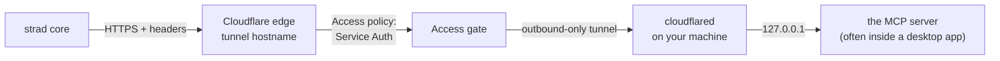

A [`kind: local-tunnel`](/servers/interface/) server is an MCP server running on a
machine a human owns, reached over a tunnel that machine dials out to. strad never
dials in. This page is the other end of that entry: what to run on the machine, how
to lock it down, and what strad does when it goes away.

Everything here is generic to the kind. Nothing on this page is specific to any one
server or account.

If the server you want on that machine is a shell or its browser,
[strad-hostd](/servers/hostd/) is strad's own: it supervises its tunnel, and it
puts a consent dialog and a kill switch in front of every caller.

## The shape



Three things have to be true at once, and each is a separate decision:

1. The machine reaches the internet through a **named** tunnel with a stable
   hostname.
2. Something starts that tunnel without you thinking about it.
3. The hostname is not an open door.

## Use a named tunnel, not a quick tunnel

`cloudflared tunnel --url http://localhost:PORT` mints a `trycloudflare.com`
hostname and is fine for a five-minute test. It is not what you put in a config: the
hostname changes every restart, so `url:` goes stale the first time the machine
reboots, and there is no way to put an access policy in front of it.

A **named tunnel** has a hostname you choose, a UUID that does not change, and a
credentials file that authorises running it. Create it once:

```bash
brew install cloudflared
cloudflared tunnel login            # writes ~/.cloudflared/cert.pem
cloudflared tunnel create <name>    # writes ~/.cloudflared/<UUID>.json
cloudflared tunnel route dns <name> mcp.example.com
```

Then a `~/.cloudflared/config.yml` that points the hostname at the local server:

```yaml
tunnel: <UUID>
credentials-file: /Users/you/.cloudflared/<UUID>.json

ingress:
  - hostname: mcp.example.com
    service: http://127.0.0.1:PORT
  - service: http_status:404
```

## Install it as a login item, not a boot daemon

On macOS, `cloudflared service install` installs **two different things** depending
on whether you use `sudo`, and the difference decides whether the tunnel works at
all:

| Command                            | Installs       | Starts at | Reads              | Logs to          |
| ---------------------------------- | -------------- | --------- | ------------------ | ---------------- |
| `cloudflared service install`      | a LaunchAgent  | login     | `~/.cloudflared/`  | `~/Library/Logs` |
| `sudo cloudflared service install` | a LaunchDaemon | boot      | `/etc/cloudflared` | `/Library/Logs`  |

**Without `sudo` is the right one for this.** A LaunchDaemon starts before anyone
logs in, which is exactly when the thing it is meant to reach does not exist yet —
see the next section. It also reads a different config directory, so a daemon
installed by reflex will not find the `config.yml` and credentials you just wrote
under `~/.cloudflared/`.

The service is a single launchd job named `com.cloudflare.cloudflared`, so a machine
has one of them: installing a second replaces the first. One machine, one
`cloudflared` service, however many hostnames its `ingress:` list routes.

:::danger[On macOS, `service install` alone does not run your tunnel]
The plist it writes runs `cloudflared` with **no arguments**, and bare
`cloudflared` does not start a named tunnel. With a `config.yml` that names one it
exits immediately:

```
$ cloudflared
use `cloudflared tunnel run` to start tunnel 3aa1f5db-…
$ echo $?
1
```

The plist sets `KeepAlive` and `ThrottleInterval 5`, so launchd restarts it every
five seconds, forever, failing every time — while `service install` reports
success and `launchctl list` shows the job. The tunnel never comes up.

This is macOS-specific. On Linux the same command builds
`--config /etc/cloudflared/config.yml tunnel run` and refuses to install at all if
the config lacks `tunnel:` and `credentials-file:`.

**The fix is to write the plist yourself**, with `tunnel run` in it:

```bash
PLIST=~/Library/LaunchAgents/com.cloudflare.cloudflared.plist
launchctl unload "$PLIST" 2>/dev/null
mkdir -p ~/Library/LaunchAgents ~/Library/Logs
cat > "$PLIST" <<EOF
<?xml version="1.0" encoding="UTF-8"?>
<!DOCTYPE plist PUBLIC "-//Apple//DTD PLIST 1.0//EN" "http://www.apple.com/DTDs/PropertyList-1.0.dtd">
<plist version="1.0">
  <dict>
    <key>Label</key><string>com.cloudflare.cloudflared</string>
    <key>ProgramArguments</key>
    <array>
      <string>$(command -v cloudflared)</string>
      <string>--no-autoupdate</string>
      <string>tunnel</string>
      <string>run</string>
    </array>
    <key>RunAtLoad</key><true/>
    <key>KeepAlive</key><true/>
    <key>ThrottleInterval</key><integer>5</integer>
    <key>StandardOutPath</key><string>$HOME/Library/Logs/com.cloudflare.cloudflared.out.log</string>
    <key>StandardErrorPath</key><string>$HOME/Library/Logs/com.cloudflare.cloudflared.err.log</string>
  </dict>
</plist>
EOF
launchctl load "$PLIST"
```

`tunnel run` with no name is deliberate: it takes the UUID from `config.yml`, so
the tunnel is named in one place rather than two.
:::

### Prove autostart is armed, not just running

"It works right now" is what you get after starting a tunnel by hand, and it says
nothing about tomorrow morning. This does:

```bash
launchctl kickstart -k gui/$(id -u)/com.cloudflare.cloudflared && sleep 8
cloudflared tunnel info <name>
```

`kickstart -k` kills the job and lets **launchd** start it from nothing, with no
terminal attached — the same thing that happens at login. Connections in
`tunnel info` afterwards mean autostart is real. `launchctl list | grep
cloudflared` should show a PID and `0` in the exit-status column; a `-` and a `1`
is the failure above.

Sleep and wake need none of this. Sleeping does not kill the process; its
connections drop and `cloudflared` re-establishes them on wake. What kills a
hand-started tunnel is closing the terminal it ran in, and what a LaunchAgent
adds is surviving that and a reboot.

## The GUI-app constraint

When the MCP server lives inside a desktop application — an add-on, a plugin, a
built-in local HTTP server — **the tool surface exists only while that application
is running**, and a desktop application runs only while somebody is logged in with
a session. There is no daemon mode to switch on, and no supervisor that can start
it headlessly.

Say that out loud when you write the runbook, because the tunnel will happily come
up without it and report itself healthy while every request 502s. The answer is a
**login item** for the application (System Settings → General → Login Items) paired
with the LaunchAgent above, so the two come up together and in the right order:
log in, app starts, tunnel starts, slug goes live.

This is a real constraint on the kind, not a gap in your setup. It is why
`local-tunnel` exists as its own kind: a machine that is off much of the time is
the normal state, and everything downstream is built to treat it that way.

## Moving to a new machine

Two categories, and only one of them is a copy:

**Reinstall:** `cloudflared` itself (`brew install cloudflared`), the desktop
application, and the service registration (`cloudflared service install`).

**Copy:** `~/.cloudflared/config.yml` and the per-tunnel credentials file
`~/.cloudflared/<UUID>.json`.

:::caution[The credentials JSON is the one unrecreatable artifact]
`<UUID>.json` is a secret: it authorises running that specific tunnel. If you lose
it you cannot regenerate it — you delete the tunnel and create a new one, which
means a new UUID, a new DNS route, and a config change on the strad side. Treat it
like any other credential: move it over a channel you would move a password
through, and `chmod 600` it on arrival.
:::

`cert.pem` is **not** in the copy list. It is the account certificate, and it is
needed to *create, delete and route* tunnels — not to run one. A machine that only
runs an existing tunnel does not need it, and leaving it off is a smaller blast
radius: the credentials file can run one tunnel and do nothing else, while
`cert.pem` can manage every tunnel on the account.

## Locking the tunnel down

**A named tunnel's hostname is discoverable.** Cloudflare issues a TLS certificate
for it, and issued certificates are published to public Certificate Transparency
logs. So "nobody knows the URL" is not a control: an unauthenticated
`local-tunnel` host is a public door to every tool it exposes, on a machine
somebody owns personally.

Two layers, and use both:

1. **Cloudflare Access with a Service Auth policy.** Put an Access application in
   front of the hostname and give it a policy whose action is **Service Auth** —
   not Allow, which prompts for an identity-provider login that a gateway cannot
   complete. Issue a service token and send its two headers on every request:
   `CF-Access-Client-Id` and `CF-Access-Client-Secret`. This rejects unauthorised
   callers **at Cloudflare's edge**, before anything reaches the machine.

2. **An app-level bearer token**, checked by the MCP server itself. It is a second
   layer for a reason: it survives an Access misconfiguration, and it is the layer
   that still applies if you ever reach the origin by another route.

In strad, all three are `${NAME}` refs on the server entry:

```yaml
- slug: <slug>
  kind: local-tunnel
  url: https://mcp.example.com/mcp
  headers:
    CF-Access-Client-Id: "${<SLUG>_CF_ACCESS_CLIENT_ID}"
    CF-Access-Client-Secret: "${<SLUG>_CF_ACCESS_CLIENT_SECRET}"
    Authorization: "Bearer ${<SLUG>_MCP_API_KEY}"
```

Those three credentials belong to this one server, so on a store-backed deployment
they live in **this server's own namespace** —
`/strad/{env}/mcp/<slug>/static/<NAME>` — and not in the shared gateway namespace.
strad reads a server's own namespace first and the gateway namespace only as a
fallback, and because these are resolved on the request path, rotating one needs no
redeploy. See [Secrets](/operate/secrets/).

## Health and logs

```bash
cloudflared tunnel list              # every tunnel on the account, and its connections
cloudflared tunnel info <name>       # this tunnel's active connector(s) and edge locations
```

`info` showing no connections means the tunnel is registered and nothing is running
it — the machine is off, asleep, or the service is stopped. That is the same thing
strad sees.

Logs — and the path depends on which of the two you installed, because a
LaunchAgent runs as you and writes under your home directory:

```
~/Library/Logs/com.cloudflare.cloudflared.{out,err}.log   # LaunchAgent (no sudo)
/Library/Logs/com.cloudflare.cloudflared.{out,err}.log    # LaunchDaemon (sudo)
```

Restarting the service. A LaunchAgent is yours, so no `sudo`:

```bash
launchctl kickstart -k gui/$(id -u)/com.cloudflare.cloudflared   # LaunchAgent
sudo launchctl kickstart -k system/com.cloudflare.cloudflared    # LaunchDaemon
```

## What strad sees when it fails

The slug does not disappear and does not fail the request. It keeps its place in
the listing and serves exactly one tool — `<slug>__troubleshoot_host` — whose
result says which machine is down, which of the two failures it is, and what to
run there. Calling it re-checks the machine first, so somebody who has just run
the commands is told so rather than being handed a stale verdict.

What that tool says comes from the `recovery:` block on the server entry, which
is where the commands for **your** machine belong:

```yaml
- slug: anki
  kind: local-tunnel
  url: https://anki.example.com/
  recovery:
    machine: "the MacBook"
    commands:
      - "launchctl kickstart -k gui/$(id -u)/com.cloudflare.cloudflared"
    notes: "Anki itself must be open — the MCP server lives inside the app."
```

Without it the tool still exists and falls back to generic guidance; it will not
invent a command. See [the kind's
fields](/servers/interface/#2-local-tunnel).

### What the console shows

Open `/playground/<slug>` in the console while the machine is not answering and
the page says so, in the amber tone it uses for "not broken, and not fine
either":

> "anki" is not serving its own tools: the machine hosting it is not available to
> strad. "anki" is a local-tunnel server: it serves tools only while the machine
> hosting it is awake, running the server, and holding its tunnel open. Either
> that machine is not answering — which is expected while it is off, and not a
> fault in strad — or it answered and refused strad's credentials, which is a
> stale credential somebody has to rotate. The one tool below is strad's own:
> call it for the diagnosis and the exact commands to run on that machine.

Both states are named because the page cannot tell them apart. The listing
SUCCEEDED to get there — one tool, strad's own — so what the page reads is the
substitution, not an error, and the substitution happens for offline and refused
alike. The tool below re-probes the machine and answers which one it is. A tool
call that finds the machine gone prints strad's own message instead, which names
the machine and what to run on it.

If the page is answered by something in FRONT of strad — a `504` or `524` whose
body is not JSON, so nothing strad authored — it says the request timed out,
names the status, and adds that a machine that is off is expected for this kind.
That one is a hint rather than a verdict: nothing inspected the machine, and a
wait on a machine that is not there is simply the commonest reason a request on
this kind runs long enough to be timed out elsewhere. It is a much narrower set
than the statuses below, and it is about a different hop — these two are a
gateway that gave up waiting on **strad**, where the list below is strad reading
a tunnel edge's answer about **the machine**.

### The machine is offline

strad reads these as "that machine is not there":

- `502`, `503`, `504` — a plain reverse proxy with nothing behind it;
- `521`, `522`, `523`, `524`, `530` — Cloudflare's own origin-unreachable codes;
- a connection refused, a DNS failure, or a handshake that does not finish inside
  `connectTimeoutMs` (5s by default).

The tunnel edge stays up and answers on the machine's behalf, which is why this
comes back as an HTTP response rather than a dead socket, and why it has to be
recognised by status.

The servers named alongside it keep working, and the slug stays connectable —
it serves `troubleshoot_host` rather than nothing. `/healthz` reports it as
`offline` rather than `unreachable` and leaves it out of `degraded`, because a
machine somebody switched off is this kind's normal state and there is no
component, image or path for anyone to go and check.

### The machine refuses — a `401` or `403`

**A refusal is not an offline verdict**, and the tool says so in as many words:
the machine answered, so it is up, and what is stale is a credential — an Access
service token that expired, or the app-level bearer no longer matching. Telling
its owner to restart a tunnel that is working would waste their afternoon.

It degrades the same way an offline machine does. That is a deliberate change of
mind: a refusal used to fail the whole `?servers=` listing, on the reasoning that
a broken credential silently removing one server from a fleet goes unnoticed for
weeks. The objection was to the SILENCE, and there is none left — the slug now
says out loud that it was refused and why. Taking thirty healthy servers
down to make that point is no longer the only way to make it.

Rotating an access token badly is therefore a one-slug problem again. Rotate the
parameter first, confirm the slug lists its real tools, then revoke the old token.

### The machine answers, and something else is wrong

A `404` (a wrong path in the slug's `url`) or a `500` (a server that ran and
threw) is an ordinary broken upstream: it still fails a listing that named the
slug, and it does not get a troubleshooting tool. Nobody at that machine can fix
either one, so sending them there would be a lie.

## Checklist for a new host

- [ ] `brew install cloudflared`
- [ ] Copy `~/.cloudflared/config.yml` and `~/.cloudflared/<UUID>.json` from the
      old machine; `chmod 600` the credentials file
- [ ] `cloudflared tunnel ingress validate` prints `OK`
- [ ] Install the LaunchAgent — **no `sudo`**, and with `tunnel run` in its
      `ProgramArguments` (see the warning above; `cloudflared service install`
      does not put it there)
- [ ] Add the desktop application to Login Items
- [ ] `launchctl kickstart -k gui/$(id -u)/com.cloudflare.cloudflared`, then
      `cloudflared tunnel info <name>` shows an active connection — this is the
      check that proves autostart rather than a terminal
- [ ] The Access application still has a **Service Auth** policy for the hostname
- [ ] The slug lists its tools through strad, and not `troubleshoot_host`
