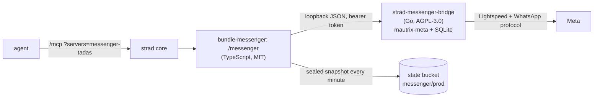

Read one person's Facebook Messenger: which chats moved, what was said, what was
attached. That is the whole requirement, and it is read-only — there is no send
tool.

`messenger-tadas` and `messenger-tadas-admin` are strad's own MCP server, source
in `servers/messenger/`, mounted at `/messenger` inside the bundle image.

:::caution
This is an unofficial client. Automated access to a Facebook account is against Facebook's Terms, and Meta can checkpoint or disable the account for it. See [Limitations #148](/limitations/).
:::

## Why it is built this way

**There is no official way in.** Meta removed personal-inbox access from its
APIs in 2015, and the Messenger Platform only reaches Pages. Everything that
reads a personal inbox speaks the protocol the Messenger apps speak.

**mautrix-meta speaks it.** [mautrix-meta](https://github.com/mautrix/meta) is
the maintained Go implementation, released monthly: the Lightspeed socket for
ordinary chats, and the WhatsApp protocol (through whatsmeow) that Messenger's
end-to-end encrypted chats run on. It is written as a Matrix bridge, so it
normally needs a Matrix homeserver beside it.

**strad runs it headless.** mautrix-meta talks to Matrix only through two
interfaces in mautrix-go's bridge framework, bridgev2. `servers/messenger/bridge`
implements them against a SQLite table instead: a "room" is a row id and a
"message sent to Matrix" is an insert. Every protocol decision stays
mautrix-meta's, at the version `bridge/go.mod` pins, and a server-side change at
Meta is fixed by moving to a newer mautrix-meta. The module is built from a copy
in `bridge/third_party/mautrix-meta` that carries strad's own fixes, each a
listed and tested delta in `bridge/third_party/README.md`, so moving means
re-copying the module and re-applying them.

**Two processes, because of the licence.** mautrix-meta is AGPL-3.0, so the Go
program is too (`servers/messenger/bridge/LICENSE`). strad is MIT, and talks to
the Go program over loopback without linking any of it. The TypeScript tree in
`servers/messenger/shared` is the MCP server; it spawns and supervises the Go
program and is its only client.



## Logging in

There is no credential to seed for Facebook itself. A human logs the bridge in
through the admin slug, from strad's console playground, and the login is made
**as a device of its own**, the way a phone app signs in.

1. `messenger_login_start` with `{"flow": "android"}` (the default). The step
   it returns asks for the account's email or phone and password.
2. `messenger_login_submit` with `{"input": {"username": "…", "password": "…"}}`.
   Meta then asks for whatever it asks a new phone for: a code it sent, an
   approval on a device already signed in, a choice of method. Each answer is
   another `messenger_login_submit`. A step of type `display_and_wait` needs no
   input — approve on the phone, then submit with nothing, and again until the
   step moves. An authenticator app's code is `{"input": {"totp_code": "…"}}`.
3. If the account has encrypted-chat backup, the next step asks for the 6-digit
   **secure-storage PIN**. Entering it restores end-to-end encrypted history
   from Meta's backup. Skipping it — `{"input": {"pin": ""}}`, with the field
   named — means encrypted chats start at the moment of login.
4. A step of type `complete` means logged in, and `saved: true` that the login
   has already reached the state bucket.

### A step that takes longer than a call

The console sits behind an ingress that gives up on a request at about a
minute, and the PIN step can take that long on its own: mautrix-meta waits up to
a minute for the encrypted connection before it asks Meta anything. So the
bridge sends an answer to Meta in the background, detached from the request,
and a call returns after 25 seconds if Meta has not finished. It returns a step
of type `working`, and `messenger_status` shows `working: true` on the login in
progress.

The answer was sent once. Call `messenger_login_submit` with **no input** to
get its result. A call with no input never sends anything to Meta: on an
input step it shows the step again, and while an answer is working it waits for
that answer. An answer typed while another is still working is refused with
"was NOT sent again" rather than forwarded. Meta counts wrong PIN attempts, and
a retry can never spend one. `messenger_login_cancel` is refused while a typed
answer is out too, because mautrix-meta cannot call one back: collect the
result first. An approval wait (`display_and_wait`) keeps its own step and
instructions while it works, and can always be cancelled.

### When Meta stops the account

Meta can end a login on its side: a checkpoint ("check the Facebook website to
continue"), a forced password change, a revoked session. `messenger_status` then
shows the account as `BAD_CREDENTIALS`, with `state_error` (for a checkpoint,
`fb-checkpoint-required`) and an `action` saying what to do, and `next_step`
repeats it. The bridge does not reconnect such a login on its own.
`UNKNOWN_ERROR` is different: bridgev2 reconnects from it by itself, so it gets
no `action` and does not block anything. A second
attempt from a datacenter IP against an account Meta has just flagged is how a
second checkpoint is earned. Only a restart retries it, once.

Clear whatever Meta asks for on facebook.com in a browser, then log in again
with `messenger_login_start`. A stopped account does not block that, and logging
in to the same account replaces it in place. If the checkpoint changed the
password, the old session is gone for good and the new password is the one to
use.

If the account is stopped while a login is at the PIN step, the PIN is not
sent: the encrypted connection it needs never opens. The next submit, with the
PIN or with no input, ends the login with an error that says the PIN was not
sent and what to do, so no stranded PIN step is left behind.

### Failed steps

A step that fails ends the login, and the error says so. Nothing is left half
done: the next call is a fresh `messenger_login_start`, from the password step.
Submitting again to the step that failed is refused with "no login is in
progress".

`"ios"` is the same flow as the iOS app. `"cookies"` adopts a browser's
facebook.com session instead (the `xs`, `c_user` and `datr` cookies): use it if
Meta's app login insists on a check a server cannot show, such as a CAPTCHA
that needs a browser.

The values typed into these steps are the account. They go from the console to
the bridge and nowhere else: telemetry never records tool arguments, the bridge
never logs them, and no step echoes one back. An agent must never ask a person to
paste them into a chat.

To replace the account, `messenger_logout` with `{"confirm": true}` first. That
logs the device out at Meta and deletes everything: the session, the keys, the
buffer and the saved snapshot.

## Tools

| Tool                       | Slug              | What it does                                                         |
| -------------------------- | ----------------- | -------------------------------------------------------------------- |
| `messenger_status`         | both              | logged in? connected? `CONNECTED` is the only healthy state          |
| `messenger_list_threads`   | both              | chats, most recently active first, with `updated_after`              |
| `messenger_get_messages`   | both              | the buffer, by cursor, across every chat or one                      |
| `messenger_get_attachment` | both              | one message's file, fetched from Meta on demand                      |
| `messenger_login_start`    | admin             | begin a login; returns the first step                                |
| `messenger_login_submit`   | admin             | answer a step; returns the next                                      |
| `messenger_login_cancel`   | admin             | abandon a login in progress                                          |
| `messenger_logout`         | admin             | log out at Meta and delete everything                                |

`messenger-tadas` allows the four reads. `messenger-tadas-admin` has no policy.

### The sweep's cursor

`messenger_get_messages` returns `next_cursor`. Pass it back as `cursor` and the
next call returns only what arrived since — including an earlier message edited
or unsent since (it comes back with `edited_at` or `deleted: true`), and history
the bridge backfilled late, whose `timestamp` is older than the sweep. A
timestamp cannot be the cursor for exactly that reason. Loop while `has_more`.

A cursor from a call filtered by `thread_id` or `since` belongs to that filter;
an every-thread sweep keeps its own. A reaction added or removed later also
moves its message past the cursor.

The buffer keeps 30 days (`MESSENGER_BUFFER_MAX_AGE_DAYS`). Attachments are not
stored: a message carries a descriptor, and `messenger_get_attachment` fetches
the file from Meta when asked. The exception is the rare file Meta cannot hand
over that way, which is kept in the snapshot if it is 2 MB or less and listed
without an attachment if it is larger. An image comes back as an image (up to 5 MB),
anything else as an embedded file (up to 25 MB).

## State

The Go program keeps everything in one SQLite file: the Meta session, the
encryption keys of the device it registered, the chats, and the buffer. App
Platform has no disk that survives a deploy, so:

- every minute, and on SIGTERM, the file is copied with SQLite's `VACUUM INTO`
  (a consistent read), gzipped, sealed with AES-256-GCM under
  `MESSENGER_STATE_ENCRYPTION_KEY`, and written to
  `{MESSENGER_STATE_PREFIX}/bridge.db.sealed` in strad's
  [state store](/operate/state-store/) — only when it changed;
- at boot, the newest copy is restored before the Go program starts.

A crash (not a deploy) loses up to a minute of encryption state. whatsmeow asks
a sender's device to re-send what it cannot decrypt, so that is usually a delay;
a message that stays undecryptable arrives as a placeholder.

**One instance, and a handoff.** One device is one connection, and two
processes on it kick each other off. `/messenger` is in `SINGLE_SOCKET_PATHS`,
so the renderer refuses `instanceCount > 1` for its bundle. A deploy still
overlaps two containers until the old one gets SIGTERM, so the new one does not
connect while the old one holds the lease (`{prefix}/lease.json`) and is
heartbeating. The old one takes a final snapshot on SIGTERM and releases the
lease. The new one then restores that snapshot and starts. It takes over anyway
after five minutes, or once the holder's heartbeat goes stale. Tool calls to the
new container wait during the handoff. Snapshot writes are conditional on the
generation last written. A process that finds the lease taken stops its bridge,
and takes the lease back if the new holder goes quiet.

## Configuration

| Variable                          | Required | What                                                                 |
| --------------------------------- | -------- | -------------------------------------------------------------------- |
| `MESSENGER_STATE_ENCRYPTION_KEY`  | yes      | 32 random bytes, base64 or hex. Seals the snapshot. A secret.        |
| `STRAD_STATE_GCS_BUCKET`          | yes      | the deployment's state bucket                                        |
| `STRAD_STATE_GCS_CLIENT_EMAIL`    | yes      | its service account                                                  |
| `STRAD_STATE_GCS_PRIVATE_KEY`     | yes      | its key. A secret.                                                   |
| `MESSENGER_STATE_PREFIX`          | no       | `messenger` or a folder under it (`messenger/prod`). Default `messenger` |
| `MESSENGER_BUFFER_MAX_AGE_DAYS`   | no       | 1–365. Default 30                                                    |
| `MESSENGER_PROXY`                 | no       | `http(s)://` or `socks5://` URL for every connection to Meta. A secret when it carries credentials |

Missing a required variable is a supported state: the tools list, every call
names what is missing, and no process is started. That is every bundle container
except the one these slugs are bundled onto.

## Where it runs, and the IP Meta sees

The bridge runs in the `bundle-messenger` component, so Meta sees a
DigitalOcean IP. Meta is more suspicious of logins from datacenter ranges, and
may answer with a checkpoint (a CAPTCHA, a phone check, a forced logout). The
app-style login helps — it registers a device the way a phone does, rather than
replaying a browser's cookies from somewhere else — but it does not remove the
risk. Each app login is also a brand-new phone to Meta: mautrix-meta mints a
fresh device id, family device id and attestation key for every attempt, and
sends no `machine_id`, so retrying a login does not look like the same phone
trying again. If checkpoints become routine, set `MESSENGER_PROXY` to a residential
egress. The alternative is to run the same Go program on the owner's Mac beside
[strad-hostd](/servers/hostd/), which only works while the Mac is awake.

## Testing

```
cd servers/messenger && npm test                 # the TypeScript tree
cd servers/messenger/bridge && go test ./...     # the Go program (cgo, SQLite)
```

The TypeScript suite drives every tool through a real MCP client against
`shared/test/fake-bridge.mjs`, a stand-in for the Go program that speaks the
same loopback protocol, and an in-memory GCS with real generation
preconditions: the login steps, values never echoed, the save at login, cursor
paging and filters, attachments, a snapshot sealed and restored across a
restart, a snapshot under the wrong key, logout deleting everything, a newer
process taking the lease, and the bridge process restarting after a crash. The
Go suite runs the recorder and the headless Matrix side against a real SQLite
file. Nothing in CI talks to Meta.
