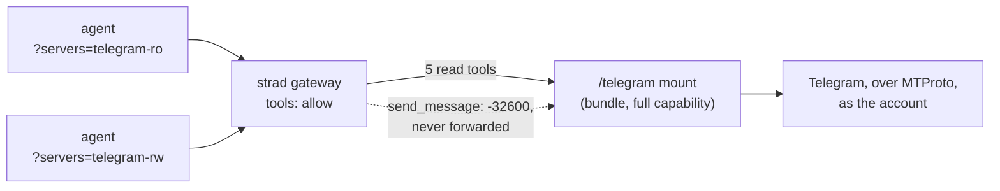

Read a Telegram group you are a member of — not an admin of — from an agent, and
optionally reply in it. That requirement is the whole design of this server, and
it is why the credential is a login rather than a token.

`telegram-ro` and `telegram-rw` are strad's own MCP server — source in
`servers/telegram/`, mounted at `/telegram` inside the bundle image.

## Why not a bot

The Telegram Bot API cannot answer the requirement, at any setting:

- a bot receives only messages sent **after** it joined, and has no method to
  fetch earlier history;
- a bot in a group runs with **privacy mode** on, so it sees only the messages
  that address it;
- a bot that is a group **admin** sees everything — but a member cannot make a
  bot an admin of someone else's group.

So this server speaks **MTProto**, the protocol Telegram's own apps speak, with a
**user session**: it is the account, doing what the account can do. There is no
bot-token fallback, because a bot token cannot do the job.

## Tools

| Tool               | Tier      | What it does                                                     |
| ------------------ | --------- | ---------------------------------------------------------------- |
| `get_me`           | read      | The account this server acts as                                  |
| `list_chats`       | read      | Chats the account belongs to, filterable by kind and title       |
| `get_chat`         | read      | Resolve an id / `@username` / t.me link to the chat it names     |
| `get_chat_history` | read      | A chat's messages, oldest first, paged backwards via `offset_id` |
| `search_messages`  | read      | Full-text search **inside one chat**, server-side                |
| `send_message`     | **write** | Post to a chat **as the account itself**                         |

Start at `list_chats`: its `id` is what every other tool takes as `chat`, and it
is also what teaches the session about a chat it has never opened — resolving a
group by numeric id needs an access hash, and a dialog list is where one comes
from.

Messages come back **oldest first**, with the sender, the timestamp, the reply-to
id, and a `media` field naming the KIND of any attachment (`photo`, `document`,
`poll`, …). File contents are never returned. `next_offset_id` pages backwards in
time; its absence means the chat has been read back to its first message.

`search_messages` requires a `chat`. Telegram's account-wide search is
deliberately not exposed — a query that sweeps every private conversation the
account has is a much larger read than the one that was asked for.

## Two slugs, one mount

| Slug          | `tools: allow`                                                            |
| ------------- | ------------------------------------------------------------------------- |
| `telegram-ro` | `get_me`, `list_chats`, `get_chat`, `get_chat_history`, `search_messages`  |
| `telegram-rw` | _(no policy — all six, `send_message` included)_                          |

Both point at the same **mount** — one `path:`, one instance, one MTProto
connection built once from one set of credentials and memoised for the life of
the process. That is why the two slugs cannot be two accounts as written: the
mount has no idea which slug a request arrived under, since the only per-slug
thing on the wire is the path. Both slugs' variables are already on the container under per-slug names
(`TELEGRAM_RO__TELEGRAM_API_HASH`, `TELEGRAM_RW__TELEGRAM_API_HASH`) — that part
is [unconditional](/operate/secrets/#what-a-servers-variables-are-called-on-the-box).
What makes them two accounts is giving each its own `path:`, `/telegram-ro` and
`/telegram-rw`, matching the slug exactly: the bundle host then builds one
instance per slug, each reading its own names off one container. As long as they share a path they share an account, which is the
arrangement today and the correct one while there is one account to share.

Both point at the same container, running at full capability. Read-only is a
[gateway decision](/intro/architecture/#capability-read-only-vs-read-write), enforced on `tools/list` **and**
on `tools/call`: a withheld tool is refused with `-32600` before it reaches the
mount. `test/telegram.policy.test.ts` proves it against a real gateway with a
call-counting upstream — a refused `send_message` never arrives.

Hand out `telegram-ro`. A message sent through `telegram-rw` is indistinguishable
from one the person typed — same account, same name, no marker that software sent
it — and Telegram allows the sender to delete a message for 48 hours and nothing
after that.

## The credential

Three variables: `TELEGRAM_API_ID`, `TELEGRAM_API_HASH` and
`TELEGRAM_STRING_SESSION`. The first two come from
[my.telegram.org](https://my.telegram.org); the third is minted once by an
interactive login as the account itself (the recipe is in
`servers/telegram/README.md`).

**The session string is the account.** Anything that account can read or send, a
holder of that string can read or send: every private conversation, under that
person's own name. It does not expire and it has no scope to narrow. It is
revoked from a Telegram client under Settings → Devices, and that is the only way
to take it back.

That cost is not incidental — it is what the requirement buys. Reading a group
you do not administer means holding a credential that is the whole account, so
treat it like one: it belongs in the secret store, never in a config file, a log
line or a PR.

## Not configured is a supported state

The image ships no credentials; strad injects them at deploy time. Until it does,
the mount is up and **degraded**: `tools/list` answers with the full surface, so
an agent and the console can see what this deployment would offer, and every call
fails with an error naming the three missing variables. One server's missing
config never costs the other twenty mounts their boot.

In `infra/strad.staging.yaml` both slugs currently ship `enabled: false`, because
an unresolved `${REF}` fails the render on purpose. Seeding the three staging
secrets and deleting the two `enabled:` lines is the whole of turning them on.

## Limits worth knowing

- **No account-wide search**, by design (above).
- **No media download.** Attachments are named, not fetched.
- **`get_chat_history` does not mark anything read**, so an agent reading a group
  does not clear its unread badge in the person's own client.
- **Telegram rate-limits per account.** A `FLOOD_WAIT` answer names the number of
  seconds to wait; the server passes that through rather than retrying, because
  the account is shared with a human who is using it.
- **The MTProto library is archived upstream.** See
  [limitations](/limitations/#49-the-telegram-mtproto-library-is-archived-upstream).
